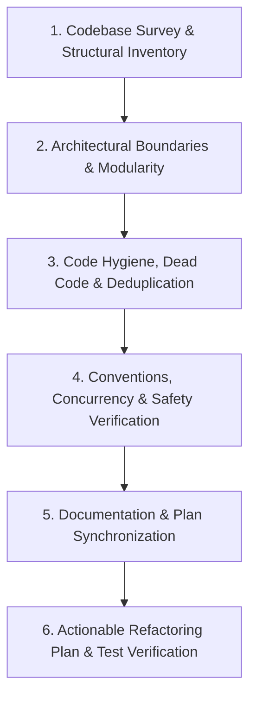

# Codebase Audit & Refactoring Skill

This skill provides a structured, repeatable framework to audit, clean, reorganize, and synchronize the Taskbar codebase. Execute this skill after completing roadmap items or releases to maintain architectural discipline, eliminate code duplication, enforce conventions, and prevent documentation drift.

---

## 1. Audit Workflow Overview

The audit follows a six-stage pipeline:



---

## 2. Stage-by-Stage Audit Procedures

### Stage 1: Codebase Survey & Structural Inventory

1. **Inventory Source Targets:**
   - Review file distribution across the 3 SPM targets:
     - `Sources/TaskbarCore/`: Models, pure `TaskbarLayoutEngine`, layout algorithms, filters, themes, settings, logging.
     - `Sources/TaskbarKit/`: AppKit UI components (`Buttons/`, `Panels/`, `Menu/`, `Management/`), view recycling, multi-display manager, AX observer engine, work area enforcer, dock controller.
     - `Sources/TaskbarApp/`: Minimal application shell (`main.swift`).
     - `Tests/`: `TaskbarCoreTests` (Unit) and `TaskbarIntegrationTests` (Functional, Edge, Stress, Pinned, Theme).
2. **Directory & File Hierarchy Evaluation:**
   - Are files grouped logically by responsibility (e.g. `Config/`, `Logic/`, `Model/`, `UI/`, `Tracking/`, `Windows/`)?
   - Are there overloaded files exceeding 400–500 lines that mix state management, UI rendering, and layout math?
   - Identify candidate files for splitting, renaming, or directory reorganization.

---

### Stage 2: Architectural Boundaries & Modularity

Verify adherence to the core architectural invariants defined in `docs/CONVENTIONS.md` and `docs/ARCHITECTURE.md`:

1. **`TaskbarCore` Purity Check:**
   - Scan `Sources/TaskbarCore/` for forbidden dependencies:
     ```bash
     grep -rn "import AppKit" Sources/TaskbarCore/ || true
     grep -rn "import ApplicationServices" Sources/TaskbarCore/ || true
     grep -rn "AXUIElement" Sources/TaskbarCore/ || true
     ```
   - **Invariant:** `TaskbarCore` must remain 100% pure Swift with zero AppKit or Accessibility dependencies.
2. **Library Circularity Check:**
   - Ensure `TaskbarKit` imports `TaskbarCore`, but `TaskbarCore` never imports `TaskbarKit`.
   - Ensure `TaskbarApp` contains no business logic or state manipulation inside `main.swift`.
3. **Protocol Decoupling & Interface Boundaries:**
   - Are components communicating via cleanly defined callbacks, closures, or protocol boundaries (e.g., `onThemeIdChanged`, `onWindowsChanged`, `WindowStoreProtocol`)?

---

### Stage 3: Code Hygiene, Dead Code & Deduplication

1. **Dead Code & Unused Declarations:**
   - Identify unused functions, obsolete helper methods, deprecated enum cases, or unused constants.
   - Check for legacy fallback code paths that are no longer reachable (e.g., legacy `onThemeChanged` callbacks superseded by `onThemeIdChanged`).
2. **Code Deduplication:**
   - Search for duplicated logic:
     - Repeated frame calculation and clamping logic (should route through `WorkAreaMath`).
     - Redundant AppleScript execution strings in test fixtures (should reuse `TestFixtureApp`).
     - Duplicated visual effect or color resolution routines.
     - Repeated layout metrics calculations across panels.
3. **API Visibility & Encapsulation:**
   - Audit `public`, `package`, `internal`, and `private` access modifiers:
     - Keep types and methods `private` or `internal` unless required across module boundaries.
     - Ensure properties that should be read-only externally use `private(set)`.

---

### Stage 4: Conventions, Concurrency & Safety Verification

1. **Swift 6 Strict Concurrency & Threading:**
   - Verify `@MainActor` isolation on all AppKit classes, views, panels, and menu controllers.
   - Verify `@unchecked Sendable` classes have explicit thread synchronization (`NSLock`, atomic guards, or queue containment).
   - Ensure `deinit` blocks are safe under Swift 6 (no actor isolation violations in deinitializers).
   - **Hard Invariant:** `AXUIElement*` calls must **never** execute on the main thread; they must be dispatched to `AXThread`.
2. **Single Source of Truth Check:**
   - Constants: All layout dimensions, debounce intervals, and timeouts must reside in `Sources/TaskbarCore/Config/TaskbarConstants.swift`.
   - Strings: All UI labels, menu titles, and glyphs must reside in `Sources/TaskbarCore/Config/TaskbarStrings.swift`.
   - Build metadata: All version numbers and bundle identifiers must be driven by `config/build.env`.
3. **Privacy Standard (Zero Identifier Leaks):**
   - Execute audit script or scan across all tracked files:
     ```bash
     git diff | grep -E "/Users/[a-zA-Z0-9_-]+" || true
     ```
   - Invariant: Zero references to personal home directories, usernames, or absolute developer paths in code, comments, logs, or documentation.

---

### Stage 5: Documentation, Plan & Agent Skills Synchronization

Audit documentation and agent skills to eliminate staleness, version drift, and outdated architectural patterns:

1. **Version & Test Count Consistency:**
   - Check `APP_VERSION` in `config/build.env`, `BuildConfiguration.swift`, and `Info.plist`.
   - Verify that test counts in `README.md`, `docs/TESTING.md`, and `docs/TEST_SPECIFICATIONS.md` match actual test output from `./scripts/test-functional.sh --all` (e.g. 236 tests).
2. **Architecture & Specification Alignment:**
   - Verify that new subsystems, mitigations, or settings are documented in `docs/ARCHITECTURE.md`.
   - Ensure all new test cases (e.g. `TC-EDGE-006`, `TC-PIN-007`, `TC-UNIT-*`) are listed in `docs/TEST_SPECIFICATIONS.md` and mapped in the Requirements Traceability Matrix.
3. **Roadmap & Plan Updates:**
   - Review `plans/roadmap.md` and milestone implementation plans under `plans/`.
   - Update checklist checkboxes (`- [x]`) and add links to any completed design documents, postmortems, or technical analyses.
4. **Agent Skills Staleness Audit & Synchronization:**
   - Audit all agent skills in `.agents/skills/` (e.g. `codebase-audit-refactor`, `performance-optimization-audit`) and their corresponding `references/` runbooks:
     - Check for staleness against recent architectural, layout, or concurrency changes.
     - Identify obsolete code snippets, superseded class/callback names (e.g. retired callbacks or outdated unmanaged pointer patterns), or stale directory structures.
     - Synchronize skill instructions, invariants, and checklist templates so future agent invocations always execute with accurate, evergreen guidance.

---

### Stage 6: Actionable Refactoring Plan & Test Verification

When presenting audit findings, structure recommendations into three risk tiers:

1. **Low Risk (Immediate Polish):**
   - Dead code removal, unused import cleanup, typo fixes, documentation synchronization, constant centralization.
2. **Medium Risk (Modular Improvements):**
   - Extracting duplicated helpers, splitting multi-responsibility files, consolidating delegate callbacks, refining access levels.
3. **High Risk / Bold Refactoring (Architectural Evolutions):**
   - Re-architecting subsystems, restructuring folder hierarchies, introducing protocol-oriented abstractions, changing state ownership models.
   - **Requirement for High-Risk Proposals:** Must include a detailed regression mitigation plan referencing specific test suites (`TC-FUNC-*`, `TC-EDGE-*`, `TC-STRESS-*`, `TC-THEME-*`, `TC-PIN-*`) to guarantee zero regressions.

---

## 3. Verification Protocol

After executing any refactoring based on this audit:

```bash
# 1. Clean build and compile all targets
swift build

# 2. Run fast unit test suite
swift test --filter TaskbarCoreTests

# 3. Run full automated functional test harness with memory/CPU benchmarks
./scripts/test-functional.sh --all

# 4. Verify release build and package assembly
./scripts/build-app.sh --install
```

All 236 tests must pass at 100%, resident memory must remain $\le 45\text{ MB}$ RSS, and idle CPU must remain $\sim 0.0\%$.

---

## 4. Supporting References

- [Audit Checklist & Code Smells Reference](./references/audit-checklist.md)
- [Documentation & Plan Synchronization Guide](./references/doc-sync-guide.md)
- [Official Codebase Conventions](../../../docs/CONVENTIONS.md)
- [Architecture & Concurrency Guide](../../../docs/ARCHITECTURE.md)
