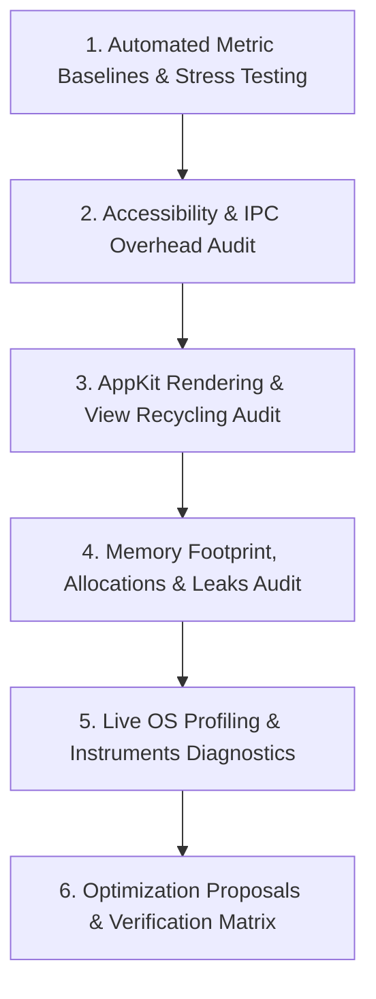

# Performance & Optimization Audit Skill

This skill provides an analytical and empirical framework to audit, profile, benchmark, and optimize the Taskbar application. Use this skill to identify latency regressions, reduce memory footprint, eliminate CPU spikes, and ensure peak UI responsiveness with ~0.0% idle CPU.

---

## 1. Performance Target Standards

Every performance audit must evaluate against the official project resource bounds defined in `config/build.env` and `docs/CONVENTIONS.md`:

| Metric | Target / Benchmark | Hard Upper Bound | Verification Method |
|---|---|---|---|
| **Idle CPU Utilization** | $\sim 0.0\%$ | $< 0.1\%$ | Activity Monitor / `ps -o pcpu` |
| **Active Load CPU (Tests/Bursts)** | $\le 1.5\%$ | $\le 2.0\%$ | `./scripts/test-functional.sh --stress` |
| **Resident Memory (RSS)** | $18\text{ MB} - 25\text{ MB}$ | $\le 45.0\text{ MB}$ | `scripts/test-functional.sh` RSS check |
| **AX Notification Coalescing** | $16\text{ms}$ frame window | $\le 50\text{ms}$ | `AppTracker` reconcile debouncer |
| **UI Interaction Latency** | $< 16\text{ms}$ | $< 33\text{ms}$ (1–2 frames) | Button click to focus dispatch |
| **View Allocation Churn** | $0$ subviews reallocated | $0$ subview leaks | `buttonMap` view recycling check |

---

## 2. Audit Workflow Overview



---

## 3. Step-by-Step Audit Procedures

### Phase 1: Automated Metric Baselines & Stress Testing

1. **Execute Pre-Audit Benchmarks:**
   Run the stress suite and full test runner to record baseline memory and CPU figures:
   ```bash
   # Run stress tests (100-window burst, overflow chevron, recycling)
   ./scripts/test-functional.sh --stress

   # Run full test suite with automated RSS and CPU monitoring
   ./scripts/test-functional.sh --all
   ```
2. **Review Output Metrics:**
   - Confirm baseline vs post-test RSS memory remains well under $45.0\text{ MB}$.
   - Confirm active CPU during bursts does not exceed the $2.0\%$ threshold.
   - Note any test suite taking longer than usual (e.g. `WindowLifecycleIntegrationTests` or `EdgeCasesIntegrationTests`).

---

### Phase 2: Accessibility & IPC Overhead Audit

The macOS Accessibility subsystem (`AXUIElement*`) communicates across processes via Mach IPC. Excessive or blocking AX calls are the primary cause of latency and beachballs in dock replacements.

1. **Main Thread Isolation Audit:**
   - Search the codebase for accidental AX calls on the main actor:
     ```bash
     grep -rn "AXUIElementCopy" Sources/TaskbarKit/UI/ || true
     grep -rn "AXUIElementSet" Sources/TaskbarKit/UI/ || true
     ```
   - **Hard Invariant:** All `AXUIElement` inspection and mutation calls must run on `AXThread` or asynchronous background tasks, **never** on the main thread.
2. **IPC Messaging Timeout Audit:**
   - Verify every AX observer or element query enforces a strict timeout:
     ```swift
     AXUIElementSetMessagingTimeout(element, 0.3)
     ```
   - An unresponsive or deadlocked third-party app must never hang `AXThread` for more than 300ms.
3. **Event Coalescing & Debounce Efficiency:**
   - Check `AppTracker` debounce interval (`TaskbarConstants.Timing.frameRenderDebounce = 0.016`).
   - Verify high-frequency bursts (moves, resizes, title churn) coalesce cleanly into single reconcile passes.
   - Check `WorkAreaEnforcer` multi-pass debounce schedules (Pass 1 at 150ms, Pass 2 at 400ms, Pass 3 at 650ms).
4. **Self-Inflicted Notification Filters:**
   - Verify programmatic window mutations (`WorkAreaEnforcer.setSize`) record timestamps and sizes in `lastSelfNudges` to prevent recursive event feedback loops.
5. **Mouse Drag Deferral:**
   - Verify `WorkAreaEnforcer` checks `CGEventSource.buttonState(.combinedSessionState, button: .left)` during active window resizing to avoid fighting WindowServer during live drags.

---

### Phase 3: AppKit Rendering & View Recycling Audit

1. **In-Place View Recycling Integrity:**
   - Audit `TaskbarView.updateWindows`:
     - Does it query `buttonMap[key]` and reuse existing `TaskButton` instances?
     - Are removed windows cleanly purged via `buttonMap.removeValue(forKey:)`?
   - Audit `TaskbarView.updatePinnedButtons`:
     - Does it query `pinnedButtonMap[bundleID]` and reuse existing `PinnedButton` instances?
   - **Verification:** Successive layout updates must **not** invoke `removeFromSuperview()` and re-instantiate buttons for existing windows.
2. **Layout Calculation & Geometry Decoupling:**
   - Audit `TaskbarLayoutEngine`:
     - Ensure layout math remains pure, allocating zero AppKit views or autoreleased objects during calculation.
     - Frame computations must use immutable `TaskbarLayoutParameters` and return `TaskbarLayoutPlan` without intermediate heap allocations.
   - Audit `needsLayout = true` and `display()` calls in `TaskbarView`:
     - Avoid redundant layout passes: layouts should only trigger when window count, geometry, or display metrics actually change.
3. **Vibrancy & Material Blending Performance:**
   - Inspect `NSVisualEffectView` configuration in `TaskbarPanel` and `TaskbarView`.
   - Ensure `blendingMode` (`.behindWindow` vs `.withinWindow`) matches theme requirements without causing unnecessary WindowServer multi-pass compositing.
4. **Drawing Allocation Discipline:**
   - Audit `draw(_:)` methods in `BaseTaskbarButton`, `TaskButton`, `PinnedButton`, and `BevelDrawing`.
   - Invariant: Zero memory allocations (e.g. `NSColor`, `NSBezierPath`, `NSDictionary` string attributes) inside `draw(_:)` loops. Pre-cache attributes, fonts, and path templates.

---

### Phase 4: Memory Footprint, Allocations & Leaks Audit

1. **Retain Cycle Detection:**
   - Search for closure captures in `AppTracker`, `ScreenManager`, `StatusMenu`, and `WorkAreaEnforcer`:
     ```bash
     grep -rn "{ \[weak self\]" Sources/TaskbarKit/
     grep -rn "{ \[self\]" Sources/TaskbarKit/
     ```
   - Ensure every closure retaining long-lived controllers uses `[weak self]` or `[unowned self]`.
2. **Unmanaged Memory Balance & ARC Deinit Safety:**
   - Audit `AXAppObserver` and observer callbacks:
     - Ensure `AXObserverContext` wrapper holding a `weak var target` is passed as unmanaged pointer (`refcon`), avoiding ARC deallocation races when C callbacks fire concurrently on `AXThread`.
     - Ensure unmanaged context pointer is safely released via `AXThread.shared.async` after run loop source unregistration, preventing premature deallocation while callbacks drain.
3. **NotificationCenter Teardown:**
   - Ensure every `addObserver` has a corresponding `removeObserver` in `deinit` or `stopTracking()`.
4. **Icon Cache Memory Bounds:**
   - Inspect `IconCache`:
     - Verify icons are cached once per `bundleIdentifier` or file path.
     - Verify multi-resolution sanitization discards low-resolution bitmaps without creating redundant representations.

---

### Phase 5: Live OS Profiling & Instruments Diagnostics

When profiling `TaskbarApp` live on macOS:

1. **Process Inspection:**
   ```bash
   # Get live PID, RSS, CPU, and VSZ
   PID=$(pgrep Taskbar || true)
   ps -o pid,rss,pcpu,pmem -p "$PID"
   ```
2. **Call Tree Sampling:**
   ```bash
   # Sample running app for 5 seconds at 10ms intervals
   sample Taskbar 5 10 -file /tmp/taskbar_sample.txt
   head -n 50 /tmp/taskbar_sample.txt
   ```
3. **Memory Leak Detection (`leaks` CLI):**
   ```bash
   leaks Taskbar
   ```
4. **Virtual Memory Breakdown (`vmmap`):**
   ```bash
   vmmap --summary Taskbar
   ```
5. **Unified Logging Inspection:**
   ```bash
   log stream --predicate 'subsystem == "com.local.taskbar"' --level debug
   ```

---

### Phase 6: Optimization Proposals & Verification Matrix

Structure all performance findings using this standard template:

```markdown
### Optimization Item: [Title]
- **Subsystem:** [e.g. WorkAreaEnforcer / IconCache / TaskbarView]
- **Current Behavior:** [Describe bottleneck, redundant work, or allocation spike]
- **Proposed Optimization:** [Specific code changes, caching, or debounce adjustment]
- **Expected Impact:**
  - CPU Reduction: [Estimated %]
  - Memory / RSS Savings: [Estimated MB]
  - Latency Improvement: [Estimated ms]
- **Verification Plan:**
  - Automated test: [Specific suite, e.g. TC-STRESS-001, TC-PERF-001]
  - Profiling validation: [leaks / sample / RSS benchmark]
```

---

## 4. Supporting References

- [Performance Profiling Runbook & Diagnostic Tooling](./references/profiling-runbook.md)
- [Performance Invariants & Memory Ceilings](./references/perf-invariants.md)
- [Official Architecture & Concurrency Guide](../../../docs/ARCHITECTURE.md)
- [Testing & Benchmark Guide](../../../docs/TESTING.md)
