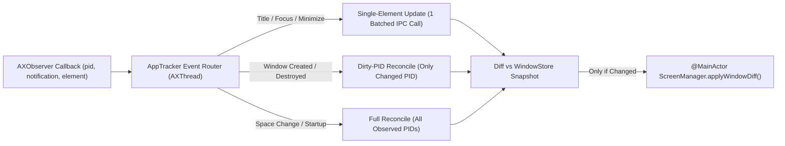

# Taskbar (`mac-dock-gemini`) — Comprehensive Codebase Audit & Refactoring Blueprint

**Audit Date:** October 15, 2026  
**Target Version Audited:** `v0.3.2` (preparing for `v0.4.0`)  
**Scope:** 100% of `Sources/TaskbarCore`, `Sources/TaskbarKit`, `Sources/TaskbarApp`, `Tests/TaskbarCoreTests`, `Tests/TaskbarIntegrationTests`, and project documentation (`docs/`, `plans/`).

---

## Executive Summary

**Taskbar** has a strong foundational split between a pure, zero-AppKit domain layer (`TaskbarCore`) and an AppKit/Accessibility shell (`TaskbarKit`), backed by a fast 110-test unit suite and 48 real-window integration tests. View recycling in `TaskbarView`, off-main-thread Accessibility observation on a dedicated `AXThread` (`CFRunLoop`), and pure layout/math engines (`TaskbarLayoutEngine`, `WorkAreaMath`, `WindowGroupingLogic`, `WindowOrderingLogic`) are well-conceived.

However, a deep line-by-line audit uncovered **26 concrete findings** across maintainability, architecture/logic bugs, runtime performance, and test coverage—including **4 P0 critical issues** that cause silent user-settings data loss, broken context menu actions, massive background Mach IPC amplification ($90\text{ timers} \times 5\text{ AX IPC calls}$ on every window event), and main-thread lock contention with synchronous AX IPC calls.

| Audit Dimension | Grade | Summary Assessment |
|---|---|---|
| **1. Maintainability & Future Feature Support** | **B-** | Pure engines exist in `TaskbarCore` for `v0.4.0` (`TaskbarEdge`, `AutoHideStateMachine`), but `TaskbarKit` remains hardcoded to `.bottom` edge geometry, `Settings` ownership is split across two controllers, and `StatusMenu` / `TaskbarView` require boilerplate touches across 5+ files per setting. |
| **2. Code Smells, Architecture & Logic Flaws** | **C+** | Split-brain value-type `Settings` overwrites user data; `TaskButton` right-click "Minimize/Restore" triggers left-click `ClickPolicy` (opening popups or focusing instead of minimizing); `GroupWindowPopup` does not live-update when windows close; `WindowStore` leaks custom order keys on `syncSnapshot`. |
| **3. App Performance (Key Priority)** | **C** | `AppTracker.reconcileWindows()` triggers full-system AX enumeration across all running apps on every single-window event AND invokes `WorkAreaEnforcer.handleWindowMovedOrResized` on every window during every reconcile. `ScreenManager.updateWindows()` runs `CGWindowListCopyWindowInfo` per screen and forces `needsDisplay = true` on all buttons every 16ms. |
| **4. Test Coverage & Hygiene** | **B** | Strong unit coverage of `TaskbarCore` math, but `ScreenManager` integration tests overwrite the host machine's live `UserDefaults.standard`, `TestFixtureApp` sleeps on `@MainActor`, and critical `TaskbarKit` interaction paths (`AppDelegate` settings sync, `TaskButton` context menu actions, `WindowActions` activation selection, non-bottom `WorkAreaEnforcer` clamping) are untested. |

---

## Section 1: Detailed Nitty-Gritty Findings by Dimension

Each finding is assigned a unique ID (`F-01` through `F-26`), categorized across the four requested dimensions, and paired with exact file/line references and a concise resolution.

---

### Dimension 1: Maintainability & Ease of Future Feature Support

#### `F-01` [P0 | Complexity: Medium] Split-Brain Value-Type `Settings` Ownership Between `AppDelegate` and `ScreenManager` (Silent Data Loss)
- **Locations:**
  - `Sources/TaskbarKit/AppDelegate.swift:19, 44, 77-177`
  - `Sources/TaskbarKit/UI/Management/ScreenManager.swift:9, 13, 52-198`
  - `Sources/TaskbarCore/Config/Settings.swift:48`
- **Nitty-Gritty Analysis:**
  - `Settings` is a value-type `struct`. At launch (`AppDelegate.swift:44`), `AppDelegate` passes its `self.settings` value into `ScreenManager(settings: settings, store: store)`. Both classes store their own independent `var settings: Settings` property and call `settings.save()` independently.
  - When a user pins, unpins, or drag-reorders a pinned app on the taskbar (`ScreenManager.pinApp` / `unpinApp` / `reorderPinnedApps`, `ScreenManager.swift:179-198`), `ScreenManager` mutates `self.settings.pinnedApps` and calls `settings.save()`. `AppDelegate.settings.pinnedApps` is **never updated**.
  - Next time the user toggles an option handled exclusively in `AppDelegate` (such as `hideSystemDock`, `dockHideDelay`, or `enableAXNudger` in `AppDelegate.swift:145-177`), `AppDelegate` mutates its stale copy of `self.settings` and calls `self.settings.save()`—**silently overwriting `UserDefaults` and wiping out all pinned app changes made during the session**.
  - Conversely, when `AppDelegate` mutates `hideSystemDock`, `dockHideDelay`, or `enableAXNudger`, `ScreenManager.settings` is never updated. The next time the user changes `barHeight`, `minButtonWidth`, `fontSize`, `iconSize`, `activeThemeId`, or `windowGroupingMode`, `ScreenManager` calls `settings.save()` last (`ScreenManager.swift:84, 91, 100, 112, 151, 172`) and **reverts `hideSystemDock`, `dockHideDelay`, and `enableAXNudger` in `UserDefaults`**.
- **Concise Feedback to Resolve:**
  - Extract a single `@MainActor final class SettingsStore` (or make `ScreenManager` the single source of truth) holding `private(set) var current: Settings` with an injectable `UserDefaults` instance and a single `update(_ mutation: (inout Settings) -> Void)` method that persists and broadcasts diffs to observers (`ScreenManager`, `StatusMenu`, `WorkAreaEnforcer`, `DockController`).

---

#### `F-02` [P1 | Complexity: High] Half-Wired `v0.4.0` Multi-Edge (`TaskbarEdge`) & Unwired `AutoHideStateMachine` Across `TaskbarKit`
- **Locations:**
  - `Sources/TaskbarKit/Tracking/WorkAreaEnforcer.swift:32, 244-292`
  - `Sources/TaskbarCore/Logic/TaskbarLayoutEngine.swift:282-323`
  - `Sources/TaskbarKit/UI/Panels/TaskbarPanel.swift:28-33, 72-80`
  - `Sources/TaskbarKit/UI/Panels/TaskbarView.swift:318-323, 517`
  - `Sources/TaskbarKit/UI/Panels/GroupWindowPopup.swift:103-118`
  - `Sources/TaskbarKit/UI/Panels/TaskbarDragCoordinator.swift:106-173`
  - `Sources/TaskbarCore/Logic/AutoHideStateMachine.swift:1-145`
- **Nitty-Gritty Analysis:**
  - `TaskbarEdge` (`.bottom`, `.top`, `.left`, `.right`) and `AutoHideStateMachine` were added to `TaskbarCore` in `v0.3.2`, and `Settings.taskbarEdge` is persisted, but **zero components in `TaskbarKit` consume them**:
    1. **`WorkAreaEnforcer` Broken for `.top`, `.left`, `.right`:** `evaluateAndClamp` (`WorkAreaEnforcer.swift:244`) still calls the legacy bottom-only `WorkAreaMath.clampedFrameForWindow(..., taskbarHeight:)` instead of `WorkAreaMath.clampedFrame(..., edge:)`. Even worse, `evaluateAndClamp` only calls `element.setSize(clampedFrame.size)` (`line 286`) and `AXElement+Attributes.swift` has **no `setPosition(_:)` helper**. For `.top` and `.left` edges, `WorkAreaMath.clampedFrame` shifts `origin.y` or `origin.x`. Calling only `setSize` without `setPosition` shrinks the window's bottom/right edge while leaving the window overlapping the `.top` or `.left` taskbar! Furthermore, `NudgeRecord` (`line 32, 258`) only tracks `targetHeight: CGFloat`, so `.left`/`.right` width clamping cannot detect resize loops.
    2. **`TaskbarLayoutEngine` Vertical Axis Geometry Flaw:** When `edge.isVertical` (`.left` or `.right`), `TaskbarLayoutEngine.computeLayout` (`lines 282-323`) maps `primaryDimension` to `containerHeight` and `crossDimension` to `containerWidth` (`30pt`), and assigns `taskButtonFrames` with `width: btnThickness (26pt)` and `height: buttonLength (80pt–160pt)`. That creates vertical rotated strips `26pt` wide by `160pt` tall (where horizontal icon+text in `TaskButton.draw` clips completely) and stacks them **bottom-to-top** (`y` increasing from `0` in non-flipped AppKit coordinates) instead of top-to-bottom.
    3. **Hardcoded Bottom Coordinates in UI:**
       - `TaskbarPanel.updateLayout` (`lines 28-33, 72-80`) places the panel at `origin: frame.origin` with `width: frame.width, height: barHeight`.
       - `TaskbarView.draw` (`lines 318-323`) always draws `topBorderColor` at `y = bounds.maxY - 0.5`.
       - `GroupWindowPopup.show` (`lines 103-118`) and `TaskbarView.showOverflowMenu` (`line 517`) anchor exclusively above the panel (`panelFrame.maxY + 4`).
       - `TaskbarDragCoordinator` (`lines 106-173`) hardcodes `deltaX`, `abs(deltaY) > verticalEscapeThreshold`, and horizontal indicator bars.
    4. **Unwired `AutoHideStateMachine`:** `AutoHideStateMachine` has zero call sites in `Sources/TaskbarKit/`, and `Settings` lacks an `autoHideTaskbar: Bool` setting.
- **Concise Feedback to Resolve:**
  - Add `setPosition(_:)` to `AXUIElement` and update `WorkAreaEnforcer` to pass `settings.taskbarEdge`, apply `setPosition` before `setSize` when `clampedFrame.origin != winFrame.origin`, and store `targetSize: CGSize` in `NudgeRecord`.
  - Refactor `TaskbarLayoutEngine` so vertical taskbars stack full-width horizontal rows top-to-bottom (`width = barThickness - 2*pad`, `height = rowHeight`, descending `y`).
  - Parameterize `TaskbarPanel`, `TaskbarView` border drawing, `GroupWindowPopup` anchoring, and `TaskbarDragCoordinator` along `TaskbarEdge`.

---

#### `F-03` [P2 | Complexity: Medium] Boilerplate Property Multiplication Across `AppDelegate` $\to$ `ScreenManager` $\to$ `TaskbarPanel` $\to$ `TaskbarView` $\to$ `StatusMenu`
- **Locations:**
  - `Sources/TaskbarKit/AppDelegate.swift:44-177`
  - `Sources/TaskbarKit/UI/Management/ScreenManager.swift:52-198`
  - `Sources/TaskbarKit/UI/Panels/TaskbarPanel.swift:47-105`
  - `Sources/TaskbarKit/UI/Panels/TaskbarView.swift:31-76`
  - `Sources/TaskbarKit/UI/Menu/StatusMenu.swift:12-62, 134-182`
- **Nitty-Gritty Analysis:**
  - Adding a single user-configurable metric or behavior currently requires:
    1. Adding a property + `CodingKeys` + backward-compatible `init(from:)` in `Settings.swift`.
    2. Adding a stored property, `init` parameter, `on<Property>Changed` closure, `update<Property>()` method (which calls `rebuildMenu()`), submenu builder, and `@objc` selector in `StatusMenu.swift`.
    3. Wiring the closure in `AppDelegate.swift` to mutate `settings`, save, and call `screenManager?.update<Property>(...)`.
    4. Adding `update<Property>(...)` in `ScreenManager.swift` to loop over `panels.values` and call `panel.update<Property>(...)`.
    5. Forwarding `panel.update<Property>(...)` in `TaskbarPanel.swift` to `taskbarView.<property> = ...`.
  - When switching to a custom theme in `AppDelegate.swift:84-94`, `AppDelegate` calls `statusMenu.updateBarHeight`, `updateMinButtonWidth`, `updateFontSize`, and `updateIconSize` back-to-back—rebuilding the entire `NSMenu` hierarchy **up to 4 times in a row**!
- **Concise Feedback to Resolve:**
  - Replace the ~15 per-property forwarding methods on `StatusMenu`, `ScreenManager`, `TaskbarPanel`, and `TaskbarView` with a unified `apply(settings: Settings, theme: ThemeDefinition)` method on each layer.

---

#### `F-04` [P2 | Complexity: Medium] Hardcoded Left-Aligned Bar Geometry Blocks `v0.4.0` Centered Buttons & System Tray / Clock Widget Support
- **Locations:**
  - `Sources/TaskbarCore/Logic/TaskbarLayoutEngine.swift:235-326`
  - `Sources/TaskbarKit/UI/Panels/TaskbarView.swift:391-432`
- **Nitty-Gritty Analysis:**
  - `TaskbarLayoutEngine.computeLayout` assumes a strict single-flow pipeline: `[StartButton] -> [PinnedButtons] -> [TaskButtons] -> [OverflowButton]` anchored at `currentPos = horizontalPadding`, with `availableWidth` extending all the way to `primaryDimension - horizontalPadding`.
  - There is no concept of a **Trailing Accessory / Tray Zone** (needed for the planned `v0.4.0` Clock widget, notification indicators, or space switcher) or **Taskbar Alignment** (`.leading` vs `.center` for Windows 11-style centered icons).
- **Concise Feedback to Resolve:**
  - Introduce `trailingReservedLength: CGFloat` (for right-aligned widgets like Clock) and `alignment: TaskbarAlignment` (`.leading`, `.centered`, `.centeredTasksOnly`) in `TaskbarLayoutEngine.LayoutInput`. Compute button widths first, then offset `startButtonFrame`, `pinnedButtonFrames`, and `taskButtonFrames` by `(usableSpan - totalOccupiedSpan) / 2` when centered.

---

### Dimension 2: Code Smells, Duplication, Architecture, Logic & Design Flaws

#### `F-05` [P0 | Complexity: Low] Right-Click Context Menu "Minimize / Restore" Broken on `TaskButton`
- **Locations:**
  - `Sources/TaskbarKit/UI/Buttons/TaskButton.swift:95-104, 139-141`
  - `Sources/TaskbarKit/UI/Panels/TaskbarView.swift:224-245`
- **Nitty-Gritty Analysis:**
  - In `TaskButton.swift:139-141`, the right-click context menu handler for Minimize/Restore is implemented as:
    ```swift
    @objc private func handleMenuMinimizeOrRestore() {
        onClick?()
    }
    ```
  - This causes **two distinct user-facing bugs**:
    1. **Grouped TaskButtons (`group.isGrouped == true`):** Right-clicking a grouped button shows `"Minimize"` (or `"Restore"`). Clicking `"Minimize"` invokes `onClick?()`, which in `TaskbarView.swift:229-231` calls `self.showGroupPopup(for: btn)`—**opening the window list popup instead of minimizing or restoring the group's windows!**
    2. **Ungrouped Unfocused Windows (`group.isGrouped == false`, `isWindowFocused == false`, `isMinimized == false`):** When a window is visible on screen but another app/window is currently focused, right-clicking its taskbar button shows `"Minimize"`. Clicking `"Minimize"` invokes `onClick?()`, which evaluates `ClickPolicy.leftClickAction(isMinimized: false, isAppHidden: false, isFocused: false, isFrontmost: false)` $\to$ `.focus`, **activating and focusing the window instead of minimizing it!**
- **Concise Feedback to Resolve:**
  - Replace `onClick?()` in `handleMenuMinimizeOrRestore()` with a dedicated `public var onMinimizeOrRestore: (() -> Void)?` callback on `TaskButton`. For a single window, explicitly call `WindowActions.minimizeWindow` if `!window.isMinimized` or `WindowActions.restoreAndFocus` if `window.isMinimized`. For a grouped button, minimize all unminimized windows in `group.windows` (or restore all if `group.allMinimized`).

---

#### `F-06` [P1 | Complexity: Low] Inconsistent `availableWidth` Math in `TaskbarView.updateWindows` vs `TaskbarLayoutEngine` Breaks `.whenCrowded` Grouping Thresholds
- **Locations:**
  - `Sources/TaskbarKit/UI/Panels/TaskbarView.swift:47-61, 152-164`
  - `Sources/TaskbarCore/Logic/TaskbarLayoutEngine.swift:250-280`
- **Nitty-Gritty Analysis:**
  - Before calling `TaskbarLayoutEngine`, `TaskbarView.updateWindows` manually computes `availableWidth` (`lines 152-164`) to feed into `WindowGroupingLogic.groupWindows`:
    ```swift
    let pinnedW = CGFloat(pinnedButtons.count) * (CGFloat(theme.iconSize) + TaskbarConstants.Layout.pinnedButtonSpacing + 8.0)
    let availableWidth = max(0, bounds.width - padX - startW - pinnedW - TaskbarConstants.Layout.pinnedSectionTrailingMargin)
    ```
  - Compare this to `TaskbarLayoutEngine.computeLayout` (`lines 250-280`):
    - `TaskbarLayoutEngine` sizes pinned buttons using `btnThickness = max(minimumButtonHeight, crossDimension - 2 * verticalPadding)` (e.g., `26pt` on a `30pt` bar regardless of whether `iconSize` is `16` or `32`), **not** `theme.iconSize + 8.0`.
    - `TaskbarLayoutEngine` only subtracts `pinnedSectionTrailingMargin - pinnedButtonSpacing` when `pinnedItemCount > 0`, whereas `TaskbarView` unconditionally subtracts `pinnedSectionTrailingMargin` (`8pt`) even when `pinnedButtons.isEmpty`.
  - Additionally, in `TaskbarView.swift:47-61`, changing `minButtonWidth` or `buttonSpacing` only triggers `layoutComponents()` in `didSet` without re-running `WindowGroupingLogic.groupWindows`. If the user changes Button Width in `StatusMenu` while in `.whenCrowded` mode, the grouping state is not recomputed until a window event occurs!
- **Concise Feedback to Resolve:**
  - Extract a static helper `TaskbarLayoutEngine.availableTaskWidth(containerLength:crossDimension:pinnedCount:)` and call it from `TaskbarView.updateWindows`. In `TaskbarView.minButtonWidth.didSet` and `buttonSpacing.didSet`, re-run `regroupAndLayout()` when `groupingMode == .whenCrowded`.

---

#### `F-07` [P1 | Complexity: Low] `GroupWindowPopup` Fails to Live-Update When Grouped Windows Close, Open, or Retitle Externally
- **Locations:**
  - `Sources/TaskbarKit/UI/Panels/TaskbarView.swift:184-188`
  - `Sources/TaskbarKit/UI/Panels/GroupWindowPopup.swift:11, 21-38`
- **Nitty-Gritty Analysis:**
  - In `TaskbarView.updateWindows` (`lines 184-188`):
    ```swift
    if let active = activeGroupPopup {
        let currentGroupIDs = Set(groups.map { $0.id })
        if !currentGroupIDs.contains(active.group.id) {
            dismissGroupPopup()
        }
    }
    ```
  - If a group has 3 windows and the user opens the `GroupWindowPopup`, and then 1 of those 3 windows closes externally (via Cmd+W in the app), or a 4th window opens, or a window's title/minimized/focused state changes:
    - If `groupingMode == .always`, `group.id` remains `"group_<bundleID>"` (or if 2 windows remain in `.whenCrowded`, `group.id` is still in `currentGroupIDs`).
    - `activeGroupPopup` is **neither dismissed nor updated** with the new `WindowGroup`'s windows! The popup continues displaying stale/closed windows.
    - Even worse, if 2 of 3 windows close in `.whenCrowded` mode, the remaining 1 window switches from `WindowGroup.applicationGroup` (`id: "group_..."`) to `WindowGroup.singleWindow` (`id: "win_..."`), which dismisses the popup, whereas in `.always` mode a single remaining window keeps `id: "group_..."` (`isGrouped == false`) and the popup stays open for a non-grouped button!
- **Concise Feedback to Resolve:**
  - In `TaskbarView.updateWindows`, look up the updated `WindowGroup` matching `active.group.id`. If `updatedGroup == nil || !updatedGroup.isGrouped || updatedGroup.windows.isEmpty`, call `dismissGroupPopup()`. Otherwise, call a new `active.popup.update(with: updatedGroup.windows, focusedKey: focusedKey, theme: theme)` method to refresh rows and resize the popup live.

---

#### `F-08` [P1 | Complexity: Low] `WindowActions.launchOrActivateApp` Picks Oldest Window (`appWindows.first`) Instead of Focused/Unminimized Window
- **Locations:**
  - `Sources/TaskbarKit/Actions/WindowActions.swift:187-197`
- **Nitty-Gritty Analysis:**
  - When a user clicks a `PinnedButton` for an application that has open windows (`WindowActions.swift:187-197`):
    ```swift
    let appWindows = store.allWindows.filter { $0.bundleID == bundleID }
    if let primaryWindow = appWindows.first {
        let isFocused = (store.focusedWindowKey == primaryWindow.key)
        ...
    ```
  - `store.allWindows` is sorted by `openOrder` ascending (oldest window first).
  - Scenario: The user has 2 Safari windows open. Window 1 (opened first) is **minimized** to the Dock. Window 2 (opened second) is **visible and active** on screen.
  - The user clicks the pinned Safari icon expecting to minimize or focus the active Safari window. Because `appWindows.first` always selects Window 1 (the oldest window), `primaryWindow.isMinimized` is `true` and `isFocused` is `false`—so clicking the pinned icon **unminimizes the old minimized Window 1** instead of interacting with the currently focused/visible Window 2!
- **Concise Feedback to Resolve:**
  - Select `primaryWindow` using priority order:
    1. The currently focused window (`appWindows.first(where: { $0.key == store.focusedWindowKey })`), else
    2. The first unminimized window (`appWindows.first(where: { !$0.isMinimized })`), else
    3. `appWindows.first`.

---

#### `F-09` [P2 | Complexity: Low] `WindowStore` Thread-Safety Violation (`@unchecked Sendable`), Stale `focusedWindowKey`, Custom-Order Memory Leak, and Duplicated Sorting Logic
- **Locations:**
  - `Sources/TaskbarCore/Logic/WindowStore.swift:6, 46-59, 91-130`
  - `Sources/TaskbarCore/Logic/WindowOrderingLogic.swift:18-48`
- **Nitty-Gritty Analysis:**
  1. **Unprotected `@unchecked Sendable`:** `WindowStore` is marked `public final class WindowStore: @unchecked Sendable` (`line 6`) with mutable state (`windows`, `customOrders`, `focusedWindowKey`, `frontmostPID`, `openOrderCounter`) and **zero synchronization or `@MainActor` isolation**.
  2. **Stale `focusedWindowKey` & Leaked `customOrders` in `syncSnapshot`:** Look at `removeWindow(key:)` (`lines 46-59`) vs `syncSnapshot(forPID:currentWindows:)` (`lines 91-103`):
     - `removeWindow(key:)` clears `focusedWindowKey` if `focusedWindowKey == key` and removes `key` from `customOrders`.
     - `syncSnapshot(forPID:currentWindows:)`—which is the **only per-window removal method actually called by `AppTracker.reconcileWindows()`** (`AppTracker.swift:268`)—removes missing windows via `windows = windows.filter { ... }`, but **never clears `focusedWindowKey`** (if the focused window closed while `currentFocusedKey` was not overwritten) and **never prunes `customOrders`**! Closed window keys accumulate in `customOrders[screenID]` for as long as the PID stays running.
  3. **Code Duplication:** `WindowStore.windows(forScreenID:screens:)` (`lines 114-129`) manually re-implements the exact same custom-order partitioning and sorting algorithm already defined in `WindowOrderingLogic.applyCustomOrder(windows:customOrder:)` (`WindowOrderingLogic.swift:18-48`), and never calls `WindowOrderingLogic`.
- **Concise Feedback to Resolve:**
  - In `WindowStore.syncSnapshot`, prune removed keys from `customOrders` (via `WindowOrderingLogic.pruneClosedWindows`) and clear `focusedWindowKey` if its key was removed. Delegate `WindowStore.windows(forScreenID:screens:)` to `WindowOrderingLogic.applyCustomOrder`. Mark `WindowStore` `@MainActor` (or guard state with `NSLock` if cross-thread access is desired).

---

#### `F-10` [P2 | Complexity: Low] Legacy 2-Theme Ternary in `Settings.init(themeStyle:)` and `StatusMenu.init` Silently Drops `.windowsXPLuna` and `.darkMinimal`
- **Locations:**
  - `Sources/TaskbarCore/Config/Settings.swift:138`
  - `Sources/TaskbarKit/UI/Menu/StatusMenu.swift:48`
- **Nitty-Gritty Analysis:**
  - `ThemeStyle` has 4 cases: `.modernHybrid`, `.retroClassic`, `.windowsXPLuna`, `.darkMinimal`.
  - Yet both `Settings.init(themeStyle:...)` (`Settings.swift:138`) and `StatusMenu.init(currentTheme:...)` (`StatusMenu.swift:48`) use a legacy binary ternary:
    ```swift
    let resolvedId = (themeStyle == .retroClassic) ? ThemeDefinition.retroClassic.id : ThemeDefinition.modernHybrid.id
    ```
  - Passing `themeStyle: .windowsXPLuna` or `.darkMinimal` silently resolves to `modern-hybrid`.
- **Concise Feedback to Resolve:**
  - Replace the ternary in both `Settings.swift:138` and `StatusMenu.swift:48` with `ThemeDefinition.forStyle(themeStyle).id`.

---

#### `F-11` [P2 | Complexity: Low] `BevelDrawing` Ignores Theme Palette Bevel Colors & `OverflowButton` Hardcodes Styling
- **Locations:**
  - `Sources/TaskbarKit/UI/Panels/BevelDrawing.swift:19-96`
  - `Sources/TaskbarKit/UI/Buttons/TaskButton.swift:172-174`
  - `Sources/TaskbarKit/UI/Buttons/PinnedButton.swift:119, 124`
  - `Sources/TaskbarKit/UI/Buttons/StartButton.swift:51, 53`
  - `Sources/TaskbarKit/UI/Buttons/OverflowButton.swift:42, 44, 67-80`
- **Nitty-Gritty Analysis:**
  - `ThemePalette` defines `bevelHighlight`, `bevelShadow`, and `bevelDarkShadow` (`ThemeDefinition.swift:54-56`), and custom JSON themes can customize them. `BevelDrawing.drawBevel` and `drawRaisedBevel` accept `highlightColor`, `shadowColor`, and `darkShadowColor` parameters (`BevelDrawing.swift:23-26, 63-66`).
  - However, **every single caller** (`TaskButton`, `PinnedButton`, `StartButton`, `OverflowButton`, `TaskbarView`, `GroupWindowContentView`) omits those parameters and uses the hardcoded default arguments (`.white`, `NSColor(calibratedWhite: 0.50)`, `NSColor(calibratedWhite: 0.15)`), making `ThemePalette`'s bevel color properties completely inert!
  - Furthermore, `OverflowButton.drawHybrid` (`OverflowButton.swift:67-80`) hardcodes `let cornerRadius: CGFloat = 4.0` instead of `CGFloat(theme.buttonCornerRadius)`, and strokes `theme.buttonBorderNormal` even when `isPressed == true` (ignoring `theme.buttonBorderPressed`).
- **Concise Feedback to Resolve:**
  - Add a convenience overload `BevelDrawing.drawBevel(in: bounds, depressed: isPressed, palette: theme.palette)` that forwards `NSColor(rgba: palette.bevelHighlight)`, `bevelShadow`, and `bevelDarkShadow`. Update `OverflowButton.drawHybrid` to use `theme.buttonCornerRadius` and `isPressed ? theme.buttonBorderPressed : theme.buttonBorderNormal`.

---

#### `F-12` [P2 | Complexity: Low] `ThemeRegistry.importTheme` Can Overwrite Built-In Presets & `ThemeFileLoader` Registers Untrimmed Theme IDs / Lacks Documented Fallback Path
- **Locations:**
  - `Sources/TaskbarCore/Config/Theme/ThemeRegistry.swift:101-105`
  - `Sources/TaskbarCore/Config/Theme/ThemeFileLoader.swift:16-24, 55-68`
- **Nitty-Gritty Analysis:**
  1. `ThemeRegistry.importTheme(from: url)` (`ThemeRegistry.swift:101-105`) decodes a JSON file and directly executes `themes[theme.id] = theme` without checking `!Self.isBuiltIn(themeId: theme.id)` and without calling `.asCustom(true)`. Calling `importTheme` on a JSON with `"id": "modern-hybrid"` overwrites the built-in preset in memory.
  2. `ThemeFileLoader.discoverCustomThemes()` (`ThemeFileLoader.swift:58-63`) checks `let trimmedId = decoded.id.trimmingCharacters(in: .whitespacesAndNewlines)` for emptiness and built-in collision, but then registers `decoded.asCustom(true)` with the **untrimmed** `decoded.id`.
  3. `ThemeFileLoader.defaultThemesDirectory()` docstring (`line 16-19`) and `docs/ARCHITECTURE.md` (`line 521`) state it falls back to `~/Library/Application Support/Taskbar/Themes/`, but the implementation (`lines 20-24`) only returns `~/.config/taskbar/themes`.
- **Concise Feedback to Resolve:**
  - In `ThemeRegistry.importTheme`, reject built-in IDs and normalize with `.asCustom(true)` and trimmed `id`. In `ThemeFileLoader`, sanitize `id` during `asCustom(true)` and either support `~/Library/Application Support/Taskbar/Themes/` as a secondary search directory or align the docstring/architecture docs.

---

#### `F-13` [P2 | Complexity: Low] Unsafe Force Casts (`as! AXUIElement`) on Untrusted Third-Party Accessibility Attributes
- **Locations:**
  - `Sources/TaskbarKit/Tracking/AXElement+Attributes.swift:68, 109`
  - `Sources/TaskbarKit/Actions/WindowActions.swift:156`
- **Nitty-Gritty Analysis:**
  - In `AXElement+Attributes.swift`:
    - `minimizeButton` (`line 68`): `guard err == .success, let unwrapped = val else { return nil }; return (unwrapped as! AXUIElement)`
    - `focusedWindow` (`line 109`): `guard err == .success, let unwrapped = val else { return nil }; return (unwrapped as! AXUIElement)`
  - And in `WindowActions.closeWindow` (`line 156`):
    - `if err == .success, let button = closeBtnValue { AXUIElementPerformAction(button as! AXUIElement, kAXPressAction as CFString) }`
  - In CoreFoundation / HIServices, buggy third-party accessibility implementations (custom Electron/Qt/Java bridges) can return `kCFNull` or a non-`AXUIElement` `CFTypeRef` alongside `.success`. Force-casting a `CFTypeRef` to a CoreFoundation opaque type in Swift without checking `CFGetTypeID` reinterprets the pointer without a runtime type check.
- **Concise Feedback to Resolve:**
  - Introduce a safe cast helper in `AXElement+Attributes.swift`:
    ```swift
    func asAXUIElement(_ ref: CFTypeRef?) -> AXUIElement? {
        guard let ref, CFGetTypeID(ref) == AXUIElementGetTypeID() else { return nil }
        return unsafeBitCast(ref, to: AXUIElement.self)
    }
    ```
    and use it at all 3 sites (and in `windows` array filtering at `line 100`).

---

#### `F-14` [P3 | Complexity: Low] Dead Code (`AppInfo.swift`) & Architecture Documentation Drift
- **Locations:**
  - `Sources/TaskbarCore/Model/AppInfo.swift:1-20`
  - `docs/ARCHITECTURE.md:9, 352, 399-402`
  - `plans/roadmap.md:12`
- **Nitty-Gritty Analysis:**
  1. `Sources/TaskbarCore/Model/AppInfo.swift` (`public struct AppInfo`) has **zero references** anywhere in `Sources/` or `Tests/`.
  2. `docs/ARCHITECTURE.md` (`line 9`) claims *"zero private APIs"* and `plans/roadmap.md` (`line 12`) claims *"No private SkyLight dependencies"*, whereas `WindowActions.swift:19-46` dynamically links `_SLPSSetFrontProcessWithOptions` from PrivateFramework `SkyLight` and `AXElement+Attributes.swift:6` links private `_AXUIElementGetWindow` from `HIServices`.
  3. `docs/ARCHITECTURE.md` (`line 352`) states group IDs use `"grp_<bundleID>"` (actual code in `WindowGroup.swift:44` uses `"group_<bundleID>"`), and `lines 399-402` state `dragThresholdPoints (5.0pt)` and `verticalEscapeThreshold (24pt)` (actual code in `TaskbarDragCoordinator.swift:28-31` uses `activationThreshold: 4.0` and `verticalEscapeThreshold: 30.0`).
- **Concise Feedback to Resolve:**
  - Delete `Sources/TaskbarCore/Model/AppInfo.swift` and update `docs/ARCHITECTURE.md` / `plans/roadmap.md` to accurately document the two private HIServices/SkyLight symbols and current drag/group constants.

---

### Dimension 3: App Performance (CPU, IPC Overhead, Latency, Allocations & Memory)

#### `F-15` [P0 | Complexity: Medium] `AppTracker.reconcileWindows()` Invokes `WorkAreaEnforcer.handleWindowMovedOrResized` on EVERY Window During EVERY Reconcile ($90\text{ Timers} \times 5\text{ IPC Calls}$ per Event)
- **Locations:**
  - `Sources/TaskbarKit/Tracking/AppTracker.swift:236-239`
  - `Sources/TaskbarKit/Tracking/WorkAreaEnforcer.swift:71-178, 181-293`
- **Nitty-Gritty Analysis:**
  - Look at `AppTracker.reconcileWindows()` (`AppTracker.swift:236-239`), which runs on `AXThread` after *every* debounced AX notification (including focus changes, window title updates, app activation, or minimize/restore):
    ```swift
    // Check if maximized window needs work area clamping
    if !isMin && !isHidden {
        WorkAreaEnforcer.shared.handleWindowMovedOrResized(element: win, pid: pid, isResize: false)
    }
    ```
  - Now trace what `WorkAreaEnforcer.handleWindowMovedOrResized(element: win, pid: pid, isResize: false)` (`WorkAreaEnforcer.swift:71-178`) does for **every non-minimized, non-hidden window on the system**:
    1. Unless `windowWasResizedInDebounce[winID] == true` (or `isSelfNudge` is true), it proceeds.
    2. It acquires `lock`, increments `generationCounters[winID]`, and emits an `os.Logger.info` log message (`logNudge("handleMovedOrResized winID: \(winID), pid: \(pid), isResize: \(isResize), gen: \(generation)")`).
    3. It schedules **3 `DispatchQueue.global(qos: .userInteractive).asyncAfter` timers** at `+150ms`, `+400ms`, and `+650ms`!
    4. Each timer wakes `AXThread.shared.async` to call `evaluateAndClamp`, which performs **5 synchronous Mach IPC round-trips** (`element.isMinimized`, `element.isFullScreen`, `element.subrole`, `element.position`, `element.size`).
  - **Quantitative Impact:** If a user has **30 open windows** across all apps and switches focus or a browser tab changes its title:
    - `reconcileWindows()` calls `handleWindowMovedOrResized` **30 times**.
    - That schedules **$30 \times 3 = 90$ global queue timers** and triggers **$90 \times 5 = 450$ Mach IPC calls** over the next 650ms—for a single title change!
    - Furthermore, within the same generation, all 3 passes (`150ms`, `400ms`, `650ms`) always execute even if the `+150ms` pass saw the window was nowhere near the taskbar!
- **Concise Feedback to Resolve:**
  1. **Remove `handleWindowMovedOrResized` from `AppTracker.reconcileWindows()`** (or call it *only* for newly discovered `WindowKey`s that were not previously in `store`). Real window moves and resizes are already observed directly by `AXAppObserver.swift:158-163`!
  2. In `WorkAreaEnforcer`, store a single cancellable `DispatchWorkItem` per `winID` instead of firing 3 uncancelled `asyncAfter` blocks. Only schedule a follow-up settle pass (`+250ms`) if the window's frame actually changed between the event and the first check or was mid-animation.

---

#### `F-16` [P0 | Complexity: Medium] Synchronous AX Mach IPC Inside `WorkAreaEnforcer.lock` Contends with `@MainActor`, Plus Background `NSScreen.screens` Race & Unbounded Drag-Retry Timers
- **Locations:**
  - `Sources/TaskbarKit/Tracking/WorkAreaEnforcer.swift:84-96, 198-205, 227-235`
  - `Sources/TaskbarKit/UI/Management/ScreenManager.swift:41-42, 65, 85, 211`
- **Nitty-Gritty Analysis:**
  1. **Main-Thread Lock Contention Over Mach IPC (`lines 84-96`):**
     ```swift
     let isSelfNudge: Bool = lock.withLock {
         if let selfNudge = lastSelfNudges[winID] {
             let isRecent = Date().timeIntervalSince(selfNudge.timestamp) < 0.35
             if isRecent, let frame = element.frame { ... }
     ```
     `element.frame` executes **2 synchronous Mach IPC calls** (`kAXPositionAttribute` + `kAXSizeAttribute`, up to `300ms` timeout each = `600ms`) **while holding `WorkAreaEnforcer.lock`**! Meanwhile, `@MainActor` acquires that exact same `lock` in `ScreenManager` (`WorkAreaEnforcer.shared.barHeight = ...`, `isEnabled = ...`, `updateScreens(...)`). If a target app hangs after a nudge, `@MainActor` stalls waiting for `WorkAreaEnforcer.lock`.
  2. **Unsynchronized `NSScreen.screens` Access on Background `AXThread` (`lines 198-205`):**
     In `evaluateAndClamp` (which runs on `AXThread`), if `_screens` is empty, it falls back to reading `NSScreen.screens` directly from the background thread—violating AppKit's `@MainActor` isolation for `NSScreen`.
  3. **Exponential / Unbounded Mouse-Drag Deferral Timers (`lines 227-235`):**
     When the left mouse button is down (`CGEventSource.buttonState(...)`), all 3 passes (`150ms`, `400ms`, `650ms`) enter the `if CGEventSource.buttonState(...)` branch and *each* spawns a recursive `+150ms` retry timer without checking `generationCounters[winID] == generation`! Holding the mouse button down for 2 seconds during a drag spawns dozens of overlapping retry chains that all fire simultaneously on mouse release.
- **Concise Feedback to Resolve:**
  - Read `element.frame` **before** acquiring `lock.withLock` in `handleWindowMovedOrResized` (or confine `WorkAreaEnforcer` entirely to `AXThread`).
  - Remove the `NSScreen.screens` fallback from `AXThread` (seed `WorkAreaEnforcer.updateScreens` synchronously during `ScreenManager.init`).
  - Gate the mouse-down deferral retry on `generationCounters[winID] == generation` and maintain at most one active retry work item per `winID`.

---

#### `F-17` [P1 | Complexity: High] $O(\text{All Apps} \times \text{All Windows})$ Full-System AX Enumeration on Every Single-Window Notification
- **Locations:**
  - `Sources/TaskbarKit/Tracking/AXAppObserver.swift:53, 155-173`
  - `Sources/TaskbarKit/Tracking/AppTracker.swift:81-85, 172-249`
  - `Sources/TaskbarKit/Actions/WindowActions.swift:9-13`
- **Nitty-Gritty Analysis:**
  - `AXAppObserver.onEvent` is typed as `(() -> Void)?` (`AXAppObserver.swift:53`), discarding the `pid`, `notification`, and `element` received by the C callback (`lines 155-173`).
  - Because `AppTracker` receives no context about *which* PID or window triggered the event, `AppTracker.scheduleReconcile()` (`AppTracker.swift:81-85`) always runs `reconcileWindows()` (`lines 172-249`) across **every observed PID on the entire system**:
    - For every app, it calls `appElement.windows` (IPC #1) and `appElement.focusedWindow` (when frontmost), and for every window of every app it calls `observeWindow(win)` (which queries `win.windowID`, IPC #2), `role` (IPC #3), `subrole` (IPC #4), `frame` (IPC #5 & #6: position + size), `isMinimized` (IPC #7), `isMain` (IPC #8), `isFullScreen` (IPC #9), `title` (IPC #10), and `win.windowID` again (IPC #11).
    - With 15 apps and 30 windows, a single window title change or focus change executes **~300 synchronous Mach IPC round-trips** across processes that didn't even change!
  - Furthermore, when a user clicks a `TaskButton`, `WindowActions.findWindowElement(for: windowKey)` (`WindowActions.swift:9-13`) re-queries `AXUIElementCreateApplication(key.pid).windows` and loops through `win.windowID` via IPC instead of looking up the `AXUIElement` already cached in `AXAppObserver.observedWindowElements`!
- **Concise Feedback to Resolve:**
  1. Change `AXAppObserver.onEvent` to `((pid_t, String, AXUIElement) -> Void)?`.
  2. In `AppTracker`, maintain `dirtyPIDs: Set<pid_t>` and `needsFullReconcile: Bool`. For app-specific notifications (`kAXTitleChangedNotification`, `kAXWindowMovedNotification`, `kAXWindowResizedNotification`, `kAXUIElementDestroyedNotification`, etc.), insert only `pid` into `dirtyPIDs` so the 16ms debounce only queries `appElement.windows` for dirty PIDs!
  3. Use `AXUIElementCopyMultipleAttributeValues` in `AXElement+Attributes.swift` to fetch `[kAXRoleAttribute, kAXSubroleAttribute, kAXTitleAttribute, kAXMinimizedAttribute, kAXMainAttribute, kAXPositionAttribute, kAXSizeAttribute, "AXFullScreen"]` in **1 Mach IPC call per window** instead of 8!
  4. Expose a thread-safe lookup for cached `AXUIElement` by `WindowKey` so `WindowActions` skips re-enumerating `appElement.windows`.

---

#### `F-18` [P1 | Complexity: Medium] `ScreenManager.updateWindows()` Runs `CGWindowListCopyWindowInfo`, Redundant `updatePinnedApps` Layout, and Unconditional `needsDisplay = true` on All Buttons on Every Reconcile
- **Locations:**
  - `Sources/TaskbarKit/UI/Management/ScreenManager.swift:233-259, 308-341`
  - `Sources/TaskbarKit/UI/Panels/TaskbarView.swift:147-149, 196-201, 297-301`
  - `Sources/TaskbarKit/UI/Buttons/TaskButton.swift:49-53`
  - `Sources/TaskbarKit/UI/Buttons/PinnedButton.swift:26-30`
- **Nitty-Gritty Analysis:**
  - Every time `AppTracker` finishes a reconcile and calls `ScreenManager.updateWindows()` on `@MainActor`:
    1. **Main-Thread WindowServer IPC (`ScreenManager.swift:233-259, 308-341`):** `isScreenInFullScreen` calls `CGWindowListCopyWindowInfo([.optionOnScreenOnly, .excludeDesktopElements], kCGNullWindowID)` **once per connected monitor** on `@MainActor`, serializing every on-screen window dictionary from WindowServer just to check if any window has `layer == 0 && bounds == screenFrame`.
    2. **Double Layout & Double `NSRunningApplication` Queries (`ScreenManager.swift:329-330`):**
       ```swift
       panel.updatePinnedApps(settings.pinnedApps, runningBundleIDs: runningBundleIDs)
       panel.updateWindows(windows: screenWindows, focusedKey: focusedKey, frontmostPID: frontmostPID)
       ```
       Calling `updatePinnedApps` on every window event runs `layoutComponents()` (`TaskbarLayoutEngine.computeLayout`) and `isAppRunning(bundleID)` (`NSRunningApplication.runningApplications(withBundleIdentifier:)`)—and then `updateWindows` immediately runs its inline `pinnedButtons` running-state loop (`TaskbarView.swift:167-170`) and `layoutComponents()` **a second time**!
    3. **Unconditional Full-Bar Redraw (`TaskbarView.swift:148, 198` & `TaskButton.swift:49` & `PinnedButton.swift:26`):**
       Inside `updatePinnedApps` (`line 148`) and `updateWindows` (`line 198`), `TaskbarView` executes `existing.theme = theme`. Neither `TaskButton.theme.didSet` (`TaskButton.swift:49-53`) nor `PinnedButton.theme.didSet` (`PinnedButton.swift:26-30`) guards with `guard oldValue != theme else { return }`! As a result, `needsDisplay = true` is set on **every single `TaskButton` and `PinnedButton` on every monitor** on every window update—even when only one window's title changed or nothing changed at all!
    4. **Button Recycling Churn on `.whenCrowded` Threshold Crossing (`WindowGroupingLogic.swift:66` vs `TaskbarView.swift:190`):**
       In `.whenCrowded` mode, when the taskbar crosses the crowding threshold, a single-window app switches from `WindowGroup.singleWindow` (`id: "win_100_1"`) to `WindowGroup.applicationGroup` (`id: "group_com.apple.Safari"`). Because `groupButtonMap` is keyed by `group.id`, **all existing `TaskButton` views are destroyed (`removeFromSuperview()`) and re-allocated from scratch** whenever the crowding threshold is crossed!
- **Concise Feedback to Resolve:**
  1. Add `guard oldValue != theme else { return }` to `theme.didSet` in `TaskButton`, `PinnedButton`, `StartButton`, and `OverflowButton`.
  2. Remove `panel.updatePinnedApps(...)` from `ScreenManager.updateWindows()` (`TaskbarView.updateWindows` already updates pinned running states).
  3. Cache `NSWorkspace.shared.runningApplications` in a `Set<String>` of running bundle IDs updated via `didLaunchApplicationNotification` / `didTerminateApplicationNotification` instead of querying `NSRunningApplication.runningApplications(withBundleIdentifier:)` per pinned app on every update.
  4. Replace per-monitor `CGWindowListCopyWindowInfo` polling in `isScreenInFullScreen` with the `WindowInfo` frames/fullscreen flags already tracked by `AppTracker` + `NSWorkspace.activeSpaceDidChangeNotification`.
  5. Use a stable button recycling key in `TaskbarView` (or key single-window `applicationGroup` consistently) so crossing `.whenCrowded` mutates `existing.group` in place instead of destroying and recreating `TaskButton` instances.

---

#### `F-19` [P2 | Complexity: Low] `IconCache` Ignores Theme `iconSize` in `TaskButton` / `GroupWindowRowsView`, Permanently Caches Transient Launch Failures, and Never Evicts Terminated Unpinned Apps
- **Locations:**
  - `Sources/TaskbarKit/UI/Management/IconCache.swift:17-69`
  - `Sources/TaskbarKit/UI/Buttons/TaskButton.swift:181, 250`
  - `Sources/TaskbarKit/UI/Panels/GroupWindowRowsView.swift:299`
  - `Sources/TaskbarKit/UI/Panels/TaskbarView.swift:509`
- **Nitty-Gritty Analysis:**
  1. **Mismatched `size` Parameter Causes Duplicate Cache Entries & Blurry Custom-Theme Icons:**
     - `PinnedButton.draw` (`PinnedButton.swift:136`) calls `IconCache.shared.icon(..., size: NSSize(width: iconDim, height: iconDim))` where `iconDim = CGFloat(theme.iconSize)`.
     - However, `TaskButton.draw` (`TaskButton.swift:181, 250`), `GroupWindowRowsView.draw` (`line 299`), and `TaskbarView.showOverflowMenu` (`line 509`) all call `IconCache.shared.icon(for: bundleID, pid: pid)` **without passing `size`**, which defaults to `NSSize(width: 16, height: 16)`!
     - When a theme uses `iconSize: 24` or `32`, `PinnedButton` caches `"com.apple.Safari_24x24"` while `TaskButton` caches a separate `"com.apple.Safari_16x16"` entry and stretches a `16pt` image to `24pt`/`32pt`.
  2. **Permanent Caching of `fallbackIcon` on Early Launch Race (`IconCache.swift:59-61`):**
     - When an app is mid-launch and `NSRunningApplication(processIdentifier: pid)?.icon` is temporarily `nil` (and bundle ID isn't indexed by LaunchServices yet), `IconCache` stores `fallbackIcon` into `cache[cacheKey]` permanently (`line 60`), so the app is stuck with a generic application icon until Taskbar restarts.
  3. **Unbounded Cache Growth:** `IconCache` has `clearCache()` (only called in tests), and never evicts icons for unpinned applications when they terminate.
- **Concise Feedback to Resolve:**
  - Pass `size: NSSize(width: CGFloat(theme.iconSize), height: CGFloat(theme.iconSize))` at all `TaskButton` and `GroupWindowRowsView` call sites. Do not insert `fallbackIcon` into `cache[cacheKey]` when `pid != nil` (or evict on app termination via `evict(bundleID:)`).

---

#### `F-20` [P2 | Complexity: Low] Per-Frame Object Allocations in `draw(_:)`, Double `computeLayout` During Drag, and Synchronous `Process.waitUntilExit()` on `@MainActor`
- **Locations:**
  - `Sources/TaskbarKit/UI/Buttons/TaskButton.swift:192-238, 262-316`
  - `Sources/TaskbarKit/UI/Panels/GroupWindowRowsView.swift:251-343`
  - `Sources/TaskbarKit/UI/Panels/TaskbarDragCoordinator.swift:114-143, 180-200`
  - `Sources/TaskbarKit/System/DockController.swift:29-52`
- **Nitty-Gritty Analysis:**
  1. **Per-Frame Drawing Allocations:** Every `draw(_:)` invocation in `TaskButton`, `StartButton`, `OverflowButton`, and `GroupWindowRowsView` allocates fresh `NSMutableParagraphStyle`, `NSFont.systemFont(...)`, `[NSAttributedString.Key: Any]` dictionaries, `NSAttributedString`, and `NSColor(rgba:)` instances—even during 60–120Hz hover/drag redraws.
  2. **Double `TaskbarLayoutEngine.computeLayout` per Mouse-Drag Event (`TaskbarDragCoordinator.swift:121, 182`):**
     During a task button drag, `handleTaskDragged` calls `currentLayoutParams()` + `TaskbarLayoutEngine.computeLayout(params)` (`line 121`) to compute `targetSlotIndex`, and then immediately calls `showTaskInsertionIndicator(forSlot:)` (`line 141`), which calls `currentLayoutParams()` + `TaskbarLayoutEngine.computeLayout(params)` **a second time** (`line 182`) with identical inputs!
  3. **Main-Thread Subprocess Blocking in `DockController` (`DockController.swift:29-52`):**
     `DockController.hideDock(delay:)` and `restoreDock()` spawn `/usr/bin/defaults` and `/usr/bin/killall Dock` and call `process.waitUntilExit()` synchronously on `@MainActor` during `applicationDidFinishLaunching` and when toggling the menu item.
- **Concise Feedback to Resolve:**
  - Pass the already-computed `layoutPlan` into `showTaskInsertionIndicator(forSlot:in:layoutPlan:)` and `showPinnedInsertionIndicator(forSlot:in:layoutPlan:)`.
  - Cache resolved AppKit `NSFont`, `NSParagraphStyle`, and `NSColor` objects in a lightweight `@MainActor` `ResolvedAppKitTheme` wrapper invalidated only when `theme` changes.
  - Run `DockController`'s `defaults` + `killall Dock` processes on a background `DispatchQueue.global(qos: .utility)` queue.

---

### Dimension 4: Test Coverage & Test Hygiene

#### `F-21` [P2 | Complexity: Low] Integration Tests Write to Shared `UserDefaults.standard` Without Isolation
- **Locations:**
  - `Tests/TaskbarIntegrationTests/PinnedAppsIntegrationTests.swift:266-299`
  - `Tests/TaskbarIntegrationTests/ThemeExpansionIntegrationTests.swift:15-39, 100-138, 178-224`
  - `Tests/TaskbarIntegrationTests/WindowGroupingIntegrationTests.swift:230-264`
  - `Tests/TaskbarIntegrationTests/WindowReorderingIntegrationTests.swift:256-310`
  - `Sources/TaskbarKit/UI/Management/ScreenManager.swift:151, 172, 181, 188, 195`
- **Nitty-Gritty Analysis:**
  - `ScreenManager` calls `settings.save()` with no arguments (`UserDefaults.standard`) inside `updateTheme(themeId:)`, `pinApp(...)`, `unpinApp(...)`, `reorderPinnedApps(...)`, and `updateGroupingMode(...)`.
  - Consequently, every time `swift test` runs, `PinnedAppsIntegrationTests`, `ThemeExpansionIntegrationTests`, `WindowGroupingIntegrationTests`, and `WindowReorderingIntegrationTests` write test fixture data to the `com.taskbar.settings` key in `UserDefaults.standard` (sharing state across test suites and unbundled `swift run TaskbarApp` executions).
- **Concise Feedback to Resolve:**
  - Inject `userDefaults: UserDefaults = .standard` into `ScreenManager.init` (or `SettingsStore`), and pass isolated `UserDefaults(suiteName: "com.taskbar.tests.\(UUID().uuidString)")!` instances in all integration tests.

---

#### `F-22` [P2 | Complexity: Medium] Missing Integration & Unit Tests for Critical `TaskbarKit` User Flows and Bugs
- **Locations:**
  - `Tests/TaskbarIntegrationTests/`
  - `Tests/TaskbarCoreTests/`
- **Nitty-Gritty Analysis:**
  - The following critical behaviors had **zero test coverage**, allowing bugs `F-01`, `F-02`, `F-05`, `F-06`, `F-07`, `F-08`, and `F-09` to slip through undetected:
    1. **No test for `AppDelegate` $\leftrightarrow$ `ScreenManager` settings persistence coordination (`F-01`):** Tests only instantiate `ScreenManager` or `StatusMenu` in isolation, never testing pinning an app followed by changing a `StatusMenu` metric.
    2. **No test for `TaskButton` right-click "Minimize / Restore" action execution (`F-05`):** `PinnedAppsIntegrationTests.swift:148-224` only tests the `"Pin to Taskbar"` / `"Unpin from Taskbar"` menu items on `TaskButton`, never invoking the `"Minimize"` / `"Restore"` or `"Close Window"` menu items on grouped or ungrouped `TaskButton`s.
    3. **No test for `GroupWindowPopup` live updates when a grouped window closes or opens while the popup is visible (`F-07`).**
    4. **No test for `WindowActions.launchOrActivateApp` window selection priority when one window is minimized and another is visible (`F-08`).**
    5. **No test for `WindowStore.syncSnapshot` pruning `customOrders` or clearing `focusedWindowKey` (`F-09`):** `WindowStoreTests.swift:83-112` tests `syncSnapshot` window list counts, but never asserts on `focusedWindowKey` or `customOrder(forScreenID:)`.
    6. **No test for `WorkAreaEnforcer` clamping on `.top`, `.left`, or `.right` edges (`F-02`):** `WorkAreaMathTests` tests the pure math function in `TaskbarCore`, while `EdgeCasesIntegrationTests` only tests `.bottom` edge clamping in `WorkAreaEnforcer`.
- **Concise Feedback to Resolve:**
  - Add targeted regression tests for each of the 6 flows above across `TaskbarCoreTests` and `TaskbarIntegrationTests`.

---

#### `F-23` [P2 | Complexity: Low] `StatusMenu` Tests Leak System `NSStatusItem`s and Rely on Fragile `Mirror` Reflection
- **Locations:**
  - `Tests/TaskbarIntegrationTests/StatusMenuThemeTests.swift:17, 60, 85, 122`
  - `Tests/TaskbarIntegrationTests/StatusMenuGroupingTests.swift:17, 45, 58, 78, 95, 118`
  - `Sources/TaskbarKit/UI/Menu/StatusMenu.swift:13, 47-62`
- **Nitty-Gritty Analysis:**
  - Every `StatusMenu(...)` instantiation in `StatusMenuThemeTests` and `StatusMenuGroupingTests` calls `NSStatusBar.system.statusItem(withLength: NSStatusItem.variableLength)`, adding live status bar icons to the macOS menu bar without removing them (`NSStatusBar.system.removeStatusItem(statusItem)` is never called on `deinit`).
  - Both test files use runtime reflection (`Mirror(reflecting: statusMenu).children.first(where: { $0.label == "statusItem" })`) to extract the `NSMenu`, making tests brittle to private property renaming.
- **Concise Feedback to Resolve:**
  - Expose `public internal(set) var menu: NSMenu? { statusItem.menu }` on `StatusMenu`, and add `deinit { NSStatusBar.system.removeStatusItem(statusItem) }` so test instances clean up their menu bar items automatically.

---

#### `F-24` [P3 | Complexity: Low] Blocking `Thread.sleep` in `TestFixtureApp.terminateApp` (Called from `@MainActor` Tests) & Split `XCTest` / `Swift Testing` Frameworks
- **Locations:**
  - `Tests/TaskbarIntegrationTests/Helpers/TestFixtureApp.swift:65`
  - `Tests/TaskbarCoreTests/` (`XCTest`) vs `Tests/TaskbarIntegrationTests/` (`Swift Testing`)
- **Nitty-Gritty Analysis:**
  - `TestFixtureApp.terminateApp` (called from `defer { fixture.terminate() }` inside `@MainActor` test suites) polls `NSWorkspace.shared.runningApplications` using synchronous `Thread.sleep(forTimeInterval: 0.05)` (`line 65`). Because `NSWorkspace.shared.runningApplications` is updated via main-runloop notifications, sleeping the main thread blocks main-runloop delivery during the sleep interval.
  - `TaskbarCoreTests` uses legacy `XCTest` (`XCTAssertEqual`), while `TaskbarIntegrationTests` uses modern `Swift Testing` (`@Suite`, `@Test`, `#expect`).
- **Concise Feedback to Resolve:**
  - Replace `Thread.sleep(forTimeInterval: 0.05)` in `TestFixtureApp.terminateApp` with `RunLoop.current.run(until: Date().addingTimeInterval(0.025))` (which drains main-runloop workspace termination notifications without freezing the thread), and migrate `TaskbarCoreTests` to `Swift Testing`.

---

## Section 2: Concrete Architectural Refactoring Blueprints

### Blueprint 1: Single-Owner Reactive `SettingsStore` (Fixes `F-01`, `F-03`, `F-21`)
Instead of `AppDelegate` and `ScreenManager` holding separate mutable copies of `struct Settings`, introduce `SettingsStore` in `TaskbarCore`:

```swift
@MainActor
public final class SettingsStore {
    public private(set) var settings: Settings
    private let defaults: UserDefaults
    private var observers: [UUID: (Settings, Settings) -> Void] = [:]

    public init(defaults: UserDefaults = .standard) {
        self.defaults = defaults
        self.settings = Settings.load(from: defaults)
    }

    public func update(_ transform: (inout Settings) -> Void) {
        let old = settings
        var next = old
        transform(&next)
        guard next != old else { return }
        settings = next
        next.save(to: defaults)
        for observer in observers.values {
            observer(old, next)
        }
    }

    @discardableResult
    public func observe(_ handler: @escaping (Settings, Settings) -> Void) -> UUID {
        let id = UUID()
        observers[id] = handler
        return id
    }
}
```
- **Impact:** Zero split-brain overwrites (`F-01`), zero live `UserDefaults.standard` pollution in tests (`F-21`), and eliminates ~15 boilerplate forwarding methods across `AppDelegate`, `ScreenManager`, `TaskbarPanel`, and `StatusMenu` (`F-03`).

---

### Blueprint 2: Delta-Driven `AppTracker` + `AXUIElementCopyMultipleAttributeValues` (Fixes `F-15`, `F-16`, `F-17`)
Currently, any AX notification triggers a full-system scan of all apps and all windows (~10 IPC calls per window). Refactor the pipeline into three tiers:



1. **Batched Window Attribute Fetch (`AXElement+Attributes.swift`):**
   Use `AXUIElementCopyMultipleAttributeValues` to fetch `kAXRoleAttribute`, `kAXSubroleAttribute`, `kAXTitleAttribute`, `kAXMinimizedAttribute`, `kAXPositionAttribute`, `kAXSizeAttribute`, and `"AXFullScreen"` in **a single Mach IPC round-trip** per window:
   ```swift
   private static let batchAttributes: CFArray = [
       kAXRoleAttribute as CFString,
       kAXSubroleAttribute as CFString,
       kAXTitleAttribute as CFString,
       kAXMinimizedAttribute as CFString,
       kAXPositionAttribute as CFString,
       kAXSizeAttribute as CFString,
       "AXFullScreen" as CFString
   ] as CFArray

   public func fetchWindowSnapshot() -> WindowElementSnapshot? {
       var values: CFArray?
       let err = AXUIElementCopyMultipleAttributeValues(self, Self.batchAttributes, [], &values)
       guard err == .success, let array = values as? [AnyObject], array.count == 7 else { return nil }
       // Decode all 7 attributes from `array` with zero additional IPC calls!
   }
   ```
2. **Decouple `WorkAreaEnforcer` from `AppTracker.reconcileWindows()`:**
   Only invoke `WorkAreaEnforcer.shared.handleWindowMovedOrResized` when:
   - `AXAppObserver` receives `kAXWindowMovedNotification` or `kAXWindowResizedNotification`, OR
   - `AppTracker` discovers a brand-new `WindowKey` for the first time.

---

### Blueprint 3: Full Multi-Edge + Auto-Hide Coordinator (Fixes `F-02`, `F-04`)
1. **`WorkAreaEnforcer` Multi-Edge Position + Size Clamping:**
   Add `setPosition(_ point: CGPoint)` to `AXUIElement`. In `evaluateAndClamp`:
   ```swift
   let clamped = WorkAreaMath.clampedFrame(
       windowFrame: winFrame,
       screenFrame: targetScreen.frame,
       visibleFrame: targetScreen.visibleFrame,
       taskbarHeight: barHeight,
       edge: taskbarEdge
   )
   if clamped.origin != winFrame.origin {
       _ = element.setPosition(clamped.origin)
   }
   if clamped.size != winFrame.size {
       _ = element.setSize(clamped.size)
   }
   ```
2. **Vertical Taskbar Row Stacking in `TaskbarLayoutEngine`:**
   When `edge == .left || edge == .right`, treat `barHeight` (or a dedicated `verticalBarWidth`, e.g. `48pt–180pt`) as the panel width, and lay out buttons top-to-bottom (`currentY = containerHeight - padY - rowHeight`) with each button spanning the full width of the vertical panel (`width = containerWidth - 2*padX`, `height = minimumButtonHeight`).

---

## Section 3: Wild & Novel Ideas for Next-Gen Performance and UX

Since performance is a top priority and this is an ambitious personal project, here are **6 novel, high-leverage ideas** ranging from low-level macOS systems programming to killer UX capabilities:

### Idea 1: Zero-Polling SkyLight Private Notification Subscription (`SLSRegisterConnectionNotifyProc`)
- **The Problem:** The Accessibility (`AXObserver`) API is notoriously chatty, synchronous-IPC-bound, and requires per-PID observer registration and polling fallbacks for Space transitions and fullscreen detection (`CGWindowListCopyWindowInfo`).
- **The Wild Idea:** Subscribe directly to the WindowServer connection event stream via SkyLight (`SLSMainConnectionID()` + `SLSRegisterConnectionNotifyProc` for events `kCGSWindowIsTerminated`, `kCGSSpaceCreated`, `kCGSWindowMoved`, `kCGSWindowResized`, `kCGSFrontmostApplicationChanged`) or `CGWindowListCopyWindowInfo` delta diffing for instant, zero-IPC window geometry/layer/fullscreen notifications across the entire system, using `AXUIElement` *lazily* only when reading titles or performing actions!
- **Payoff:** Drops background CPU and Mach IPC traffic by **>90%** while detecting window open/close/fullscreen in $<1\text{ms}$.

### Idea 2: Live GPU-Zero-Copy Window Thumbnail Previews via `ScreenCaptureKit` (`SCContentSharingPicker` / `SCScreenshotManager`)
- **The Idea:** When hovering over a `TaskButton` or opening `GroupWindowPopup`, render live 60fps (or low-overhead single-frame `SCScreenshotManager.captureImage`) miniature window previews directly inside the popup—just like Windows 11 Taskbar Thumbnails and Aero Peek!
- **Why It's Fast on Modern macOS:** `ScreenCaptureKit` delivers `IOSurface`-backed `CMSampleBuffer` / `CGImage` frames directly on the GPU. Assigning an `IOSurface` directly to `CALayer.contents` renders live window thumbnails with **zero CPU pixel copying** and negligible RAM overhead (especially if `IOSurface` layers are released the instant the popup closes).

### Idea 3: "Aero Peek" / X-Ray Window Preview on Hover via `CGSSetWindowAlpha`
- **The Idea:** While hovering over a row in `GroupWindowPopup` (or holding Option while hovering a `TaskButton`), temporarily bring that window's preview into view or dim non-hovered windows using private SkyLight `CGSSetWindowAlpha(cid, wid, 0.15)` (restoring to `1.0` on mouse exit), giving instant spatial awareness of which window is where on a cluttered multi-monitor setup.

### Idea 4: Scroll-Wheel & Middle-Click Power Gestures on `TaskButton`
- **The Idea:**
  - **Middle-Click on `TaskButton` or `GroupWindowPopup` row:** Immediately closes the window (or opens a new window if Shift+Middle-Click on `PinnedButton`), matching Windows Taskbar and browser tab muscle memory.
  - **Two-Finger Scroll / Mouse Wheel on `TaskButton`:** Scroll up to focus/unminimize the window (or cycle forward through windows of that app group); scroll down to minimize the window!

### Idea 5: Per-Space / Virtual Desktop Filtering Mode ("Current Space Only" vs "All Spaces")
- **The Idea:** macOS power users use Mission Control Spaces heavily, but `AXUIElement.application(pid).windows` only returns windows on the *active* Space for some apps and *all* Spaces for others. By cross-referencing `CGWindowID` with `CGSCopySpacesForWindows(cid, kCGSSpaceAll, [wid])`, Taskbar can:
  1. Display a subtle Space badge (`S1`, `S2`) on windows living on another desktop, OR
  2. Offer a toggle to filter taskbar buttons to the current Space only, OR
  3. Switch Spaces smoothly when clicking a window on another Space.

### Idea 6: Single-Pass `CALayer` / `CAKeyframeAnimation` Layout & Texture Atlas for Bevel / Chrome Rendering
- **The Idea:** Instead of overriding `NSView.draw(_:)` in `TaskButton`, `PinnedButton`, `StartButton`, and `OverflowButton` (which rasterizes a full CPU backing store per button via CoreGraphics whenever hover/press state changes), back each button with reusable sublayers (`CATextLayer` + `CALayer` for icon + 9-slice `contentsCenter` bevel/border image).
- **Payoff:** Hover, press, focus, and `.whenCrowded` width animations become **100% GPU-composited on WindowServer** with **0% CPU drawing cost** and smooth 120Hz ProMotion spring transitions on button reorder/insertion!

---

## Section 4: Ranking 1 — All Findings Ranked by Priority (`P0` $\to$ `P3`)

| Priority Rank | ID | Priority | Dimension | Finding Title | Concise Resolution Feedback |
|---|---|---|---|---|---|
| **1** | `F-01` | **P0** | Maintainability / Bug | Split-brain value-type `Settings` ownership between `AppDelegate` and `ScreenManager` overwrites `UserDefaults` | Centralize settings in a single `@MainActor final class SettingsStore` observed by `AppDelegate`, `ScreenManager`, and `StatusMenu`. |
| **2** | `F-15` | **P0** | Performance | `AppTracker.reconcileWindows()` invokes `WorkAreaEnforcer.handleWindowMovedOrResized` (3 timers $\times$ 5 IPC calls) on *every* window during *every* reconcile | Remove `handleWindowMovedOrResized` from `reconcileWindows()` (only call on new window discovery or actual `AXAppObserver` move/resize events) and coalesce per-window timers into a single cancellable `DispatchWorkItem`. |
| **3** | `F-05` | **P0** | Bug / Logic | `TaskButton` right-click "Minimize / Restore" invokes `onClick?()`, opening group popups or focusing unfocused windows instead of minimizing | Add a dedicated `onMinimizeOrRestore` closure on `TaskButton` that explicitly calls `WindowActions.minimizeWindow` or `restoreAndFocus` on the target window(s). |
| **4** | `F-16` | **P0** | Performance / Concurrency | Synchronous AX Mach IPC (`element.frame`) inside `WorkAreaEnforcer.lock` contends with `@MainActor`, plus background `NSScreen.screens` access and unbounded mouse-down retry timers | Query `element.frame` outside `lock.withLock`, remove background `NSScreen.screens` fallback, and guard mouse-down retry timers with `generationCounters[winID] == currentGen`. |
| **5** | `F-17` | **P1** | Performance | $O(\text{All Apps} \times \text{All Windows})$ full-system AX enumeration on every single-window notification (~10 IPC calls/window) | Pass `(pid, notification, element)` from `AXAppObserver`, track `dirtyPIDs` for incremental per-PID reconciliation, and batch window attribute reads into 1 IPC call via `AXUIElementCopyMultipleAttributeValues`. |
| **6** | `F-18` | **P1** | Performance | `ScreenManager.updateWindows()` runs `CGWindowListCopyWindowInfo` per monitor, redundant `updatePinnedApps` layout, and unconditional `needsDisplay = true` on all buttons every 16ms | Guard `theme.didSet` with `oldValue != theme`, remove `updatePinnedApps` from `updateWindows()`, cache running bundle IDs via `NSWorkspace` notifications, and stabilize `TaskbarView` button recycling keys across `.whenCrowded` transitions. |
| **7** | `F-02` | **P1** | Maintainability / Architecture | Half-wired `TaskbarEdge` (`.top`/`.left`/`.right` clamping broken without `setPosition`, vertical layout creates 26x160pt strips) and unwired `AutoHideStateMachine` | Add `AXUIElement.setPosition`, wire `TaskbarEdge` through `WorkAreaEnforcer`/`TaskbarPanel`/`GroupWindowPopup`/`TaskbarDragCoordinator`, stack vertical taskbar rows top-to-bottom, and connect `AutoHideStateMachine`. |
| **8** | `F-06` | **P1** | Logic Bug | `TaskbarView.updateWindows` computes `availableWidth` differently from `TaskbarLayoutEngine` and skips regrouping when `minButtonWidth`/`buttonSpacing` change | Extract `TaskbarLayoutEngine.availableTaskWidth(...)` for `.whenCrowded` grouping and trigger `regroupAndLayout()` in `minButtonWidth.didSet` and `buttonSpacing.didSet`. |
| **9** | `F-07` | **P1** | Logic Bug | `GroupWindowPopup` fails to live-update or close when windows inside an open group close, open, or retitle externally | In `TaskbarView.updateWindows`, refresh `activeGroupPopup` with the updated `WindowGroup.windows` (or dismiss if `!updatedGroup.isGrouped`). |
| **10** | `F-08` | **P1** | Logic Bug | `WindowActions.launchOrActivateApp` picks `appWindows.first` (oldest window) instead of the focused or visible unminimized window | Prioritize the focused window first, then the first unminimized window, and fall back to `appWindows.first` only when all windows are minimized. |
| **11** | `F-21` | **P1** | Test Hygiene | Integration tests (`ScreenManager`) overwrite the developer's live `UserDefaults.standard` | Inject an isolated `UserDefaults` instance into `ScreenManager` / `SettingsStore` during tests. |
| **12** | `F-09` | **P2** | Logic / Memory Leak | `WindowStore` is `@unchecked Sendable` without locks, `syncSnapshot` never clears `focusedWindowKey` or prunes `customOrders`, and custom-order sorting is duplicated | Prune `customOrders` and clear `focusedWindowKey` in `syncSnapshot`, delegate sorting to `WindowOrderingLogic.applyCustomOrder`, and isolate `WindowStore` to `@MainActor` (or `NSLock`). |
| **13** | `F-19` | **P2** | Performance / Bug | `IconCache` ignores theme `iconSize` in `TaskButton`/`GroupWindowRowsView`, permanently caches `fallbackIcon` on launch races, and never evicts terminated unpinned apps | Pass `theme.iconSize` to `IconCache.shared.icon(...)` everywhere, skip caching `fallbackIcon` for transient PID failures, and evict unpinned app icons on termination. |
| **14** | `F-03` | **P2** | Maintainability | Adding or updating any setting requires forwarding methods across 5 files and rebuilds `StatusMenu` 5x consecutively on custom theme switch | Replace per-property `updateX()` methods with a single `apply(settings:theme:)` pipeline and coalesce `StatusMenu` rebuilds. |
| **15** | `F-04` | **P2** | Maintainability | `TaskbarLayoutEngine` lacks trailing accessory reservation and center-alignment support for `v0.4.0` Clock & Centered Buttons | Add `trailingReservedLength` and `TaskbarAlignment` (`.leading`, `.centered`) to `TaskbarLayoutEngine.LayoutInput`. |
| **16** | `F-10` | **P2** | Logic Bug | Legacy 2-theme ternary in `Settings.init(themeStyle:)` and `StatusMenu.init` maps `.windowsXPLuna` and `.darkMinimal` to `modern-hybrid` | Replace the binary ternary with `themeStyle.rawValue`. |
| **17** | `F-11` | **P2** | Design / Bug | `BevelDrawing` callers ignore `ThemePalette` bevel colors (`bevelHighlight`/`bevelShadow`/`bevelDarkShadow`) and `OverflowButton` hardcodes corner radius & border color | Pass `theme.palette` bevel colors to `BevelDrawing` and use `theme.buttonCornerRadius` + `buttonBorderPressed` in `OverflowButton`. |
| **18** | `F-12` | **P2** | Bug / Validation | `ThemeRegistry.importTheme` can overwrite built-in presets, `ThemeFileLoader` registers untrimmed IDs, and documented fallback directory is missing | Reject built-in IDs and enforce `.asCustom(true)` with trimmed ID in `importTheme` and `discoverCustomThemes`. |
| **19** | `F-13` | **P2** | Safety / Stability | Force casts (`as! AXUIElement`) on untrusted third-party AX attribute values can crash on malformed `CFTypeRef` | Guard with `CFGetTypeID(ref) == AXUIElementGetTypeID()` before casting to `AXUIElement`. |
| **20** | `F-20` | **P2** | Performance | Per-frame `NSFont`/`NSParagraphStyle`/`NSColor` allocations in `draw(_:)`, double `computeLayout` during drag, and synchronous `Process.waitUntilExit()` on `@MainActor` in `DockController` | Cache resolved AppKit theme fonts/colors, reuse `layoutPlan` in `TaskbarDragCoordinator`, and dispatch `DockController` shell commands on a background queue. |
| **21** | `F-22` | **P2** | Test Coverage | Missing tests for `AppDelegate` settings sync, `TaskButton` minimize/restore menu item, live `GroupWindowPopup` updates, `WindowActions` multi-window selection, `WindowStore.syncSnapshot` pruning, and non-bottom `WorkAreaEnforcer` | Add unit and integration regression tests covering all 6 gaps. |
| **22** | `F-23` | **P2** | Test Hygiene | `StatusMenu` tests leak system `NSStatusItem`s in the menu bar and rely on fragile `Mirror` reflection | Remove `statusItem` in `StatusMenu.deinit` and expose `internal var menu: NSMenu?`. |
| **23** | `F-14` | **P3** | Hygiene / Docs | Unused `AppInfo.swift` model and documentation drift in `docs/ARCHITECTURE.md` / `plans/roadmap.md` | Delete `AppInfo.swift` and update docs to reflect SkyLight/HIServices dynamic symbols and current constants. |
| **24** | `F-24` | **P3** | Test Performance | `TestFixtureApp` calls blocking `Thread.sleep` on `@MainActor`, and test targets split `XCTest` vs `Swift Testing` | Drain `RunLoop.main.run(until:)` in short slices instead of `Thread.sleep` on `@MainActor`, and unify on `Swift Testing`. |

---

## Section 5: Ranking 2 — All Findings Ranked by Code Complexity (`High` $\to$ `Low`)

This ranking orders the exact same findings from **Highest Engineering & Architectural Complexity** (multi-file structural refactors) down to **Lowest Complexity** (surgical 1–15 line fixes), ideal for sprint planning or picking quick wins first.

| Complexity Rank | ID | Complexity Tier | Estimated Scope | Priority | Finding Title | Concise Resolution Feedback |
|---|---|---|---|---|---|---|
| **1** | `F-02` | **High (Architectural)** | ~6 files, 250–350 LOC | **P1** | Full Multi-Edge (`TaskbarEdge`) & `AutoHideStateMachine` integration across `TaskbarKit` | Add `AXUIElement.setPosition`, wire `TaskbarEdge` into `WorkAreaEnforcer`, `TaskbarLayoutEngine` (top-to-bottom vertical rows), `TaskbarPanel`, `GroupWindowPopup`, and `TaskbarDragCoordinator`, and connect `AutoHideStateMachine`. |
| **2** | `F-17` | **High (Architectural)** | ~4 files, 180–250 LOC | **P1** | Delta-driven `AppTracker` reconciliation (`dirtyPIDs`) + batched `AXUIElementCopyMultipleAttributeValues` | Pass `(pid, notification, element)` from `AXAppObserver`, reconcile only dirty PIDs on 16ms ticks, batch 7 window attributes into 1 IPC call, and reuse cached `AXUIElement`s in `WindowActions`. |
| **3** | `F-18` | **Medium-High** | ~5 files, 120–180 LOC | **P1** | `ScreenManager.updateWindows()` IPC & redraw storm elimination + stable `.whenCrowded` view recycling | Guard `theme.didSet` with `oldValue != theme`, remove redundant `updatePinnedApps` call, track running bundle IDs via `NSWorkspace` notifications, replace `CGWindowListCopyWindowInfo` polling, and stabilize `TaskbarView` button recycling keys. |
| **4** | `F-01` | **Medium** | ~4 files, 100–140 LOC | **P0** | Single-owner reactive `SettingsStore` replacing split `AppDelegate` / `ScreenManager` copies | Create `@MainActor final class SettingsStore` with injectable `UserDefaults` and observer notifications. |
| **5** | `F-03` | **Medium** | ~5 files, 100–150 LOC | **P2** | Unified `apply(settings:theme:)` pipeline across `ScreenManager`, `TaskbarPanel`, `TaskbarView`, and `StatusMenu` | Consolidate ~15 per-property `updateX()` methods into a single diff-aware `apply(settings:theme:)` call per component. |
| **6** | `F-15` | **Medium** | ~2 files, 60–90 LOC | **P0** | Decouple `WorkAreaEnforcer.handleWindowMovedOrResized` from `AppTracker.reconcileWindows()` & coalesce timers | Remove `handleWindowMovedOrResized` from `reconcileWindows()` (except newly added windows) and replace the 3 fire-and-forget timers with a single cancellable `DispatchWorkItem` per `winID`. |
| **7** | `F-16` | **Medium** | ~2 files, 50–80 LOC | **P0** | Remove synchronous AX IPC from `WorkAreaEnforcer.lock`, fix `NSScreen.screens` race, and bound drag retries | Fetch `element.frame` before `lock.withLock`, seed screens on `@MainActor`, and check `generationCounters` before scheduling mouse-down retry timers. |
| **8** | `F-22` | **Medium** | ~4 test files, 150–220 LOC | **P2** | Regression test suite for `SettingsStore`, `TaskButton` context menu, `GroupWindowPopup` live sync, `WindowActions`, and `WindowStore` | Add unit and integration tests covering the 6 untested interaction paths. |
| **9** | `F-04` | **Medium** | ~2 files, 60–100 LOC | **P2** | `TaskbarLayoutEngine` support for `trailingReservedLength` (Clock/Tray) and `TaskbarAlignment` (`.centered`) | Extend `LayoutInput` and offset computed button frames when `.centered` is active. |
| **10** | `F-20` | **Low-Medium** | ~5 files, 60–90 LOC | **P2** | Cache AppKit drawing fonts/colors, deduplicate `computeLayout` in drag coordinator, and async `DockController` | Cache `NSFont`/`NSColor`/`NSParagraphStyle` per theme change, pass `layoutPlan` into drag indicator helpers, and run `DockController` `Process` calls on a background queue. |
| **11** | `F-19` | **Low** | ~4 files, 35–50 LOC | **P2** | Pass `theme.iconSize` to `IconCache`, avoid caching transient `fallbackIcon`, and evict terminated unpinned apps | Pass `NSSize(width: theme.iconSize, height: theme.iconSize)` in `TaskButton`/`GroupWindowRowsView` and add `IconCache.evict(bundleID:)`. |
| **12** | `F-09` | **Low** | ~1 file, 25–40 LOC | **P2** | Fix `WindowStore.syncSnapshot` stale `focusedWindowKey` / `customOrders` leak and deduplicate custom-order sorting | Prune `customOrders` and reset `focusedWindowKey` in `syncSnapshot`, and call `WindowOrderingLogic.applyCustomOrder` in `windows(forScreenID:screens:)`. |
| **13** | `F-07` | **Low** | ~2 files, 25–35 LOC | **P1** | Live-update or dismiss `GroupWindowPopup` when group windows mutate in `TaskbarView.updateWindows` | Add `GroupWindowPopup.update(with:focusedKey:theme:)` and invoke it in `TaskbarView.updateWindows`. |
| **14** | `F-05` | **Low** | ~2 files, 20–30 LOC | **P0** | Fix `TaskButton` right-click "Minimize / Restore" context menu action | Add `onMinimizeOrRestore` callback on `TaskButton` and wire it in `TaskbarView` to explicitly minimize or restore the window(s). |
| **15** | `F-06` | **Low** | ~2 files, 20–30 LOC | **P1** | Unify `availableWidth` math between `TaskbarView` and `TaskbarLayoutEngine` and regroup on width/spacing changes | Extract `TaskbarLayoutEngine.availableTaskWidth(...)` and re-run grouping when `minButtonWidth` or `buttonSpacing` changes. |
| **16** | `F-21` | **Low** | ~5 files, 25–35 LOC | **P1** | Inject isolated `UserDefaults` in `ScreenManager` integration tests | Add `userDefaults: UserDefaults = .standard` to `ScreenManager.init` and pass ephemeral suite defaults in tests. |
| **17** | `F-11` | **Low** | ~5 files, 25–35 LOC | **P2** | Wire `ThemePalette` bevel colors into `BevelDrawing` and fix `OverflowButton` hardcoded radius/border | Add `BevelDrawing.drawBevel(..., palette:)` overload and update `OverflowButton.drawHybrid`. |
| **18** | `F-24` | **Low** | ~1 file, 15–25 LOC | **P3** | Replace blocking `Thread.sleep` on `@MainActor` in `TestFixtureApp` | Use `RunLoop.main.run(until: Date().addingTimeInterval(0.025))` instead of `Thread.sleep` in `@MainActor` helpers. |
| **19** | `F-12` | **Low** | ~2 files, 15–25 LOC | **P2** | Protect built-in presets in `ThemeRegistry.importTheme` and trim custom theme IDs | Guard `!Self.isBuiltIn(themeId:)` and trim `id` in `importTheme` and `discoverCustomThemes`. |
| **20** | `F-23` | **Low** | ~3 files, 15–20 LOC | **P2** | Clean up `NSStatusItem` in `StatusMenu.deinit` and remove `Mirror` reflection in tests | Add `deinit { NSStatusBar.system.removeStatusItem(statusItem) }` and `public internal(set) var menu: NSMenu?`. |
| **21** | `F-13` | **Low (Trivial)** | ~2 files, 12–15 LOC | **P2** | Replace `as! AXUIElement` force casts with `CFGetTypeID` check | Use `CFGetTypeID(ref) == AXUIElementGetTypeID()` helper before casting. |
| **22** | `F-08` | **Low (Trivial)** | ~1 file, 8–12 LOC | **P1** | Fix `WindowActions.launchOrActivateApp` picking oldest minimized window | Select focused window $\to$ first unminimized window $\to$ `appWindows.first`. |
| **23** | `F-14` | **Low (Trivial)** | ~3 files, 10–15 LOC | **P3** | Remove unused `AppInfo.swift` and sync `docs/ARCHITECTURE.md` | Delete `AppInfo.swift` and update doc references. |
| **24** | `F-10` | **Low (Trivial)** | ~2 files, 2 LOC | **P2** | Fix legacy 2-theme ternary in `Settings.init(themeStyle:)` and `StatusMenu.init` | Replace `(themeStyle == .retroClassic) ? ...` with `themeStyle.rawValue`. |

---

## Recommended Execution Order (Quick Wins $\to$ High-Impact Refactors)

1. **Phase 1 — Immediate Surgical Bug & Performance Fixes (< 1 Hour):**
   - Fix `F-05` (`TaskButton` Minimize/Restore context menu), `F-08` (`launchOrActivateApp` window selection), `F-10` (theme ternary), `F-13` (`AXUIElement` safe cast), `F-09` (`WindowStore.syncSnapshot` cleanup), `F-06` (`availableWidth` math), `F-07` (`GroupWindowPopup` live update), and `F-15`/`F-16` (decouple `WorkAreaEnforcer` from `reconcileWindows()` and move `element.frame` out of `lock`).
2. **Phase 2 — Core State & UI Pipeline Consolidation (~2–3 Hours):**
   - Implement **Blueprint 1 (`SettingsStore`)** to resolve `F-01`, `F-03`, and `F-21`, and fix `F-18`/`F-19`/`F-20` (button `theme.didSet` guards, `IconCache` sizing, `StatusMenu` coalescing).
3. **Phase 3 — Delta-Driven AX Pipeline & `v0.4.0` Multi-Edge Completion (~4–6 Hours):**
   - Implement **Blueprint 2** (`F-17`: `dirtyPIDs` + `AXUIElementCopyMultipleAttributeValues`) and **Blueprint 3** (`F-02`, `F-04`: full multi-edge + auto-hide + centered/clock layout).
