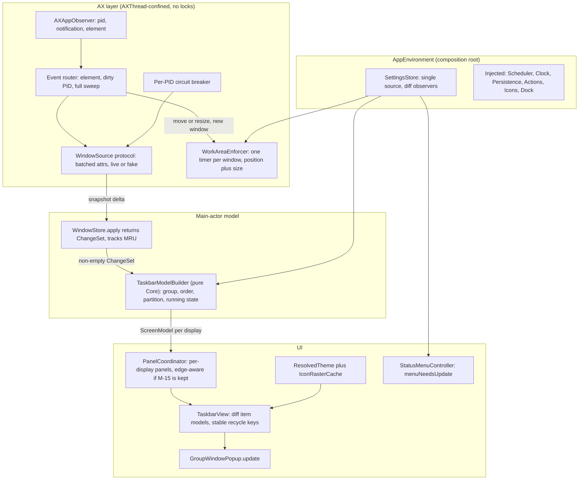

# Taskbar (mac-dock-gemini) — MASTER Codebase Audit

**Date:** 2026-10-16  **Baseline:** `v0.3.2` (`12d0814`)
**Sources merged:** [C] [claude_taskbar_codebase_audit_2026-10-12.md](./claude_taskbar_codebase_audit_2026-10-12.md) · [A] [ARGON_CODEBASE_AUDIT.md](./ARGON_CODEBASE_AUDIT.md) · comparison in [AUDIT_COMPARISON.md](./AUDIT_COMPARISON.md)

Every finding below was **re-checked against the source**. Where [A]'s quoted identifiers were wrong, they've been corrected to the real names. Each finding is tagged with where it came from: `[C]`, `[A]`, or `[C+A]` (found independently by both, so high confidence).

**Legend:** **P0** Critical (data loss, or a perf flaw that grows with usage) · **P1** High (functional bug, race, hot-path waste) · **P2** Medium (maintainability / architecture debt) · **P3** Low (polish, docs).
**Effort:** XS (< 15 min) · S (< 1 h) · M (½–1 day) · L (multi-day).

---

## 0. Executive Summary

| Dimension | Grade | One-line assessment |
|---|---|---|
| Maintainability & future features | **B-** | Clean module split and pure layout/math engines. But settings are split across owners, adding a setting touches 5 files, and edge/auto-hide support is half-built. |
| Code smell / architecture / logic | **C+** | Settings saves overwrite each other (data loss). The right-click Minimize item, the group popup, and pinned-app window selection are wrong. Custom-order and observer lifecycles are fragile. |
| **Performance (top priority)** | **C** | One title change in any app triggers a full AX rescan of every app, then ~3 enforcer passes per window, then a repaint of every button on every display. A single hung app can block the whole AX pipeline. |
| Test coverage | **B-** | Core math is well tested. The runtime (tracker, enforcer, observer, settings flows) is untested because of singletons and static AX calls. Integration tests rely on a real app and have side effects. There are no perf regression guards. |

**The core problem:** the work done per event isn't proportional to what changed. Fix the event pipeline (M-02, M-03, M-06), unify settings ownership (M-01), and the rest becomes incremental cleanup.

---

## 1. Master Findings Index

### 1.1 Ranked by Priority (`P0` → `P3`)

| ID | Pri | Effort | Src | Title |
|---|---|---|---|---|
| **M-01** | P0 | M | C+A | Split-brain `Settings` → saves overwrite each other (data loss) |
| **M-02** | P0 | L | C+A | Every AX event triggers a full system-wide AX rescan |
| **M-03** | P0 | S | C+A | Reconcile queues 3 enforcer passes for every visible window |
| **M-04** | P0 | M | C | One serial `AXThread` can be blocked by a hung app |
| **M-05** | P1 | S | A | Right-click **Minimize/Restore** runs the left-click action instead |
| **M-06** | P1 | M | C+A | UI refresh storm: unconditional repaint, double layout, `CGWindowList` per screen, button churn in `.whenCrowded` |
| **M-07** | P1 | M | C+A | `WorkAreaEnforcer`: IPC under a lock, off-main `NSScreen`, timer fan-out, runaway retries, leaks |
| **M-08** | P1 | M | C | `AXAppObserver` lifecycle races and duplicate registrations |
| **M-09** | P1 | M | C+A | Allocations and high-res icon resampling inside `draw(_:)` |
| **M-10** | P1 | S | A+C | Pinned click and group primary pick the **oldest** window, not the focused/most recently used one |
| **M-11** | P1 | S | A | `GroupWindowPopup` shows stale windows (never refreshed) |
| **M-12** | P1 | XS | C | Space-change debounce cancels itself; redundant UI pass |
| **M-13** | P1 | M | C+A | Custom order: string keys, applied twice, allocations in sort, stale drag indices, key leak |
| **M-14** | P1 | S–M | C+A | `DockController`: main-thread subprocesses, no crash recovery, stale snapshot |
| **T-01** | P1 | M | C+A | The core runtime is untested; missing regression tests for known bugs |
| **M-15** | P2 | L | C+A | `TaskbarEdge` / `AutoHideStateMachine` half-built: **decide whether to finish or remove** |
| **M-16** | P2 | M | C+A | Singletons and static actions block testing; tests have side effects |
| **M-17** | P2 | XS | C+A | `WindowStore` is `@unchecked Sendable` with no synchronization |
| **M-18** | P2 | M | C+A | God objects + per-setting forwarding boilerplate across 5 files |
| **M-19** | P2 | S | C+A | Duplicated theme logic; legacy `themeStyle` ternary drops XP/Dark (2 sites) |
| **M-20** | P2 | S | C+A | `availableWidth` differs from the layout engine; no regroup when width/spacing changes |
| **M-21** | P2 | S | C+A | Drag coordinator: duplicated task/pinned paths, double `computeLayout` per event |
| **M-22** | P2 | S | C+A | `IconCache`: wrong size, apps without a bundle ID, fallback cached forever, no eviction |
| **M-23** | P2 | S | C | `windowID` falls back to `CFHash` (unstable identity) |
| **M-24** | P2 | S | C | Fullscreen detection heuristic (false positives + cost) |
| **M-25** | P2 | XS | A | Unchecked `as! AXUIElement` casts on untrusted AX values |
| **M-26** | P2 | S | A | Theme bevel colors are inert; `OverflowButton` hardcodes radius/border |
| **M-27** | P2 | S | C+A | Dead code: `AppInfo`, legacy shims, unused APIs |
| **T-02** | P2 | M | C+A | Integration tests depend on a real app (TextEdit), sleep/poll, and have side effects |
| **T-03** | P2 | XS | A | `StatusMenu` tests leak real `NSStatusItem`s and use `Mirror` |
| **T-04** | P2 | S | C | No perf regression guards (draw count, IPC budget, timing) |
| **M-28** | P3 | XS | A | `ThemeRegistry.importTheme` / `ThemeFileLoader` validation gaps |
| **M-29** | P3 | S | C+A | Docs drift: private APIs, `grp_` ID prefix, drag thresholds, theme fallback dir, doc volume |
| **M-30** | P3 | S | C | Constants bypass `TaskbarConstants`; display-ID helper duplicated 6× |
| **M-31** | P3 | S | C | Taskbar's own buttons lack VoiceOver labels and roles |
| **M-32** | P3 | XS | C | Accessibility-permission polling gives up after 30 s |
| **M-33** | P3 | M | A | Layout engine has no trailing tray zone or centered alignment (only if v0.4.0 needs it) |
| **T-05** | P3 | S | C | No coverage measurement or thresholds |
| **T-06** | P3 | S | A | Test frameworks are split (17 XCTest files, 9 Swift Testing files) |

### 1.2 Ranked by Code Complexity / Effort (`L` Architectural → `XS` Surgical)

| Complexity Rank | ID | Complexity / Effort | Est. Scope | Pri | Title | Concise Resolution Feedback |
|---|---|---|---|---|---|---|
| **1** | **M-15** | **L (Architectural)** | ~6 files, 250–350 LOC | P2 | Multi-edge (`TaskbarEdge`) & `AutoHideStateMachine` integration (or removal) | Either wire `setPosition`, vertical top-to-bottom row layout, edge-aware panels/popups/drags, and `AutoHideStateMachine`, or strip unwired surface (YAGNI). |
| **2** | **M-02** | **L (Architectural)** | ~4 files, 180–250 LOC | P0 | Delta-driven AX event routing + batched `AXUIElementCopyMultipleAttributeValues` | Pass `(pid, notification, element)` from `AXAppObserver`, reconcile only dirty elements/PIDs, batch 8 window attributes into 1 IPC call, and cache `WindowKey → AXUIElement`. |
| **3** | **M-16** | **M (Structural)** | ~6 files, 150–220 LOC | P2 | Protocol-based dependency injection (`AppEnvironment`) replacing singletons | Inject `WindowSource`, `Scheduler`, `Clock`, `SettingsPersistence`, and `DockServicing`; disable live enforcer in tests. |
| **4** | **T-01** | **M (Structural)** | ~5 test files, 200–300 LOC | P1 | Core runtime unit tests (`FakeWindowSource`, `TestClock`) & bug regressions | Add deterministic unit tests for `AppTracker`, `WorkAreaEnforcer`, `AXAppObserver`, `SettingsStore`, and regressions for `M-01`..`M-22`. |
| **5** | **T-02** | **M (Structural)** | ~5 test files, 150–200 LOC | P2 | Migrate slow TextEdit integration tests to `FakeWindowSource` + `TestScheduler` | Keep a small `@Tag(.liveAX)` smoke suite and run ~80% of scenarios deterministically in-memory with isolated `UserDefaults`. |
| **6** | **M-06** | **M (Multi-File)** | ~5 files, 120–180 LOC | P1 | Eliminate UI refresh storm (`ChangeSet`, `didSet` guards, stable `.whenCrowded` keys) | Return `ChangeSet` from `WindowStore`, guard `theme.didSet`, cache running bundle IDs via `NSWorkspace`, and preserve button instances across `.whenCrowded`. |
| **7** | **M-18** | **M (Multi-File)** | ~5 files, 120–160 LOC | P2 | Consolidate god objects & 5-file per-setting forwarding boilerplate | Replace ~15 `updateX()` methods with `apply(settings:theme:)`, build `StatusMenu` in `menuNeedsUpdate(_:)`, and split `ScreenManager`. |
| **8** | **M-07** | **M (Multi-File)** | ~2 files, 100–150 LOC | P1 | Confine `WorkAreaEnforcer` to `AXThread` with 1 timer per window & `setPosition` | Drop `lock`, push screens/config from `@MainActor`, use 1 deadline timer per `winID`, gate mouse-down retries on generation, and apply `setPosition`. |
| **9** | **M-01** | **M (Multi-File)** | ~4 files, 100–140 LOC | P0 | Single-owner reactive `SettingsStore` replacing split-brain `Settings` copies | Centralize state in `@MainActor final class SettingsStore` with diff observers and injectable `SettingsPersistence`. |
| **10** | **M-13** | **M (Multi-File)** | ~4 files, 90–130 LOC | P1 | Typed `OrderKey`, single-pass ordering in `TaskbarModelBuilder`, and drag safety | Replace `[String: Int]` with `[OrderKey: Int]`, deduplicate store/view sorting, prune closed keys in `syncSnapshot`, and commit drags by ID. |
| **11** | **M-09** | **M (Multi-File)** | ~5 files, 90–130 LOC | P1 | `ResolvedTheme` asset cache + pre-rasterized target-scale icons for `draw(_:)` | Cache `NSColor`/`NSFont`/`NSParagraphStyle` per theme change and rasterize icons once to `iconSize × backingScale`. |
| **12** | **M-08** | **M (Focused)** | ~2 files, 80–120 LOC | P1 | Fix `AXAppObserver` duplicate registrations, launch/activate race, and main-thread IPC | Confine observer mutations to `AXThread`, track `pendingPIDs`, register move/resize at one level only, and resolve destroyed elements via `CFEqual`. |
| **13** | **M-04** | **M (Focused)** | ~2 files, 70–100 LOC | P0 | Per-PID circuit breaker + chunked `AXThread` sweeps so hung apps don't freeze clicks | Skip timed-out PIDs for 5s, lower sweep timeout to `0.15s`, and chunk full sweeps into one-PID-per-runloop-turn on `AXThread`. |
| **14** | **M-33** | **M (Focused)** | ~2 files, 60–100 LOC | P3 | `TaskbarLayoutEngine` trailing tray zone & centered button alignment | Add `trailingReservedLength` and `TaskbarAlignment` when v0.4.0 clock/centered features are scheduled. |
| **15** | **M-14** | **S–M (Focused)** | ~2 files, 50–80 LOC | P1 | Async `DockController`, `CFPreferences` reads, fresh snapshots, and crash recovery | Read Dock prefs via `CFPreferencesCopyAppValue`, write on utility queue, snapshot before hiding, and restore on dirty-session launch. |
| **16** | **M-21** | **S (Surgical)** | ~2 files, 40–60 LOC | P2 | Deduplicate `TaskbarDragCoordinator` task/pinned paths & single `computeLayout` | Parameterize drag handlers over `DragKind` and reuse the layout plan across slot and indicator calculations. |
| **17** | **T-04** | **S (Surgical)** | ~2 test files, 40–60 LOC | P2 | Add `drawCount` and `FakeWindowSource` IPC budget performance tests | Assert 0 redraws on no-op updates, 1 redraw on single title change, and bounded attribute reads per event. |
| **18** | **T-06** | **S (Surgical)** | ~17 test files, mechanical | P3 | Unify test suites on `Swift Testing` | Migrate `TaskbarCoreTests` from `XCTest` to `@Suite` / `@Test` / `#expect`. |
| **19** | **M-22** | **S (Surgical)** | ~4 files, 35–50 LOC | P2 | Fix `IconCache` `theme.iconSize`, bundle-less apps, sticky `fallbackIcon`, and eviction | Pass `theme.iconSize` everywhere, key bundle-less apps by executable/PID, don't cache `fallbackIcon` on PID misses, and evict on terminate. |
| **20** | **M-03** | **S (Surgical)** | ~2 files, 25–40 LOC | P0 | Remove `WorkAreaEnforcer` call from `reconcileWindows()` | Delete `handleWindowMovedOrResized` from the reconcile loop; invoke only on newly inserted windows and real move/resize events. |
| **21** | **M-20** | **S (Surgical)** | ~2 files, 25–35 LOC | P2 | Share `TaskbarLayoutEngine.taskAreaLength` & regroup on width/spacing `didSet` | Use one width formula for both `.whenCrowded` grouping and layout, and regroup when `minButtonWidth` or `buttonSpacing` changes. |
| **22** | **M-26** | **S (Surgical)** | ~5 files, 25–35 LOC | P2 | Wire `ThemePalette` bevel colors into `BevelDrawing` & fix `OverflowButton` border/radius | Pass palette bevel colors to `BevelDrawing` and use `theme.buttonCornerRadius` + `buttonBorderPressed` in `OverflowButton`. |
| **23** | **M-11** | **S (Surgical)** | ~2 files, 25–35 LOC | P1 | Refresh or dismiss `GroupWindowPopup` when group windows mutate in `updateWindows` | Call `popup.update(group:focusedKey:)` in `TaskbarView.updateWindows` or dismiss if no longer grouped. |
| **24** | **M-05** | **S (Surgical)** | ~2 files, 20–30 LOC | P1 | Fix right-click **Minimize/Restore** on `TaskButton` | Add `onMinimizeOrRestore` callback on `TaskButton` to explicitly minimize or restore target window(s). |
| **25** | **M-24** | **S (Surgical)** | ~2 files, 25–35 LOC | P2 | Replace `CGWindowList` fullscreen bounds heuristic with tracked `AXFullScreen` | Derive per-screen fullscreen state from `WindowStore` `isFullScreen` flags and space changes. |
| **26** | **M-19** | **S (Surgical)** | ~3 files, 25–35 LOC | P2 | Deduplicate theme metric overrides & fix `ThemeStyle` ternary | Use `themeStyle.rawValue` in `Settings` and `StatusMenu` and centralize `Settings.applyingThemeOverrides(_:)`. |
| **27** | **M-23** | **S (Surgical)** | ~2 files, 20–30 LOC | P2 | Remove unstable `CFHash` fallback from `AXUIElement.windowID` | Return `UInt64?` (or map via `CFEqual` table) when `_AXUIElementGetWindow` fails. |
| **28** | **M-27** | **S (Surgical)** | ~5 files, deletions | P2 | Remove dead `AppInfo.swift`, legacy shims, and unused `StatusMenu` methods | Delete unused types and methods. |
| **29** | **M-29** | **S (Surgical)** | ~3 files, docs | P3 | Fix documentation drift (`PrivateAPI.swift`, group prefix, drag constants) | Centralize private `dlsym` symbols in `PrivateAPI.swift` and sync `docs/ARCHITECTURE.md`. |
| **30** | **M-30** | **S (Surgical)** | ~4 files, 25–35 LOC | P3 | Move magic numbers to `TaskbarConstants` & deduplicate `NSScreen.displayID` | Extract `NSScreen.displayID` / `.descriptor` extension and move `NSColor(rgba:)` to `Extensions/`. |
| **31** | **M-31** | **S (Surgical)** | ~3 files, 15–25 LOC | P3 | Add VoiceOver role, label, and press action to `TaskButton`, `StartButton`, `OverflowButton` | Configure `setAccessibilityRole(.button)` and `setAccessibilityLabel(...)`. |
| **32** | **T-05** | **S (Surgical)** | ~1 file, 15–20 LOC | P3 | Enable code coverage reporting in `scripts/test-functional.sh` | Run `swift test --enable-code-coverage` and `xcrun llvm-cov report`. |
| **33** | **M-10** | **S (Surgical)** | ~2 files, 15–25 LOC | P1 | Select focused / MRU unminimized window on pinned click & `WindowGroup.primaryWindow` | Track `lastFocusedAt` in `WindowStore` and prioritize focused → MRU unminimized → MRU overall. |
| **34** | **T-03** | **XS (Trivial)** | ~3 files, 15–20 LOC | P2 | Remove leaked `NSStatusItem` in `StatusMenu.deinit` & drop `Mirror` in tests | Call `NSStatusBar.system.removeStatusItem(statusItem)` in `deinit` and expose `internal var menu: NSMenu?`. |
| **35** | **M-28** | **XS (Trivial)** | ~2 files, 15–20 LOC | P3 | Reject built-in IDs in `ThemeRegistry.importTheme` and trim custom theme IDs | Guard `!Self.isBuiltIn(themeId:)` and trim `id` in `importTheme` and `discoverCustomThemes`. |
| **36** | **M-25** | **XS (Trivial)** | ~2 files, 12–15 LOC | P2 | Replace `as! AXUIElement` force casts with `CFGetTypeID` check | Validate `CFGetTypeID(ref) == AXUIElementGetTypeID()` before casting. |
| **37** | **M-12** | **XS (Trivial)** | ~2 files, 10–15 LOC | P1 | Fix self-cancelling 50ms/150ms space-change debounce in `AppTracker` | Use separate quick/settle work items (or earliest-deadline scheduling) and drop redundant `ScreenManager` space observer. |
| **38** | **M-32** | **XS (Trivial)** | ~1 file, 10–15 LOC | P3 | Observe `com.apple.accessibility.api` distributed notification for permission grant | Listen to `DistributedNotificationCenter` so permission grant after 30s still activates tracking. |
| **39** | **M-17** | **XS (Trivial)** | ~2 files, 5–10 LOC | P2 | Isolate `WindowStore` to `@MainActor` instead of `@unchecked Sendable` | Add `@MainActor` to `WindowStore` and pass value snapshots from `AXThread`. |

---

## 2. Detailed Findings

### P0 — Critical

#### M-01 · Split-brain `Settings` → data loss `[C+A]` · M
**Where:** [AppDelegate.swift](file:///Users/obertguo/Documents/mac-dock-gemini/Sources/TaskbarKit/AppDelegate.swift#L8-L185), [ScreenManager.swift](file:///Users/obertguo/Documents/mac-dock-gemini/Sources/TaskbarKit/UI/Management/ScreenManager.swift#L9-L205), [StatusMenu.swift](file:///Users/obertguo/Documents/mac-dock-gemini/Sources/TaskbarKit/UI/Menu/StatusMenu.swift#L9-L18)
**Problem:** `Settings` is a struct. `AppDelegate` and `ScreenManager` each hold a copy, and **both save**. `StatusMenu` mirrors 10 more fields. Example: pin an app (only `ScreenManager`'s copy is saved), then toggle *Hide System Dock* (`AppDelegate` saves its stale copy), and the pin is lost on disk. The reverse also happens: toggle the dock, then change the bar height, and `ScreenManager` saves last with a stale `hideSystemDock`. Separately, a custom theme switch rebuilds the status menu up to 4× in a row.
**Fix:** A single `@MainActor final class SettingsStore` with an injectable persistence protocol (`UserDefaults` in the app, in-memory in tests), `update(_:(inout Settings)->Void)` that compares old vs. new before saving, and observers that receive `(old, new)`. Every other component reads from it and reacts to the diff. `StatusMenu` builds its menu on demand (M-18). Add a regression test: pin → toggle dock → both persisted.

#### M-02 · Every AX event triggers a full system-wide AX rescan `[C+A]` · L
**Where:** [AppTracker.reconcileWindows](file:///Users/obertguo/Documents/mac-dock-gemini/Sources/TaskbarKit/Tracking/AppTracker.swift#L159-L280), [AXAppObserver.onEvent](file:///Users/obertguo/Documents/mac-dock-gemini/Sources/TaskbarKit/Tracking/AXAppObserver.swift#L53)
**Problem:** `onEvent: () -> Void` throws away the pid, notification, and element. So any notification from any app re-enumerates **all regular apps × all windows**, at ~9–11 IPC calls per window (`windows`, `role`, `subrole`, `position`, `size`, `minimized`, `main`, `AXFullScreen`, `title`, `_AXUIElementGetWindow`, plus `windowID` again inside `observeWindow`). That's roughly 300–400 IPC calls per title change with 15 apps and 30–40 windows. `WindowActions.findWindowElement` re-enumerates windows on every click.
**Fix:**
1. `onEvent: (pid_t, CFString, AXUIElement) -> Void`.
2. Route events by type: window-level (title, minimize, move) → refresh one element. Created/destroyed → refresh one PID. Launch/terminate, space change, permission granted → full sweep.
3. Fetch attributes in one call with `AXUIElementCopyMultipleAttributeValues` (1 IPC instead of ~8).
4. Keep an AX-side `WindowKey → AXUIElement` cache for actions (O(1) clicks).
5. Diff against the store, and notify main **only if something changed** (feeds M-06).

#### M-03 · Reconcile queues 3 enforcer passes for every visible window `[C+A]` · S
**Where:** [AppTracker.swift#L236-L239](file:///Users/obertguo/Documents/mac-dock-gemini/Sources/TaskbarKit/Tracking/AppTracker.swift#L236-L239), [WorkAreaEnforcer.handleWindowMovedOrResized](file:///Users/obertguo/Documents/mac-dock-gemini/Sources/TaskbarKit/Tracking/WorkAreaEnforcer.swift#L71-L178)
**Problem:** Every non-minimized window, on every reconcile, schedules 3 `asyncAfter` blocks (150/400/650 ms), each making ~5 IPC calls. With 30–40 windows, one focus change produces ~90–120 timers and ~450–600 IPC calls.
**Fix:** Remove the call from reconcile. Enforce only on actual move/resize notifications, on **first sighting** of a window (the store reports an insertion), and in one sweep when settings or screens change. Replace the 3 timers with one per-window deadline (M-07). **This is the quickest high-impact performance win.**

#### M-04 · One serial `AXThread` can be blocked by a hung app `[C]` · M
**Where:** [AXThread.swift](file:///Users/obertguo/Documents/mac-dock-gemini/Sources/TaskbarKit/Tracking/AXThread.swift), [WindowActions](file:///Users/obertguo/Documents/mac-dock-gemini/Sources/TaskbarKit/Actions/WindowActions.swift)
**Problem:** Reconcile, observer callbacks, enforcer passes, **and click actions** all share one run loop, with a 0.3 s timeout *per attribute*. A beachballing app with 5 windows can block the thread for about 15 s per sweep, and clicks on the taskbar queue up behind it.
**Fix:** A per-PID circuit breaker: on a timeout, skip that app for ~5 s and keep its last known (dimmed) windows. Use a lower timeout for enumeration (0.1–0.15 s). To keep user clicks responsive without breaking `AXThread` lock-free confinement (M-02), either **(a)** chunk full sweeps into **one-PID-per-runloop-turn** (`AXThread.shared.async` per PID instead of a single loop over all `runningApps`) so interactive clicks interleave between PIDs with `< 100 ms` latency, or **(b)** run user actions on a separate serial "interactive" queue that reads a lock-guarded/atomic snapshot of the `WindowKey → AXUIElement` cache.

---

### P1 — High

#### M-05 · Right-click Minimize/Restore runs the left-click action `[A]` · S
**Where:** [TaskButton.handleMenuMinimizeOrRestore](file:///Users/obertguo/Documents/mac-dock-gemini/Sources/TaskbarKit/UI/Buttons/TaskButton.swift#L139-L141), [TaskbarView onClick](file:///Users/obertguo/Documents/mac-dock-gemini/Sources/TaskbarKit/UI/Panels/TaskbarView.swift#L224-L246), [ClickPolicy](file:///Users/obertguo/Documents/mac-dock-gemini/Sources/TaskbarCore/Logic/ClickPolicy.swift)
**Problem:** The menu item calls `onClick?()`. For a **grouped** button that opens the window-list popup. For an **unfocused visible window**, `ClickPolicy` returns `.focus`, so "Minimize" focuses the window instead.
**Fix:** Add an `onMinimizeOrRestore` callback. For a single window: minimize if it's visible, otherwise restore and focus. For a group: minimize all visible windows, or restore all if every window is minimized. Add a test (T-01).

#### M-06 · UI refresh storm `[C+A]` · M
**Where:** [ScreenManager.updateWindows](file:///Users/obertguo/Documents/mac-dock-gemini/Sources/TaskbarKit/UI/Management/ScreenManager.swift#L308-L341), [TaskbarView.updateWindows](file:///Users/obertguo/Documents/mac-dock-gemini/Sources/TaskbarKit/UI/Panels/TaskbarView.swift#L138-L278), [TaskButton.theme](file:///Users/obertguo/Documents/mac-dock-gemini/Sources/TaskbarKit/UI/Buttons/TaskButton.swift#L49-L53), [PinnedButton.theme](file:///Users/obertguo/Documents/mac-dock-gemini/Sources/TaskbarKit/UI/Buttons/PinnedButton.swift#L26-L30)
**Problem:** After *every* reconcile, even when nothing changed:
- `CGWindowListCopyWindowInfo` runs **once per screen** on main.
- `updatePinnedApps` and `updateWindows` both run, so `isAppRunning` executes twice per pinned app (with a `NSRunningApplication` query when the app isn't running) and layout runs at least twice.
- `existing.theme = theme` is set on every button, and `didSet` unconditionally sets `needsDisplay`, so **every button on every display repaints**.
- `WindowGroup ==` compares frames, so moving a window repaints its button.
- In `.whenCrowded`, crossing the threshold changes every button ID (`win_…` ↔ `group_…`), so **all buttons are destroyed and re-created**.

**Fix:**
1. `WindowStore.apply(snapshot) -> ChangeSet`; return early when it's empty.
2. Guard every `didSet` with `oldValue != newValue`.
3. Keep a running bundle-ID set updated from `NSWorkspace` launch/terminate notifications.
4. Compute fullscreen state once per space change (M-24).
5. Partition windows by screen in a single pass.
6. Diff only the fields a button renders.
7. Use a **stable recycling key** (e.g. `bundleID` for app groups, and map single-window groups onto an existing button) so `.whenCrowded` changes `group` in place.

#### M-07 · `WorkAreaEnforcer` concurrency and timer design `[C+A]` · M
**Where:** [WorkAreaEnforcer.swift](file:///Users/obertguo/Documents/mac-dock-gemini/Sources/TaskbarKit/Tracking/WorkAreaEnforcer.swift)
**Problem:**
- `element.frame` (2 IPC calls) runs **inside `lock.withLock`** ([L84-L96](file:///Users/obertguo/Documents/mac-dock-gemini/Sources/TaskbarKit/Tracking/WorkAreaEnforcer.swift#L84-L96)), so main-thread setters can block.
- `NSScreen.screens` is read on `AXThread` ([L198-L205](file:///Users/obertguo/Documents/mac-dock-gemini/Sources/TaskbarKit/Tracking/WorkAreaEnforcer.swift#L198-L205)).
- 3 copy-pasted `asyncAfter` passes run per event (~180 dispatches/s during a drag).
- The mouse-down deferral re-schedules **without a generation check**, so up to 3 retry chains run per window.
- `logNudge(String)` formats the message eagerly at `.info`.
- Intervals use the wall clock (`Date()`).
- Per-window dictionaries leak when no destroy notification arrives (or when `_AXUIElementGetWindow` fails on an already-destroyed element and falls back to `CFHash`, see M-08/M-23).
- Only `setSize` is applied: the origin is never set and `NudgeRecord` tracks height only, which breaks top/left edges (M-15).

**Fix:** Confine all enforcer state to `AXThread` and remove the lock. Push configuration and screens from main. Keep one timer per window with `{deadline, pass, wasResize}`, and run a follow-up pass only if the frame changed or the window was mid-animation. Allow at most one deferral per window, gated on the generation. Log at `.debug` with direct `os_log` interpolation. Use a monotonic clock. Garbage-collect state when the tracker reports removed windows. Add `setPosition` and a `CGSize` target to `NudgeRecord`.

#### M-08 · `AXAppObserver` lifecycle races `[C]` · M
**Where:** [AppTracker.trackApp / handleAppActivated](file:///Users/obertguo/Documents/mac-dock-gemini/Sources/TaskbarKit/Tracking/AppTracker.swift#L76-L125), [AXAppObserver](file:///Users/obertguo/Documents/mac-dock-gemini/Sources/TaskbarKit/Tracking/AXAppObserver.swift)
**Problem:**
1. Launch → activate creates a **duplicate observer**: creation is still in flight, `trackingAttemptedPIDs` gets cleared, and the first instance is replaced, so its `deinit` runs AX teardown on main.
2. `onEvent` is read on `AXThread` without a lock while it's set to nil on main (a data race).
3. `invalidate()` makes AX IPC calls on main.
4. **Move/resize are registered at both app and window level**, so every move event fires twice.
5. On `kAXUIElementDestroyedNotification`, calling `element.windowID` (`_AXUIElementGetWindow`) on the already-destroyed element often returns `.invalidUIElement` and falls back to `CFHash(element)`, which **fails to match** the real `CGWindowID` stored in `observedWindows`, `observedWindowElements`, and `WorkAreaEnforcer`—leaking entries even when the destroy notification fires.
6. Observers for PIDs that have no windows are never pruned.
7. `setTimeout(0.3)` is hardcoded.

**Fix:** Confine the observer to `AXThread` (all mutations, including invalidation, go through `AXThread.async`). Track a `pending` set to prevent duplicate creation. Register move/resize at one level only (either window-level only, or app-level with an `element.role == kAXWindowRole` guard before passing `element` to `WorkAreaEnforcer`). Resolve destroyed `AXUIElement`s by matching `observedWindowElements` via `CFEqual` instead of calling `_AXUIElementGetWindow` on a dead element. Prune against `runningApplications`. Use `TaskbarConstants.Timing.axTimeout`.

#### M-09 · Allocations and icon resampling inside `draw(_:)` `[C+A]` · M
**Where:** [TaskButton draw](file:///Users/obertguo/Documents/mac-dock-gemini/Sources/TaskbarKit/UI/Buttons/TaskButton.swift#L165-L307), [PinnedButton](file:///Users/obertguo/Documents/mac-dock-gemini/Sources/TaskbarKit/UI/Buttons/PinnedButton.swift#L113-L194), [StartButton.preferredWidth](file:///Users/obertguo/Documents/mac-dock-gemini/Sources/TaskbarKit/UI/Buttons/StartButton.swift#L23-L33), [OverflowButton](file:///Users/obertguo/Documents/mac-dock-gemini/Sources/TaskbarKit/UI/Buttons/OverflowButton.swift), [GroupWindowRowsView](file:///Users/obertguo/Documents/mac-dock-gemini/Sources/TaskbarKit/UI/Panels/GroupWindowRowsView.swift#L251-L345), [IconCache.prepareIcon](file:///Users/obertguo/Documents/mac-dock-gemini/Sources/TaskbarKit/UI/Management/IconCache.swift#L71-L89)
**Problem:** Every draw creates `NSFont`, `NSMutableParagraphStyle`, attribute dictionaries, `NSAttributedString`, `NSColor(rgba:)` values, and `NSBezierPath`, and measures text. `preferredWidth()` builds a font and measures text on every layout. `prepareIcon` keeps every rep ≥ 64 px (including 512/1024 px), so each 16 pt draw resamples from a huge source.
**Fix:** A `ResolvedTheme` (Kit-side, rebuilt only when the theme changes) holding colors, fonts, paragraph styles, and per-state attribute dictionaries. Cache `preferredWidth` per theme. Rasterize each icon **once** to `iconSize × backingScale` pixels and cache it by `(key, px)`. Optionally (from [A]'s ideas) move to `CALayer`-backed icon and text sublayers so hover and press are composited on the GPU.

#### M-10 · Oldest window chosen instead of focused/most recently used `[A+C]` · S
**Where:** [WindowActions.launchOrActivateApp](file:///Users/obertguo/Documents/mac-dock-gemini/Sources/TaskbarKit/Actions/WindowActions.swift#L176-L219), [WindowGroup.primaryWindow](file:///Users/obertguo/Documents/mac-dock-gemini/Sources/TaskbarCore/Model/WindowGroup.swift#L28-L31)
**Problem:** A pinned click uses `appWindows.first`, the oldest window by `openOrder`. If that window is minimized while another is visible, the click restores the old minimized window. `WindowGroup.primaryWindow` has the same "oldest first" behavior, even though its comment says "most recently referenced".
**Fix:** Track `lastFocusedAt` in the store (updated on focus change). Select in this order: focused → most recent unminimized → most recent overall. Use the same rule for `primaryWindow`.

#### M-11 · `GroupWindowPopup` never refreshes `[A]` · S
**Where:** [TaskbarView.swift#L184-L188](file:///Users/obertguo/Documents/mac-dock-gemini/Sources/TaskbarKit/UI/Panels/TaskbarView.swift#L184-L188), [GroupWindowPopup](file:///Users/obertguo/Documents/mac-dock-gemini/Sources/TaskbarKit/UI/Panels/GroupWindowPopup.swift)
**Problem:** The popup keeps a snapshot of the group. It's only dismissed if the group ID disappears, so closed, new, or retitled windows show stale rows. In `.always` mode a group that drops to 1 window keeps its ID and the popup stays open.
**Fix:** In `updateWindows`, look up the updated group. If it's missing or no longer grouped, dismiss the popup. Otherwise call `popup.update(group:focusedKey:)` to refresh the rows and resize.

#### M-12 · Space-change debounce cancels itself `[C]` · XS
**Where:** [AppTracker.handleActiveSpaceChanged](file:///Users/obertguo/Documents/mac-dock-gemini/Sources/TaskbarKit/Tracking/AppTracker.swift#L139-L142)
**Problem:** The 150 ms schedule cancels the 50 ms one, so the quick pass never fires. `ScreenManager` also runs its own full `updateWindows()` before the store has updated.
**Fix:** Give the scheduler a "keep the earliest deadline" mode, or use separate work items for the quick pass and the settle pass. Remove the space observer from `ScreenManager`.

#### M-13 · Custom-order design `[C+A]` · M
**Where:** [WindowStore.windows(forScreenID:)](file:///Users/obertguo/Documents/mac-dock-gemini/Sources/TaskbarCore/Logic/WindowStore.swift#L106-L130), [WindowOrderingLogic.applyCustomOrder](file:///Users/obertguo/Documents/mac-dock-gemini/Sources/TaskbarCore/Logic/WindowOrderingLogic.swift#L18-L48), [TaskbarView.commitCustomOrderToStore](file:///Users/obertguo/Documents/mac-dock-gemini/Sources/TaskbarKit/UI/Panels/TaskbarView.swift#L424-L436), [TaskbarDragCoordinator](file:///Users/obertguo/Documents/mac-dock-gemini/Sources/TaskbarKit/UI/Panels/TaskbarDragCoordinator.swift#L151-L156)
**Problem:**
- The order map is `[String: Int]` and mixes group and window keys; removal works by matching string prefixes.
- Ordering is **applied twice** (store + view) with **duplicated comparators** that build strings inside the sort closure.
- `commitCustomOrderToStore` duplicates `rebuildOrderMap`.
- `syncSnapshot` never prunes keys for closed windows (a slow leak).
- The drag commit uses indices captured at drag start; a reconcile mid-drag can make it **move the wrong button**.

**Fix:** `enum OrderKey: Hashable { case window(WindowKey), app(String) }`. Precompute slots once (decorate → sort → undecorate). Apply ordering once, in a pure `TaskbarModelBuilder` (§3). Prune in `apply(snapshot)`. Pause applying updates during a drag, or commit by **ID**.

#### M-14 · `DockController` `[C+A]` · S–M
**Where:** [DockController.swift](file:///Users/obertguo/Documents/mac-dock-gemini/Sources/TaskbarKit/System/DockController.swift)
**Problem:** `defaults` and `killall Dock` run with `waitUntilExit()` **on main**: at launch, in `init` (2 reads), and on menu toggles. The original state is captured only on the **first run ever**. If the app crashes or is force-quit (SIGKILL), the Dock stays at a ~1000 s autohide delay.
**Fix:** Read with `CFPreferencesCopyAppValue(…, "com.apple.dock")` (no subprocess). Write on a background utility queue. Take a fresh snapshot whenever the dock goes from "not hidden by us" to hidden. Keep a "dirty session" sentinel and restore on the next launch. An optional LaunchAgent watchdog can restore the Dock if the Taskbar process disappears.

---

### P2 — Medium

#### M-15 · Edge and auto-hide support is half-built: decide first `[C+A]` · L (finish) / S (remove)
**Problem:** `Settings.taskbarEdge` is saved but ignored. The enforcer calls the bottom-only `clampedFrameForWindow(…, taskbarHeight:)` and never sets the window's origin. The vertical layout produces 26 pt-wide strips stacked bottom-to-top. `TaskbarPanel`, the border drawing, popup/overflow anchoring, and the drag coordinator all assume the bottom edge. `AutoHideStateMachine` has no call sites.
**Decision gate:**
- **If v0.4.0 includes edges:** follow [A]'s blueprint. Add `AXUIElement.setPosition`; use a `CGSize` target in `NudgeRecord`; lay vertical rows out top-to-bottom at full width; parameterize panel, border, popup anchor, and drag axis by `TaskbarEdge`; wire `AutoHideStateMachine` behind a new `autoHideTaskbar` setting. Each piece needs integration tests.
- **Otherwise:** remove `taskbarEdge` from `Settings` (keep decoding it for compatibility) and park the pure engines on a branch (YAGNI).

#### M-16 · Singletons, static actions, and test side effects `[C+A]` · M
**Problem:** `WorkAreaEnforcer.shared`, `IconCache.shared`, `ThemeRegistry.shared`, `ThemeFileLoader.shared`, `DockController.shared`, `AXThread.shared`, the static `WindowActions` and `Launcher`, and `Settings.save(to: .standard)` make the runtime impossible to unit-test. Integration tests that construct `AppTracker` start the **global enforcer, which resizes real windows**. `ScreenManager` tests save into `UserDefaults.standard` (the test runner's `xctest` domain—not the bundled `com.local.taskbar` app domain, though unbundled `swift run TaskbarApp` and cross-suite runs within `swift test` still share unisolated `UserDefaults.standard` state).
**Fix:** Define protocols (`WindowSource`, `WindowActionPerforming`, `IconProviding`, `ThemeProviding`, `DockServicing`, `Scheduler`, `Clock`, `SettingsPersistence`). Build everything once in an `AppEnvironment.live` composition root and inject it. Tests use `AppEnvironment.test` with fakes, an in-memory store, and the enforcer disabled.

#### M-17 · `WindowStore` `@unchecked Sendable` `[C+A]` · XS
Mark it `@MainActor` (Core can do that without AppKit) and stop capturing it in `AXThread` closures.

#### M-18 · God objects and forwarding boilerplate `[C+A]` · M
**Problem:** Adding one setting touches `Settings` → `StatusMenu` (stored field + init param + callback + `updateX` + submenu + selector) → an `AppDelegate` closure → `ScreenManager.updateX` → `TaskbarPanel` → `TaskbarView`. `AppDelegate` has 15 closures that all "mutate + save + forward". `StatusMenu` (440 lines) has 6 near-identical preset submenus and 5 unused update methods. `ScreenManager` mixes persistence, theme resolution, panel lifecycle, fullscreen detection, and pin management.
**Fix:** With `SettingsStore` (M-01) in place:
- Each layer exposes a diff-aware `apply(settings:theme:)`.
- `StatusMenuController` builds its menu in `menuNeedsUpdate(_:)` from the store, using a generic `presetSubmenu(title:presets:keyPath:)`.
- Split `ScreenManager` into `PanelCoordinator`, `FullscreenMonitor`, and `ThemeResolver`.

#### M-19 · Theme logic duplication and legacy ternary `[C+A]` · S
**Problem:** The "custom theme overrides metrics" logic is duplicated in `AppDelegate.onThemeIdChanged` and `ScreenManager.updateTheme`. The `themeStyle ↔ id` mapping is written out 3× in `Settings`. **`Settings.init(themeStyle:)` and `StatusMenu.init`** both use `retroClassic ? … : modernHybrid`, which silently drops XP Luna and Dark Minimal.
**Fix:** Use `ThemeStyle.rawValue` (it already equals the preset ID) as the single mapping. Add one `ThemeResolver.resolve(settings)` and one `Settings.applyingThemeOverrides(_:)`. Delete `init(themeStyle:)` and `updateThemeStyle`.

#### M-20 · `availableWidth` inconsistency `[C+A]` · S
**Where:** [TaskbarView.swift#L151-L164](file:///Users/obertguo/Documents/mac-dock-gemini/Sources/TaskbarKit/UI/Panels/TaskbarView.swift#L151-L164) vs [TaskbarLayoutEngine](file:///Users/obertguo/Documents/mac-dock-gemini/Sources/TaskbarCore/Logic/TaskbarLayoutEngine.swift#L265-L280)
**Problem:** The view estimates pinned width with `iconSize + spacing + 8.0` and always subtracts the pinned margin. The engine uses `btnThickness` and subtracts the margin only when there are pinned items. So `.whenCrowded` decides grouping using the wrong width. The `minButtonWidth` and `buttonSpacing` `didSet`s only relayout; they don't regroup.
**Fix:** Add `TaskbarLayoutEngine.taskAreaLength(params)` and use it for both grouping and layout. Regroup in those `didSet`s when the mode is `.whenCrowded`. Bundle the 18 initializer fields into a `LayoutMetrics` struct.

#### M-21 · Drag coordinator duplication `[C+A]` · S
The task and pinned handlers are ~90% identical. `computeLayout` runs twice per mouse-drag event. The math is horizontal-only. The delegate exposes the view's internal `{ get set }` button arrays. **Fix:** Make the handlers generic over `DragKind`, compute the layout plan once at drag start, and give the delegate read-only accessors plus intent methods.

#### M-22 · `IconCache` correctness `[C+A]` · S
**Where:** [IconCache.swift](file:///Users/obertguo/Documents/mac-dock-gemini/Sources/TaskbarKit/UI/Management/IconCache.swift)
**Problem:**
- `TaskButton`, `GroupWindowRowsView`, and the overflow menu request the default **16 pt** size regardless of `theme.iconSize` (blurry icons, duplicate cache entries).
- An empty `bundleID` without a custom path gives an **empty key that's never cached**, so the icon is resolved in every draw.
- `fallbackIcon` is **cached forever** if the lookup fails during app launch.
- The cache is never evicted.

**Fix:** Key on `bundleID ?? executable path ?? "pid:\(pid)"`. Always pass `theme.iconSize`. Don't cache the fallback for lookups by pid (or retry on activation). Add `evict(bundleID:)` on terminate for unpinned apps. Combine with rasterization (M-09).

#### M-23 · `windowID` falls back to `CFHash` `[C]` · S
**Where:** [AXElement+Attributes.swift#L119-L125](file:///Users/obertguo/Documents/mac-dock-gemini/Sources/TaskbarKit/Tracking/AXElement+Attributes.swift#L119-L125)
`CFHash` isn't stable across element instances and can collide, and it feeds `WindowKey` everywhere (and breaks `kAXUIElementDestroyedNotification` cleanup when `_AXUIElementGetWindow` returns `.invalidUIElement` on a dead element). **Fix:** Skip the window during enumeration if `_AXUIElementGetWindow` fails and log it once per PID (or map via a `CFEqual`-based table on `AXThread`). For destroy notifications, look up the `winID` via `observedWindowElements` (`CFEqual`) instead of re-querying `_AXUIElementGetWindow`.

#### M-24 · Fullscreen detection `[C]` · S
**Where:** [ScreenManager.isScreenInFullScreen](file:///Users/obertguo/Documents/mac-dock-gemini/Sources/TaskbarKit/UI/Management/ScreenManager.swift#L233-L259)
Any layer-0 window that covers the display counts as "fullscreen", which gives false positives for borderless windowed games, video players, and kiosk apps. It also runs `CGWindowList` once per screen on every update. **Fix:** Use the store's `AXFullScreen` flag for windows on that screen. Re-evaluate on space change. Keep the `CGWindowList` check only as a one-time fallback after a space change.

#### M-25 · Unchecked `as! AXUIElement` casts `[A]` · XS
**Where:** [AXElement+Attributes.swift#L68, #L109](file:///Users/obertguo/Documents/mac-dock-gemini/Sources/TaskbarKit/Tracking/AXElement+Attributes.swift#L62-L110), [WindowActions.closeWindow](file:///Users/obertguo/Documents/mac-dock-gemini/Sources/TaskbarKit/Actions/WindowActions.swift#L149-L159)
A CF downcast isn't checked at runtime, so a malformed value gets reinterpreted. **Fix:** Add a helper: `guard CFGetTypeID(ref) == AXUIElementGetTypeID() else { return nil }`, and use it at all 3 sites.

#### M-26 · Inert theme bevel colors; hardcoded `OverflowButton` style `[A]` · S
All 9 `BevelDrawing` call sites use the default colors, so `palette.bevelHighlight/Shadow/DarkShadow` (and custom JSON themes that set them) have no effect. `OverflowButton.drawHybrid` hardcodes a 4.0 radius and always strokes `buttonBorderNormal`. **Fix:** Add `BevelDrawing.draw…(in:palette:)` overloads (or take colors from `ResolvedTheme`, M-09). Use `theme.buttonCornerRadius` and the pressed border color.

#### M-27 · Dead and legacy code `[C+A]` · S
Remove or wire up:
- `AppInfo.swift` (no references)
- The "backward-compatible" `atX:`/`taskbarHeight:` shims in `TaskbarLayoutEngine` and `WorkAreaMath`
- `StatusMenu.updateStyle/updateNudgerState/updateDockHiddenState/updateDockDelay/refresh`
- `ScreenManager.updateThemeStyle`
- `WindowStore.setMinimized/removeWindow(key:)` (or actually use `removeWindow` from `syncSnapshot`)
- `TaskButton.windowInfo`'s synthetic pid-0 fallback

---

### P3 — Low

| ID | Src | Finding | Fix |
|---|---|---|---|
| **M-28** | A | `ThemeRegistry.importTheme` accepts built-in IDs and doesn't call `.asCustom(true)`; `ThemeFileLoader` validates the trimmed ID but registers the untrimmed one. (`importTheme` is only used in tests.) | Reject built-in IDs; trim and normalize the ID in both places. |
| **M-29** | C+A | Docs drift: "zero private APIs" (the code uses `_AXUIElementGetWindow`, `_SLPSSetFrontProcessWithOptions`, and the deprecated `GetProcessForPID`), `grp_` vs `group_`, drag thresholds 5/24 vs 4/30, a theme fallback directory that isn't implemented, and ~5.2k lines of plans. | Put the private symbols in one `PrivateAPI.swift` with fallbacks; fix the docs; move old plans to `plans/archive/`; generate test counts and coverage from CI. |
| **M-30** | C | Hardcoded `setTimeout(0.3)` ×2, a 0.35 s self-nudge window, `+0.25`, `8.0`, `0x200`. The `NSScreenNumber` lookup is duplicated 6×. `NSColor(rgba:)` lives in `BevelDrawing.swift`. | Move them to `TaskbarConstants`; add `NSScreen.displayID` / `.descriptor` helpers; move the color extension to `Extensions/`. |
| **M-31** | C | Task, Start, and Overflow buttons have no accessibility role or label. | `setAccessibilityRole(.button)`, a label, and `accessibilityPerformPress`. |
| **M-32** | C | Permission polling stops after 30 s. | Observe the `com.apple.accessibility.api` distributed notification. |
| **M-33** | A | The layout engine has no trailing tray/clock zone and no centered alignment. | Add `trailingReservedLength` and `TaskbarAlignment` **only when** the clock/centered features are scheduled. |

---

## 3. Target Architecture (consolidated)

**Principles:** event cost proportional to what changed · zero work when nothing changed · thread confinement instead of locks · pure, testable model building in Core · every system dependency injected.

---

## 4. Test Strategy (consolidated)

#### T-01 · P1 · The core runtime is untested `[C+A]`
After M-16 (injection), add:
- **Fake-source reconcile tests:** insert, remove, update; focus fallback; stale-PID pruning; "no change → no callback"; dirty-PID routing.
- **Virtual-clock enforcer tests:** passes, self-nudge filter, recursion guard, deferral gated on generation, top/left edges if M-15 is kept.
- **Regression tests for every bug in this audit:** M-01 (pin + dock toggle persisted), M-05 (menu Minimize on grouped and unfocused buttons), M-10 (pinned click with mixed minimized/visible windows), M-11 (popup refresh), M-12 (space debounce), M-13 (reorder during an update; key pruning), M-08 (duplicate track → one observer), M-22 (app without a bundle ID).

#### T-02 · P2 · Integration tests on a real app `[C+A]`
Move ~80% of the TextEdit/AppleScript scenarios onto `FakeWindowSource` + `TestScheduler`. Keep a small `@Tag(.liveAX)` smoke suite for local runs only. Disable the enforcer and use an isolated `UserDefaults(suiteName:)` in tests. Replace the remaining `Thread.sleep` with run-loop draining or `await`.

#### T-03 · P2 · `StatusMenu` test hygiene `[A]`
Add `deinit { NSStatusBar.system.removeStatusItem(statusItem) }` (or an explicit `teardown()`). Expose `internal var menu: NSMenu?` and drop the `Mirror` reflection. Once M-18 lands, test the menu builder without a status item at all.

#### T-04 · P2 · Perf regression guards `[C]`
- A debug-only `drawCount` on `BaseTaskbarButton`: an identical update → **0** draws; one title change → **1** draw.
- An IPC budget: `FakeWindowSource` counts attribute fetches; a title event must stay ≤ N.
- Micro-benchmarks (`XCTClockMetric`/`XCTMemoryMetric` or package-benchmark): `TaskbarModelBuilder` with 200 windows, a no-op `WindowStore.apply`, a no-op `TaskbarView` update, `computeLayout`.

#### T-05 · P3 · Coverage `[C]`
Run `swift test --enable-code-coverage` + `llvm-cov report` in `scripts/test-functional.sh`. Target Core ≥ 90%, and ratchet Kit so it can't go down. Publish the numbers automatically.

#### T-06 · P3 · Unify frameworks `[A]`
Migrate `TaskbarCoreTests` (XCTest) to Swift Testing for consistent `#expect` and parameterized `@Test(arguments:)`.

---

## 5. Execution Roadmap

| Phase | Items | Effort | Guard suites |
|---|---|---|---|
| **0 — Quick wins (≤ 2 h total)** | M-03 (remove enforcer from reconcile), M-05, M-12, M-06 step 2 (`didSet` guards), M-10, M-19 ternary, M-25, M-17, T-03 | XS–S each | `TC-FUNC-*`, `TC-EDGE-*`, `TC-PIN-*` + new regression tests |
| **1 — State ownership** | M-01 `SettingsStore`, M-18, M-19, M-16 (persistence part), T-01 settings tests | M | `SettingsTests`, `TC-THEME-*`, `TC-PIN-*` |
| **2 — UI pipeline** | M-06 (ChangeSet, stable recycle keys, running set), M-11, M-20, M-09, M-22, M-26, T-04 draw-count | M | `TC-GROUP-*`, `TC-DRAG-*`, `TC-STRESS-*`, render snapshot tests |
| **3 — Injection & testability** | M-16 (full), T-01 fake source + virtual clock, T-02, T-05 | M | All unit tests; live-AX smoke suite |
| **4 — AX pipeline** | M-02, M-04, M-08, M-23, M-24, T-04 IPC budget | L | `TC-FUNC-*`, `TC-EDGE-*`, fake-source suites |
| **5 — Enforcer & Dock** | M-07, M-14 | M | Virtual-clock enforcer tests, `TC-EDGE-*`, manual Dock crash test |
| **6 — Ordering & drag** | M-13, M-21 | M | `TC-DRAG-*`, reorder-during-update test |
| **7 — Product decision** | M-15 (finish or remove), M-33 | S or L | New edge/auto-hide integration tests if kept |
| **8 — Cleanup** | M-27–M-32, T-06 | S | Full `./scripts/test-functional.sh --all` |

Keep the project's resource invariants green throughout: **RSS ≤ 45 MB**, **idle CPU ≈ 0%**.

---

## 6. Idea Backlog (from [A], with feasibility notes)

| Idea | Value | Feasibility / caveat |
|---|---|---|
| Middle-click to close, scroll to cycle or minimize on `TaskButton` | High UX, low cost | ✅ Easy (`otherMouseDown`, `scrollWheel`) |
| Per-Space badge or "current Space only" filter | High for Spaces users | ⚠️ Needs the private `CGSCopySpacesForWindows`; put it behind a fallback |
| `CALayer`-backed buttons (GPU-composited hover/press) | Perf + smooth animations | ✅ Natural follow-up to M-09 |
| SkyLight connection notifications instead of chatty AX | Big IPC reduction | ⚠️ Deep private-API dependency that can break on OS updates; keep AX as the fallback |
| ScreenCaptureKit window thumbnails | Windows-like previews | ⚠️ Needs **Screen Recording** permission, which goes against the project's "no screen capture" principle; make it opt-in only |
| "Aero Peek" via `CGSSetWindowAlpha` on other apps | Spatial awareness | ❌ Likely infeasible: changing other apps' window alpha requires WindowServer privileges that third-party apps don't have |
