# Taskbar — Master Phased Remediation & Architecture Plan

**Date:** 2026-10-16  
**Source of Truth:** [`MASTER_CODEBASE_AUDIT.md`](file:///Users/obertguo/Documents/mac-dock-gemini/MASTER_CODEBASE_AUDIT.md) (`M-01`–`M-33`, `T-01`–`T-06`)  
**Target Audience:** Autonomous coding agents & developers executing incremental, test-verified refactors.

---

## Locked Design Decisions (Aligned via Design Review)

1. **`v0.4.0` Multi-Edge & Auto-Hide Scope (`M-15`, `M-33` — Phase 7):**
   - **Decision:** Focus strictly on refactoring, performance, and stability of the current horizontal taskbar. Quarantine/remove the unfinished vertical layout branch in [`TaskbarLayoutEngine.swift`](file:///Users/obertguo/Documents/mac-dock-gemini/Sources/TaskbarCore/Logic/TaskbarLayoutEngine.swift) and the unwired [`AutoHideStateMachine.swift`](file:///Users/obertguo/Documents/mac-dock-gemini/Sources/TaskbarCore/Logic/AutoHideStateMachine.swift) until `v0.4.0` feature work begins, while keeping [`WorkAreaMath.clampedFrame`](file:///Users/obertguo/Documents/mac-dock-gemini/Sources/TaskbarCore/Logic/WorkAreaMath.swift) and `AXUIElement.setPosition` ready.
2. **Grouped Button Right-Click Minimize/Restore (`M-05` — Phase 0):**
   - **Decision:** Match Windows taskbar behavior: on a grouped [`TaskButton`](file:///Users/obertguo/Documents/mac-dock-gemini/Sources/TaskbarKit/UI/Buttons/TaskButton.swift) (`group.isGrouped == true`), right-click Minimize/Restore minimizes all unminimized windows in the group (or restores all windows in the group if all are currently minimized). On a single-window button, it minimizes or restores that single window.
3. **Hung / Beachballing App Circuit Breaker UX (`M-04` — Phase 4):**
   - **Decision:** Keep last-known windows displayed normally (no visual dimming flicker) during the 5-second per-PID circuit breaker backoff. If the user clicks a circuit-broken app's button to focus it, bypass AX IPC and immediately invoke the WindowServer fast-path (`activateSingleWindow` / `NSRunningApplication.activate`) in [`WindowActions.swift`](file:///Users/obertguo/Documents/mac-dock-gemini/Sources/TaskbarKit/Actions/WindowActions.swift) so the click never stalls [`AXThread`](file:///Users/obertguo/Documents/mac-dock-gemini/Sources/TaskbarKit/Tracking/AXThread.swift).
4. **Live `TextEdit`/`Finder` GUI Automation vs. `swift test` (`T-02` — Phase 3):**
   - **Decision:** Gate live `TextEdit`/`Finder` GUI automation tests in [`WindowLifecycleIntegrationTests.swift`](file:///Users/obertguo/Documents/mac-dock-gemini/Tests/TaskbarIntegrationTests/WindowLifecycleIntegrationTests.swift) and [`EdgeCasesIntegrationTests.swift`](file:///Users/obertguo/Documents/mac-dock-gemini/Tests/TaskbarIntegrationTests/EdgeCasesIntegrationTests.swift) behind the environment variable `TASKBAR_RUN_LIVE_AX_TESTS=1` (automatically exported by [`scripts/test-functional.sh`](file:///Users/obertguo/Documents/mac-dock-gemini/scripts/test-functional.sh) in `--quick` and `--all` modes). A plain `swift test` runs 100% deterministically in-memory using `FakeWindowSource` without popping up windows on the desktop.
5. **Custom Drag Order Pruning Lifecycle (`M-13` — Phase 6):**
   - **Decision:** Prune both `.window(WindowKey)` and `.app(bundleID)` entries from [`WindowStore.customOrders`](file:///Users/obertguo/Documents/mac-dock-gemini/Sources/TaskbarCore/Logic/WindowStore.swift) once an app has no remaining open windows on that screen, so newly opened apps/windows naturally append at the end of the taskbar (matching Windows taskbar behavior).

---

## How to Use This Plan (Agent Execution Rules)

1. **Execute Strictly in Phase Order (or follow the Dependency Graph below):**
   - **Phase 0** requires no architectural refactoring and fixes immediate `P0`/`P1` bugs in ~1.5–2 hours.
   - **Phase 1** (`SettingsStore`) and **Phase 3** (`AppEnvironment` + `FakeWindowSource` test harness) unlock deterministic unit testing and eliminate god-object wiring before tackling the deeper `AXThread` refactors in **Phase 4** and **Phase 5**.
2. **Preserve Strict Concurrency & Thread Confinement:**
   - **UI & State Pipeline (`@MainActor`):** `SettingsStore`, [`WindowStore`](file:///Users/obertguo/Documents/mac-dock-gemini/Sources/TaskbarCore/Logic/WindowStore.swift), [`ScreenManager`](file:///Users/obertguo/Documents/mac-dock-gemini/Sources/TaskbarKit/UI/Management/ScreenManager.swift), [`TaskbarPanel`](file:///Users/obertguo/Documents/mac-dock-gemini/Sources/TaskbarKit/UI/Panels/TaskbarPanel.swift), [`TaskbarView`](file:///Users/obertguo/Documents/mac-dock-gemini/Sources/TaskbarKit/UI/Panels/TaskbarView.swift), [`StatusMenu`](file:///Users/obertguo/Documents/mac-dock-gemini/Sources/TaskbarKit/UI/Menu/StatusMenu.swift), and all `NSView` subclasses.
   - **Accessibility & IPC Pipeline (`AXThread`):** [`AXAppObserver`](file:///Users/obertguo/Documents/mac-dock-gemini/Sources/TaskbarKit/Tracking/AXAppObserver.swift), [`AppTracker`](file:///Users/obertguo/Documents/mac-dock-gemini/Sources/TaskbarKit/Tracking/AppTracker.swift)'s AX inspection workers, and [`WorkAreaEnforcer`](file:///Users/obertguo/Documents/mac-dock-gemini/Sources/TaskbarKit/Tracking/WorkAreaEnforcer.swift) (after Phase 5). **Never** store or dereference raw `AXUIElement` handles across threads without explicit `AXThread` confinement.
3. **Verify After Every Phase:**
   - Run `swift build` and `swift test` after completing each phase before committing.
   - Do not leave dead compatibility shims once all callers and tests in the repository are migrated within a phase.

```mermaid
flowchart TD
    P0["Phase 0: Surgical Quick Wins & Bug Fixes<br/>(M-03, M-05, M-06 pt.1, M-10, M-12, M-17, M-19 pt.1, M-25, T-03)"]
    P1["Phase 1: Unified SettingsStore & Theme Overrides<br/>(M-01, M-16 pt.1, M-18, M-19 pt.2)"]
    P2["Phase 2: ChangeSet UI Pipeline, ResolvedTheme & Icon Cache<br/>(M-06 pt.2, M-09, M-11, M-20, M-22, M-24, M-26, T-04)"]
    P3["Phase 3: AppEnvironment DI & Deterministic Test Harness<br/>(M-16 pt.2, T-01, T-02, T-05)"]
    P4["Phase 4: Delta-Driven AX Pipeline, Batched IPC & Circuit Breaker<br/>(M-02, M-04, M-08, M-23)"]
    P5["Phase 5: AXThread-Confined WorkAreaEnforcer & Resilient DockController<br/>(M-07, M-14)"]
    P6["Phase 6: Typed OrderKey, TaskbarModelBuilder & Drag Deduplication<br/>(M-13, M-21)"]
    P7["Phase 7: Quarantine Unfinished v0.4.0 Scaffolding & Clean Layout API<br/>(M-15, M-27, M-33)"]
    P8["Phase 8: Code Hygiene, Accessibility, Docs Sync & Swift Testing Unification<br/>(M-28, M-29, M-30, M-31, M-32, T-06)"]

    P0 --> P1
    P0 --> P2
    P1 --> P3
    P2 --> P3
    P3 --> P4
    P3 --> P5
    P2 --> P6
    P4 --> P7
    P5 --> P7
    P6 --> P7
    P7 --> P8
```



---

## Phase 0 — Surgical Quick Wins & Immediate Bug Fixes

**Estimated Effort:** `S` (~1.5–2 hours)  
**Priority Coverage:** `P0` (`M-03`, `M-05`), `P1` (`M-06` pt. 1, `M-10`, `M-12`, `T-03`), `P2` (`M-17`, `M-19` pt. 1, `M-25`)

### 1. Problems & Root Causes Addressed

| ID | Exact File & Line Range | Problem Summary |
|---|---|---|
| **M-03** | [`Sources/TaskbarKit/Tracking/AppTracker.swift:329-333`](file:///Users/obertguo/Documents/mac-dock-gemini/Sources/TaskbarKit/Tracking/AppTracker.swift#L329-L333)<br/>[`Sources/TaskbarKit/Tracking/AXAppObserver.swift:20-34`](file:///Users/obertguo/Documents/mac-dock-gemini/Sources/TaskbarKit/Tracking/AXAppObserver.swift#L20-L34) | `AppTracker.reconcileWindows()` calls `WorkAreaEnforcer.shared.handleWindowMovedOrResized(pid:windowElement:)` for **every window of every running app** on every 5s poll and every debounced AX event—triggering 350–1,050 redundant Mach IPC calls per reconcile when no window moved. |
| **M-05** | [`Sources/TaskbarKit/UI/Buttons/TaskButton.swift:98-104, 139-141`](file:///Users/obertguo/Documents/mac-dock-gemini/Sources/TaskbarKit/UI/Buttons/TaskButton.swift#L98-L141)<br/>[`Sources/TaskbarKit/UI/Panels/TaskbarView.swift:590-599, 637-657`](file:///Users/obertguo/Documents/mac-dock-gemini/Sources/TaskbarKit/UI/Panels/TaskbarView.swift#L590-L657) | Right-click context menu **"Minimize"** / **"Restore"** calls `handleMenuMinimizeOrRestore()`, which invokes `onClick?()`. For an unminimized non-focused window, clicking "Minimize" **activates/focuses** the window instead of minimizing it. For a grouped button, it opens the group popup. |
| **M-06 (pt. 1)** | [`Sources/TaskbarKit/UI/Buttons/TaskButton.swift:49-53`](file:///Users/obertguo/Documents/mac-dock-gemini/Sources/TaskbarKit/UI/Buttons/TaskButton.swift#L49-L53)<br/>[`Sources/TaskbarKit/UI/Buttons/PinnedButton.swift:12`](file:///Users/obertguo/Documents/mac-dock-gemini/Sources/TaskbarKit/UI/Buttons/PinnedButton.swift#L12)<br/>[`Sources/TaskbarKit/UI/Buttons/StartButton.swift:10`](file:///Users/obertguo/Documents/mac-dock-gemini/Sources/TaskbarKit/UI/Buttons/StartButton.swift#L10)<br/>[`Sources/TaskbarKit/UI/Buttons/OverflowButton.swift:12`](file:///Users/obertguo/Documents/mac-dock-gemini/Sources/TaskbarKit/UI/Buttons/OverflowButton.swift#L12) | `public var theme: ThemeDefinition { didSet { needsDisplay = true } }` unconditionally dirties every button during `TaskbarView.updateWindows()` even when `oldValue == theme`. |
| **M-10** | [`Sources/TaskbarKit/Actions/WindowActions.swift:187-197`](file:///Users/obertguo/Documents/mac-dock-gemini/Sources/TaskbarKit/Actions/WindowActions.swift#L187-L197)<br/>[`Sources/TaskbarCore/Model/WindowGroup.swift:16-18`](file:///Users/obertguo/Documents/mac-dock-gemini/Sources/TaskbarCore/Model/WindowGroup.swift#L16-L18) | `WindowActions.launchOrActivateApp` picks `appWindows.first`, which is sorted by `openOrder` (the **oldest** window) and doesn't even prefer unminimized or recently focused windows. `WindowGroup.primaryWindow` similarly picks the first unminimized window by `openOrder` instead of the most recently focused window (`lastFocusedAt`). |
| **M-12** | [`Sources/TaskbarKit/Tracking/AppTracker.swift:225-248`](file:///Users/obertguo/Documents/mac-dock-gemini/Sources/TaskbarKit/Tracking/AppTracker.swift#L225-L248)<br/>[`Sources/TaskbarKit/UI/Management/ScreenManager.swift:126-135, 168-171`](file:///Users/obertguo/Documents/mac-dock-gemini/Sources/TaskbarKit/UI/Management/ScreenManager.swift#L126-L171) | `AppTracker.handleActiveSpaceChanged()` schedules a 50ms quick pass via `triggerImmediateCheck(delay: 0.05)`, then immediately calls `debounceWorkItem?.cancel()` to schedule a 150ms settle pass—cancelling the 50ms pass every time. Furthermore, `ScreenManager` registers a duplicate `activeSpaceDidChangeNotification` observer that calls `appTracker?.triggerImmediateCheck(delay: 0.05)` and resets debounce again. |
| **M-17** | [`Sources/TaskbarCore/Logic/WindowStore.swift:6`](file:///Users/obertguo/Documents/mac-dock-gemini/Sources/TaskbarCore/Logic/WindowStore.swift#L6) | `WindowStore` is marked `@unchecked Sendable` with mutable arrays/dictionaries and zero synchronization, when it is strictly mutated and read on `@MainActor`. |
| **M-19 (pt. 1)** | [`Sources/TaskbarCore/Config/Settings.swift:45`](file:///Users/obertguo/Documents/mac-dock-gemini/Sources/TaskbarCore/Config/Settings.swift#L45)<br/>[`Sources/TaskbarKit/UI/Menu/StatusMenu.swift:72`](file:///Users/obertguo/Documents/mac-dock-gemini/Sources/TaskbarKit/UI/Menu/StatusMenu.swift#L72) | `self.selectedThemeID = themeStyle == .classic ? "classic" : "modern"` hardcodes a 2-theme ternary that silently maps `.win11`, `.vista`, `.xp`, and `.macOSNative` to `"modern"`. |
| **M-25** | [`Sources/TaskbarKit/Tracking/AXElement+Attributes.swift:267-272`](file:///Users/obertguo/Documents/mac-dock-gemini/Sources/TaskbarKit/Tracking/AXElement+Attributes.swift#L267-L272) | `asAXUIElement` performs `unsafeBitCast(ref, to: AXUIElement.self)` without verifying `CFGetTypeID(ref) == AXUIElementGetTypeID()`. |
| **T-03** | [`Sources/TaskbarKit/UI/Menu/StatusMenu.swift:16-17, 70-76`](file:///Users/obertguo/Documents/mac-dock-gemini/Sources/TaskbarKit/UI/Menu/StatusMenu.swift#L16-L76)<br/>[`Tests/TaskbarIntegrationTests/StatusMenuThemeTests.swift`](file:///Users/obertguo/Documents/mac-dock-gemini/Tests/TaskbarIntegrationTests/StatusMenuThemeTests.swift)<br/>[`Tests/TaskbarIntegrationTests/StatusMenuGroupingTests.swift`](file:///Users/obertguo/Documents/mac-dock-gemini/Tests/TaskbarIntegrationTests/StatusMenuGroupingTests.swift) | `StatusMenu` never calls `NSStatusBar.system.removeStatusItem(statusItem)` in `deinit` (leaking menu bar icons in tests), and keeps `menu` `private`, forcing tests to use fragile `Mirror(reflecting:)` inspection. |

### 2. Target Goal & Target Architecture

1. **Event-Driven `WorkAreaEnforcer` Invocation (`M-03`):**
   - In [`AppTracker.swift`](file:///Users/obertguo/Documents/mac-dock-gemini/Sources/TaskbarKit/Tracking/AppTracker.swift), track `private var knownWindowKeys: Set<WindowKey> = []` on `AXThread`. Call `WorkAreaEnforcer.shared.handleWindowMovedOrResized(pid: pid, windowElement: winEl)` **only** when `!knownWindowKeys.contains(key)` (newly discovered windows).
   - Keep `AXAppObserver`'s `kAXWindowMovedNotification` / `kAXWindowResizedNotification` trigger for `WorkAreaEnforcer.shared.handleWindowMovedOrResized`.
2. **Windows-Style Right-Click Minimize/Restore (`M-05`):**
   - Add `public var onMinimizeOrRestore: (() -> Void)?` to [`TaskButton.swift`](file:///Users/obertguo/Documents/mac-dock-gemini/Sources/TaskbarKit/UI/Buttons/TaskButton.swift) and call `onMinimizeOrRestore?()` inside `handleMenuMinimizeOrRestore()`.
   - In [`TaskbarView.swift`](file:///Users/obertguo/Documents/mac-dock-gemini/Sources/TaskbarKit/UI/Panels/TaskbarView.swift), wire `button.onMinimizeOrRestore`:
     - If `group.isGrouped`: if `group.isMinimized` (all windows minimized), call `WindowActions.restoreAndFocusWindow` on each window in `group.windows` (focusing `group.primaryWindow` last); otherwise call `WindowActions.minimizeWindow` on all unminimized windows in `group.windows`.
     - If single window: if `win.isMinimized`, call `WindowActions.restoreAndFocusWindow(win.key)`; else call `WindowActions.minimizeWindow(win.key)`.
3. **Theme Equality Guards (`M-06` pt. 1):**
   - Add `guard oldValue != theme else { return }` to `public var theme: ThemeDefinition { didSet { ... } }` in `TaskButton`, `PinnedButton`, `StartButton`, and `OverflowButton`.
4. **MRU Window Selection (`M-10`):**
   - Add `public var lastFocusedAt: Date?` (or monotonic `UInt64` focus sequence counter `focusOrder` incremented in `WindowStore.setFocusedWindow(key:)`) to [`WindowInfo`](file:///Users/obertguo/Documents/mac-dock-gemini/Sources/TaskbarCore/Model/WindowInfo.swift).
   - Update [`WindowGroup.primaryWindow`](file:///Users/obertguo/Documents/mac-dock-gemini/Sources/TaskbarCore/Model/WindowGroup.swift#L16-L18) and [`WindowActions.launchOrActivateApp`](file:///Users/obertguo/Documents/mac-dock-gemini/Sources/TaskbarKit/Actions/WindowActions.swift#L187-L197) to select:
     1. Most recently focused unminimized window (`!isMinimized`, highest `focusOrder`, tie-broken by lowest `openOrder`),
     2. Otherwise most recently focused minimized window (highest `focusOrder`, tie-broken by lowest `openOrder`).
5. **Space-Change Two-Pass Timer Fix (`M-12`):**
   - In [`AppTracker.swift`](file:///Users/obertguo/Documents/mac-dock-gemini/Sources/TaskbarKit/Tracking/AppTracker.swift), add `private var spaceSettleWorkItem: DispatchWorkItem?` so `handleActiveSpaceChanged()` runs both the 50ms quick pass (`debounceWorkItem`) and the 150ms settle pass (`spaceSettleWorkItem`) without cancelling each other.
   - In [`ScreenManager.swift`](file:///Users/obertguo/Documents/mac-dock-gemini/Sources/TaskbarKit/UI/Management/ScreenManager.swift#L126-L135), remove `appTracker?.triggerImmediateCheck(delay: 0.05)` from `handleSpaceParametersChanged()`.
6. **Concurrency, Theme ID & CFType Safety (`M-17`, `M-19` pt. 1, `M-25`, `T-03`):**
   - Annotate [`WindowStore`](file:///Users/obertguo/Documents/mac-dock-gemini/Sources/TaskbarCore/Logic/WindowStore.swift) with `@MainActor` (or keep core methods synchronous and isolate callers cleanly) and remove `@unchecked Sendable` where appropriate.
   - Replace the 2-theme ternary in `Settings.swift:45` and `StatusMenu.swift:72` with `ThemeDefinition.forStyle(themeStyle).id`.
   - Guard `asAXUIElement` in [`AXElement+Attributes.swift`](file:///Users/obertguo/Documents/mac-dock-gemini/Sources/TaskbarKit/Tracking/AXElement+Attributes.swift#L267-L272) with `CFGetTypeID(ref) == AXUIElementGetTypeID()`.
   - In [`StatusMenu.swift`](file:///Users/obertguo/Documents/mac-dock-gemini/Sources/TaskbarKit/UI/Menu/StatusMenu.swift), add `deinit { NSStatusBar.system.removeStatusItem(statusItem) }` and expose `public var menu: NSMenu? { statusItem.menu }`.

### 3. Updated & New Tests
- **`Tests/TaskbarIntegrationTests/TaskButtonContextMenuTests.swift` (New):**
  - Verify right-click "Minimize" on an unminimized, unfocused single `TaskButton` invokes `onMinimizeOrRestore` (not `onClick`), and on a grouped button minimizes all unminimized windows in the group.
- **`Tests/TaskbarCoreTests/WindowGroupingLogicTests.swift` & `WindowStoreTests.swift` (Updated):**
  - Verify `WindowStore.setFocusedWindow` updates `focusOrder` and `WindowGroup.primaryWindow` picks the MRU unminimized window rather than the oldest window.
- **`Tests/TaskbarIntegrationTests/StatusMenuThemeTests.swift` & `StatusMenuGroupingTests.swift` (Updated):**
  - Remove `Mirror(reflecting: statusMenu)` helpers and inspect `statusMenu.menu` directly (`T-03`).

### 4. Verification & Exit Criteria
- `swift build` and `swift test --filter TaskbarCoreTests` + `swift test --filter StatusMenu` pass with zero errors.

---

## Phase 1 — Unified State Ownership (`SettingsStore`) & Boilerplate Elimination

**Estimated Effort:** `M` (~3–4 hours)  
**Priority Coverage:** `P0` (`M-01`), `P1` (`M-16` pt. 1, `M-18`, `M-19` pt. 2)

### 1. Problems & Root Causes Addressed

| ID | Exact File & Line Range | Problem Summary |
|---|---|---|
| **M-01** | [`Sources/TaskbarKit/AppDelegate.swift:12, 85-169`](file:///Users/obertguo/Documents/mac-dock-gemini/Sources/TaskbarKit/AppDelegate.swift#L12-L169)<br/>[`Sources/TaskbarKit/UI/Management/ScreenManager.swift:18, 49, 275-282, 417-423`](file:///Users/obertguo/Documents/mac-dock-gemini/Sources/TaskbarKit/UI/Management/ScreenManager.swift#L18-L423) | `AppDelegate` and `ScreenManager` each hold an independent `var settings: Settings` value copy. When a user pins/unpins an app (`ScreenManager.pinApp`) or changes display mode (`setDisplayMode`), `ScreenManager` saves its copy via `SettingsManager`, leaving `AppDelegate.settings` stale. The next `StatusMenu` toggle in `AppDelegate` saves `AppDelegate.settings`, **silently overwriting and deleting the user's newly pinned apps**. |
| **M-16 (pt. 1)** | [`Sources/TaskbarCore/Config/Settings.swift:145-175`](file:///Users/obertguo/Documents/mac-dock-gemini/Sources/TaskbarCore/Config/Settings.swift#L145-L175) | `SettingsManager` writes directly to `UserDefaults.standard` unless overridden, causing `ScreenManager` integration tests (`WindowGroupingIntegrationTests`, `PinnedAppsIntegrationTests`) to mutate shared defaults across suites. |
| **M-18** | [`Sources/TaskbarKit/AppDelegate.swift:32-169`](file:///Users/obertguo/Documents/mac-dock-gemini/Sources/TaskbarKit/AppDelegate.swift#L32-L169)<br/>[`Sources/TaskbarKit/UI/Menu/StatusMenu.swift:19-33, 52-66`](file:///Users/obertguo/Documents/mac-dock-gemini/Sources/TaskbarKit/UI/Menu/StatusMenu.swift#L19-L66)<br/>[`Sources/TaskbarKit/UI/Management/ScreenManager.swift`](file:///Users/obertguo/Documents/mac-dock-gemini/Sources/TaskbarKit/UI/Management/ScreenManager.swift)<br/>[`Sources/TaskbarKit/UI/Panels/TaskbarPanel.swift`](file:///Users/obertguo/Documents/mac-dock-gemini/Sources/TaskbarKit/UI/Panels/TaskbarPanel.swift)<br/>[`Sources/TaskbarKit/UI/Panels/TaskbarView.swift`](file:///Users/obertguo/Documents/mac-dock-gemini/Sources/TaskbarKit/UI/Panels/TaskbarView.swift) | Adding a single setting requires touching 5 files and wiring another closure on `StatusMenu` (currently 15 individual `onToggle...`/`onChange...` closures). Worse, every `StatusMenu` property `didSet` calls `buildMenu()`, rebuilding the entire `NSMenu` up to 8 times during startup or 2–3 times on a single click. |
| **M-19 (pt. 2)** | [`Sources/TaskbarKit/AppDelegate.swift:262-286`](file:///Users/obertguo/Documents/mac-dock-gemini/Sources/TaskbarKit/AppDelegate.swift#L262-L286)<br/>[`Sources/TaskbarKit/UI/Management/ScreenManager.swift:432-447`](file:///Users/obertguo/Documents/mac-dock-gemini/Sources/TaskbarKit/UI/Management/ScreenManager.swift#L432-L447) | Identical 25-line blocks in `AppDelegate.resolveTheme()` and `ScreenManager.resolveCurrentTheme()` copy `customBarHeight`, `customMaxButtonWidth`, `customMinButtonWidth`, `customButtonSpacing`, and `customIconSize` onto a base `ThemeDefinition`. |

### 2. Target Goal & Target Architecture

Establish a single, observable `@MainActor` source of truth (`SettingsStore`) for `Settings` and resolved `ThemeDefinition` so split-brain overwrites are impossible.

1. **`SettingsPersistence` Protocol (`Sources/TaskbarCore/Config/Settings.swift`):**
   ```swift
   public protocol SettingsPersistence: Sendable {
       func load() -> Settings
       func save(_ settings: Settings)
   }

   public final class UserDefaultsSettingsPersistence: SettingsPersistence, @unchecked Sendable {
       private let defaults: UserDefaults
       public init(defaults: UserDefaults = .standard) { self.defaults = defaults }
       public func load() -> Settings { SettingsManager.load(from: defaults) }
       public func save(_ settings: Settings) { SettingsManager.save(settings, to: defaults) }
   }

   public final class InMemorySettingsPersistence: SettingsPersistence, @unchecked Sendable {
       public var stored: Settings
       public init(initial: Settings = Settings()) { self.stored = initial }
       public func load() -> Settings { stored }
       public func save(_ settings: Settings) { stored = settings }
   }
   ```
2. **`Settings.applyingThemeOverrides(to:)` (`Sources/TaskbarCore/Config/Theme/ThemeDefinition.swift`):**
   - Deduplicate the 25-line custom metric override logic from `AppDelegate.resolveTheme()` and `ScreenManager.resolveCurrentTheme()` into `Settings.applyingThemeOverrides(to base: ThemeDefinition) -> ThemeDefinition`.
3. **`@MainActor public final class SettingsStore` (`Sources/TaskbarCore/Config/SettingsStore.swift`):**
   - Holds `public private(set) var settings: Settings`, persists via `SettingsPersistence`, and notifies observers with `(oldSettings, newSettings)` whenever `update(_ transform: (inout Settings) -> Void)` produces a change (`next != old`).
4. **Unify `AppDelegate`, `ScreenManager`, and `StatusMenu` (`M-01`, `M-18`):**
   - `AppDelegate` creates one `SettingsStore` and passes it to `ScreenManager` and `StatusMenu`.
   - `ScreenManager.pinApp` / `unpinApp` / `setDisplayMode` mutate `settingsStore.update { ... }` directly.
   - Make `StatusMenu` conform to `NSMenuDelegate` (`menuNeedsUpdate(_:)`) or coalesce rebuilds via a single `settingsStore` observer instead of 8 property `didSet`s.
   - Add `apply(settings: Settings, theme: ThemeDefinition)` on `TaskbarPanel` and `TaskbarView`.

### 3. Updated & New Tests
- **`Tests/TaskbarCoreTests/SettingsTests.swift` (Updated):**
  - Add unit tests for `SettingsStore` mutation, deduplication (`old == new` skips persistence & observer notification), and `applyingThemeOverrides(to:)`.
- **`Tests/TaskbarIntegrationTests/PinnedAppsIntegrationTests.swift` (Updated — `M-01` regression):**
  - Pin an app via `ScreenManager`, then toggle a setting via `StatusMenu` / `SettingsStore`, and assert the pinned app is preserved in `SettingsStore.settings.pinnedApps`.
  - Inject `InMemorySettingsPersistence` across all `ScreenManager` integration tests.

### 4. Verification & Exit Criteria
- `AppDelegate` no longer owns a separate `var settings: Settings`.
- `swift test --filter TaskbarCoreTests` and `swift test --filter PinnedAppsIntegrationTests` pass.

---

## Phase 2 — ChangeSet-Driven UI Pipeline, Zero-Allocation Drawing & Icon Raster Cache

**Estimated Effort:** `M` (~4–5 hours)  
**Priority Coverage:** `P1` (`M-06` pt. 2, `M-09`, `M-11`, `M-20`), `P2` (`M-22`, `M-24`, `M-26`, `T-04`)

### 1. Problems & Root Causes Addressed

| ID | Exact File & Line Range | Problem Summary |
|---|---|---|
| **M-06 (pt. 2)** | [`Sources/TaskbarKit/UI/Management/ScreenManager.swift:289-379`](file:///Users/obertguo/Documents/mac-dock-gemini/Sources/TaskbarKit/UI/Management/ScreenManager.swift#L289-L379)<br/>[`Sources/TaskbarKit/UI/Panels/TaskbarView.swift:267-360, 481-635`](file:///Users/obertguo/Documents/mac-dock-gemini/Sources/TaskbarKit/UI/Panels/TaskbarView.swift#L267-L635) | Every `onWindowsChanged` callback runs `NSWorkspace.shared.runningApplications` inside `pinnedAppViews(on:)`, partitions windows per screen $O(S \times W)$, rebuilds all view models, and triggers layout + redraw even when no window state changed. Also, crossing the `.whenCrowded` threshold changes group IDs from `"win:pid:id"` to `"app:bundleID"`, destroying and recreating all `TaskButton` instances. |
| **M-09** | [`Sources/TaskbarKit/UI/Buttons/TaskButton.swift:155-307`](file:///Users/obertguo/Documents/mac-dock-gemini/Sources/TaskbarKit/UI/Buttons/TaskButton.swift#L155-L307)<br/>[`Sources/TaskbarKit/UI/Buttons/PinnedButton.swift`](file:///Users/obertguo/Documents/mac-dock-gemini/Sources/TaskbarKit/UI/Buttons/PinnedButton.swift)<br/>[`Sources/TaskbarKit/UI/Buttons/StartButton.swift`](file:///Users/obertguo/Documents/mac-dock-gemini/Sources/TaskbarKit/UI/Buttons/StartButton.swift)<br/>[`Sources/TaskbarKit/UI/Buttons/OverflowButton.swift`](file:///Users/obertguo/Documents/mac-dock-gemini/Sources/TaskbarKit/UI/Buttons/OverflowButton.swift)<br/>[`Sources/TaskbarKit/UI/Panels/BevelDrawing.swift`](file:///Users/obertguo/Documents/mac-dock-gemini/Sources/TaskbarKit/UI/Panels/BevelDrawing.swift) | Every `draw(_:)` call allocates `NSColor(rgba:)`, `NSBezierPath`, `NSFont`, `NSMutableParagraphStyle`, and `[NSAttributedString.Key: Any]` dictionaries, and draws multi-representation `NSImage`s that CoreGraphics re-rasterizes at 60–120fps. `StartButton.preferredWidth` also runs `NSString.size(withAttributes:)` on every layout pass. |
| **M-11** | [`Sources/TaskbarKit/UI/Panels/TaskbarView.swift:267-305, 650-687`](file:///Users/obertguo/Documents/mac-dock-gemini/Sources/TaskbarKit/UI/Panels/TaskbarView.swift#L267-L687)<br/>[`Sources/TaskbarKit/UI/Panels/GroupWindowPopup.swift`](file:///Users/obertguo/Documents/mac-dock-gemini/Sources/TaskbarKit/UI/Panels/GroupWindowPopup.swift) | While a `GroupWindowPopup` is open, `TaskbarView.updateWindows()` updates the underlying buttons but **never updates or closes `activeGroupPopup`**. Closed windows remain clickable in the popup and new/retitled windows don't appear. |
| **M-20** | [`Sources/TaskbarKit/UI/Panels/TaskbarView.swift:84, 92, 429-468, 709-717`](file:///Users/obertguo/Documents/mac-dock-gemini/Sources/TaskbarKit/UI/Panels/TaskbarView.swift#L84-L717) | `shouldGroupWhenCrowded()` computes available width with `bounds.width - startRes - 16`, whereas `TaskbarLayoutEngine` uses `containerLength - leadingPad(4) - startRes - spacing - trailingPad(4)`. Also, `minButtonWidth` and `buttonSpacing` `didSet` only call `relayout()` without re-running `updateTaskButtons()` under `.whenCrowded`. |
| **M-22** | [`Sources/TaskbarKit/UI/Management/IconCache.swift`](file:///Users/obertguo/Documents/mac-dock-gemini/Sources/TaskbarKit/UI/Management/IconCache.swift)<br/>[`Sources/TaskbarKit/UI/Buttons/TaskButton.swift:181, 250`](file:///Users/obertguo/Documents/mac-dock-gemini/Sources/TaskbarKit/UI/Buttons/TaskButton.swift#L181-L250) | `IconCache.icon(...)` defaults to `size: CGFloat = 16`, and callers never pass `theme.iconSize` (blurry icons on themes with `iconSize: 20` or `24`). Bundle-less apps (`bundleID == nil`) bypass the cache. Transient PID misses permanently cache `fallbackIcon` under valid `bundleID`s. Terminated apps are never evicted. |
| **M-24** | [`Sources/TaskbarKit/UI/Management/ScreenManager.swift:175, 291`](file:///Users/obertguo/Documents/mac-dock-gemini/Sources/TaskbarKit/UI/Management/ScreenManager.swift#L175-L291) | `ScreenManager` calls `CGWindowListCopyWindowInfo(.optionOnScreenOnly, kCGNullWindowID)` on every window update to detect fullscreen apps, even though `AppTracker` already reads `kAXFullScreenAttribute` (`WindowInfo.isFullScreen`). |
| **M-26** | [`Sources/TaskbarKit/UI/Panels/BevelDrawing.swift`](file:///Users/obertguo/Documents/mac-dock-gemini/Sources/TaskbarKit/UI/Panels/BevelDrawing.swift)<br/>[`Sources/TaskbarKit/UI/Buttons/OverflowButton.swift`](file:///Users/obertguo/Documents/mac-dock-gemini/Sources/TaskbarKit/UI/Buttons/OverflowButton.swift) | `BevelDrawing` ignores `theme.bevelHighlight`/`bevelShadow`/`bevelDarkShadow` and uses hardcoded whites/blacks. `OverflowButton.drawHybrid` hardcodes `cornerRadius: 4` and omits the pressed border. |

### 2. Target Goal & Target Architecture

1. **Snapshot Change Detection & Single-Pass Screen Partitioning (`M-06`):**
   - Have `WindowStore.syncSnapshot(forPID:currentWindows:)` return `Bool` (`didChange`) so `AppTracker.reconcileWindows()` skips `onWindowsChanged?()` when nothing changed across any PID or focus state.
   - Track `runningBundleIDs: Set<String>` in `ScreenManager` via `NSWorkspace` launch/terminate notifications instead of querying `NSWorkspace.shared.runningApplications` on every update.
   - Partition `store.allWindows` across screens in a single pass in `ScreenManager`.
   - When recycling `TaskButton`s in `TaskbarView.updateTaskButtons()`, fall back to matching by `group.bundleID` (or primary window key) when `.whenCrowded` crosses the grouping threshold so existing `TaskButton` instances are reused without `NSView` teardown.
   - Compare only render-relevant properties on `WindowGroup` (`id`, `appName`, `bundleID`, `displayTitle`, `count`, `isMinimized`, `isAppHidden`, `isGrouped`) before setting `TaskButton.needsDisplay = true`.
2. **Live `GroupWindowPopup` Synchronization (`M-11`):**
   - Track `private var activePopupGroupID: String?` alongside `activeGroupPopup` in [`TaskbarView.swift`](file:///Users/obertguo/Documents/mac-dock-gemini/Sources/TaskbarKit/UI/Panels/TaskbarView.swift).
   - Add `public func updateGroup(_ group: WindowGroup, focusedWindowKey: WindowKey?, theme: ThemeDefinition)` to [`GroupWindowPopup.swift`](file:///Users/obertguo/Documents/mac-dock-gemini/Sources/TaskbarKit/UI/Panels/GroupWindowPopup.swift).
   - In `TaskbarView.updateWindows()`, if `activeGroupPopup` is visible: update it in place if the matching group still has `>= 2` windows, or call `closePopup()` if it dropped below 2 windows.
3. **Shared `.whenCrowded` Width Formula (`M-20`):**
   - Add `public static func availableTaskAreaLength(_ params: TaskbarLayoutParams) -> CGFloat` to [`TaskbarLayoutEngine.swift`](file:///Users/obertguo/Documents/mac-dock-gemini/Sources/TaskbarCore/Logic/TaskbarLayoutEngine.swift) and call it from `TaskbarView.shouldGroupWhenCrowded()`.
   - Trigger `updateTaskButtons()` in `TaskbarView.minButtonWidth` and `buttonSpacing` `didSet` when `groupingMode == .whenCrowded`.
4. **`ResolvedTheme` & Target-Scale Icon Rasterization (`M-09`, `M-22`, `M-26`):**
   - Create `Sources/TaskbarKit/UI/Panels/ResolvedTheme.swift` pre-building `NSColor`s, `NSFont`s, paragraph styles, text attribute dictionaries, and cached `startButtonPreferredWidth`.
   - Pass theme bevel colors into [`BevelDrawing.swift`](file:///Users/obertguo/Documents/mac-dock-gemini/Sources/TaskbarKit/UI/Panels/BevelDrawing.swift) and use `theme.buttonCornerRadius` + `theme.buttonBorderPressed` in [`OverflowButton.swift`](file:///Users/obertguo/Documents/mac-dock-gemini/Sources/TaskbarKit/UI/Buttons/OverflowButton.swift) (`M-26`).
   - Update [`IconCache.swift`](file:///Users/obertguo/Documents/mac-dock-gemini/Sources/TaskbarKit/UI/Management/IconCache.swift) to key by `(appKey: bundleID ?? executableURL?.path ?? "pid:\(pid)", size: Int(size), scale: Int(scaleFactor))`, pre-rasterize bitmap representations, skip caching `fallbackIcon` when `NSRunningApplication(processIdentifier:)` returns `nil`, evict on app termination, and pass `size: CGFloat(theme.iconSize)` at all call sites.
5. **Derive Fullscreen State from `WindowStore` (`M-24`):**
   - Use `WindowInfo.isFullScreen` from `WindowStore` during regular `updateWindowsOnScreens()` passes, reserving `CGWindowListCopyWindowInfo` for active space transitions (`handleSpaceParametersChanged`).

### 3. Updated & New Tests
- **`Tests/TaskbarIntegrationTests/WindowGroupingIntegrationTests.swift` (Updated — `M-11`, `M-06`, `M-20`):**
  - Verify an open `GroupWindowPopup` live-updates its rows when a window closes or changes title, and auto-closes when only 1 window remains in the group.
  - Verify crossing the `.whenCrowded` threshold reuses existing `TaskButton` view instances (`===`).
  - Add a redraw counter assertion (`T-04`) verifying a no-op `updateWindows` triggers `0` button redraws.

### 4. Verification & Exit Criteria
- `swift build` and `swift test --filter WindowGroupingIntegrationTests` pass.

---

## Phase 3 — Dependency Injection (`AppEnvironment`) & Deterministic Test Harness

**Estimated Effort:** `M` (~4 hours)  
**Priority Coverage:** `P1` (`M-16` pt. 2, `T-01`, `T-02`), `P2` (`T-05`)

### 1. Problems & Root Causes Addressed

| ID | Exact File & Line Range | Problem Summary |
|---|---|---|
| **M-16 (pt. 2)** | `AXThread.shared`, `IconCache.shared`, `ThemeRegistry.shared`, `WorkAreaEnforcer.shared`, `DockController`, `WindowActions` | Core services in `TaskbarKit` are hardwired to concrete singletons or static `enum` methods, preventing isolated unit testing of `AppTracker`, `WorkAreaEnforcer`, `DockController`, and `WindowActions`. |
| **T-01** | `Tests/TaskbarIntegrationTests/` | Zero unit tests exist for `WorkAreaEnforcer`, `DockController`, `AXAppObserver`, `WindowActions`, and `AppTracker`'s reconciliation logic. |
| **T-02** | [`Tests/TaskbarIntegrationTests/WindowLifecycleIntegrationTests.swift`](file:///Users/obertguo/Documents/mac-dock-gemini/Tests/TaskbarIntegrationTests/WindowLifecycleIntegrationTests.swift)<br/>[`Tests/TaskbarIntegrationTests/EdgeCasesIntegrationTests.swift`](file:///Users/obertguo/Documents/mac-dock-gemini/Tests/TaskbarIntegrationTests/EdgeCasesIntegrationTests.swift)<br/>[`Tests/TaskbarIntegrationTests/Helpers/TestFixtureApp.swift:65`](file:///Users/obertguo/Documents/mac-dock-gemini/Tests/TaskbarIntegrationTests/Helpers/TestFixtureApp.swift#L65) | Running `swift test` launches real `TextEdit.app` and `Finder` windows on the user's desktop, uses `Thread.sleep(forTimeInterval: 0.5)` at `TestFixtureApp.swift:65`, and allows `WorkAreaEnforcer.shared` to resize real desktop windows during test runs. |
| **T-05** | [`scripts/test-functional.sh`](file:///Users/obertguo/Documents/mac-dock-gemini/scripts/test-functional.sh) | No code coverage reporting exists in `scripts/test-functional.sh`. |

### 2. Target Goal & Target Architecture

1. **Clock, Scheduler & Service Protocols (`Sources/TaskbarKit/System/AppEnvironment.swift`):**
   - `public protocol Clock: Sendable { func now() -> TimeInterval }` (`SystemUptimeClock` vs `TestClock`).
   - `public protocol Scheduler: Sendable { @discardableResult func schedule(after delay: TimeInterval, _ action: @escaping @Sendable () -> Void) -> any Cancellable }` (`AXThreadScheduler` / `MainScheduler` vs `TestScheduler`).
   - `public protocol WindowActionPerforming` (wrapping `WindowActions` methods with a default `LiveWindowActions` implementation and a `SpyWindowActions` for tests).
   - `public protocol DockServicing` (wrapping `DockController` with `MockDockService` for tests).
2. **`FakeWindowSource` & Live AX Test Gating (`T-01`, `T-02`):**
   - Create `Tests/TaskbarIntegrationTests/Helpers/FakeWindowSource.swift` to drive `WindowStore` and `ScreenManager` deterministically in `<10ms`.
   - Gate the live `TextEdit`/`Finder` tests in [`WindowLifecycleIntegrationTests.swift`](file:///Users/obertguo/Documents/mac-dock-gemini/Tests/TaskbarIntegrationTests/WindowLifecycleIntegrationTests.swift) and [`EdgeCasesIntegrationTests.swift`](file:///Users/obertguo/Documents/mac-dock-gemini/Tests/TaskbarIntegrationTests/EdgeCasesIntegrationTests.swift) behind `ProcessInfo.processInfo.environment["TASKBAR_RUN_LIVE_AX_TESTS"] == "1"`.
   - Update [`scripts/test-functional.sh`](file:///Users/obertguo/Documents/mac-dock-gemini/scripts/test-functional.sh) to export `TASKBAR_RUN_LIVE_AX_TESTS=1` when running `--quick`, `--edge-cases`, or `--all`, and add `--coverage` support via `swift test --enable-code-coverage` + `xcrun llvm-cov report` (`T-05`).
   - Replace `Thread.sleep(forTimeInterval: 0.5)` at [`TestFixtureApp.swift:65`](file:///Users/obertguo/Documents/mac-dock-gemini/Tests/TaskbarIntegrationTests/Helpers/TestFixtureApp.swift#L65) with a polling wait loop, and disable `WorkAreaEnforcer.shared.isEnabled` by default in tests unless explicitly testing the nudger.

### 3. Updated & New Tests
- **`Tests/TaskbarIntegrationTests/DeterministicLifecycleTests.swift` (New — `T-01`, `T-02`):**
  - Mirror all 7 window lifecycle scenarios (`TC-FUNC-001` through `TC-FUNC-007`) using `FakeWindowSource` and `SpyWindowActions` so they run on every `swift test` in `<20ms` without launching `TextEdit`.

### 4. Verification & Exit Criteria
- Running `swift test` completes in seconds without launching `TextEdit` or `Finder` on the desktop.
- Running `./scripts/test-functional.sh --quick` runs the live `TextEdit` smoke suite with `TASKBAR_RUN_LIVE_AX_TESTS=1`.

---

## Phase 4 — Delta-Driven AX Pipeline, Batched IPC & Circuit Breaker

**Estimated Effort:** `L` (~6–8 hours)  
**Priority Coverage:** `P0` (`M-02`, `M-04`), `P1` (`M-08`), `P2` (`M-23`)

### 1. Problems & Root Causes Addressed

| ID | Exact File & Line Range | Problem Summary |
|---|---|---|
| **M-02** | [`Sources/TaskbarKit/Tracking/AXAppObserver.swift:12-34`](file:///Users/obertguo/Documents/mac-dock-gemini/Sources/TaskbarKit/Tracking/AXAppObserver.swift#L12-L34)<br/>[`Sources/TaskbarKit/Tracking/AppTracker.swift:269-360`](file:///Users/obertguo/Documents/mac-dock-gemini/Sources/TaskbarKit/Tracking/AppTracker.swift#L269-L360)<br/>[`Sources/TaskbarKit/Tracking/AXElement+Attributes.swift`](file:///Users/obertguo/Documents/mac-dock-gemini/Sources/TaskbarKit/Tracking/AXElement+Attributes.swift)<br/>[`Sources/TaskbarKit/Actions/WindowActions.swift:9-13`](file:///Users/obertguo/Documents/mac-dock-gemini/Sources/TaskbarKit/Actions/WindowActions.swift#L9-L13) | `AXAppObserver` receives `(element, notification, pid)` in its callback, then **throws all three away** to call `onEvent: () -> Void`, triggering a full $O(\text{all apps} \times \text{all windows} \times 8\text{ AX attributes})$ sweep on every single window move, resize, or title change. Moreover, `AXElement+Attributes` fetches attributes one by one instead of using `AXUIElementCopyMultipleAttributeValues`, and `WindowActions.findWindowElement` re-enumerates `appElement.windows` over IPC on every click. |
| **M-04** | [`Sources/TaskbarKit/Tracking/AXThread.swift:56`](file:///Users/obertguo/Documents/mac-dock-gemini/Sources/TaskbarKit/Tracking/AXThread.swift#L56)<br/>[`Sources/TaskbarKit/Tracking/AppTracker.swift`](file:///Users/obertguo/Documents/mac-dock-gemini/Sources/TaskbarKit/Tracking/AppTracker.swift)<br/>[`Sources/TaskbarKit/Actions/WindowActions.swift`](file:///Users/obertguo/Documents/mac-dock-gemini/Sources/TaskbarKit/Actions/WindowActions.swift) | Both background sweeps and interactive user clicks (`WindowActions`) share the single serial `AXThread` with a `0.5s` global messaging timeout. One hung/beachballing app blocks `AXThread` for 500ms–1,500ms per sweep and has no circuit breaker, freezing taskbar clicks. |
| **M-08** | [`Sources/TaskbarKit/Tracking/AppTracker.swift:114-218`](file:///Users/obertguo/Documents/mac-dock-gemini/Sources/TaskbarKit/Tracking/AppTracker.swift#L114-L218)<br/>[`Sources/TaskbarKit/Tracking/AXAppObserver.swift:24-28, 70-124`](file:///Users/obertguo/Documents/mac-dock-gemini/Sources/TaskbarKit/Tracking/AXAppObserver.swift#L24-L124) | `AppTracker.observers` is mutated on `@MainActor` while `AXAppObserver.teardown()` runs on `AXThread`. Rapid `didLaunch` $\to$ `didActivate` before the 0.3s async delay finishes creates duplicate `AXAppObserver`s for one PID, leaking the first observer in `AXThread`'s run loop. `kAXWindowMoved`/`Resized` are registered at both app-level and window-level (firing twice). On `kAXUIElementDestroyedNotification`, `element.windowID` fails on the dead handle and falls back to `CFHash(element)` (`M-23`), failing to remove the real `CGWindowID` from `observedWindows` and `observedWindowElements`. |
| **M-23** | [`Sources/TaskbarKit/Tracking/AXElement+Attributes.swift:122-129`](file:///Users/obertguo/Documents/mac-dock-gemini/Sources/TaskbarKit/Tracking/AXElement+Attributes.swift#L122-L129) | `AXUIElement.windowID` silently returns `UInt64(CFHash(self))` when `_AXUIElementGetWindow` fails, corrupting `WindowKey` identity with process-local pointer hashes. |

### 2. Target Goal & Target Architecture

1. **Fix `AXUIElement.windowID` Identity (`M-23`):**
   - Change `var windowID: UInt64?` in [`AXElement+Attributes.swift`](file:///Users/obertguo/Documents/mac-dock-gemini/Sources/TaskbarKit/Tracking/AXElement+Attributes.swift#L122-L129) to return `nil` when `_AXUIElementGetWindow(self, &wid) != .success || wid == 0`. Never fall back to `CFHash(self)`.
2. **Batched Window Attribute Fetch (`M-02`):**
   - Add `func fetchWindowAttributesBatch() -> RawWindowAttributes?` on `AXUIElement` using `AXUIElementCopyMultipleAttributeValues` (`kAXRoleAttribute`, `kAXSubroleAttribute`, `kAXTitleAttribute`, `kAXMinimizedAttribute`, `kAXPositionAttribute`, `kAXSizeAttribute`, `"AXFullScreen"`), reducing per-window inspection from 8 Mach IPC calls to 1.
3. **Structured `AXAppObserver` Events & Strict `AXThread` Confinement (`M-02`, `M-08`):**
   - Emit `AXNotificationEvent(pid: pid_t, notification: String, element: AXUIElement, resolvedWindowID: UInt64?)` from `AXAppObserver`.
   - Confine `AppTracker.observers: [pid_t: AXAppObserver]` and `pendingPIDs: Set<pid_t>` strictly to `AXThread`.
   - Register `kAXWindowMovedNotification` and `kAXWindowResizedNotification` once (not at both app and window levels).
   - On `kAXUIElementDestroyedNotification`, scan `observedWindowElements` via `CFEqual(storedElement, element)` to recover the true `UInt64` `windowID` when `_AXUIElementGetWindow` fails on the destroyed handle, removing it cleanly from `observedWindows`, `observedWindowElements`, and `WorkAreaEnforcer`.
4. **3-Tier Delta Router & $O(1)$ `WindowKey -> AXUIElement` Cache (`M-02`):**
   - Maintain an `AXThread`-confined `windowElementsByKey: [WindowKey: AXUIElement]` cache used by `WindowActions` before falling back to `findWindowElement`.
   - Route events into:
     - **Tier 1 (Single-Window Delta):** Title/minimize/move/resize updates only that single `WindowKey`.
     - **Tier 2 (Dirty-PID Reconcile):** Window created, destroyed, main/focused window changed, or app hidden/shown reconciles only `dirtyPIDs: Set<pid_t>`.
     - **Tier 3 (Chunked Full Sweep):** Space changes, startup, and a 30s fallback safety poll.
5. **Per-PID Circuit Breaker, Chunked Sweeps & WindowServer Fast-Path (`M-04`):**
   - Set global `AXThread` timeout to `0.15s`.
   - If a PID times out (`.cannotComplete` or `>150ms`), record `backoffUntilByPID[pid] = clock.now() + 5.0` (and mirror active backoff PIDs in an atomic/lock-guarded `Set<pid_t>` readable by `WindowActions`).
   - While a PID is backed off:
     - Keep its last-known `WindowInfo` entries in `WindowStore` (no visual dimming flicker).
     - When the user clicks that app's button to focus it (`WindowActions.focusWindow`), check `isPIDBackedOff(key.pid)`: if backed off, **bypass AX IPC completely** and immediately invoke `activateSingleWindow(key: key)` / `NSRunningApplication(processIdentifier: key.pid)?.activate()` so `AXThread` is never stalled.
   - Chunk Tier 3 full sweeps into 1–2 PIDs per `AXThread.shared.async` runloop turn so user clicks interleave between PIDs with `<20ms` latency.

### 3. Updated & New Tests
- **`Tests/TaskbarIntegrationTests/AXEventRouterAndCircuitBreakerTests.swift` (New — `M-02`, `M-04`, `M-08`, `M-23`, `T-01`, `T-04`):**
  - Verify single-window title change performs 1 batched attribute fetch (`T-04`).
  - Verify `dirtyPIDs` sweep inspects only the dirty PID.
  - Verify a timed-out PID enters 5s backoff, preserves its existing windows in `WindowStore` without dimming, and routes `focusWindow` directly to the WindowServer activation fast-path without making AX IPC calls.
  - Verify `kAXUIElementDestroyedNotification` cleans up dead handles via `CFEqual`.

### 4. Verification & Exit Criteria
- `swift build` and `swift test` pass all new router and circuit-breaker tests.

---

## Phase 5 — `AXThread`-Confined `WorkAreaEnforcer` & Resilient `DockController`

**Estimated Effort:** `M` (~4 hours)  
**Priority Coverage:** `P1` (`M-07`, `M-14`), `P2` (`T-01`)

### 1. Problems & Root Causes Addressed

| ID | Exact File & Line Range | Problem Summary |
|---|---|---|
| **M-07** | [`Sources/TaskbarKit/Tracking/WorkAreaEnforcer.swift:12-238`](file:///Users/obertguo/Documents/mac-dock-gemini/Sources/TaskbarKit/Tracking/WorkAreaEnforcer.swift#L12-L238)<br/>[`Sources/TaskbarKit/Tracking/AXElement+Attributes.swift:158-167`](file:///Users/obertguo/Documents/mac-dock-gemini/Sources/TaskbarKit/Tracking/AXElement+Attributes.swift#L158-L167) | `WorkAreaEnforcer` acquires `stateLock` across 3 threads (`AXThread`, `@MainActor`, `DispatchQueue.global()`), spawns 3 `asyncAfter` timers (100ms, 220ms, 500ms) per mouse-drag pixel, fails to cancel mouse-up retry timers across generations, uses wall-clock `Date()`, leaks `nudgeStates`/`recentNudges` for closed windows, and lacks `AXUIElement.setPosition(_:)`. |
| **M-14** | [`Sources/TaskbarKit/System/DockController.swift:17-120`](file:///Users/obertguo/Documents/mac-dock-gemini/Sources/TaskbarKit/System/DockController.swift#L17-L120) | Runs synchronous `Process` (`/usr/bin/defaults` + `/usr/bin/killall Dock`) on `@MainActor`, leaves the user's Dock permanently hidden (`autohide-delay = 1000`) if Taskbar crashes or is `SIGKILL`ed, and skips `saveCurrentDockState()` if an older snapshot is still sitting in `UserDefaults`. |

### 2. Target Goal & Target Architecture

1. **`AXThread`-Confined `WorkAreaEnforcer` (`M-07`):**
   - Confine all mutable state in [`WorkAreaEnforcer.swift`](file:///Users/obertguo/Documents/mac-dock-gemini/Sources/TaskbarKit/Tracking/WorkAreaEnforcer.swift) to `AXThread`, removing `stateLock: NSLock` and `DispatchQueue.global`.
   - Push `[ScreenDescriptor]` and `(isEnabled, barHeight, edge)` from `ScreenManager` on `@MainActor` into `WorkAreaEnforcer` on `AXThread`.
   - Replace the 3 `asyncAfter` blocks per move/resize with 1 per-window deadline timer (`Scheduler` + monotonic `Clock`) stepping through pass indices `0` (100ms), `1` (220ms), and `2` (500ms).
   - Gate mouse-down deferral on `state.generation == capturedGeneration` with at most 1 retry timer per window.
   - Add `@discardableResult public func setPosition(_ position: CGPoint) -> Bool` to `AXUIElement` in [`AXElement+Attributes.swift`](file:///Users/obertguo/Documents/mac-dock-gemini/Sources/TaskbarKit/Tracking/AXElement+Attributes.swift) and use `WorkAreaMath.clampedFrame` in `WorkAreaEnforcer`.
   - Add `removeWindow(_ key: WindowKey)` and `removeApp(pid: pid_t)` called by `AppTracker` on window close / app quit.
2. **Resilient, Non-Blocking `DockController` (`M-14`):**
   - Read `com.apple.dock` preferences in-process via `CFPreferencesCopyAppValue`.
   - Perform writes (`CFPreferencesSetAppValue` + `CFPreferencesAppSynchronize` + `/usr/bin/killall Dock`) asynchronously on a serial utility queue.
   - Persist a dirty-session sentinel (`com.taskbar.dockCurrentlyOverriddenByTaskbar = true`) while the Dock is hidden by Taskbar, and add `DockController.reconcileOnLaunch(shouldHideDock: Bool)` so a crash/`SIGKILL` never strands the user's Dock or overwrites their true baseline Dock state.

### 3. Updated & New Tests
- **`Tests/TaskbarIntegrationTests/WorkAreaEnforcerTests.swift` (New — `M-07`, `T-01`):**
  - Using `TestScheduler` and `TestClock`, test drag-event timer coalescing, self-nudge suppression within 500ms, recursion guard after 2 resistant resizes, mouse-down generation gating, and `removeWindow` state cleanup.
- **`Tests/TaskbarIntegrationTests/DockControllerTests.swift` (New — `M-14`, `T-01`):**
  - Verify crash recovery restores saved Dock state when launched with `hideSystemDock == false` after an unclean exit, and preserves the original pre-hide snapshot when launched with `hideSystemDock == true` after an unclean exit.

### 4. Verification & Exit Criteria
- `WorkAreaEnforcer` has zero locks and zero global queue dispatches.
- `swift test --filter WorkAreaEnforcerTests` and `swift test --filter DockControllerTests` pass.

---

## Phase 6 — Typed Custom Ordering (`OrderKey`), `TaskbarModelBuilder` & Drag Deduplication

**Estimated Effort:** `M` (~4 hours)  
**Priority Coverage:** `P1` (`M-13`, `M-21`)

### 1. Problems & Root Causes Addressed

| ID | Exact File & Line Range | Problem Summary |
|---|---|---|
| **M-13** | [`Sources/TaskbarCore/Logic/WindowStore.swift:8, 47-73, 91-145`](file:///Users/obertguo/Documents/mac-dock-gemini/Sources/TaskbarCore/Logic/WindowStore.swift#L8-L145)<br/>[`Sources/TaskbarCore/Logic/WindowOrderingLogic.swift`](file:///Users/obertguo/Documents/mac-dock-gemini/Sources/TaskbarCore/Logic/WindowOrderingLogic.swift)<br/>[`Sources/TaskbarKit/UI/Management/ScreenManager.swift:344-367`](file:///Users/obertguo/Documents/mac-dock-gemini/Sources/TaskbarKit/UI/Management/ScreenManager.swift#L344-L367)<br/>[`Sources/TaskbarKit/UI/Panels/TaskbarView.swift:412-425, 488-535`](file:///Users/obertguo/Documents/mac-dock-gemini/Sources/TaskbarKit/UI/Panels/TaskbarView.swift#L412-L535) | Custom order uses untyped strings (`"win:\(pid):\(id)"` and `"app:\(bundleID)"`) sorted in 3 different places (`WindowStore`, `ScreenManager`, `TaskbarView`). `WindowStore.syncSnapshot` never prunes closed keys from `customOrders` and never clears `focusedWindowKey` when the focused window disappears. Mid-drag window reconciles mutate `taskButtons` out from under the active drag index. |
| **M-21** | [`Sources/TaskbarKit/UI/Panels/TaskbarDragCoordinator.swift:66-225`](file:///Users/obertguo/Documents/mac-dock-gemini/Sources/TaskbarKit/UI/Panels/TaskbarDragCoordinator.swift#L66-L225)<br/>[`Sources/TaskbarKit/UI/Panels/TaskbarView.swift:24-37`](file:///Users/obertguo/Documents/mac-dock-gemini/Sources/TaskbarKit/UI/Panels/TaskbarView.swift#L24-L37) | `TaskbarDragCoordinator` duplicates ~120 lines across task and pinned button drag handlers, calls `TaskbarLayoutEngine.computeLayout` twice per mouse-drag event, and mutates `TaskbarView.taskButtons` / `pinnedButtons` directly via mutable `{ get set }` arrays on `TaskbarDragCoordinatorDelegate`. |

### 2. Target Goal & Target Architecture

1. **Typed `OrderKey` & Full Pruning When Apps Close (`M-13`):**
   - Introduce `public enum OrderKey: Hashable, Sendable { case window(WindowKey), app(String) }` in `Sources/TaskbarCore/Model/OrderKey.swift`.
   - Update [`WindowOrderingLogic.swift`](file:///Users/obertguo/Documents/mac-dock-gemini/Sources/TaskbarCore/Logic/WindowOrderingLogic.swift) and [`WindowStore.swift`](file:///Users/obertguo/Documents/mac-dock-gemini/Sources/TaskbarCore/Logic/WindowStore.swift) to use `[OrderKey: Int]`.
   - Whenever windows are removed (`removeWindow`, `removeWindows(forPID:)`, or `syncSnapshot`), prune closed `.window(key)` entries **and** prune `.app(bundleID)` on any screen where that `bundleID` no longer has any open windows—so newly opened apps/windows naturally append at the end of the taskbar. Also clear `focusedWindowKey` in `syncSnapshot` if the focused window was removed.
2. **Single-Pass Decorate-Sort-Undecorate (`M-13`):**
   - Consolidate window-to-group ordering into one decorate-sort-undecorate pass in `WindowOrderingLogic` / `TaskbarModelBuilder` so `ScreenManager` and `TaskbarView` do not sort the same windows three times.
3. **Deduplicated `TaskbarDragCoordinator` & Mid-Drag Reconcile Deferral (`M-13`, `M-21`):**
   - Unify task and pinned drag handling in [`TaskbarDragCoordinator.swift`](file:///Users/obertguo/Documents/mac-dock-gemini/Sources/TaskbarKit/UI/Panels/TaskbarDragCoordinator.swift) behind `enum DragKind { case task, pinned }`.
   - Call `TaskbarLayoutEngine.computeLayout` only **once** per drag move event.
   - Make `taskButtons` and `pinnedButtons` read-only on `TaskbarDragCoordinatorDelegate`, using explicit `moveTaskButton(from:to:)` and `movePinnedButton(from:to:)` methods.
   - In `TaskbarView.updateWindows()`, if `dragCoordinator.isDragging` is true, buffer the incoming window update and apply it immediately upon `endDrag` so button indices never shift mid-drag.

### 3. Updated & New Tests
- **`Tests/TaskbarCoreTests/WindowOrderingLogicTests.swift` & `WindowStoreTests.swift` (Updated — `M-13`):**
  - Verify closing the last window of an app prunes both `.window(key)` and `.app(bundleID)` from `customOrders`, so reopening the app places it at the end of the taskbar.
  - Verify `syncSnapshot` prunes closed windows from `customOrders` and clears stale `focusedWindowKey`.
- **`Tests/TaskbarIntegrationTests/WindowReorderingIntegrationTests.swift` (Updated — `M-13`, `M-21`):**
  - Add a mid-drag window close test verifying that a concurrent `updateWindows` call during an active drag is buffered until drop and commits the intended order cleanly.

### 4. Verification & Exit Criteria
- `swift build` and `swift test --filter WindowOrdering` + `swift test --filter WindowReorderingIntegrationTests` pass.

---

## Phase 7 — Quarantine Unfinished `v0.4.0` Scaffolding & Clean Layout API

**Estimated Effort:** `S` (~45–60 minutes)  
**Priority Coverage:** `P1` (`M-15`), `P2` (`M-27`), `P3` (`M-33`)

### 1. Problems & Root Causes Addressed

| ID | Exact File & Line Range | Problem Summary |
|---|---|---|
| **M-15** | [`Sources/TaskbarCore/Logic/TaskbarLayoutEngine.swift:127-244`](file:///Users/obertguo/Documents/mac-dock-gemini/Sources/TaskbarCore/Logic/TaskbarLayoutEngine.swift#L127-L244)<br/>[`Sources/TaskbarCore/Logic/AutoHideStateMachine.swift`](file:///Users/obertguo/Documents/mac-dock-gemini/Sources/TaskbarCore/Logic/AutoHideStateMachine.swift) | `AutoHideStateMachine` and the vertical (`!params.isHorizontal`) branch of `TaskbarLayoutEngine` are completely unwired in `TaskbarKit`, and the vertical layout branch has inverted width/height and y-axis math. |
| **M-27** | [`Sources/TaskbarCore/Model/AppInfo.swift`](file:///Users/obertguo/Documents/mac-dock-gemini/Sources/TaskbarCore/Model/AppInfo.swift)<br/>[`Sources/TaskbarCore/Logic/TaskbarLayoutEngine.swift:56-120`](file:///Users/obertguo/Documents/mac-dock-gemini/Sources/TaskbarCore/Logic/TaskbarLayoutEngine.swift#L56-L120)<br/>[`Sources/TaskbarCore/Logic/WorkAreaMath.swift:66-79`](file:///Users/obertguo/Documents/mac-dock-gemini/Sources/TaskbarCore/Logic/WorkAreaMath.swift#L66-L79)<br/>[`Sources/TaskbarKit/UI/Menu/StatusMenu.swift:266`](file:///Users/obertguo/Documents/mac-dock-gemini/Sources/TaskbarKit/UI/Menu/StatusMenu.swift#L266)<br/>[`Sources/TaskbarKit/UI/Management/ScreenManager.swift:198`](file:///Users/obertguo/Documents/mac-dock-gemini/Sources/TaskbarKit/UI/Management/ScreenManager.swift#L198)<br/>[`Sources/TaskbarKit/UI/Buttons/TaskButton.swift:16-31`](file:///Users/obertguo/Documents/mac-dock-gemini/Sources/TaskbarKit/UI/Buttons/TaskButton.swift#L16-L31) | Unused types, deprecated layout/workarea shims, unused helper methods, and the synthetic PID-0 `TaskButton.windowInfo` getter clutter the codebase. |

### 2. Target Goal & Target Architecture

1. **Quarantine/Remove Unfinished `v0.4.0` Scaffolding (`M-15`):**
   - Remove `Sources/TaskbarCore/Logic/AutoHideStateMachine.swift` and `Tests/TaskbarCoreTests/AutoHideStateMachineTests.swift` (can be restored from git history or rebuilt cleanly when `v0.4.0` begins).
   - Simplify [`TaskbarLayoutEngine.swift`](file:///Users/obertguo/Documents/mac-dock-gemini/Sources/TaskbarCore/Logic/TaskbarLayoutEngine.swift) to focus strictly on horizontal layout (keeping `TaskbarEdge` in `Settings` for JSON backward-compatibility, and keeping `WorkAreaMath.clampedFrame` intact).
2. **Delete Dead Code & Legacy Shims (`M-27`):**
   - Delete `Sources/TaskbarCore/Model/AppInfo.swift`.
   - Remove deprecated `TaskbarLayoutParams.init(barWidth:barHeight:...)`, `TaskbarLayoutEngine.buttonWidths(...)`, and `WorkAreaMath.clampedHeight(...)` shims and migrate their unit test call sites.
   - Remove unused `StatusMenu.updateDisplayMode(_:)`, `ScreenManager.panel(for:)`, and the synthetic PID-0 `TaskButton.windowInfo` property.

### 3. Updated & New Tests
- **`Tests/TaskbarCoreTests/TaskbarLayoutEngineTests.swift` & `WorkAreaMathTests.swift` (Updated):**
  - Update test call sites to use the primary `TaskbarLayoutEngine.computeLayout` and `WorkAreaMath.clampedFrame` APIs.

### 4. Verification & Exit Criteria
- `swift build` and `swift test` pass with zero dead shims remaining.

---

## Phase 8 — Code Hygiene, Accessibility, Documentation Sync & Swift Testing Unification

**Estimated Effort:** `S` (~2–3 hours)  
**Priority Coverage:** `P2` (`M-28`, `M-29`, `M-30`, `T-06`), `P3` (`M-31`, `M-32`)

### 1. Problems & Root Causes Addressed

| ID | Exact File & Line Range | Problem Summary |
|---|---|---|
| **M-28** | [`Sources/TaskbarCore/Config/Theme/ThemeRegistry.swift:92`](file:///Users/obertguo/Documents/mac-dock-gemini/Sources/TaskbarCore/Config/Theme/ThemeRegistry.swift#L92)<br/>[`Sources/TaskbarCore/Config/Theme/ThemeFileLoader.swift:65-75`](file:///Users/obertguo/Documents/mac-dock-gemini/Sources/TaskbarCore/Config/Theme/ThemeFileLoader.swift#L65-L75) | `ThemeRegistry.importTheme(from:)` never checks `builtInIDs.contains(theme.id)` and never calls `.asCustom(true)`. `ThemeFileLoader.validate` checks `trimmedID.isEmpty` without trimming `theme.id` / `theme.name`. |
| **M-29** | [`Sources/TaskbarKit/Tracking/AXElement+Attributes.swift:6-7`](file:///Users/obertguo/Documents/mac-dock-gemini/Sources/TaskbarKit/Tracking/AXElement+Attributes.swift#L6-L7)<br/>[`Sources/TaskbarKit/Actions/WindowActions.swift:26-52`](file:///Users/obertguo/Documents/mac-dock-gemini/Sources/TaskbarKit/Actions/WindowActions.swift#L26-L52)<br/>[`docs/ARCHITECTURE.md`](file:///Users/obertguo/Documents/mac-dock-gemini/docs/ARCHITECTURE.md)<br/>[`docs/TESTING.md`](file:///Users/obertguo/Documents/mac-dock-gemini/docs/TESTING.md) | Private SkyLight/HIServices SPIs (`_AXUIElementGetWindow`, `_SLPSSetFrontProcessWithOptions`) are scattered across files instead of isolated in `PrivateAPI.swift`. Documentation is out of sync with the current architecture and test suite. |
| **M-30** | `NSScreen` display ID extraction (6 files)<br/>`NSColor(rgba:)` in [`BevelDrawing.swift`](file:///Users/obertguo/Documents/mac-dock-gemini/Sources/TaskbarKit/UI/Panels/BevelDrawing.swift) | `NSScreen.deviceDescription[NSDeviceDescriptionKey("NSScreenNumber")] as? CGDirectDisplayID` is copy-pasted across 6 files. `NSColor(rgba:)` is buried in `BevelDrawing.swift`. |
| **M-31** | [`Sources/TaskbarKit/UI/Buttons/TaskButton.swift`](file:///Users/obertguo/Documents/mac-dock-gemini/Sources/TaskbarKit/UI/Buttons/TaskButton.swift)<br/>[`Sources/TaskbarKit/UI/Buttons/StartButton.swift`](file:///Users/obertguo/Documents/mac-dock-gemini/Sources/TaskbarKit/UI/Buttons/StartButton.swift)<br/>[`Sources/TaskbarKit/UI/Buttons/OverflowButton.swift`](file:///Users/obertguo/Documents/mac-dock-gemini/Sources/TaskbarKit/UI/Buttons/OverflowButton.swift) | Custom `NSView` buttons lack `setAccessibilityRole(.button)`, `setAccessibilityLabel(...)`, and `accessibilityPerformPress()` (only `PinnedButton` implements accessibility). |
| **M-32** | [`Sources/TaskbarKit/Tracking/AppTracker.swift`](file:///Users/obertguo/Documents/mac-dock-gemini/Sources/TaskbarKit/Tracking/AppTracker.swift) | `AppTracker` only checks `AXIsProcessTrusted()` once at launch instead of observing `DistributedNotificationCenter` `"com.apple.accessibility.api"` to auto-recover when the user grants permission in System Settings. |
| **T-06** | `Tests/TaskbarCoreTests/` | Check any remaining `XCTest` usage in `Tests/TaskbarCoreTests/` and ensure 100% consistent `Swift Testing` (`@Suite`, `@Test`, `#expect`) across all test targets. |

### 2. Target Goal & Target Architecture

1. **Harden `ThemeRegistry` & `ThemeFileLoader` (`M-28`):**
   - Reject built-in theme IDs in `ThemeRegistry.importTheme(from:)`, normalize imported themes with `.asCustom(true)`, and trim whitespace on `id` and `name` in `ThemeFileLoader`.
2. **Isolate Private SPIs & Centralize Extensions (`M-29`, `M-30`):**
   - Extract `_AXUIElementGetWindow`, `GetProcessForPID`, `SetFrontProcessWithOptions`, and `_SLPSSetFrontProcessWithOptions` into `Sources/TaskbarKit/System/PrivateAPI.swift`.
   - Create `Sources/TaskbarKit/UI/Management/NSScreen+DisplayID.swift` with `public var displayID: CGDirectDisplayID?` and `public var screenDescriptor: ScreenDescriptor?`, replacing all 6 duplicate `deviceDescription` lookups.
   - Move `NSColor(rgba:)` into `Sources/TaskbarKit/UI/Panels/NSColor+RGBA.swift`.
3. **Complete VoiceOver Accessibility & Live AX Permission Recovery (`M-31`, `M-32`):**
   - Add `isAccessibilityElement()`, `accessibilityRole()`, `accessibilityLabel()`, and `accessibilityPerformPress()` to [`BaseTaskbarButton`](file:///Users/obertguo/Documents/mac-dock-gemini/Sources/TaskbarKit/UI/Buttons/BaseTaskbarButton.swift) / `TaskButton` / `StartButton` / `OverflowButton`.
   - Observe `DistributedNotificationCenter` `"com.apple.accessibility.api"` in `AppTracker` to automatically start tracking when Accessibility permission is granted.
4. **Sync Documentation (`M-29`, `T-06`):**
   - Update [`docs/ARCHITECTURE.md`](file:///Users/obertguo/Documents/mac-dock-gemini/docs/ARCHITECTURE.md), [`docs/TESTING.md`](file:///Users/obertguo/Documents/mac-dock-gemini/docs/TESTING.md), and [`plans/roadmap.md`](file:///Users/obertguo/Documents/mac-dock-gemini/plans/roadmap.md) to reflect the new architecture and test suite.

### 3. Updated & New Tests
- **`Tests/TaskbarCoreTests/ThemeFileLoaderTests.swift` & `ThemeTests.swift` (Updated — `M-28`):**
  - Verify `ThemeRegistry.importTheme(from:)` rejects built-in theme IDs (`"classic"`, `"win11"`, etc.) and sets `isCustom == true`.
- **`Tests/TaskbarIntegrationTests/AccessibilityButtonsTests.swift` (New — `M-31`):**
  - Verify `TaskButton`, `PinnedButton`, `StartButton`, and `OverflowButton` expose `.button` accessibility role, label, and `accessibilityPerformPress()`.

### 4. Verification & Exit Criteria
- `swift build` and `swift test` pass 100% of suites.
- `git grep "NSScreenNumber"` returns only `NSScreen+DisplayID.swift`.
- `git grep "_AXUIElementGetWindow\|_SLPSSetFrontProcessWithOptions"` returns only `PrivateAPI.swift`.

---

## Cross-Reference Checklist (`MASTER_CODEBASE_AUDIT.md` $\to$ Remediation Phase)

| Finding ID | Short Description | Assigned Phase |
|---|---|---|
| **M-01** | Split-brain `Settings` copies in `AppDelegate` & `ScreenManager` | **Phase 1** |
| **M-02** | `AXAppObserver` discards delta payloads + unbatched IPC + click re-enumeration | **Phase 4** |
| **M-03** | `WorkAreaEnforcer` called for all windows on every reconcile | **Phase 0** |
| **M-04** | Shared `AXThread` starvation + 0.5s timeout + no circuit breaker | **Phase 4** |
| **M-05** | `TaskButton` right-click "Minimize"/"Restore" calls `onClick` | **Phase 0** |
| **M-06** | Unconditional UI rebuilds, theme `didSet` invalidation & `.whenCrowded` view churn | **Phase 0 (pt. 1) & Phase 2 (pt. 2)** |
| **M-07** | `WorkAreaEnforcer` 3-thread lock contention, timer storm, mouse-down bug & leaks | **Phase 5** |
| **M-08** | `AXAppObserver` cross-thread race, duplicate observer leak & dead-handle cleanup | **Phase 4** |
| **M-09** | Per-frame `draw(_:)` object allocations & uncached icon scaling | **Phase 2** |
| **M-10** | `WindowActions.launchOrActivateApp` & `WindowGroup.primaryWindow` ignore MRU focus order | **Phase 0** |
| **M-11** | `GroupWindowPopup` never refreshed or closed when windows change | **Phase 2** |
| **M-12** | Space-change 150ms timer cancels 50ms timer + duplicate `ScreenManager` observer | **Phase 0** |
| **M-13** | Triple sorting, stringly-typed `customOrders`, unbounded growth & mid-drag reconcile bug | **Phase 6** |
| **M-14** | `DockController` synchronous `Process` on `@MainActor` + no crash recovery | **Phase 5** |
| **M-15** | Unfinished `v0.4.0` multi-edge & auto-hide scaffolding + vertical layout bugs | **Phase 7** |
| **M-16** | Zero service protocols in `TaskbarKit` + unisolated `UserDefaults` in tests | **Phase 1 (pt. 1) & Phase 3 (pt. 2)** |
| **M-17** | `WindowStore` marked `@unchecked Sendable` instead of `@MainActor` | **Phase 0** |
| **M-18** | God objects (`AppDelegate`, `ScreenManager`, `TaskbarView`) + 5-file setting boilerplate | **Phase 1** |
| **M-19** | Duplicated theme metric overrides + stale 2-theme ternary | **Phase 0 (pt. 1) & Phase 1 (pt. 2)** |
| **M-20** | Divergent `.whenCrowded` width formula + missing regrouping in metric `didSet`s | **Phase 2** |
| **M-21** | `TaskbarDragCoordinator` ~120-line duplication + double `computeLayout` per drag event | **Phase 6** |
| **M-22** | `IconCache` hardcoded `16pt`, bundle-less miss, permanent fallback caching & no eviction | **Phase 2** |
| **M-23** | `AXUIElement.windowID` silently falls back to `CFHash(self)` | **Phase 4** |
| **M-24** | `ScreenManager` runs `CGWindowListCopyWindowInfo` on every window update | **Phase 2** |
| **M-25** | Unsafe `unsafeBitCast` in `asAXUIElement` without `CFGetTypeID` check | **Phase 0** |
| **M-26** | `BevelDrawing` ignores theme bevel colors + `OverflowButton` hybrid bugs | **Phase 2** |
| **M-27** | Dead code (`AppInfo.swift`, deprecated layout/workarea shims, unused helpers) | **Phase 7** |
| **M-28** | `ThemeRegistry.importTheme` allows built-in ID overwrite & forgets `.asCustom(true)` | **Phase 8** |
| **M-29** | Scattered private SPIs (`_AXUIElementGetWindow`, `_SLPSSetFrontProcessWithOptions`) & stale docs | **Phase 8** |
| **M-30** | 6x `NSScreenNumber` duplication, misplaced `NSColor(rgba:)`, scattered magic numbers | **Phase 8** |
| **M-31** | Missing VoiceOver accessibility on `TaskButton`, `StartButton`, and `OverflowButton` | **Phase 8** |
| **M-32** | No live `DistributedNotificationCenter` observer for AX permission grant | **Phase 8** |
| **M-33** | Layout engine lacks `trailingReservedLength` and `TaskbarAlignment` (`.center`) | **Phase 7 (Deferred to v0.4.0)** |
| **T-01** | Untested `TaskbarKit` services (`WorkAreaEnforcer`, `DockController`, `AXAppObserver`, `WindowActions`) | **Phase 3, Phase 4 & Phase 5** |
| **T-02** | Integration tests coupled to live `TextEdit`/AppleScript + live `WorkAreaEnforcer` side effects | **Phase 3** |
| **T-03** | `StatusMenu` leaks `NSStatusItem` in tests + requires `Mirror` reflection | **Phase 0** |
| **T-04** | No performance / IPC / redraw count regression assertions | **Phase 2 & Phase 4** |
| **T-05** | `scripts/test-functional.sh` lacks `--enable-code-coverage` reporting | **Phase 3** |
| **T-06** | Ensure unified `Swift Testing` across all test suites | **Phase 8** |
