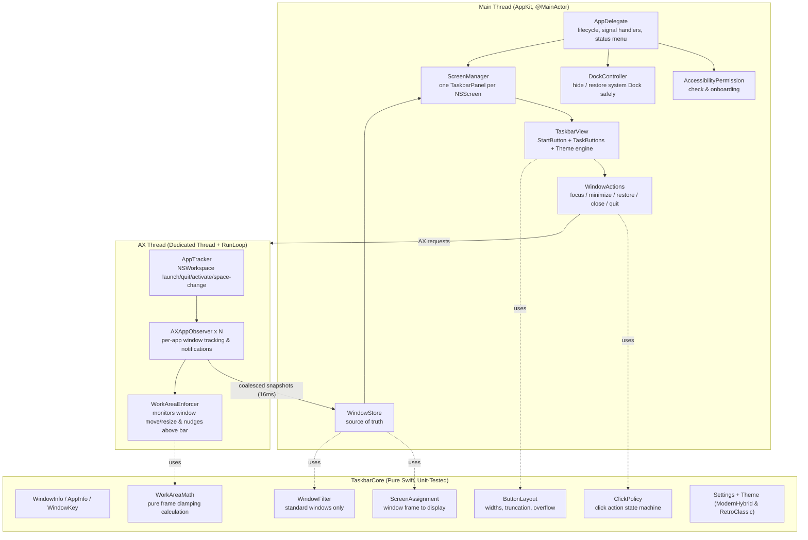

# Implementation Plan — Native Windows-style Taskbar for macOS

## Goal
A small, fast, native macOS agent application (`LSUIElement`) that replaces the Dock with a **Windows-style taskbar**:

- **One bar at the bottom of every display.** Each bar displays **that display's windows on its current Space**, plus minimized and hidden windows.
- **One button per window**, with app icon and truncated window title. Left-click focuses the window; clicking the already-focused window minimizes it; clicking a minimized window restores and focuses it. Right-click opens a context menu (Minimize/Restore, Close Window, Quit App).
- **Configurable Visual Style (Hybrid & Retro):**
  - **Modern Hybrid:** Native macOS frosted vibrancy (`NSVisualEffectView`), subtle rounded pill buttons, and system typography (`SF Pro`).
  - **Retro Classic:** Windows 98/2000 style with `#C0C0C0` gray background, 3D raised/sunken beveled borders, and classic typography.
  - Switchable live via settings and the status bar menu with zero bloat (pure AppKit custom drawing).
- **Screen Space Reservation via AX Nudger (`WorkAreaEnforcer`):** Floating bar paired with an active AX Nudger that automatically clamps maximized windows so their bottom edges (status bars, terminal prompts, input fields) remain visible above the taskbar, complete with recursion guards and settle debouncing.
- **Minimalist Start Button & Right Edge:** Start button triggers the user's preferred app launcher (Spotlight, Raycast, or Launchpad, configurable). The right edge remains clean and empty (relying on the macOS menu bar for clock/status).
- **Dock Replacement & Crash Safety:** The macOS system Dock is hidden during execution (`autohide = true` with delay) and safely restored upon quit, `SIGINT`/`SIGTERM` signals, crash, or via the menu bar status item and emergency terminal script.
- **100% Public APIs & Lightweight Footprint:** Uses standard Accessibility (`AXUIElement`) and `NSWorkspace` APIs (no fragile private SkyLight APIs, no Screen Recording permission prompts). Target <40 MB RAM and ~0.0% idle CPU.

---

## User Decisions & Alignments

1. **Visual Style:** Both **Modern Hybrid** and **Retro Classic** are supported via a lightweight theme engine without architectural overhead. 1-to-1 button model (no multi-window grouping popups).
2. **Screen Space Reservation:** **Floating bar with AX Nudger** (`WorkAreaEnforcer`) included directly in the core build rather than deferred.
3. **Multi-Display & Spaces:** **Per-display, current Space only.** 100% public Apple APIs for rock-solid stability across macOS versions.
4. **Start Button & Tray:** **Minimalist.** Start button triggers launcher shortcut; right edge is empty.
5. **Code Signing:** Signed using Apple Development certificate via Xcode (with local self-signed certificate fallback in build scripts).
6. **Documentation:** Comprehensive root `README.md` and modular markdown files in `docs/` (`ARCHITECTURE.md`, `BUILD_AND_RELEASE.md`, `CONFIGURATION.md`, `TESTING.md`) for human developers and future AI agents.
7. **Centralized Configuration:** Dedicated `config/` directory for build/packaging settings, paired with a strongly typed `Settings.swift` for runtime preferences.
8. **Performance-First & Pragmatic Extensibility:**
   - **Zero Bloat / No Over-Engineering:** Avoid deep abstraction layers, unnecessary dependency injection frameworks, or bloated view hierarchies. Favor flat structures, value types (Swift structs), and direct AppKit drawing.
   - **Hard Performance Targets:** <40 MB RAM, ~0.0% idle CPU, zero main-thread hangs (via dedicated AX background thread with timeouts), cached icons (16x16 icon cached per app bundle ID), and localized redraws (`setNeedsDisplay`).
   - **Clean Extensibility by Design:** Keep extension points straightforward:
     - `Theme` as a clean enum/struct with clear properties (easy to add new palettes or styles later).
     - `Settings` as a Codable struct (adding future toggles like auto-hide or grouping is one new property).
     - `ButtonLayout` as a pure function (easy to plug in grouping or multi-row layout later).
     - `WindowFilter` as a single predicate (easy to add per-app exclusion lists).
     - `WorkAreaMath` as pure frame geometry.

---

## Architecture Overview



### Key Design Tenets

1. **Dedicated AX Thread & Non-Blocking UI:** Every Accessibility IPC call runs on a background thread with strict timeouts (`AXUIElementSetMessagingTimeout`, ~0.3s). The main UI thread never blocks on hung or unresponsive third-party apps.
2. **Event-Driven, Zero Timers:** State updates are triggered strictly by `NSWorkspace` and `AXObserver` events. Idle CPU stays near 0.0%.
3. **Pure Logic in `TaskbarCore`:** Frame calculations, button layouts, click state machines, and nudger geometry are decoupled from AppKit/AX and 100% unit-tested.
4. **Recursion-Proof AX Nudger:** The `WorkAreaEnforcer` validates whether a window is already positioned correctly before issuing an AX resize, preventing feedback loops with AX move/resize notifications.
5. **Robust Signal Handling for Dock Safety:** POSIX signal traps (`SIGINT`, `SIGTERM`, `SIGHUP`) and `atexit` hooks guarantee that the system Dock is restored even if the process is terminated from the terminal.

---

## Project Layout

```
mac-dock-gemini/
├── Package.swift                     # Swift Package definition (TaskbarCore + TaskbarApp + Tests)
├── README.md                         # Primary project handbook & AI agent guide
├── .gitignore
├── config/
│   └── build.env                     # Centralized build/packaging config (App name, bundle ID, paths)
├── docs/
│   ├── ARCHITECTURE.md               # Threading model, IPC, AX concurrency, and data flow
│   ├── BUILD_AND_RELEASE.md          # Xcode setup, code signing, packaging, and installation
│   ├── CONFIGURATION.md              # Build configuration & runtime user preferences reference
│   └── TESTING.md                    # Unit test specs, mock harness, and manual test checklist
├── Resources/
│   └── Info.plist                    # LSUIElement = true, bundle ID, versioning
├── scripts/
│   ├── build-app.sh                  # Release compile, .app assembly, codesign, ~/Applications install
│   └── restore-dock.sh               # Standalone emergency Dock restore script
├── Sources/
│   ├── TaskbarCore/                  # Pure Swift business logic (Zero OS/AppKit dependencies)
│   │   ├── Model/
│   │   │   ├── WindowInfo.swift
│   │   │   ├── AppInfo.swift
│   │   │   └── WindowKey.swift       # Stable window identifier (CFHash/CFEqual wrapper)
│   │   ├── Logic/
│   │   │   ├── ScreenAssignment.swift
│   │   │   ├── ButtonLayout.swift
│   │   │   ├── ClickPolicy.swift
│   │   │   ├── WindowFilter.swift
│   │   │   ├── WorkAreaMath.swift    # Pure coordinate clamping calculations
│   │   │   └── WindowStore.swift
│   │   └── Config/
│   │       ├── Settings.swift        # Codable runtime preferences (UserDefaults / JSON)
│   │       └── Theme.swift           # Theme definitions (.modernHybrid and .retroClassic)
│   └── TaskbarApp/                   # AppKit shell and system integration
│       ├── main.swift                # App entry point, signal handlers, atexit hook
│       ├── AppDelegate.swift         # Lifecycle, status bar menu, permission check
│       ├── StatusMenu.swift          # Menu bar icon: Theme toggle, Nudge toggle, Restore Dock, Quit
│       ├── System/
│       │   ├── AccessibilityPermission.swift
│       │   ├── DockController.swift  # Dock autohide + autohide-delay manipulation
│       │   └── Launcher.swift        # Triggers Spotlight, Raycast, or Launchpad
│       ├── Tracking/
│       │   ├── AXThread.swift        # Dedicated background run loop
│       │   ├── AppTracker.swift      # NSWorkspace application observer
│       │   ├── AXAppObserver.swift   # Per-app AXObserver notification handler
│       │   ├── AXElement+Attributes.swift
│       │   └── WorkAreaEnforcer.swift # Nudges maximized windows above the bar
│       ├── Actions/
│       │   └── WindowActions.swift   # Focus, raise, minimize, restore, close, quit
│       └── UI/
│           ├── ScreenManager.swift   # Multi-display lifecycle and positioning
│           ├── TaskbarPanel.swift    # Non-activating, borderless NSPanel
│           ├── TaskbarView.swift     # Container view managing Start button & TaskButtons
│           ├── TaskButton.swift      # Custom-drawn AppKit button (supports both themes)
│           ├── StartButton.swift     # Custom-drawn Start button
│           └── BevelDrawing.swift    # 3D bevel drawing utilities for retro mode
└── Tests/
    └── TaskbarCoreTests/
        ├── ScreenAssignmentTests.swift
        ├── ButtonLayoutTests.swift
        ├── ClickPolicyTests.swift
        ├── WindowFilterTests.swift
        ├── WorkAreaMathTests.swift
        └── WindowStoreTests.swift
```

---

## Configuration Architecture

### 1. Build & Packaging Configuration (`config/build.env`)
A single file defining project metadata:
```bash
APP_NAME="Taskbar"
BUNDLE_ID="com.local.taskbar"
APP_VERSION="0.1.0"
MIN_MACOS_VERSION="14.0"
INSTALL_DIR="~/Applications"
SIGN_IDENTITY="Apple Development" # Or empty for local self-signed auto-detection
```

### 2. Runtime User Preferences (`Sources/TaskbarCore/Config/Settings.swift`)
Saved to `UserDefaults` (domain: `com.local.taskbar`):
- `themeStyle`: `.modernHybrid` (default) or `.retroClassic`
- `barHeight`: `30.0` pt
- `maxButtonWidth`: `160.0` pt
- `minButtonWidth`: `28.0` pt
- `launcherAction`: `.spotlight`, `.raycast`, or `.customPath(String)`
- `enableAXNudger`: `true`
- `hideSystemDock`: `true`

---

## Detailed Component Specifications

### 1. Theme Engine (`Theme.swift` & `TaskButton.swift`)
- **`ThemeStyle` Enum:** `.modernHybrid` vs `.retroClassic`.
- **Hybrid Drawing:**
  - Backing: `NSVisualEffectView` with `.underWindowBackground` or `.menu` material, `.behindWindow` blending.
  - Buttons: Pill shape with 4pt corner radius. Subtle translucent borders and background tints on hover/press. Typography: `NSFont.systemFont(ofSize: 11, weight: .medium)`.
- **Retro Drawing:**
  - Backing: Solid `#C0C0C0` gray fill with top 1pt highlight border.
  - Buttons: Classical 3D beveled borders:
    - Normal: Top/Left `#FFFFFF`, Bottom/Right `#404040`.
    - Focused / Pressed: Sunken bevel (Top/Left `#404040`, Bottom/Right `#FFFFFF`), background `#DCDCDC`.
    - Typography: `NSFont.systemFont(ofSize: 11, weight: .regular)` or Tahoma/Geneva style.

### 2. WorkAreaEnforcer & WorkAreaMath (`WorkAreaEnforcer.swift`, `WorkAreaMath.swift`)
- **Pure Math:** `WorkAreaMath.clampWindowFrame(windowFrame: CGRect, screenVisibleFrame: CGRect, taskbarHeight: CGFloat) -> CGRect?`
  - If a window's bottom edge extends into the taskbar's vertical reservation:
    - Calculates new height = `currentHeight - overlapAmount`.
    - Returns updated `CGRect`.
    - If no overlap or if difference < 2pt, returns `nil` (no-op).
- **Enforcer Behavior:**
  - Listens to `kAXWindowMovedNotification` and `kAXWindowResizedNotification` on the AX thread.
  - Debounces by ~100ms so user resizing is smooth.
  - Recursion guard: Ignores notifications generated by its own resize adjustments.
  - Ignores dialogs, floating panels, or native full-screen windows.

### 3. Dock Safety (`DockController.swift`)
- **Original Settings Persistence:** Before altering any preferences, original `autohide` and `autohide-delay` values are read and persisted into `UserDefaults`.
- **Hiding:**
  - `defaults write com.apple.dock autohide -bool true`
  - `defaults write com.apple.dock autohide-delay -float 1000`
  - `killall Dock`
- **Restoration:**
  - Triggered by `applicationWillTerminate`, POSIX signal handlers (`SIGINT`, `SIGTERM`), status menu click, or `./scripts/restore-dock.sh`.
  - Reverts values to original settings or deletes keys if they were previously unset.
  - `killall Dock` to reload system Dock.

---

## Milestones

| Milestone | Scope & Deliverables | Verification Criteria |
|---|---|---|
| **M0: Scaffold, Config & Documentation** | Package.swift, Info.plist, `config/build.env`, scripts (`build-app.sh`, `restore-dock.sh`), `README.md`, and modular `docs/`. Git init. | `scripts/build-app.sh --install` builds `Taskbar.app`, signs it, and installs to `~/Applications/Taskbar.app`. All doc files exist. |
| **M1: Panels & Theme Engine** | Multi-screen `TaskbarPanel` (`NSPanel`), `TaskbarView`, `StartButton`. Live switching between Modern Hybrid and Retro Classic. | Both themes render cleanly on all attached screens. Plugging/unplugging displays updates layout. Start button launches Spotlight/Raycast. |
| **M2: Window Tracking & Core Tests** | `AXThread`, `AppTracker`, `AXAppObserver`, `WindowStore`, and pure logic in `TaskbarCore` with full unit tests. | `swift test` passes 100%. Console logs correct window list per display for active Space only. |
| **M3: Task Buttons & Window Actions** | `TaskButton` rendering per window with icons/titles, left-click focus/minimize/restore, right-click context menu (Close/Quit), active window highlight. | Clicking unfocused window raises and activates it; clicking focused window minimizes it; right-click closes window. |
| **M4: AX Nudger (`WorkAreaEnforcer`)** | `WorkAreaMath` unit tests + `WorkAreaEnforcer` on AX thread. Clamps maximized windows above the taskbar. | Maximizing a window (e.g. Terminal, VS Code, Notes) stops above the bar; status bars and terminal input remain completely unobstructed. |
| **M5: Dock Controller & System Safety** | `DockController` hide/restore, POSIX signal traps (`SIGINT`, `SIGTERM`, `atexit`), menu bar status icon (Theme toggle, Nudge toggle, Restore Dock, Quit). | Dock is hidden on launch and restored cleanly on quit or kill. Menu item and standalone script restore Dock. |
| **M6: Polish & Verification** | Button overflow handling (`»`), performance benchmarking (<40 MB RSS, ~0.0% idle CPU), documentation final review. | Passes automated and manual verification checklist. |

---

## Verification Plan

### Automated Testing
```bash
# Run pure logic unit tests
swift test

# Build release bundle, sign, and install
./scripts/build-app.sh --install

# Verify code signature
codesign --verify --deep --strict ~/Applications/Taskbar.app
```

### Manual Test Checklist
1. **Permission Flow:** First run prompts for Accessibility. Once granted, bars populate immediately without requiring an app relaunch.
2. **Display Isolation:** Each display shows only the windows physically residing on it. Dragging a window between monitors moves its button.
3. **Space Switching:** Changing virtual desktops instantly updates the bar to reflect windows on that active desktop. Minimized windows remain accessible.
4. **Window Interaction:**
   - Click unfocused button -> Brings window to front and focuses app.
   - Click focused button -> Minimizes window.
   - Click minimized button -> Restores and focuses window.
5. **AX Nudger:** Double-clicking title bar or pressing maximize in window managers stops the window directly above the taskbar; no UI elements hidden.
6. **Theme Toggle:** Switching between Modern Hybrid and Retro Classic in the menu bar instantly updates all bars without restarting.
7. **Dock Recovery:** Quitting via menu bar or terminating with `kill -SIGTERM` immediately restores the system Dock. Running `./scripts/restore-dock.sh` works independently.
8. **Performance & Concurrency:** With 30+ open windows, memory stays < 40 MB and idle CPU stays ~0.0%. Freezing an external app with `kill -STOP <pid>` does not hang the Taskbar UI.
