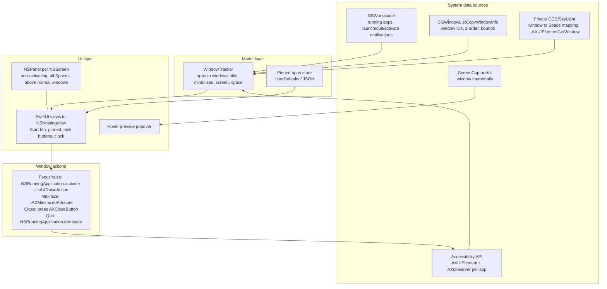

# macOS Windows-style Taskbar — Research & Architecture Options

## Goal
Build a macOS app that replaces the default Dock with a Windows-style taskbar: one bar along a screen edge with a button per window (or per app), pinned apps, and click-to-focus/minimize behavior.

This doc covers what already exists, how those apps work, what macOS won't let us do, a recommended architecture, and the questions to settle before I write the implementation plan.

---

## 1. Existing apps

| App | License / Price | Model | Notable features | Takeaways |
|---|---|---|---|---|
| **uBar 4** (Brawer Software) | Closed, $30 one-time | Full Dock replacement; Dock or Taskbar mode | Window grouping (Always/Never/Auto), hover previews, per-monitor bars, any edge, up to 5 rows, clock + hover calendar, "uBar menu" (Start-like), badges, CPU/RAM on Ctrl, app progress, themes | The most complete feature set to compare against. Users report it sometimes feels "janky" next to native UI, and **maximized windows overlap it** because it can't reserve screen space. |
| **Taskbar** (lawand.io) | Closed, paid | Literal Windows taskbar | A button per window, hover previews, pinning | Proof that a "pure" Win-style UX has an audience |
| **OpenTaskbar** | OSS, experimental | Menu-bar utility + taskbar | <3 MB, window previews, pinning, sorting | The closest OSS analogue, but immature |
| **Docky** (josejuanqm) | OSS GPLv3, free | Dock replacement; can run **alongside, mirror, or fully replace** the system Dock | Widgets, Launchpad, live window switcher, scripted actions | Swift/SwiftUI, Xcode 16, macOS 14+. Good reference for how to hide or replace the Dock |
| **DockDoor** (ejbills) | OSS, free (+Pro) | *Adds to* the native Dock | Live previews on Dock hover (incl. other Spaces, minimized, hidden), Alt-Tab, close/min/fullscreen from preview | Swift, macOS 13+. **Best reference for window enumeration + previews** |
| **AltTab** (lwouis) | OSS GPL | Window switcher | Lists every window across Spaces/screens, including minimized ones | **The standard reference** for the AX + private CGS/SkyLight window-tracking code |
| **ActiveDock** | Closed, paid | Enhanced dock (icons, not buttons) | Groups, folders, previews | Less relevant (dock style, not taskbar) |

> [!NOTE]
> Every serious app here is **native Swift/AppKit (plus SwiftUI)**, **not sandboxed**, distributed **outside the Mac App Store**, and asks for **Accessibility** permission (and **Screen Recording** if it shows previews).

---

## 2. How these apps work (common architecture)

Key building blocks:
- **App type:** an agent app (`LSUIElement = YES`), so it has no Dock icon and no menu bar of its own, with a status-bar item for settings.
- **The bar window:** an `NSPanel` set to `.nonactivatingPanel`, `level` ≈ `.statusBar` or `.dock`, and `collectionBehavior = [.canJoinAllSpaces, .stationary, .fullScreenAuxiliary/.ignoresCycle]`. Clicking the bar must not take focus away from the app you're working in.
- **Window discovery:** public APIs only show windows on the *current* Space. Listing windows on *other* Spaces and mapping AX elements to `CGWindowID` takes private symbols (`_AXUIElementGetWindow`, `CGSCopySpacesForWindows`, and sometimes `_AXUIElementCreateWithRemoteToken` to brute-force AX elements). AltTab and DockDoor both do this.
- **Live updates:** `AXObserver` notifications (`kAXWindowCreated`, `kAXUIElementDestroyed`, `kAXTitleChanged`, `kAXWindowMiniaturized`, `kAXFocusedWindowChanged`, …) plus `NSWorkspace` notifications. Avoid polling, though a slow reconcile timer is a common safety net because AX can be flaky.
- **Previews:** `CGWindowListCreateImage` is **obsoleted in macOS 15**. The supported path is **ScreenCaptureKit** (`SCScreenshotManager.captureImage`), which needs the Screen Recording permission. On macOS 15+ that permission also triggers recurring system re-confirmation prompts.

---

## 3. Platform limitations

> [!WARNING]
> **No public API reserves screen space.** Only the system Dock and menu bar shrink `NSScreen.visibleFrame`. A third-party bar is just a floating window, so maximized/zoomed windows and window-snapping tools will cover it. This is the main complaint about uBar.

Ways to deal with it:

| Option | How | Pros | Cons |
|---|---|---|---|
| **A. Accept overlap** | Bar floats above windows | Simple | Bar covers the bottom of maximized windows |
| **B. "Dock shim" hack** | Keep the system Dock **visible** (not auto-hidden) on the same edge, with tile size/magnification set so its reserved band matches our bar's height, then draw our opaque bar on top of it | Real `visibleFrame` reservation, so zoom/maximize and Rectangle all respect it | Hacky. Only works on the screen that has the Dock. Changes the user's Dock prefs (we must restore them). Height can only be matched in steps |
| **C. AX "window nudger"** | Watch window move/resize events and push back any window that overlaps the bar | Works on every monitor | Visible "snap back" jitter. Some apps resist AX resizing. More AX traffic |
| **B + C** | Shim on the main screen, nudger on secondary screens | Best coverage | Most complex |

> [!IMPORTANT]
> **The Dock process can't be killed or removed.** `Dock.app` also runs Mission Control, Spaces, Launchpad, Cmd-Tab, notification-badge plumbing, and the desktop wallpaper on some versions. Every replacement *hides* it instead: `autohide = true` plus `autohide-delay = 1000` (`defaults write com.apple.dock …; killall Dock`). Our app should save and restore these prefs.

Other limitations to know about:
- **Accessibility permission is tied to the code signature.** With ad-hoc signing, every rebuild invalidates the permission and you have to re-grant it. A stable signing identity (Apple Development cert or a self-signed local cert) avoids this during development.
- **Badges and progress:** no public API exposes other apps' Dock badges. uBar reads them through AX on the Dock process (`AXStatusLabel` on Dock tiles), which is fragile.
- **Full-screen apps:** the bar should hide in native full-screen Spaces.
- **Stage Manager / Mission Control:** expect odd behavior. Most apps just ignore it.
- **Private APIs:** they can break on any macOS update, and they rule out the App Store. Fine for personal or Developer-ID distribution.
- **Windows-style "jump lists":** no equivalent. The closest substitutes are an app's Dock menu (`applicationDockMenu`, not accessible from outside) or recent documents (limited).

---

## 4. Tech stack

| Choice | Recommendation | Why |
|---|---|---|
| Language | **Swift 6** | Used by every reference app. C interop with AX/CG is straightforward |
| UI | **AppKit shell (NSPanel) + SwiftUI content** | SwiftUI alone can't build a non-activating, all-Spaces panel. AppKit can |
| Build | **Xcode project** *or* **SwiftPM + script to assemble `.app`** | See environment finding below |
| Min OS | macOS 14 or 15 | ScreenCaptureKit screenshot API, `@Observable` |
| Not recommended | Electron / Tauri / Flutter | Still need native AX/CG/SCK bridges. Heavier, worse at window-level control |

### Environment findings
- macOS **15.7.4** on Apple Silicon, Swift **6.1.2**.
- **Xcode is not installed**, only the Command Line Tools. A SwiftPM-only build plus a small script that assembles `Taskbar.app` (Info.plist with `LSUIElement`, plus codesign) works fine. Installing Xcode would add SwiftUI previews, Instruments, and easier signing.

---

## 5. Suggested MVP vs later phases (for discussion)

| Phase | Features |
|---|---|
| **MVP** | Bottom bar on the main screen; Start button (app launcher list); pinned apps; a button per running app *or* per window (title + icon); click = focus / minimize-if-focused (Windows behavior); right-click menu (close window, quit, pin/unpin); active-window highlight; clock; hide system Dock (with restore); hide in full-screen |
| **Phase 2** | Hover previews (ScreenCaptureKit); grouping modes; drag to reorder; multi-monitor bars that show only windows on that screen; screen-space strategy B/C |
| **Phase 3** | Start menu search, badges, settings UI, themes (Win11 look), launch at login, auto-update |

---

## 6. Open questions

> [!IMPORTANT]
> These decide the architecture and MVP scope. Please answer what you can.

1. **Button model:** a button **per window** (classic Win7/XP, labels shown) or **per app, grouped** (Win10/11 default, icons only and expand on hover)? Or configurable?
2. **Screen space:** which strategy, A, B, C, or B+C? (I'd suggest prototyping **B** early since it carries the most risk.)
3. **Multi-monitor:** do you use more than one display? A bar on every screen showing only that screen's windows?
4. **Spaces:** should the taskbar show windows from **all** Spaces or only the current one? "All" requires private APIs.
5. **Start button:** a real Start menu (app grid + search), or just open Launchpad/Spotlight/Raycast?
6. **Visual style:** Windows 11 look (centered icons, Mica-like blur), classic Windows, or macOS-native vibrancy?
7. **Previews:** needed in the MVP? They bring in the Screen Recording permission and its recurring prompts.
8. **Distribution:** personal use only, or eventually public/open source? This affects private-API use, signing (Developer ID + notarization), and licensing (e.g., whether we can borrow GPL code from AltTab or DockDoor).
9. **Toolchain:** OK to stay SwiftPM-only, or will you install Xcode?
10. **System tray area:** macOS already has the menu bar for status items. Do you want a clock/tray area on the taskbar anyway, or keep it minimal?
