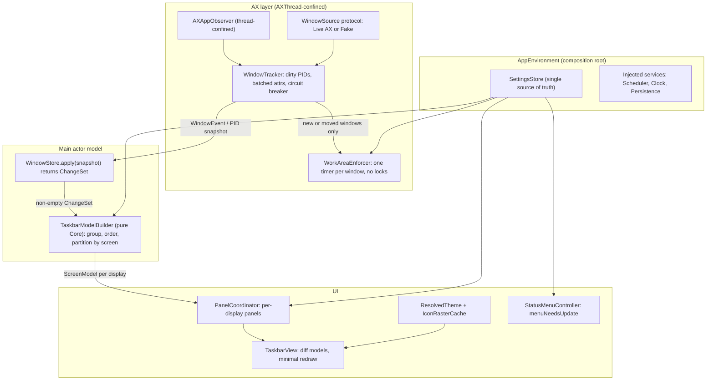

# Taskbar (mac-dock-gemini) — Codebase Audit

**Date:** 2026-10-12  **Scope:** `Sources/` (~6.9k LOC), `Tests/` (158 tests), `docs/`, `scripts/`
**Lenses:** (1) maintainability & extensibility, (2) code smell / duplication / architecture / logic flaws, (3) runtime performance, (4) test coverage.

> **Method note:** This was a static review: I read every tracking, UI, and core-logic file, plus a sample of the tests. I couldn't run `swift build` / `swift test`, because the sandbox blocks the SwiftPM module cache. Each finding below cites code paths you can check directly.

---

## 0. Executive Summary

The codebase is tidy at the micro level. It has clear module boundaries (`TaskbarCore` is pure, `TaskbarKit` holds the UI), centralized constants and strings, view recycling, and pure layout math with good unit tests. The serious problems are at the **system level**:

1. **Settings are split three ways.** `AppDelegate`, `ScreenManager`, and `StatusMenu` each keep their own copy, and two of them save to disk. **This loses user data** (pins, dock toggle) — see F-01.
2. **The work done per event has no upper bound.** Any AX notification, even a tab-title change in one app, triggers a **full system-wide AX rescan**. That rescan then queues **3 delayed enforcer passes for every visible window**, and finally **repaints every button on every display**. "Idle" is ~0% CPU only because nothing is happening. Under real usage (browser tabs, Slack, terminals that update their titles) the work grows as *apps × windows × IPC calls*.
3. **One serial AX thread with no protection against a hung app.** A single beachballing app can stall all tracking, window clamping, and taskbar clicks for seconds.
4. **Tests cover the pure parts well and the risky parts not at all.** The parts most likely to regress (reconcile, enforcer state machine, observer lifecycle, settings flows) have no unit tests. They're hard to test because of singletons and static AX calls.

### Top 6 actions (best return for the effort)

| # | Action | Fixes |
|---|---|---|
| 1 | One `SettingsStore` as the only source of truth | F-01, F-14, F-15 |
| 2 | Incremental per-PID reconcile + batched AX attribute fetch | F-02, F-04 |
| 3 | Remove the enforcer call from reconcile; one timer per window | F-03, F-08 |
| 4 | Store returns a change set → skip the UI pass when nothing changed; compare before setting `theme` | F-05 |
| 5 | Cache resolved theme styles and pre-rasterized icons for `draw(_:)` | F-06, F-19 |
| 6 | Inject protocols (`WindowSource`, `Scheduler`, `SettingsPersistence`) → unit-test the core runtime | F-12, T-01..T-03 |

---

## 1. Priority Legend

| Priority | Meaning |
|---|---|
| **P0 — Critical** | Real bug that loses user data, or a performance flaw that grows with normal usage. Fix first. |
| **P1 — High** | Correctness risk, race condition, or a clear performance loss on a hot path. |
| **P2 — Medium** | Maintainability or architecture debt that slows down future features. |
| **P3 — Low** | Polish, consistency, docs. |

## 2. Findings Index

| ID | Pri | Area | Title |
|---|---|---|---|
| F-01 | P0 | Logic / Arch | Split-brain `Settings` → saves overwrite each other (data loss) |
| F-02 | P0 | Perf | Every AX event triggers a full system-wide AX rescan |
| F-03 | P0 | Perf | Reconcile queues 3 enforcer passes for every visible window |
| F-04 | P0 | Perf / Robustness | One serial `AXThread` can be blocked by a hung app |
| F-05 | P1 | Perf | Unconditional full UI refresh, repaint of every button, `CGWindowList` call for each screen |
| F-06 | P1 | Perf | Allocations and high-res icon resampling inside `draw(_:)` |
| F-07 | P1 | Concurrency | `AXAppObserver` lifecycle races and duplicate registrations |
| F-08 | P1 | Concurrency / Perf | `WorkAreaEnforcer`: IPC under a lock, off-main `NSScreen`, timer fan-out, leaks |
| F-09 | P1 | Logic | Space-change debounce cancels itself; redundant UI pass |
| F-10 | P1 | Design | String-typed custom order, applied twice, allocations in sort; stale drag indices |
| F-11 | P1 | Perf / Robustness | `DockController` blocks the main thread with subprocesses; no crash recovery |
| F-12 | P2 | Testability | Singletons and static action APIs; tests change real windows |
| F-13 | P2 | Concurrency | `WindowStore` marked `@unchecked Sendable` with no synchronization |
| F-14 | P2 | Arch | God objects and callback sprawl (`AppDelegate`, `StatusMenu`, `ScreenManager`) |
| F-15 | P2 | Duplication | Custom-theme application and `themeStyle` legacy mapping duplicated |
| F-16 | P2 | Duplication / Logic | `TaskbarView` re-derives layout width with a different formula than the engine |
| F-17 | P2 | Duplication | Drag coordinator: task and pinned paths ~90% identical |
| F-18 | P2 | Dead code | Unwired features (`TaskbarEdge`, `AutoHideStateMachine`) and legacy shims |
| F-19 | P2 | Logic / Perf | Icon cache keying and grouping are broken for apps without a bundle ID |
| F-20 | P2 | Logic | `windowID` falls back to `CFHash` (unstable, can collide) |
| F-21 | P2 | Logic / Perf | Fullscreen detection relies on a bounds heuristic |
| F-22 | P3 | Docs / Risk | Private API use contradicts the "zero private APIs" claim in the docs |
| F-23 | P3 | Hygiene | Constants bypass `TaskbarConstants`; display-ID helper duplicated 6× |
| F-24 | P3 | A11y | Task, Start, and Overflow buttons expose no accessibility label or role |
| F-25 | P3 | UX | Accessibility-permission polling gives up after 30 s |
| F-26 | P3 | Docs | Docs and plans total ~5.2k lines and keep drifting from the code |
| F-27 | P3 | UX | Group "primary window" is the oldest window, not the most recently used |
| T-01 | P1 | Tests | The core runtime (tracker, enforcer, observer, settings flows) is untested |
| T-02 | P2 | Tests | Integration tests depend on a real app (TextEdit) and have side effects |
| T-03 | P2 | Tests | "Stress" tests aren't performance tests; no perf regression guard |
| T-04 | P3 | Tests | No coverage measurement or thresholds |

---

## 3. Detailed Findings

### F-01 · P0 · Split-brain `Settings` → data loss
**Where:** [AppDelegate.swift](file:///Users/obertguo/Documents/mac-dock-gemini/Sources/TaskbarKit/AppDelegate.swift#L8-L185), [ScreenManager.swift](file:///Users/obertguo/Documents/mac-dock-gemini/Sources/TaskbarKit/UI/Management/ScreenManager.swift#L9-L205), [StatusMenu.swift](file:///Users/obertguo/Documents/mac-dock-gemini/Sources/TaskbarKit/UI/Menu/StatusMenu.swift#L9-L18)

`Settings` is a value type. `AppDelegate.settings` and `ScreenManager.settings` are **independent copies**, and **both call `save()`**. `StatusMenu` keeps a third mirror of 10 fields.

**Reproduction:**
1. Pin an app from the taskbar context menu. Only `ScreenManager.settings` is updated and saved.
2. Toggle **Hide System Dock** in the status menu. `AppDelegate` saves *its own* copy, whose `pinnedApps` is stale, and that overwrites the new pin on disk.
3. Relaunch → the pin is gone.

The reverse also happens. Toggle the dock, then change the bar height: `ScreenManager.updateBarHeight` saves last with a stale `hideSystemDock`, so the dock toggle is reverted on disk. Every `AppDelegate` closure saves first, then a `ScreenManager.updateX` method saves again, so whichever copy saves last wins.

**Fix:** Introduce a single `@MainActor final class SettingsStore` owned by the composition root:
```swift
@MainActor final class SettingsStore {
    private(set) var value: Settings
    private let persistence: SettingsPersistence      // protocol → UserDefaults / in-memory for tests
    private var observers: [(Settings, Settings) -> Void] = []
    func update(_ mutate: (inout Settings) -> Void) {
        let old = value; mutate(&value)
        guard value != old else { return }
        persistence.save(value)
        observers.forEach { $0(old, value) }
    }
    func observe(_ cb: @escaping (Settings, Settings) -> Void) { observers.append(cb) }
}
```
`ScreenManager`, `StatusMenu`, the dock service, and the enforcer subscribe and react to the *diff* (`old.barHeight != new.barHeight`, and so on). No other component holds a copy of `Settings`. This also deletes most of `AppDelegate`'s 15 closures (F-14).

---

### F-02 · P0 · Every AX event triggers a full system-wide AX rescan
**Where:** [AppTracker.reconcileWindows](file:///Users/obertguo/Documents/mac-dock-gemini/Sources/TaskbarKit/Tracking/AppTracker.swift#L159-L280), [AXAppObserver.handleNotification](file:///Users/obertguo/Documents/mac-dock-gemini/Sources/TaskbarKit/Tracking/AXAppObserver.swift#L155-L173)

Every observer callback (title changed, focus changed, moved, resized, created, destroyed, in *any* app) calls `scheduleReconcile`. That runs `reconcileWindows`, which loops over **every regular app → every window**, making roughly 9–10 Mach IPC round-trips per window: `windows`, `role`, `subrole`, `position`, `size`, `minimized`, `main`, `AXFullScreen`, `title`, `_AXUIElementGetWindow`, plus `observeWindow` (another `windowID` call). With 15 apps and 40 windows that's about **400+ IPC calls per event**. A browser updating a tab title every second ("(3) Inbox") keeps this running continuously. The 16 ms trailing debounce only merges bursts. It doesn't reduce the work per pass.

**Fix (incremental reconcile):**
- Track `dirtyPIDs: Set<pid_t>` (and optionally dirty window IDs). Observer callbacks pass `(pid, notification, element)` instead of a bare `() -> Void`.
- Window-level notifications (`title`, `miniaturized`, `moved`) → refresh **only that window**. App-level `windowCreated`/`destroyed` → refresh only that PID.
- Keep the full sweep for: app launch/terminate, space change, permission granted, and an optional low-frequency safety sweep (e.g. every 30 s while the app is active, never when idle).
- Fetch attributes in batches with `AXUIElementCopyMultipleAttributeValues(win, [role, subrole, position, size, minimized, main, title, "AXFullScreen"], 0, &values)`. That's **one IPC call instead of ~8**.
- Cache `AXUIElement ↔ WindowKey` on the AX side so `windowID` isn't recomputed and `WindowActions.findWindowElement` (which enumerates all windows on every click) becomes an O(1) lookup.

**Expected impact (estimate):** 10–50× fewer IPC calls under normal title churn. Event-to-paint latency drops because each pass is tiny.

---

### F-03 · P0 · Reconcile queues 3 enforcer passes for every visible window
**Where:** [AppTracker.swift#L236-L239](file:///Users/obertguo/Documents/mac-dock-gemini/Sources/TaskbarKit/Tracking/AppTracker.swift#L236-L239), [WorkAreaEnforcer.handleWindowMovedOrResized](file:///Users/obertguo/Documents/mac-dock-gemini/Sources/TaskbarKit/Tracking/WorkAreaEnforcer.swift#L71-L178)

Inside the reconcile loop, every non-minimized window calls `WorkAreaEnforcer.shared.handleWindowMovedOrResized(..., isResize: false)`. Each call schedules **3 `DispatchQueue.global().asyncAfter`** blocks (150 / 400 / 650 ms). Each block hops to `AXThread`, and each `evaluateAndClamp` makes ~5 IPC calls (`minimized`, `fullScreen`, `subrole`, `position`, `size`). With 40 windows, **one focus change** creates **120 timers and ~600 more IPC calls**, plus the reconcile itself. And because reconcile runs on every event, this repeats constantly.

**Fix:**
- Remove the enforcer call from reconcile. Enforce only on (a) `kAXWindowMoved`/`Resized` notifications, (b) **first sighting** of a new window (`store` reports it as an insertion), and (c) settings or screen changes (one sweep).
- Replace the 3-timer fan-out with **one rescheduled deadline per window** (see F-08).

---

### F-04 · P0 · One serial `AXThread` can be blocked by a hung app
**Where:** [AXThread.swift](file:///Users/obertguo/Documents/mac-dock-gemini/Sources/TaskbarKit/Tracking/AXThread.swift), the reconcile loop, [WindowActions](file:///Users/obertguo/Documents/mac-dock-gemini/Sources/TaskbarKit/Actions/WindowActions.swift)

All of these share one run loop: reconcile, observer callbacks, enforcer passes, **and click actions** (focus, minimize, close). The AX timeout is 0.3 s *per call*. A hung app with 5 windows costs about 5 × 10 × 0.3 s ≈ **15 s** of blocked thread per reconcile. During that time taskbar clicks queue up and observer events pile up. Reconcile also runs again for the hung app on every event from *other* apps.

**Fix:**
- **Circuit breaker per PID:** on `kAXErrorCannotComplete` (timeout), mark the PID `unresponsive(until: now + 5s)` and skip it in sweeps. Keep its last known windows (dim them) so the UI doesn't flicker.
- Lower the enumeration timeout (0.1–0.15 s). Keep 0.3 s only for user-initiated actions.
- Put **user actions first**: run click actions on a separate serial queue (AX calls are thread-safe per element), or keep a dedicated "interactive" AX thread so clicks never wait behind sweeps.
- Optional: run reconcile per PID on a small concurrent pool. Observer run-loop sources stay on `AXThread`.

---

### F-05 · P1 · Unconditional full UI refresh on every reconcile
**Where:** [ScreenManager.updateWindows](file:///Users/obertguo/Documents/mac-dock-gemini/Sources/TaskbarKit/UI/Management/ScreenManager.swift#L308-L341), [TaskbarView.updateWindows](file:///Users/obertguo/Documents/mac-dock-gemini/Sources/TaskbarKit/UI/Panels/TaskbarView.swift#L138-L278), [TaskButton.theme](file:///Users/obertguo/Documents/mac-dock-gemini/Sources/TaskbarKit/UI/Buttons/TaskButton.swift#L49-L53), [PinnedButton.theme](file:///Users/obertguo/Documents/mac-dock-gemini/Sources/TaskbarKit/UI/Buttons/PinnedButton.swift#L26-L30)

`onWindowsChanged` fires after every reconcile, **even when nothing changed**. Then, for **each panel**:
- `isScreenInFullScreen` calls `CGWindowListCopyWindowInfo`. That copies a dictionary for every on-screen window, **once per screen**, on the main thread.
- `updatePinnedApps` runs, and `isAppRunning` is evaluated **twice per pinned app** (once here, once in `updateWindows`). For pinned apps that *aren't running* (the common case) each check is `NSRunningApplication.runningApplications(withBundleIdentifier:)`.
- `existing.theme = theme` is set on every task and pinned button. The `didSet` **unconditionally** sets `needsDisplay = true`, so **every button on every display repaints on every AX event**.
- `layoutComponents()` runs at least twice (once from `updatePinnedApps`, once from `updateWindows`), and again from `layout()` / `setFrameSize`.
- `WindowStore.windows(forScreenID:)` re-runs screen assignment and sorting over all windows for each screen.

**Fix:**
1. `WindowStore.apply(snapshot) -> ChangeSet` (`inserted`, `removed`, `updated` keys, `focusChanged`). If the change set is empty, return early. Also keep a monotonically increasing `version`.
2. Guard every `didSet` with an equality check: `didSet { guard oldValue != theme else { return }; needsDisplay = true }`.
3. Maintain the running bundle-ID set from `NSWorkspace` launch/terminate notifications (O(1) lookup, no queries).
4. Compute fullscreen state **once per space change**, not per screen per update. Better, derive it from the `isFullScreen` values already in the store (F-21).
5. Partition windows by screen **once** per update (a single pass building `[screenID: [WindowInfo]]`).
6. Compare only the fields a button actually renders (`displayTitle`, `isMinimized`, `isAppHidden`, `count`, `bundleID`) before calling `needsDisplay`. Frame-only changes currently cause repaints because `WindowGroup ==` compares full `WindowInfo.frame`.

---

### F-06 · P1 · Allocations and high-res icon resampling inside `draw(_:)`
**Where:** [TaskButton.drawRetro/drawHybrid](file:///Users/obertguo/Documents/mac-dock-gemini/Sources/TaskbarKit/UI/Buttons/TaskButton.swift#L165-L307), [PinnedButton](file:///Users/obertguo/Documents/mac-dock-gemini/Sources/TaskbarKit/UI/Buttons/PinnedButton.swift#L113-L194), [StartButton.preferredWidth](file:///Users/obertguo/Documents/mac-dock-gemini/Sources/TaskbarKit/UI/Buttons/StartButton.swift#L23-L33), [GroupWindowRowsView.drawRows](file:///Users/obertguo/Documents/mac-dock-gemini/Sources/TaskbarKit/UI/Panels/GroupWindowRowsView.swift#L251-L345), [IconCache.prepareIcon](file:///Users/obertguo/Documents/mac-dock-gemini/Sources/TaskbarKit/UI/Management/IconCache.swift#L71-L89)

On every draw call the code creates `NSFont`, `NSMutableParagraphStyle`, an attributes dictionary, `NSAttributedString`, 3–6 `NSColor(rgba:)` conversions, `NSBezierPath`, and measures text with `str.size()`. That violates the project's own perf invariant ("zero allocations inside `draw(_:)`"). `StartButton.preferredWidth()` builds a font and measures text on every `layoutComponents()` call.

`prepareIcon` keeps **every representation ≥ 64 px**, including 512 and 1024 px. Each 16 pt draw then resamples from a large source, and the cache keeps those large reps alive.

**Fix:**
- Add a `ResolvedTheme` (Kit-side, built once per theme change) holding pre-built `NSColor`s, `NSFont`s for the regular/bold/medium weights, and paragraph styles. Store attribute dictionaries per state, e.g. `attrs[.focused]`, `attrs[.dimmed]`.
- Cache `preferredWidth` per theme ID and font size.
- **Rasterize icons once** to a bitmap of exactly `iconSize × backingScaleFactor` (`NSBitmapImageRep` / `CGContext`) and cache that by `(key, px)`. Drawing becomes a cheap blit, and the large reps are released.
- Optional: render icons with a `CALayer` (`contents = cgImage`) and draw only background and text. Hover then repaints without re-compositing the icon.

---

### F-07 · P1 · `AXAppObserver` lifecycle races and duplicate registrations
**Where:** [AppTracker.trackApp / handleAppActivated](file:///Users/obertguo/Documents/mac-dock-gemini/Sources/TaskbarKit/Tracking/AppTracker.swift#L76-L125), [AXAppObserver](file:///Users/obertguo/Documents/mac-dock-gemini/Sources/TaskbarKit/Tracking/AXAppObserver.swift)

1. **Duplicate creation.** At launch, `didLaunch` and then `didActivate` arrive back to back. `handleAppActivated` sees `observers[pid] == nil` because creation is still in flight on `AXThread`, removes the PID from `trackingAttemptedPIDs`, and starts a **second** `AXObserverCreate`. The first instance is overwritten in the dictionary, and its `deinit` → `invalidate()` then runs on **main**.
2. **Data race.** `onEvent` is read on `AXThread` in `handleNotification` without a lock, while `invalidate()` sets it to nil under `stateLock` from main. TSan would flag this.
3. **Main-thread AX IPC.** `invalidate()` (called from `untrackApp` and `deinit` on main) calls `AXObserverRemoveNotification` for every window, which breaks the project's "no AX on main" invariant.
4. **Double notifications.** `kAXWindowMoved` and `kAXWindowResized` are registered at **both** app level and window level, so each move fires twice. That doubles the enforcer and reconcile triggers.
5. Observers for PIDs that have no windows in the store are never pruned (pruning keys off `store.allWindows`).
6. `setTimeout(0.3)` is hardcoded instead of using `TaskbarConstants.Timing.axTimeout`.

**Fix:** Confine `AXAppObserver` to `AXThread`. Every mutation, including `invalidate()`, goes through `AXThread.shared.async`, so the locks can go away. Keep a `pending: Set<pid_t>` state in the tracker so creation can't run twice. Register move/resize at one level only (the app level works across windows). Prune observers against `runningApplications`, not against the store.

---

### F-08 · P1 · `WorkAreaEnforcer` concurrency and timer design
**Where:** [WorkAreaEnforcer.swift](file:///Users/obertguo/Documents/mac-dock-gemini/Sources/TaskbarKit/Tracking/WorkAreaEnforcer.swift)

- **IPC inside a lock:** `element.frame` (2 IPC calls, up to 0.6 s) runs inside `lock.withLock` ([L84-L96](file:///Users/obertguo/Documents/mac-dock-gemini/Sources/TaskbarKit/Tracking/WorkAreaEnforcer.swift#L84-L96)). Main-thread setters (`isEnabled`, `barHeight`, `configure`) can block on it.
- **`NSScreen.screens` read off-main** in the fallback path ([L198-L205](file:///Users/obertguo/Documents/mac-dock-gemini/Sources/TaskbarKit/Tracking/WorkAreaEnforcer.swift#L198-L205)). `NSScreen` is a main-thread API.
- **Timer fan-out:** 3 `asyncAfter` blocks per event. During a 60 Hz window drag that's about 180 dispatches per second, almost all thrown away by the generation check. The three pass bodies are copy-pasted.
- **Unbounded deferral chains:** the mouse-down branch reschedules `evaluateAndClamp` *without* a generation check. Each of the 3 passes can start its own polling chain while the button is held.
- **Eager log formatting:** `logNudge(_ msg: String)` builds the interpolated string on every event at `.info`, so the `os_log` lazy formatting is lost.
- **Wall-clock time:** `Date()` is used for intervals. Use a monotonic clock (`ContinuousClock` / `DispatchTime`).
- **Leaks:** the per-window dictionaries are cleaned only when a destroy notification arrives. If an app quits without sending one, the entries stay forever.
- **Latent multi-edge bug:** the enforcer only calls `setSize`. For `.top` and `.left`, `WorkAreaMath` returns a moved origin that is never applied.

**Fix:** Run all enforcer logic on `AXThread` and drop the locks. Configuration arrives via `AXThread.async`, and the screen list is pushed from main. For each window keep `{deadline, passIndex, wasResize}` and a **single** `DispatchSourceTimer` (or one shared tick timer) that reschedules on new events. Apply `position` when `origin` differs. Log at `.debug` with `os_log` interpolation directly. Garbage-collect state when the tracker reports removed windows.

---

### F-09 · P1 · Space-change debounce cancels itself
**Where:** [AppTracker.handleActiveSpaceChanged](file:///Users/obertguo/Documents/mac-dock-gemini/Sources/TaskbarKit/Tracking/AppTracker.swift#L139-L142)

```swift
scheduleReconcile(delay: spaceChangeInitialDebounce)  // 50ms
scheduleReconcile(delay: spaceChangeSettleDelay)      // 150ms — cancels the 50ms item
```
`scheduleReconcile` cancels the pending item, so the "initial" quick pass **never runs**. On top of that, `ScreenManager` listens to the same notification and runs a full `updateWindows()` *before* the store has updated, which is a wasted UI pass.

**Fix:** Let the scheduler support a "fire no later than" mode (keep the earlier deadline), or keep separate work items for the quick pass and the settle pass. Remove `ScreenManager`'s space observer and drive the UI from the store's change set.

---

### F-10 · P1 · Custom ordering design
**Where:** [WindowStore.windows(forScreenID:)](file:///Users/obertguo/Documents/mac-dock-gemini/Sources/TaskbarCore/Logic/WindowStore.swift#L106-L130), [WindowOrderingLogic.applyCustomOrder](file:///Users/obertguo/Documents/mac-dock-gemini/Sources/TaskbarCore/Logic/WindowOrderingLogic.swift#L18-L48), [TaskbarView.commitCustomOrderToStore](file:///Users/obertguo/Documents/mac-dock-gemini/Sources/TaskbarKit/UI/Panels/TaskbarView.swift#L424-L436)

- The order map is `[String: Int]` and **mixes** group IDs (`group_<bundle>`) with window IDs (`win_<pid>_<id>`). Removal uses string-prefix matching.
- Ordering is **applied twice**: once in the store and once in the view. The store has its own copy of the comparator.
- Both comparators **build strings inside the sort closure**, which is O(n log n · w) allocations.
- `commitCustomOrderToStore` duplicates `WindowOrderingLogic.rebuildOrderMap`.
- **Bug risk:** the drag coordinator records `initialIndex` when the drag starts. If a reconcile arrives mid-drag, `taskButtons` is rebuilt or reordered, and the commit moves the wrong button.

**Fix:**
```swift
enum OrderKey: Hashable, Sendable { case window(WindowKey), app(bundleID: String) }
```
Precompute one slot per item (decorate → sort → undecorate). Apply ordering **once**, in a pure `TaskbarModelBuilder` (see §4). While `dragCoordinator.activeDragSession != nil`, pause applying updates or commit by **ID** instead of index.

---

### F-11 · P1 · `DockController` blocks the main thread and has no crash recovery
**Where:** [DockController.swift](file:///Users/obertguo/Documents/mac-dock-gemini/Sources/TaskbarKit/System/DockController.swift)

- `Process` + `waitUntilExit()` for `defaults` (×2–3) and `killall Dock` runs synchronously **on main**: at launch, in `DockController.shared.init` (2 reads), and on every menu toggle. That's ~100–500 ms of UI stall.
- The original Dock state is captured **only on the first run ever**. If the user later changes their Dock preferences, "restore" brings back an old snapshot.
- If the app crashes or is force-quit (SIGKILL, SIGSEGV), `atexit` and the signal handlers never run, and the Dock stays hidden with a ~1000 s delay.

**Fix:** Read with `CFPreferencesCopyAppValue("autohide" as CFString, "com.apple.dock" as CFString)` (no subprocess). Write on a background queue. Capture a fresh snapshot whenever the dock goes from "not hidden by us" to hidden. At launch, if a "we hid the dock" sentinel exists but `hideSystemDock == false` (or the last session didn't exit cleanly), restore. Optionally add a tiny LaunchAgent watchdog that restores the Dock if the Taskbar PID disappears.

---

### F-12 · P2 · Singletons and static actions hurt testability
**Where:** `WorkAreaEnforcer.shared`, `IconCache.shared`, `ThemeRegistry.shared`, `ThemeFileLoader.shared`, `DockController.shared`, `AXThread.shared`, `WindowActions` (static enum), `Launcher` (static), `Settings.save(to: .standard)`.

Consequences:
- `AppTracker`, `TaskbarView`, and `ScreenManager` can't be tested without real AX, real apps, and real `UserDefaults`.
- Integration tests that construct `AppTracker` start the **global enforcer** (enabled by default), which **resizes the developer's real windows** during a test run.
- `Settings.currentTheme` (in Core) reaches into a global registry, so Core isn't truly pure.

**Fix:** Define protocols (`WindowActionPerforming`, `IconProviding`, `ThemeProviding`, `DockServicing`, `WindowSource`, `Scheduler`, `SettingsPersistence`). Build concrete instances once in an `AppEnvironment` composition root and inject them through initializers. Keep `.shared` only as a default inside `AppEnvironment.live`.

---

### F-13 · P2 · `WindowStore` is `@unchecked Sendable` without synchronization
**Where:** [WindowStore.swift#L6](file:///Users/obertguo/Documents/mac-dock-gemini/Sources/TaskbarCore/Logic/WindowStore.swift#L6). It is captured into an `AXThread` closure in [AppTracker.swift#L177](file:///Users/obertguo/Documents/mac-dock-gemini/Sources/TaskbarKit/Tracking/AppTracker.swift#L177).

It's only safe today because of how the code happens to be called. **Fix:** Mark it `@MainActor` (allowed in Core, which has no AppKit dependency), or make it a `struct` that the tracker owns. Audit the other `@unchecked Sendable` types the same way: `ThemeRegistry` and `DockController` are OK with their locks; `AXAppObserver` should become thread-confined (F-07).

---

### F-14 · P2 · God objects and callback sprawl
- **`AppDelegate`** (216 lines): 15 inline closures, each repeating "mutate settings → save → call manager".
- **`StatusMenu`** (440 lines): mirrors 10 settings fields and rebuilds the **whole menu** on every change. There are 6 near-identical "preset submenu" blocks. Unused APIs: `updateStyle`, `updateNudgerState`, `updateDockHiddenState`, `updateDockDelay`, `refresh`.
- **`ScreenManager`** (360 lines): mixes settings persistence, theme resolution, panel lifecycle, fullscreen detection, window distribution, and pin management.

**Fix:**
- `StatusMenuController` implements `NSMenuDelegate.menuNeedsUpdate(_:)` and builds the menu from `SettingsStore.value` when it opens. That removes all mirrored state.
- Add a generic `func presetSubmenu<T: Equatable>(_ title: String, presets: [(String, T)], current: T, keyPath: WritableKeyPath<Settings, T>)`. Each menu action becomes `store.update { $0[keyPath: kp] = value }`.
- Split `ScreenManager` into a `PanelCoordinator` (panel lifecycle per display), a `FullscreenMonitor`, and a `ThemeResolver`. Pin management moves into `SettingsStore`.

---

### F-15 · P2 · Duplicated theme logic
- The "custom theme overrides metrics" logic is duplicated almost line for line in [AppDelegate.onThemeIdChanged](file:///Users/obertguo/Documents/mac-dock-gemini/Sources/TaskbarKit/AppDelegate.swift#L77-L97) and [ScreenManager.updateTheme](file:///Users/obertguo/Documents/mac-dock-gemini/Sources/TaskbarKit/UI/Management/ScreenManager.swift#L122-L164).
- The `ThemeStyle ↔ themeId` mapping is written out 3 times in `Settings` (getter, setter, decoder). `Settings.init(themeStyle:)` maps XP Luna and Dark Minimal to **Modern** (a bug, though the init is unused).
- `currentTheme` resolution (`isCustom ? theme : theme.withCustomMetrics(...)`) is repeated 4× in `ScreenManager`.

**Fix:** Add `ThemeStyle.themeId` and `ThemeDefinition.style` as the single mapping. Add `ThemeResolver.resolve(settings) -> ThemeDefinition` and `Settings.applyingThemeOverrides(theme)`. Delete `init(themeStyle:)` and `updateThemeStyle`. Once a migration has run, drop the encoded `themeStyle` key.

---

### F-16 · P2 · Layout width derived twice with different formulas
**Where:** [TaskbarView.swift#L151-L155](file:///Users/obertguo/Documents/mac-dock-gemini/Sources/TaskbarKit/UI/Panels/TaskbarView.swift#L151-L155) vs [TaskbarLayoutEngine.computeLayout](file:///Users/obertguo/Documents/mac-dock-gemini/Sources/TaskbarCore/Logic/TaskbarLayoutEngine.swift#L265-L280)

The view estimates pinned width as `count × (iconSize + spacing + 8.0)`, with a magic `8.0`. The engine uses `btnThickness + pinnedSpacing`, where `btnThickness` depends on bar height. So **`.whenCrowded` grouping decisions use a different width than the actual layout** and can group or ungroup at the wrong moment.

**Fix:** Add `TaskbarLayoutEngine.taskAreaLength(params) -> Double` and use it for both grouping and layout. Group parameters into a `LayoutMetrics` struct to shrink the 18-field `TaskbarLayoutParameters` initializer.

---

### F-17 · P2 · Drag coordinator duplication
**Where:** [TaskbarDragCoordinator.swift](file:///Users/obertguo/Documents/mac-dock-gemini/Sources/TaskbarKit/UI/Panels/TaskbarDragCoordinator.swift)

The task and pinned handlers (started / dragged / ended / indicator) are about 90% copy-paste. `computeLayout` runs **twice per mouse-drag event** (once for the slot, once for the indicator). The math is horizontal-only (`deltaX`, `atX`) even though the engine has edge-aware APIs. The delegate exposes `taskButtons` and `pinnedButtons` as `{ get set }`, which leaks the view's internals.

**Fix:** Make the handlers generic over `enum DragKind { case task, pinned }` with key paths and closures for "frames in plan" and "commit". Compute the plan once at drag start (the button count doesn't change mid-drag). Have the delegate expose read-only `buttons(for:)` plus intent methods.

---

### F-18 · P2 · Dead, speculative, and legacy code
| Item | Status |
|---|---|
| `TaskbarEdge` | Persisted in `Settings`, used by `TaskbarLayoutEngine` and `WorkAreaMath`, **ignored** by `TaskbarPanel` and the enforcer (and wrong for top/left, see F-08) |
| `AutoHideStateMachine` | 194 lines, tested, **never used** |
| "Backward-compatible" shims | `slotIndex(atX:)`, `taskInsertionSlot(atX:)`, `pinnedInsertionIndicatorX`, `clampWindowFrame`, `clampedFrameForWindow(taskbarHeight:)`. There are no external consumers. |
| `StatusMenu.updateStyle / updateNudgerState / updateDockHiddenState / updateDockDelay / refresh` | Unused |
| `ScreenManager.updateThemeStyle`, `updateButtonWidths` path | Unused or redundant |
| `WindowStore.setMinimized`, `removeWindow(key:)` | Unused by the app |
| `TaskButton.windowInfo` synthetic fallback | Builds a fake `WindowInfo` with pid 0 |

**Fix:** Delete these, or wire them up behind a feature flag with an integration test. For a personal project, YAGNI wins: untested, unwired code is a maintenance cost.

---

### F-19 · P2 · Problems with apps that have no bundle ID
**Where:** [IconCache.icon](file:///Users/obertguo/Documents/mac-dock-gemini/Sources/TaskbarKit/UI/Management/IconCache.swift#L21-L62), [WindowGroupingLogic.groupAllByApplication](file:///Users/obertguo/Documents/mac-dock-gemini/Sources/TaskbarCore/Logic/WindowGroupingLogic.swift#L51-L76)

- An empty `bundleID` with no custom path gives `cacheKey == ""`, which is **never cached**. Every `draw(_:)` then resolves `NSRunningApplication` + `icon(forFile:)`. This affects Java, Python/Tk, and CLI-launched GUI apps.
- Task buttons always fetch icons at the **16 pt default** even when `theme.iconSize` is 20 or 24, so they draw blurry or resample.
- All apps without a bundle ID are **grouped together** under `group_`.

**Fix:** Key on `bundleID ?? executableURL.path ?? "pid:\(pid)"`. Pass `theme.iconSize`. Group by `bundleID.isEmpty ? "pid:\(pid)" : bundleID`.

---

### F-20 · P2 · Unstable `windowID` fallback
**Where:** [AXElement+Attributes.swift#L119-L125](file:///Users/obertguo/Documents/mac-dock-gemini/Sources/TaskbarKit/Tracking/AXElement+Attributes.swift#L119-L125)

When `_AXUIElementGetWindow` fails, the code falls back to `CFHash(element)`. That value isn't stable across element instances for the same window and can collide. It feeds `WindowKey`, which drives the store, enforcer state, and custom order, so it can cause duplicate or flickering buttons. **Fix:** If the real ID can't be read, skip the window and log it once per PID, or keep an AX-side `[AXUIElement (CFEqual): syntheticID]` table.

---

### F-21 · P2 · Fullscreen detection heuristic
**Where:** [ScreenManager.isScreenInFullScreen](file:///Users/obertguo/Documents/mac-dock-gemini/Sources/TaskbarKit/UI/Management/ScreenManager.swift#L233-L259)

Any layer-0 window that matches the display bounds counts as "fullscreen". That gives false positives for borderless windowed-fullscreen games, video players, and kiosk-style Electron apps (the taskbar disappears). It also runs a `CGWindowList` copy for each screen on every update (F-05). **Fix:** Use the store's `isFullScreen` (from `AXFullScreen`) for windows assigned to that screen, re-evaluated on space change and on fullscreen-related notifications. Keep the `CGWindowList` check only as a one-time fallback after a space change.

---

### F-22 · P3 · Private API use vs. documentation
`ARCHITECTURE.md` says "zero private APIs". The code uses `_AXUIElementGetWindow`, `_SLPSSetFrontProcessWithOptions`, and the deprecated `GetProcessForPID` / `SetFrontProcessWithOptions` via `dlsym`. That's fine for a personal app. **Fix:** Collect them in a `PrivateAPI.swift` shim with logged fallbacks, and update the docs.

### F-23 · P3 · Constants and helper hygiene
- `setTimeout(0.3)` hardcoded in 2 places. The self-nudge window `0.35`, Pass-3 `+0.25`, the `8.0` pinned padding, and `0x200` are all magic numbers.
- The `NSScreenNumber` display-ID extraction is duplicated **6×**. Add `extension NSScreen { var displayID: CGDirectDisplayID }` and `var descriptor: ScreenDescriptor`.
- `NSColor(rgba:)` lives in `BevelDrawing.swift`. Move it to `Extensions/NSColor+RGBA.swift`.

### F-24 · P3 · Accessibility of the taskbar's own UI
`PinnedButton` sets its role and label. `TaskButton`, `StartButton`, and `OverflowButton` don't, so VoiceOver can't use them. Add `setAccessibilityRole(.button)`, a label (the display title), and `accessibilityPerformPress`.

### F-25 · P3 · Permission polling gives up
`schedulePermissionCheck` stops after 60 × 0.5 s. **Fix:** Subscribe to `DistributedNotificationCenter` `"com.apple.accessibility.api"` and re-check when it fires. That removes the polling entirely.

### F-26 · P3 · Docs and plans volume
There are ~5.2k lines of docs and plans, including several earlier AI-generated audits. Claims like "100% covered by headless unit tests" and "zero private APIs" have already drifted. **Fix:** Keep `ARCHITECTURE.md`, `CONVENTIONS.md`, and `TESTING.md` short and current. Move older plans to `plans/archive/`. Generate test counts and coverage from CI output instead of writing them by hand.

### F-27 · P3 · Group primary window
`WindowGroup.primaryWindow` is `windows.first`, i.e. the oldest by `openOrder`. Its doc comment says "most recently referenced". Windows taskbar behavior is MRU. **Fix:** Track `lastFocusedAt` in the store (updated on focus change) and sort group windows by it.

---

## 4. Proposed Target Architecture (big refactor)



**Key ideas**
1. **Unidirectional data flow:** AX events → snapshot → `ChangeSet` → pure model → diffed views. When nothing changed, no work is done downstream.
2. **`TaskbarModelBuilder` in Core** takes `(windows, settings, customOrder, screens, focus)` and returns `[ScreenID: ScreenModel]`, where `ScreenModel = { pinned: [PinnedItemModel], tasks: [TaskItemModel], overflow }`. It contains all grouping, ordering, partitioning, and "is running" logic, and is fully unit-testable. `TaskbarView` becomes a thin renderer that diffs `[TaskItemModel]` (Equatable, render fields only).
3. **Thread confinement over locks:** AX-side objects live only on `AXThread`, and UI and model live on `@MainActor`. Messages cross between them as values. This removes `NSLock` and most `@unchecked Sendable`.
4. **Injection everywhere:** a `Scheduler` and `Clock` make the debounces and enforcer passes deterministic in tests.

**Suggested directory layout**
```
Sources/TaskbarCore/{Model, Settings, Theme, Layout, Ordering, Grouping, WorkArea, ModelBuilder}
Sources/TaskbarKit/{Environment, AX (Thread, Observer, Source, Tracker, Enforcer, PrivateAPI),
                    Services (Dock, Launcher, WindowActions, Icons),
                    UI (Panels, Buttons, Popup, Menu, Theme/ResolvedTheme), Extensions}
```

### Regression mitigation for the refactor
| Phase | Change | Guard suites |
|---|---|---|
| 1 | `SettingsStore` (F-01/14/15) | `SettingsTests`, `TC-THEME-*`, `TC-PIN-*`, **new** settings-flow tests (T-01) |
| 2 | Change set + UI diffing + `didSet` guards (F-05) | `TC-FUNC-*`, `TC-GROUP-*`, `TC-DRAG-*`, **new** "no-op update → 0 redraws" test |
| 3 | `ResolvedTheme` + icon rasterization (F-06/19) | `TC-THEME-*`, snapshot tests (render to `NSBitmapImageRep` and compare) |
| 4 | `WindowSource` protocol + incremental tracker (F-02/04/07/09/20) | `TC-FUNC-*`, `TC-EDGE-*`, **new** fake-source reconcile tests |
| 5 | Enforcer rewrite (F-03/08) | `TC-EDGE-*` (clamping), **new** virtual-clock enforcer tests |
| 6 | Dock service (F-11), dead-code removal (F-18) | Manual + `scripts/restore-dock.sh` check; full `./scripts/test-functional.sh --all` |

Do each phase on its own branch, keep the RSS ≤ 45 MB / idle CPU checks green, and land them in order: 1 and 2 are independent of each other, and 4 should land before 5.

---

## 5. Test Coverage Assessment

**What's good:** 158 tests. Core logic has solid unit coverage (layout engine, work-area math, grouping, ordering, filters, themes, file loader, settings codec). Swift Testing is used with clear TC-IDs and a traceability matrix.

### T-01 · P1 · The core runtime is untested
These have **no unit tests**: `AppTracker` (reconcile diffing, PID pruning, debounce), the `WorkAreaEnforcer` pass, generation, and recursion-guard state machine, the `AXAppObserver` lifecycle, the `AppDelegate`/`ScreenManager` settings flows (which is how F-01 slipped through), `DockController`, `IconCache`, and `ScreenManager` window distribution and fullscreen logic. These are the most complex and most fragile parts.

**Fix:** After F-12 (injection):
- `FakeWindowSource` returns scripted `[pid: [WindowSnapshot]]` → test reconcile insert/remove/update, focus fallback, stale-PID pruning, and the "no change → no callback" path.
- `TestScheduler`/`TestClock` (virtual time) → test enforcer Pass 1/2/3, the self-nudge filter, the recursion guard, and mouse-down deferral without sleeping.
- `InMemorySettingsPersistence` → test "pin, then toggle dock → both persisted" (a regression test for F-01).
- Tests for F-09 (space debounce), F-10 (reorder while an update arrives), F-19 (bundle-less grouping), and F-07 (duplicate track calls → one observer).

### T-02 · P2 · Integration tests depend on a real app
The functional suites use TextEdit, AppleScript, real AX permission, and `sleep`/poll loops (9+ sleeps). They're slow, can be flaky, can't run in CI, and have **side effects**: the global enforcer resizes real windows, and `UserDefaults` writes land in the test runner's domain.
**Fix:** Move about 80% of the functional scenarios onto the fake source and scheduler. Keep a small `@Tag(.liveAX)` smoke suite (launch → button appears → minimize → restore → quit) that only runs locally. Disable the enforcer by default in the test environment.

### T-03 · P2 · No performance regression guard
`TC-STRESS-*` checks store counts and overflow visibility, but nothing measures **time, allocations, or redraws**. Since performance is the project's top priority, add:
- **Micro-benchmarks** (package-benchmark or `XCTestCase.measure(metrics: [XCTClockMetric(), XCTMemoryMetric(), XCTCPUMetric()])`): `TaskbarModelBuilder` with 200 windows, `WindowStore.apply` no-op, `TaskbarView.update` no-op, `computeLayout`.
- **Behavioral perf assertions:** a debug-only `drawCount` counter on `BaseTaskbarButton`. Assert that an identical update triggers **0** draws, and a single title change triggers **1**.
- **IPC budget test:** have `FakeWindowSource` count attribute calls and assert that a title-change event fetches ≤ N attributes.

### T-04 · P3 · No coverage measurement
Add `swift test --enable-code-coverage` plus `xcrun llvm-cov report` to `scripts/test-functional.sh`. Set targets: Core ≥ 90%, and Kit tracked with a ratchet so it can't go down. Publish the numbers into `TESTING.md` automatically.

---

## 6. Suggested Roadmap

| Order | Items | Effort | Risk |
|---|---|---|---|
| 1 | F-01 SettingsStore (+ T-01 settings tests) | M | Low |
| 2 | F-05 change set + `didSet` guards + single partition pass; F-09 | S–M | Low |
| 3 | F-03 remove enforcer from reconcile (one-line removal + insert hook) | S | Low |
| 4 | F-06 / F-19 ResolvedTheme + icon raster cache | M | Low |
| 5 | F-12 / F-13 injection + `@MainActor` store → enables T-01..T-03 | M | Medium |
| 6 | F-02 / F-04 / F-07 / F-20 incremental tracker + circuit breaker | L | Medium–High |
| 7 | F-08 enforcer rewrite (AXThread-confined, single timer) | M | Medium |
| 8 | F-10 / F-16 / F-17 ModelBuilder, typed order keys, drag dedup | M | Medium |
| 9 | F-11 Dock service | S | Low |
| 10 | F-18, F-21–F-27 cleanup, docs | S | Low |

**Quick wins you can land today (< 1 hour each):** guard `theme` `didSet` with an equality check (F-05), delete the enforcer call in reconcile and add it on window insertion instead (F-03), fix the space-change self-cancel (F-09), make the icon cache key fall back to the pid (F-19), and replace the hardcoded `setTimeout(0.3)` (F-23).
