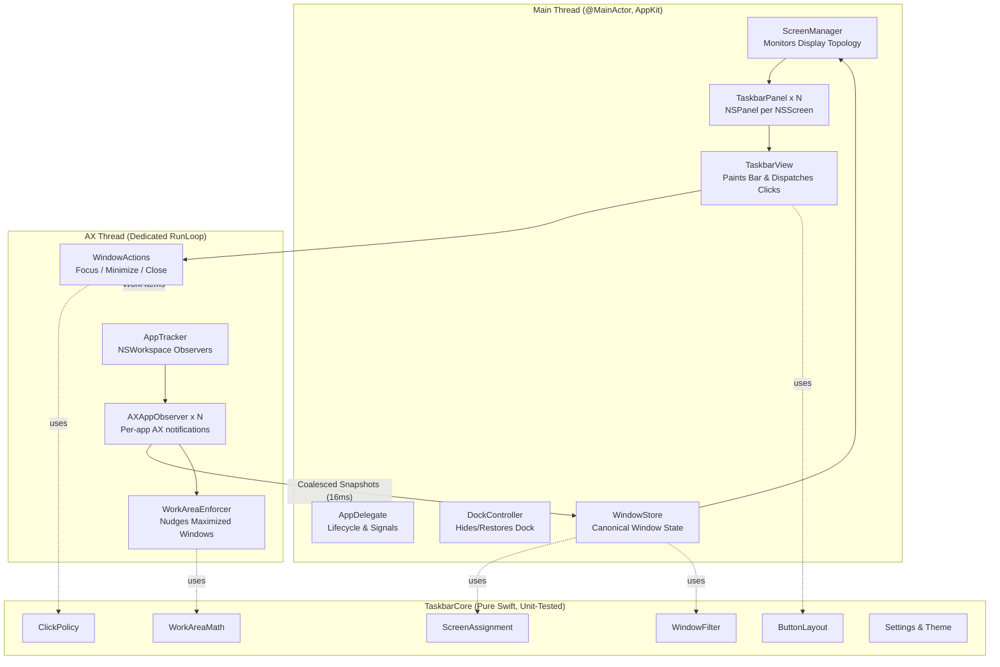

# Architecture & Concurrency Guide

This document describes the architectural topology, threading model, and event pipelines for `Taskbar`.

---

## 1. System Topology



---

## 2. Threading & Concurrency Model

### A. The Main Thread (`@MainActor`)
- Owns all `NSWindow` / `NSPanel` instances and custom AppKit views (`TaskbarView`, `TaskButton`).
- Owns the canonical `WindowStore`, receiving immutable state snapshots from the background thread.
- Renders UI changes directly without layer indirection; invokes `setNeedsDisplay` only on buttons whose state or label changed.
- **Rule:** Never execute an `AXUIElement*` function on the main thread. Any blocking Accessibility IPC call can stall the UI if a target app is hung.

### B. The Dedicated AX Thread (`AXThread`)
- Runs on a dedicated background `Thread` with a persistent `CFRunLoop`.
- Registers `AXObserver` notification sources for all running applications.
- Configures per-element timeouts using `AXUIElementSetMessagingTimeout(element, 0.3)` so queries to unresponsive apps abort swiftly.
- Dispatches window mutations (`kAXRaiseAction`, `kAXMinimizedAttribute`, `kAXCloseButtonAttribute`) safely in the background.

### C. State Synchronization & Event Coalescing
- When windows open, move, resize, or close, bursts of AX events can occur (e.g. 5 windows opening at once during startup).
- `AXAppObserver` batches incoming events over a **16 ms window** (one display frame) into a unified snapshot before dispatching to the main thread `WindowStore`.

---

## 3. Screen Space Reservation: The AX Nudger (`WorkAreaEnforcer`)

macOS lacks a public API for third-party apps to reserve screen space (`NSScreen.visibleFrame`).

### Strategy:
1. `TaskbarPanel` floats above standard windows at `.dock` / `.floating` window level.
2. `WorkAreaEnforcer` listens to `kAXWindowMovedNotification` and `kAXWindowResizedNotification` on the AX thread.
3. When a window's bottom edge reaches or extends into the taskbar's reserved height:
   $$\text{overlap} = \text{window.frame.maxY} - (\text{screen.frame.maxY} - \text{taskbarHeight})$$
4. If $\text{overlap} > 2\text{pt}$, the window's height is clamped:
   $$\text{newHeight} = \text{window.frame.height} - \text{overlap}$$
5. **Recursion Guard:** If `newHeight` matches the window's current height (within 1pt), no AX resize is dispatched, breaking infinite feedback loops with OS window server events.
6. **Exclusions:** Full-screen Spaces, native full-screen windows, sheets, dialogs, and popovers are ignored.

---

## 4. Dock Hiding Safety & Signal Trapping

### Mechanism
The system Dock is hidden using:
```bash
defaults write com.apple.dock autohide -bool true
defaults write com.apple.dock autohide-delay -float 1000
killall Dock
```

### Safety Traps
- **On Launch:** Original settings are captured and persisted to `UserDefaults`.
- **POSIX Signal Traps:** `main.swift` installs signal handlers for `SIGINT`, `SIGTERM`, and `SIGHUP`, as well as registering `atexit(restoreDock)`.
- **Status Item:** The menu bar status item provides an explicit "Restore Dock" toggle.
- **Emergency Script:** A standalone script (`./scripts/restore-dock.sh`) can be executed from terminal independently of the app.
