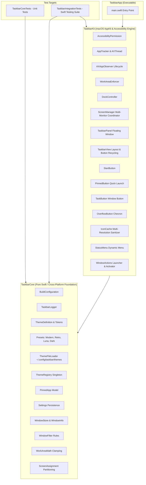
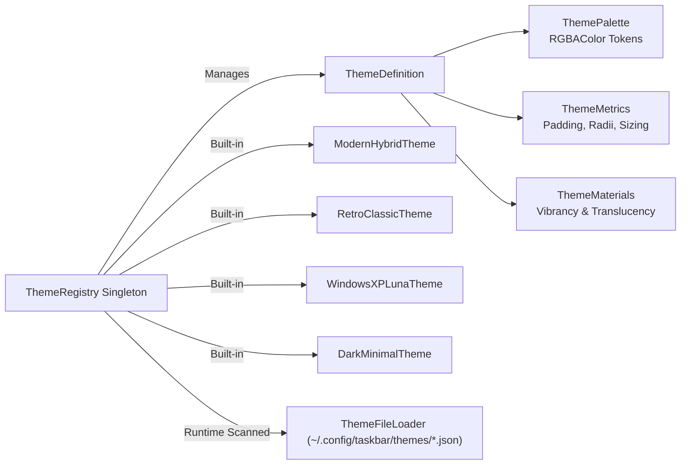
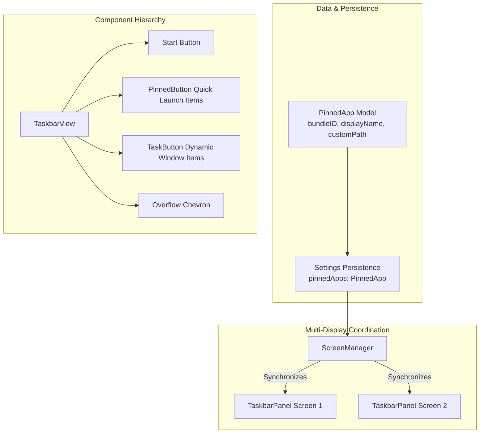
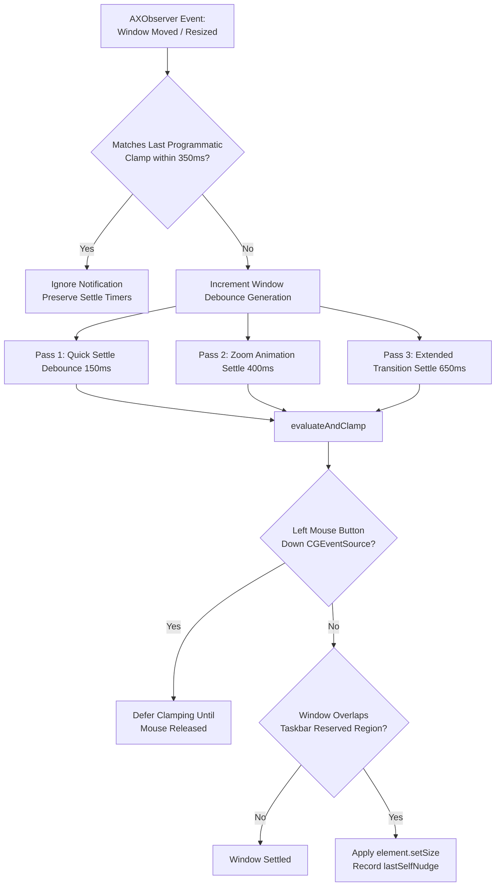
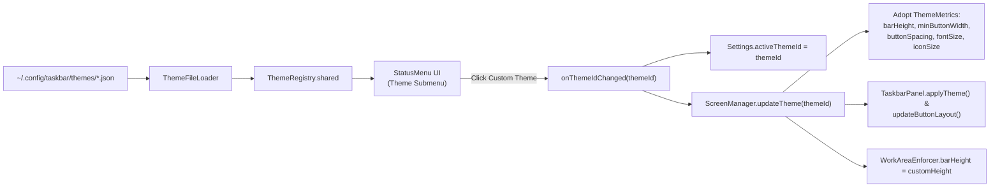

# Taskbar Architecture & Design Document

This document provides a comprehensive technical breakdown of **Taskbar** architecture. It details the modular theming engine, built-in presets, external JSON theme loader, pinned applications bar, multi-resolution icon sanitization, view recycling, observer lifecycle hardening, work area clamping, focus isolation, and multi-display synchronization.

---

## 1. High-Level Architectural Overview

Taskbar is a native macOS agent application (`LSUIElement`) built strictly using public Apple frameworks (`AppKit`, `ApplicationServices`, `CoreGraphics`, `os`). It delivers a high-performance Windows-style taskbar with zero private APIs, zero screen capture permissions, and zero polling loops.



---

## 2. Modular Target Hierarchy

The codebase adheres strictly to a three-tiered library/executable structure to guarantee complete test isolation and zero binary circularity:

1. **`TaskbarCore` (Library Target):**
   - Independent of UI view hierarchies and `NSView` lifecycles.
   - Houses mathematical models, window filtering rules, coordinate clamping math, configuration encoders/decoders, theme definitions and presets, file-based theme discovery, pinned application domain models, thread-safe `ThemeRegistry`, and unified `TaskbarLogger`.
   - 100% covered by headless unit tests in `TaskbarCoreTests`.

2. **`TaskbarKit` (Library Target):**
   - Contains all macOS system integration and UI view code:
     - **Tracking:** `AppTracker`, `AXAppObserver`, `AXThread`, `WorkAreaEnforcer`.
     - **UI Subsystems:**
       - **Buttons:** `BaseTaskbarButton`, `TaskButton`, `StartButton`, `PinnedButton`, `OverflowButton`.
       - **Panels:** `TaskbarPanel`, `TaskbarView`, `BevelDrawing`.
       - **Menu:** `StatusMenu`.
       - **Management:** `ScreenManager`, `IconCache`, `VisualEffectMapping`.
     - **Actions & System:** `WindowActions`, `DockController`, `Launcher`, `AccessibilityPermission`, `AppDelegate`.
   - Publicly exported for deterministic integration testing in `TaskbarIntegrationTests`.

3. **`TaskbarApp` (Executable Target):**
   - Lightweight executable wrapper containing only `main.swift`.
   - Installs POSIX signal handlers (`SIGINT`, `SIGTERM`, `SIGHUP`) and `atexit` hooks for guaranteed system Dock restoration, instantiates `AppDelegate`, and initiates `NSApplication.shared.run()`.

---

## 3. Modular Theming Engine & Preset Architecture

In v0.2.0, theming was refactored from monolithic definitions into modular, single-responsibility files under `Sources/TaskbarCore/Config/Theme/`:



### 3.1 Built-in Presets
1. **Modern Hybrid (`modern-hybrid`):** Native macOS frosted glass vibrancy (`NSVisualEffectView`), rounded pill buttons, subtle hover translucency, and `SF Pro` system typography.
2. **Retro Classic (`retro-classic`):** Authentic Windows 95/98 `#C0C0C0` solid gray background, 1pt white highlight border, classic 3D beveled borders (`BevelDrawing`), and retro typography.
3. **Windows XP Luna (`windows-xp-luna`):** Authentic Windows XP Luna classic blue (`#245EDC` / `#1642A5`), signature emerald green Start button (`#388E3C` / `#43A047`) with gold accent, royal blue active buttons (`#1941A5`) with border bevels, and sky-blue hover highlights.
4. **Dark Minimal (`dark-minimal`):** Pitch black (`#121212`) background with subtle border delimiter, flat minimal hover rectangles, active indicator border (`#00BCD4` cyan), and distraction-free typography.

### 3.2 User Custom Theme Loader (`ThemeFileLoader`)
- **Canonical Storage:** `~/.config/taskbar/themes/` (with fallback to `~/Library/Application Support/Taskbar/Themes/`).
- **Discovery Lifecycle:**
  - Auto-discovers all `*.json` files on startup and upon on-demand "Reload Themes from Disk" requests.
  - Validates non-empty `id` and skips collisions with built-in preset IDs to prevent overriding default presets.
  - Deserializes gracefully with structured error logging without interrupting app execution or crashing.
  - Automatically injects discovered themes into `ThemeRegistry` and marks them with `isCustom: true`.
- **Export Facility:** Exports any currently active theme as a formatted, pretty-printed JSON file directly to disk or via an interactive save panel.

---

## 4. Pinned Applications & Quick Launch Bar

Version `0.2.0` introduces a native Quick Launch bar providing instant access to pinned applications directly from the taskbar on all connected displays.



### 4.1 Horizontal Geometry & Layout
On every connected display, `TaskbarView` arranges subviews horizontally:
1. **Start Button:** Fixed width at `x = buttonSpacing`.
2. **Pinned Apps Bar:** Fixed compact square buttons ($w = \text{height} - 2 \times \text{padding}$) for each pinned application, separated by `pinnedButtonSpacing = 2.0pt` and followed by `pinnedSectionTrailingMargin = 6.0pt`.
3. **Dynamic Task Buttons:** Auto-stretching or shrinking task buttons for open windows on that display.
4. **Overflow Chevron (`»`):** Appears automatically if window density forces buttons below `minButtonWidth`.

### 4.2 Interaction Mechanics
- **One-Click Launch & Raise:**
  - If target application is not running: Launches via `NSWorkspace.shared.openApplication(at:configuration:)`.
  - If target application is running: Activates process, deminiaturizes minimized windows, and raises the frontmost window.
- **Running Indicator:**
  - A subtle running indicator dot/badge renders at the bottom center of the pinned button whenever one or more windows belonging to that application are open.
  - Theme-adaptive: Dark/black in Retro bevel mode; theme accent color (`#00BCD4`, emerald, or theme highlight) in Modern Hybrid, Luna, and Minimal modes.
- **Context Menus:**
  - **On `PinnedButton`:** "Open <App>", "Unpin from Taskbar", and "Quit <App>" (when running).
  - **On `TaskButton`:** Dynamic "Pin to Taskbar" / "Unpin from Taskbar" toggle item. Pinning or unpinning synchronizes instantly across all connected screens.

### 4.3 High-DPI & Multi-Resolution Icon Sanitization
Application bundles (particularly Electron or older apps like Antigravity) occasionally contain corrupted or uninitialized 16x16 / 32x32 bitmap representations inside their `.icns` file while providing clean high-resolution assets (64px, 128px, 256px, 512px).
- On Retina screens (2.0x), AppKit selects clean `@2x` assets.
- On non-Retina screens (1.0x), AppKit defaults to matching 1x point sizes, drawing corrupt noise.
- **`IconCache.prepareIcon(_:targetSize:)`:** When an icon bundle contains representations $\ge 64\text{px}$, all representations $< 64\text{px}$ are stripped. This forces AppKit to downsample from the pristine high-resolution bitmaps using smooth bilinear anti-aliasing on 1x displays, eliminating visual corruption across mixed-DPI multi-monitor environments.
- **Dimension-Aware Cache Keys:** Cache keys incorporate dimensions (`\(baseKey)_\(width)x\(height)`), ensuring cached representations resize properly when `settings.iconSize` changes.

---

## 5. View Recycling & In-Place Performance

To maintain low memory usage ($< 25\text{ MB}$ typical RSS) and eliminate mouse tracking area flicker during frequent window operations:
- **`TaskButton` Recycling:** `TaskbarView` maintains `buttonMap: [WindowKey: TaskButton]`. Buttons are recycled in place, preserving existing views and mouse tracking areas.
- **`PinnedButton` Recycling:** `TaskbarView` maintains `pinnedButtonMap: [String: PinnedButton]`, reusing existing pinned button instances across layout updates.
- **Idle CPU:** $\sim 0.0\%$ at idle; no polling loops; state changes driven exclusively by asynchronous event notifications.

---

## 6. Accessibility Observer Lifecycle & Coalescing

- **Dynamic Subrole Filtering:** macOS Accessibility dynamically morphs minimized Cocoa windows into `AXDialog` subroles when minimized to the Dock. `WindowFilter.shouldInclude` allows `AXDialog` subroles when `isMinimized == true` to prevent dropping minimized windows.
- **In-Flight Observer Coalescing:** `AppTracker` implements `needsReconcileAgain` latching to prevent dropping notifications (e.g. `AXWindowDeminiaturized`) that arrive while a snapshot reconciliation pass is already in flight.
- **Clean Notification Teardown:** Explicitly unregisters all window and application notifications via `AXObserverRemoveNotification` prior to clearing run loop sources in `AXAppObserver`.

---

## 7. Multi-Display Window Focus Isolation (`WindowActions`)

In multi-monitor environments, activating an application using standard AppKit APIs (`NSRunningApplication.activate(options: .activateAllWindows)`) causes macOS to bring *all* windows belonging to that application to the front across *all* connected displays. This behavior disrupts user focus on other screens (e.g. clicking Chrome on Monitor 2 would unintentionally raise a background Chrome window on Monitor 1, covering an active code editor).

To guarantee strict multi-display isolation:
- **Targeted AX Window Focus:** `WindowActions.performAction(.focus, for: key)` locates the specific `AXUIElement` window for the requested key.
- **Selective Raising:** Invokes `AXUIElementPerformAction(window, kAXRaiseAction)` and assigns `kAXMainAttribute` directly to the target window.
- **Selective App Activation:** Activates the application process *without* the `.activateAllWindows` flag:
  ```swift
  app.activate(options: [])
  ```
- **Outcome:** Only the clicked window on the specific monitor is raised and given keyboard focus; background windows belonging to the same application on other monitors remain undisturbed in their existing z-order.

---

## 8. Work Area Clamping & Multi-Pass Settle Architecture (`WorkAreaEnforcer`)

macOS lacks an official API like Windows' `SHAppBarMessage` or X11's `_NET_WM_STRUT` to reserve screen edge space for third-party docks. `WorkAreaEnforcer` enforces taskbar screen reservation by monitoring window geometry and clamping maximized window heights above the taskbar boundary.



### 8.1 Key Engineering Mitigations
1. **Self-Inflicted Notification Filtering:**
   Calling `element.setSize(clampedFrame.size)` triggers an operating system `kAXWindowResizedNotification`. `WorkAreaEnforcer` caches the exact programmatic clamp size and timestamp (`lastSelfNudges`). When incoming resize events match the target size within 350ms, they are ignored. This prevents self-inflicted feedback loops and guarantees that downstream settle verification passes are not superseded.
2. **Active Mouse Drag Deferral:**
   During live mouse resizing, WindowServer binds the window edge to the cursor coordinates. Calling `setSize` while the left mouse button is pressed causes visible cursor jitter and WindowServer immediately overrides the adjustment, burning through recursion limits. `WorkAreaEnforcer` checks `CGEventSource.buttonState(.combinedSessionState, button: .left)` and defers clamping until the mouse is released.
3. **Multi-Pass Settle Verification:**
   - **Pass 1 (150ms):** Fast debounce coalescing for rapid user interactions and window snapping.
   - **Pass 2 (400ms):** Animation settle verification ensuring native macOS titlebar double-click zoom and window tiling animations (~250–300ms) settle cleanly above the taskbar without being reverted by AppKit animation completion handlers.
   - **Pass 3 (650ms):** Extended settle verification accommodating slower Chromium and Electron window frame adjustments.
4. **Dynamic Screen Fallback:**
   If screen descriptors have not yet been populated by `ScreenManager`, `evaluateAndClamp` dynamically queries `NSScreen.screens` to resolve physical display bounds.
5. **Application-Level Move/Resize Listening:**
   `AXAppObserver` registers `kAXWindowResizedNotification` and `kAXWindowMovedNotification` at the application level as well as the window level. Newly opened windows in Electron and Chromium apps that omit `kAXWindowCreatedNotification` are automatically registered and observed upon first movement or resize.
6. **In-Flight Resize Debounce Protection:**
   When an active resize debounce burst is in-flight (`windowWasResizedInDebounce[winID] == true`), passive move or periodic window reconciliation events (`!isResize`) arriving within the settle window are ignored. This prevents `generationCounters[winID]` from incrementing prematurely, ensuring that Pass 1 (150ms) and Pass 2 (400ms) execution are not cancelled before clamping occurs.
7. **TCC Authorization Polling & Dynamic Observer Attachment:**
   On ad-hoc rebuilt binaries where TCC cdhash trust verification is asynchronous at startup, `AppTracker` polls authorization for up to 30 seconds via a background task. As soon as permission is confirmed, all running applications are immediately tracked. Furthermore, `handleAppActivated` dynamically attaches observers to active applications upon focus, guaranteeing immediate window maximize responsiveness.
8. **Resilient Window Observer Registration:**
   `AXAppObserver` only marks a window as observed (`observedWindows.insert(winID)`) if at least one core AX notification registration succeeds, allowing transparent retry on subsequent events rather than silently abandoning registration.
9. **Startup Configuration Precedence:**
   `WorkAreaEnforcer.shared.configure` is executed prior to `ScreenManager` display panel instantiation, guaranteeing accurate custom taskbar height reservation from the moment of launch.

---

## 9. Custom Theme Engine & Dynamic Layout Metric Adoption

Taskbar provides a modular, data-driven theming architecture supporting both built-in presets (`modern-hybrid`, `retro-classic`, `windows-xp-luna`, `dark-minimal`) and user-authored JSON themes loaded dynamically from disk.



### 9.1 Callback Architecture & Invariant Enforcement
- **Unified Event Flow:** All theme activation flows through `onThemeIdChanged(String)`. In earlier iterations, `StatusMenu` also invoked a legacy `onThemeChanged(ThemeStyle)` callback, which clobbered custom theme selections back to `.modernHybrid` because custom themes are not built-in enum presets.
- **Strict Invariant:** Theme lifecycle events flow exclusively through `onThemeIdChanged(String)`. The legacy `onThemeChanged(ThemeStyle)` callback has been retired from `StatusMenu`, ensuring unified handling across built-in presets and user custom themes with zero enum clobbering.

### 9.2 Dynamic Layout Metric Adoption
- **Extended Theme Metrics (`ThemeMetrics`):** Theme JSON definitions can optionally specify layout dimensions:
  ```json
  "metrics": {
    "barHeight": 64.0,
    "minButtonWidth": 50.0,
    "maxButtonWidth": 250.0,
    "buttonSpacing": 10.0,
    "fontSize": 8.0,
    "iconSize": 48.0,
    "buttonCornerRadius": 25.0,
    "is3DBeveled": true
  }
  ```
- **Panel & Work Area Propagation:** When switching to a custom theme, `ScreenManager.updateTheme` adopts the theme's custom `fontSize`, `iconSize`, `barHeight`, `minButtonWidth`, `maxButtonWidth`, and `buttonSpacing`:
  1. Updates `settings` and persists to `UserDefaults`.
  2. Updates `WorkAreaEnforcer.shared.barHeight` so maximized windows clamp to the new taskbar height.
  3. Calls `refreshPanels()` to resize panels across all connected displays.
  4. Synchronizes Status Menu checkmarks and submenus (`barHeight`, `fontSize`, `iconSize`, `minButtonWidth`).

### 9.3 Dynamic Visual Effect Materials & Blending Modes (`ThemeMaterials`)
- **AppKit Vibrancy Decoupling:** In `TaskbarCore`, `ThemeMaterials` decodes `useTranslucency`, optional `material: String?`, and optional `blendingMode: String?` without coupling the core data layer to AppKit.
- **Dynamic Resolution (`VisualEffectMapping`):** `TaskbarKit` normalizes and resolves theme tokens to native AppKit visual effect properties:
  - `NSVisualEffectView.Material`: `"hudWindow"`, `"windowBackground"`, `"popover"`, `"sidebar"`, `"menu"`, `"headerView"`, `"sheet"`, `"selection"`, `"titlebar"`, `"toolTip"`, `"contentBackground"`, `"underPageBackground"`, `"fullScreenUI"`, defaulting safely to `.underWindowBackground`.
  - `NSVisualEffectView.BlendingMode`: `"behindWindow"` (samples desktop wallpaper and underlying windows) or `"withinWindow"` (samples content within the taskbar window itself), defaulting to `.behindWindow`.
- **Runtime Application:** `TaskbarView.applyTheme()` dynamically updates `visualEffectView.material`, `visualEffectView.blendingMode`, and `visualEffectView.isHidden` across all display panels immediately upon theme selection without requiring an application restart.
