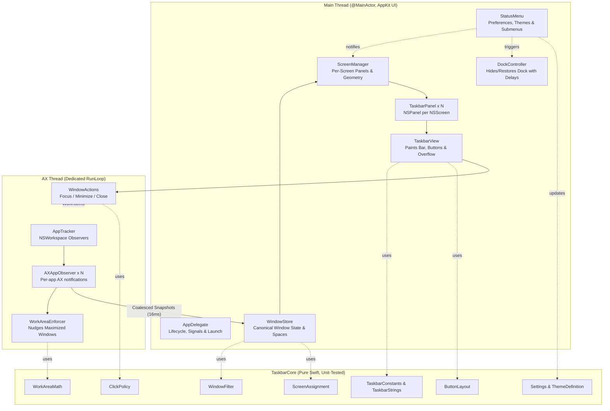

# Architecture & Concurrency Guide (v0.1.1)

This document describes the architectural topology, threading model, subsystem boundaries, and event pipelines for `Taskbar.app`.

---

## 1. System Topology

`Taskbar` follows a strictly decoupled layered architecture separating pure, platform-independent business logic from AppKit rendering and Accessibility IPC.



---

## 2. Threading & Concurrency Model

### A. The Main Thread (`@MainActor`)
- Owns all `NSWindow` / `NSPanel` instances and custom AppKit views ([`TaskbarView`](file:///Sources/TaskbarApp/UI/TaskbarView.swift), [`TaskButton`](file:///Sources/TaskbarApp/UI/TaskButton.swift), [`StartButton`](file:///Sources/TaskbarApp/UI/StartButton.swift)).
- Owns the canonical [`WindowStore`](file:///Sources/TaskbarCore/Logic/WindowStore.swift), receiving immutable state snapshots from the background AX thread.
- Renders UI changes directly without layer indirection; redraws are targeted and minimal (`setNeedsDisplay` only on buttons whose state, width, or title changed).
- **Hard Invariant:** Never execute an `AXUIElement*` API call on the main thread. Any blocking Accessibility IPC call can stall the UI indefinitely if a target application is beachballing or hung.

### B. The Dedicated AX Thread (`AXThread`)
- Runs on a dedicated background `Thread` with a persistent `CFRunLoop`.
- Registers `AXObserver` notification sources for all active desktop applications.
- Enforces strict per-element timeouts using `AXUIElementSetMessagingTimeout(element, 0.3)` so queries to unresponsive apps abort swiftly within 300ms.
- Dispatches window mutations (`kAXRaiseAction`, `kAXMinimizedAttribute`, `kAXCloseButtonAttribute`) safely in the background.

### C. State Synchronization & Event Coalescing
- When applications launch, exit, or rapidly resize/move windows, bursts of AX events occur.
- [`AXAppObserver`](file:///Sources/TaskbarApp/Tracking/AXAppObserver.swift) coalesces incoming notifications over a **16 ms window** (one display frame) into a unified snapshot before dispatching to the main thread [`WindowStore`](file:///Sources/TaskbarCore/Logic/WindowStore.swift).
- This prevents redundant layout thrashing on the main thread during heavy window activity.

---

## 3. Screen Space Reservation: The AX Nudger (`WorkAreaEnforcer`)

macOS provides no public API for third-party utilities to shrink `NSScreen.visibleFrame` (only the native Dock and Menu Bar can reserve screen margins).

### Strategy & Mechanics
1. Each [`TaskbarPanel`](file:///Sources/TaskbarApp/UI/TaskbarPanel.swift) floats above standard windows at `.dock` / `.floating` window level.
2. [`WorkAreaEnforcer`](file:///Sources/TaskbarApp/Tracking/WorkAreaEnforcer.swift) observes `kAXWindowMovedNotification` and `kAXWindowResizedNotification` on the dedicated AX thread.
3. When a window is vertically maximized or tiled to the screen bottom:
   $$\text{overlap} = \text{window.frame.maxY} - (\text{screen.frame.maxY} - \text{taskbarHeight})$$
4. If $\text{overlap} > \text{TaskbarConstants.WorkArea.overlapTolerance}$ ($2.0\text{ pt}$):
   $$\text{newHeight} = \text{window.frame.height} - \text{overlap}$$
5. **Recursion Guard:** If the difference between `newHeight` and the window's current height is less than `TaskbarConstants.WorkArea.clampingRecursionGuardDelta` ($1.0\text{ pt}$), no AX resize is dispatched. This eliminates feedback loops with OS window server events.
6. **Debounce & Settle Guard:** Resize events are debounced by 100ms. If the user is actively dragging the window resize border, the enforcer preserves user intent until dragging settles.
7. **Exclusions:** Native full-screen windows, sheets, dialogs, drawers, popovers, and system overlays are excluded by [`WindowFilter`](file:///Sources/TaskbarCore/Logic/WindowFilter.swift).

---

## 4. Dock Replacement & Dynamic Delay Safety

`Dock.app` is an essential system daemon responsible for Mission Control, Spaces, Launchpad, and Cmd-Tab application switching; it cannot be terminated permanently. Instead, `Taskbar` manages Dock auto-hiding and reveal delays cleanly.

### Mechanism
```bash
defaults write com.apple.dock autohide -bool true
defaults write com.apple.dock autohide-delay -float <DELAY_SECONDS>
killall Dock
```

### Configurable Delay Presets
Users can adjust the Dock autohide delay dynamically via the menu bar status item:
- **Permanently Hidden (1000s):** Default setting. Dock is hidden indefinitely and never accidentally triggers on bottom mouse movements.
- **1.5s (Deliberate Hover):** Reveals only when the user deliberately rests the cursor at the screen edge.
- **1.0s (Slow Hover):** Moderate delay preventing accidental activation.
- **0.5s (Normal Autohide):** Standard macOS auto-hide timing.
- **0.0s (Instant Reveal):** Instant Dock access on edge touch.

### Intelligent Process Restart
[`DockController`](file:///Sources/TaskbarApp/System/DockController.swift) tracks `_currentAppliedDelay`. If the dock is already hidden and the user selects the same delay or toggles an unrelated setting, `killall Dock` is omitted to avoid unnecessary system flicker.

### Safety Traps & Recovery Guarantees
- **First-Run Backup:** Before altering system preferences, original `autohide` and `autohide-delay` values are captured and stored in `UserDefaults` (`com.taskbar.original_dock_state`).
- **POSIX Signal Traps:** `main.swift` installs signal handlers for `SIGINT`, `SIGTERM`, and `SIGHUP`, as well as registering `atexit(restoreDockSync)`.
- **Status Menu Item:** The menu bar status item provides an explicit "Restore System Dock Now" action.
- **Standalone Emergency Script:** [`scripts/restore-dock.sh`](file:///scripts/restore-dock.sh) can be run independently from any terminal if the app is forcibly killed (`kill -9`).

---

## 5. Window Discovery, Tracking & Edge Cases

### A. Non-Standard App Behavior (Chromium, Electron, VS Code)
- Minimized Chromium (Google Chrome, Discord, Slack) windows often report $(0, 0, 0, 0)$ frames or temporarily clear their position attributes.
- [`WindowFilter`](file:///Sources/TaskbarCore/Logic/WindowFilter.swift) inspects the `kAXMinimizedAttribute` before rejecting windows with empty dimensions, ensuring minimized apps remain visible and retrievable on the taskbar.

### B. Native Full-Screen Spaces
- Native macOS full-screen apps (Keynote presentations, video players, full-screen IDEs) create dedicated Mission Control Spaces.
- [`WindowStore`](file:///Sources/TaskbarCore/Logic/WindowStore.swift) tracks full-screen status via `isFullScreen`. When switching to a full-screen Space, [`TaskbarPanel`](file:///Sources/TaskbarApp/UI/TaskbarPanel.swift) instances hide themselves automatically to avoid obscuring full-screen controls, returning to view when switching back to regular desktops.

### C. Multi-Monitor Topology & Screen Changes
- When external displays are connected or disconnected, `NSApplication.didChangeScreenParametersNotification` triggers [`ScreenManager`](file:///Sources/TaskbarApp/UI/ScreenManager.swift).
- Panels are re-aligned, geometry constraints updated, and windows re-partitioned across remaining active screens.

---

## 6. UI & Layout Subsystem

### A. Layout Engine (`ButtonLayout`)
- Available bar width = $\text{screen.width} - \text{StartButton.width} - \text{OverflowButton.width} - \text{margins}$.
- If total required width exceeds available space, buttons shrink proportionally from `maxButtonWidth` (160pt) down to `minButtonWidth` (configurable, default 80pt).
- If buttons cannot fit at `minButtonWidth`, excess buttons are moved into the overflow list.
- **Dynamic Title Visibility:** Window titles remain visible as long as button width $\ge \text{titleVisibilityThreshold}$ (50pt). Below this threshold, buttons render in icon-only mode.
- **Overflow Chevron (`»`):** Rendered when overflow exists. Clicking displays an AppKit `NSMenu` listing all overflowed windows with icons, active highlights, and left-click activation.

### B. Dual-Theme Engine & Vertical Alignment
- **Modern Hybrid:** Frosted translucency (`NSVisualEffectView` with `.underWindowBackground` material), rounded pill buttons (4pt radius), subtle translucent hover/pressed borders.
- **Retro Classic:** Windows 95/98 `#C0C0C0` palette, 1pt white top highlight line, square 3D beveled borders ([`BevelDrawing`](file:///Sources/TaskbarApp/UI/BevelDrawing.swift)).
- **Baseline Alignment:** Window titles and application icons are vertically centered dynamically by calculating:
  $$\text{baselineOffset} = \frac{\text{buttonHeight} - \text{font.capHeight}}{2} - 1.0$$
  This maintains balanced visual alignment across all user-selected bar heights (26–44pt) and font sizes (10–14pt).
