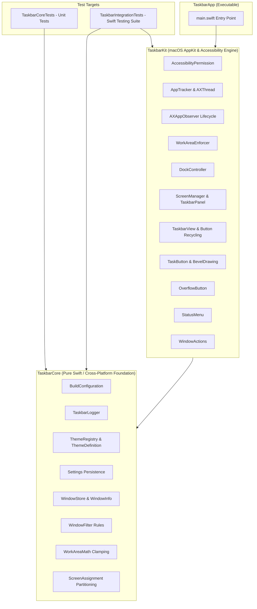
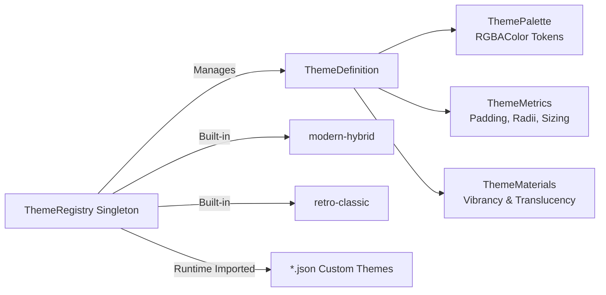

# Taskbar Architecture & Design Document (v0.1.1)

This document provides a comprehensive technical breakdown of **Taskbar** architecture for the `v0.1.1` release, incorporating the architectural decoupling, pure data-driven theme registry, in-place view recycling, observer lifecycle hygiene, unified logging, and automated test harness introduced in this release.

---

## 1. High-Level Architectural Overview

Taskbar is a native macOS agent (`LSUIElement`) built strictly using public Apple frameworks (`AppKit`, `ApplicationServices`, `CoreGraphics`, `os`). It delivers a high-performance Windows-style taskbar with zero private APIs, zero screen capture permissions, and zero polling loops.



---

## 2. Modular Target Hierarchy

In v0.1.1, the monolithic app target was cleanly decoupled into a three-tiered library/executable structure to enable unit and integration testing without binary circularity:

1. **`TaskbarCore` (Library Target):**
   - Independent of UI view hierarchies and `NSView` lifecycles.
   - Houses mathematical models, window filtering rules, coordinate clamping math, configuration encoders/decoders, thread-safe `ThemeRegistry`, and Apple's unified `TaskbarLogger`.
   - 100% covered by `TaskbarCoreTests`.

2. **`TaskbarKit` (Library Target):**
   - Contains all macOS system integration and UI view code:
     - **Tracking:** `AppTracker`, `AXAppObserver`, `AXThread`, `WorkAreaEnforcer`.
     - **UI:** `ScreenManager`, `TaskbarPanel`, `TaskbarView`, `TaskButton`, `StartButton`, `OverflowButton`, `BevelDrawing`, `IconCache`.
     - **Actions & System:** `WindowActions`, `DockController`, `Launcher`, `AccessibilityPermission`, `StatusMenu`, `AppDelegate`.
   - Publicly exported for deterministic integration testing in `TaskbarIntegrationTests`.

3. **`TaskbarApp` (Executable Target):**
   - Lightweight executable wrapper containing only `main.swift`.
   - Installs POSIX signal handlers (`SIGINT`, `SIGTERM`, `SIGHUP`) and `atexit` hooks for guaranteed system Dock restoration, instantiates `AppDelegate`, and kicks off `NSApplication.shared.run()`.

---

## 3. Pure Data-Driven Theme Registry

Prior to v0.1.1, visual styling was tightly coupled to hardcoded enum cases in `ThemeDefinition`. In v0.1.1, styling was decoupled into a pure data-driven registry:



### Key Token Structs:
- **`ThemePalette`:** Defines `backgroundColor`, `topBorderColor`, `textNormal`, `textPressed`, `buttonNormal`, `buttonHover`, `buttonPressed`, `buttonBorderNormal`, and `buttonBorderPressed` as serializable `RGBAColor` values.
- **`ThemeMetrics`:** Defines `buttonCornerRadius`, `is3DBeveled`, `fontBold`, `fontSize`, and `iconSize`.
- **`ThemeMaterials`:** Controls `useTranslucency` for frosted glass vibrancy.
- **`ThemeRegistry`:** Thread-safe (`NSLock`) registry managing both built-in presets and user-imported `.json` themes uniformly by unique `id: String`.

---

## 4. In-Place View Recycling in `TaskbarView`

In earlier versions, every window update triggered `removeFromSuperview()` and reallocated new `TaskButton` instances for every open window, churning memory allocations and tracking areas.

In v0.1.1, `TaskbarView` incorporates an internal view recycling map:
$$\text{buttonMap}: [\text{WindowKey}: \text{TaskButton}]$$

### Lifecycle of an Update:
1. **Prune:** Windows no longer present in the updated list have their buttons removed from the superview and deleted from `buttonMap`.
2. **Mutate in Place:** Existing windows reuse the identical `TaskButton` pointer, mutating `windowInfo`, `isFocusedWindow`, and `theme` in-place.
3. **Insert:** Newly created windows instantiate a new `TaskButton` and insert it into `buttonMap`.
4. **Layout:** Re-computes button widths via `ButtonLayout.computeLayout` and positions buttons. Overflowing buttons are cleanly hidden and routed to `OverflowButton` (`»`).

**Impact:** Pointer identity is preserved across dynamic updates, eliminating subview churn and transient allocations while ensuring smooth 60fps animations.

---

## 5. AX Observer & Notification Teardown Hygiene

Taskbar communicates with running applications via macOS Accessibility APIs on a dedicated background run loop thread (`AXThread.shared`).

### Teardown Safeguards:
- `AXAppObserver` maintains a strict registry of all observed window elements:
  `observedWindowElements: [UInt64: AXUIElement]`
- On `invalidate()`, every registered window notification (`AXUIElementDestroyed`, `AXTitleChanged`, `AXWindowMiniaturized`, `AXWindowDeminiaturized`) and application notification (`AXFocusedWindowChanged`, `AXWindowCreated`) is explicitly unregistered via `AXObserverRemoveNotification` before run loop sources are detached.
- `AppTracker.stopTracking()` and `ScreenManager.stop()` ensure all workspace notification observers are cleanly unregistered during shutdown or display reconfiguration.

---

## 6. Unified Logging Infrastructure (`TaskbarLogger`)

Ad-hoc `print(...)` statements were replaced with Apple's unified `os.Logger` framework:
- **Subsystem:** Derived dynamically from `BuildConfiguration.bundleID` (`com.local.taskbar`).
- **Categories:**
  - `Lifecycle`: App launch, display configuration changes, termination.
  - `Tracking`: Window creation, state transitions, title mutations, debouncing.
  - `WorkArea`: Window clamping and nudge boundary enforcement.
  - `Dock`: System Dock autohide delay modifications and restorations.
  - `UI`: View layout, recycling, theme applications, menu interactions.

System logs are low-overhead and filterable directly in Console.app or via the `log stream --predicate 'subsystem == "com.local.taskbar"'` CLI command.

---

## 7. Automated Test & Harness Architecture

Taskbar v0.1.1 introduces an end-to-end automated testing architecture:

```
                    ┌─────────────────────────────────┐
                    │  scripts/test-functional.sh     │
                    │  (Orchestration & Benchmarks)   │
                    └────────────────┬────────────────┘
                                     │
           ┌─────────────────────────┼─────────────────────────┐
           ▼                         ▼                         ▼
   --quick (TC-FUNC-*)     --edge-cases (TC-EDGE-*)    --stress (TC-STRESS-*)
           │                         │                         │
           ▼                         ▼                         ▼
┌───────────────────────┐ ┌───────────────────────┐ ┌───────────────────────┐
│ WindowLifecycleTests  │ │ EdgeCasesTests        │ │ StressTests           │
│ Real-Window Fixtures  │ │ 0x0 Frames, Sheets,   │ │ 100-Window Density,   │
│ via TestFixtureApp    │ │ Rapid Debounce Burst  │ │ Chevron & Recycling   │
└───────────────────────┘ └───────────────────────┘ └───────────────────────┘
```

- **Single-Source Configuration:** Test parameters (`TEST_MAX_RSS_MB`, `TEST_MAX_CPU_PERCENT`, `TEST_AX_AUTH_TIMEOUT_SECONDS`, `TEST_FIXTURE_APP`) are managed in `config/build.env`.
- **Shared Automation Utilities:** `scripts/common.sh` provides shared ANSI styling, logging helpers, OS version verification, and process memory/CPU sampling.
