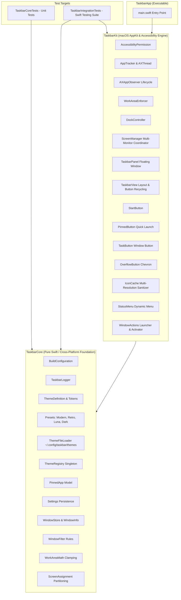
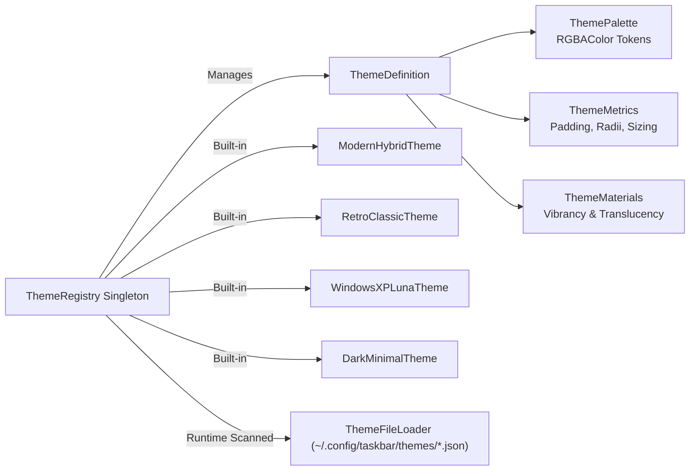
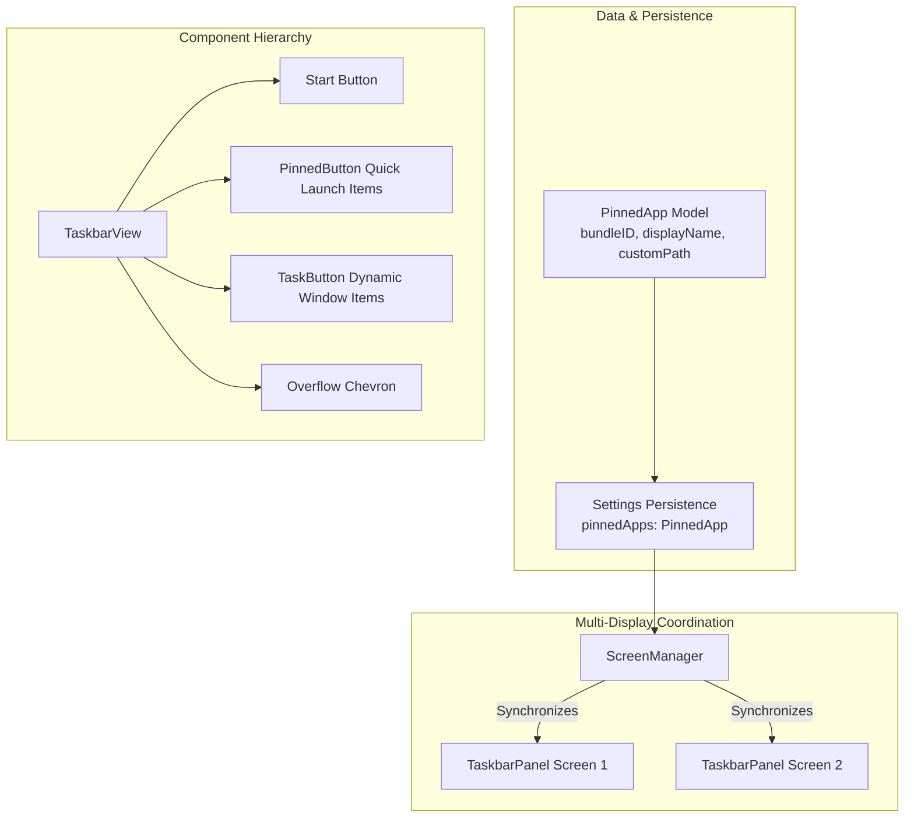

# Taskbar Architecture & Design Document (v0.2.0)

This document provides a comprehensive technical breakdown of **Taskbar** architecture for the `v0.2.0` release ("Personalization & Quick Launch"). It details the modular theming engine, built-in presets, external JSON theme loader, pinned applications bar, multi-resolution icon sanitization, view recycling, observer lifecycle hardening, and multi-display synchronization.

---

## 1. High-Level Architectural Overview

Taskbar is a native macOS agent application (`LSUIElement`) built strictly using public Apple frameworks (`AppKit`, `ApplicationServices`, `CoreGraphics`, `os`). It delivers a high-performance Windows-style taskbar with zero private APIs, zero screen capture permissions, and zero polling loops.

---

## 2. Modular Target Hierarchy

The codebase adheres strictly to a three-tiered library/executable structure to guarantee complete test isolation and zero binary circularity:

1. **`TaskbarCore` (Library Target):**
   - Independent of UI view hierarchies and `NSView` lifecycles.
   - Houses mathematical models, window filtering rules, coordinate clamping math, configuration encoders/decoders, theme definitions and presets, file-based theme discovery, pinned application domain models, thread-safe `ThemeRegistry`, and unified `TaskbarLogger`.
   - 100% covered by headless unit tests in `TaskbarCoreTests`.

2. **`TaskbarKit` (Library Target):**
   - Contains all macOS system integration and UI view code:
     - **Tracking:** `AppTracker`, `AXAppObserver`, `AXThread`, `WorkAreaEnforcer`.
     - **UI:** `ScreenManager`, `TaskbarPanel`, `TaskbarView`, `TaskButton`, `StartButton`, `PinnedButton`, `OverflowButton`, `BevelDrawing`, `IconCache`.
     - **Actions & System:** `WindowActions`, `DockController`, `Launcher`, `AccessibilityPermission`, `StatusMenu`, `AppDelegate`.
   - Publicly exported for deterministic integration testing in `TaskbarIntegrationTests`.

3. **`TaskbarApp` (Executable Target):**
   - Lightweight executable wrapper containing only `main.swift`.
   - Installs POSIX signal handlers (`SIGINT`, `SIGTERM`, `SIGHUP`) and `atexit` hooks for guaranteed system Dock restoration, instantiates `AppDelegate`, and initiates `NSApplication.shared.run()`.

---

## 3. Modular Theming Engine & Preset Architecture

In v0.2.0, theming was refactored from monolithic definitions into modular, single-responsibility files under `Sources/TaskbarCore/Config/Theme/`:

### 3.1 Built-in Presets
1. **Modern Hybrid (`modern-hybrid`):** Native macOS frosted glass vibrancy (`NSVisualEffectView`), rounded pill buttons, subtle hover translucency, and `SF Pro` system typography.
2. **Retro Classic (`retro-classic`):** Authentic Windows 95/98 `#C0C0C0` solid gray background, 1pt white highlight border, classic 3D beveled borders (`BevelDrawing`), and retro typography.
3. **Windows XP Luna (`windows-xp-luna`):** Authentic Windows XP Luna classic blue (`#245EDC` / `#1642A5`), signature emerald green Start button (`#388E3C` / `#43A047`) with gold accent, royal blue active buttons (`#1941A5`) with border bevels, and sky-blue hover highlights.
4. **Dark Minimal (`dark-minimal`):** Pitch black (`#121212`) background with subtle border delimiter, flat minimal hover rectangles, active indicator border (`#00BCD4` cyan), and distraction-free typography.

### 3.2 User Custom Theme Loader (`ThemeFileLoader`)
- **Canonical Storage:** `~/.config/taskbar/themes/` (with fallback to `~/Library/Application Support/Taskbar/Themes/`).
- **Discovery Lifecycle:**
  - Auto-discovers all `*.json` files on startup and upon on-demand "Reload Themes from Disk" requests.
  - Validates non-empty `id` and skips collisions with built-in preset IDs to prevent overriding default presets.
  - Deserializes gracefully with structured error logging without interrupting app execution or crashing.
  - Automatically injects discovered themes into `ThemeRegistry` and marks them with `isCustom: true`.
- **Export Facility:** Exports any currently active theme as a formatted, pretty-printed JSON file directly to disk or via an interactive save panel.

---

## 4. Pinned Applications & Quick Launch Bar

Version `0.2.0` introduces a native Quick Launch bar providing instant access to pinned applications directly from the taskbar on all connected displays.

### 4.1 Horizontal Geometry & Layout
On every connected display, `TaskbarView` arranges subviews horizontally:
1. **Start Button:** Fixed width at `x = buttonSpacing`.
2. **Pinned Apps Bar:** Fixed compact square buttons ($w = \text{height} - 2 \times \text{padding}$) for each pinned application, separated by `pinnedButtonSpacing = 2.0pt` and followed by `pinnedSectionTrailingMargin = 6.0pt`.
3. **Dynamic Task Buttons:** Auto-stretching or shrinking task buttons for open windows on that display.
4. **Overflow Chevron (`»`):** Appears automatically if window density forces buttons below `minButtonWidth`.

### 4.2 Interaction Mechanics
- **One-Click Launch & Raise:**
  - If target application is not running: Launches via `NSWorkspace.shared.openApplication(at:configuration:)`.
  - If target application is running: Activates process, deminiaturizes minimized windows, and raises the frontmost window.
- **Running Indicator:**
  - A subtle running indicator dot/badge renders at the bottom center of the pinned button whenever one or more windows belonging to that application are open.
  - Theme-adaptive: Dark/black in Retro bevel mode; theme accent color (`#00BCD4`, emerald, or theme highlight) in Modern Hybrid, Luna, and Minimal modes.
- **Context Menus:**
  - **On `PinnedButton`:** "Open <App>", "Unpin from Taskbar", and "Quit <App>" (when running).
  - **On `TaskButton`:** Dynamic "Pin to Taskbar" / "Unpin from Taskbar" toggle item. Pinning or unpinning synchronizes instantly across all connected screens.

### 4.3 High-DPI & Multi-Resolution Icon Sanitization
Application bundles (particularly Electron or older apps like Antigravity) occasionally contain corrupted or uninitialized 16x16 / 32x32 bitmap representations inside their `.icns` file while providing clean high-resolution assets (64px, 128px, 256px, 512px).
- On Retina screens (2.0x), AppKit selects clean `@2x` assets.
- On non-Retina screens (1.0x), AppKit defaults to matching 1x point sizes, drawing corrupt noise.
- **`IconCache.prepareIcon(_:targetSize:)`:** When an icon bundle contains representations $\ge 64\text{px}$, all representations $< 64\text{px}$ are stripped. This forces AppKit to downsample from the pristine high-resolution bitmaps using smooth bilinear anti-aliasing on 1x displays, eliminating visual corruption across mixed-DPI multi-monitor environments.
- **Dimension-Aware Cache Keys:** Cache keys incorporate dimensions (`\(baseKey)_\(width)x\(height)`), ensuring cached representations resize properly when `settings.iconSize` changes.

---

## 5. View Recycling & In-Place Performance

To maintain low memory usage ($< 25\text{ MB}$ typical RSS) and eliminate mouse tracking area flicker during frequent window operations:
- **`TaskButton` Recycling:** `TaskbarView` maintains `buttonMap: [WindowKey: TaskButton]`. Buttons are recycled in place, preserving existing views and mouse tracking areas.
- **`PinnedButton` Recycling:** `TaskbarView` maintains `pinnedButtonMap: [String: PinnedButton]`, reusing existing pinned button instances across layout updates.
- **Idle CPU:** $\sim 0.0\%$ at idle; no polling loops; state changes driven exclusively by asynchronous event notifications.

---

## 6. Accessibility Observer Lifecycle & Coalescing

- **Dynamic Subrole Filtering:** macOS Accessibility dynamically morphs minimized Cocoa windows into `AXDialog` subroles when minimized to the Dock. `WindowFilter.shouldInclude` allows `AXDialog` subroles when `isMinimized == true` to prevent dropping minimized windows.
- **In-Flight Observer Coalescing:** `AppTracker` implements `needsReconcileAgain` latching to prevent dropping notifications (e.g. `AXWindowDeminiaturized`) that arrive while a snapshot reconciliation pass is already in flight.
- **Clean Notification Teardown:** Explicitly unregisters all window and application notifications via `AXObserverRemoveNotification` prior to clearing run loop sources in `AXAppObserver`.
