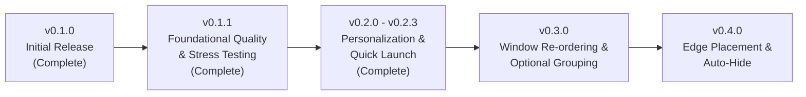

# Taskbar Product & Technical Roadmap

This document outlines the high-level roadmap and architectural priorities for **Taskbar** beyond the initial `v0.1.0` release.

Individual release cycles will have their own dedicated, detailed implementation plans located in `plans/vX.Y.Z/`.

---

## 1. Guiding Vision & Principles

1. **Lightweight & High Performance:** Target $< 40\text{ MB}$ memory footprint, $\sim 0.0\%$ idle CPU, and zero main UI thread hangs.
2. **100% Public Apple APIs:** Rely strictly on public Accessibility (`AXUIElement`) and `NSWorkspace` APIs for rock-solid stability across macOS versions. No private SkyLight dependencies or screen recording prompts.
3. **Taskbar-Focused Simplicity:** Avoid bloat and feature creep. Maintain focus on fast, seamless window switching, raising, and minimizing.
4. **Clean Decoupling:** Keep business logic, layout algorithms, and geometry calculations isolated in [`TaskbarCore`](../Sources/TaskbarCore) with 100% automated test coverage.

---

## 2. Release Roadmap Overview

| Release | Milestone Focus | Key Objectives |
|---|---|---|
| **v0.1.0** | **Initial Core Release** *(Completed)* | Dual themes, 1-to-1 task buttons, AX Nudger (`WorkAreaEnforcer`), Dock hiding with configurable delays, button overflow chevron, and packaging pipeline. |
| **v0.1.1** | **Foundational Quality & Hardening** *(Completed)* | Automated functional & stress test harness, codebase audit & refactoring, ecosystem research. |
| **v0.2.0 – v0.2.3** | **Personalization & Quick Launch** *(Completed)* | Data-driven custom theming (JSON import/export), Quick Launch / pinned applications, multi-resolution icon sanitization, focus isolation, in-flight debounce protection, and robust work area clamping. |
| **v0.3.0** | **Advanced Window Organization** | Drag-and-drop window re-ordering, optional window grouping. |
| **v0.4.0** | **Layout & Placement Flexibility** | Multi-edge placement (Top/Left/Right/Bottom), taskbar auto-hide mode, button alignment (Left vs. Center). |

---

## 3. Phase 1: Foundational Quality, Testing & Research (v0.1.1) *(Completed)*

Before expanding feature surface area, establish a robust automated testing and benchmarking harness to prevent functional or performance regressions.

### 1. Automated Functional & Stress Test Harness
- **Real-Window Test Harness:** Build automated test scripts (`scripts/test-functional.sh` or `tests/integration/`) using AppleScript/JXA to launch, manipulate, and close real application windows (native Cocoa, Chromium, Electron).
- **Functional Matrix:** Validate happy paths, empty/mutating titles, rapid space switching, native full-screen transitions, and multi-display window migration.
- **Stress & Longevity Benchmarks:**
  - Automated tests spawning 50 to 100 windows to verify the overflow chevron (`»`), memory bounds ($< 45\text{ MB}$ RSS), and zero memory leaks upon window closure.
  - Idle CPU verification ($< 0.1\%$).

### 2. Codebase Audit, Cleanup & Refactoring
- **Theme Engine Decoupling:** Refactor hardcoded theme definitions into data-driven color and geometry tokens to prepare for user custom theming.
- **Lifecycle & Memory Hygiene:** Audit `AXAppObserver` cleanup on process termination to ensure zero dangling observers over multi-day uptime.
- **Allocation Optimization:** Profile and reduce transient heap allocations during high-frequency window event coalescing.

### 3. Ecosystem Research
- Analyze proven open-source and commercial macOS window management utilities (e.g. **AltTab**, **uBar**, **DockDoor**) to incorporate architectural insights, window filter edge cases, and performance optimizations.

---

## 4. Phase 2: Personalization & Quick Launch (v0.2.0 – v0.2.3) *(Completed)*

### 1. Custom Theming & Preset Modularization
- **Modular Presets Architecture:** Refactor `Theme.swift` into dedicated files:
  - `ThemeDefinition.swift` (core models, palette, metrics, materials, and Codable tokens)
  - `Presets/` directory with separate Swift definitions for each built-in theme:
    - `ModernHybridTheme.swift` (macOS vibrancy & pill buttons)
    - `RetroClassicTheme.swift` (Windows 95/98 beveled classic)
    - `WindowsXPLunaTheme.swift` (Windows XP Luna blue/green/silver)
    - `DarkMinimalTheme.swift` (borderless high-contrast dark theme)
- **User Custom Theme Loader:** `ThemeFileLoader.swift` discovering and auto-loading custom `.json` themes from `~/.config/taskbar/themes/`.
- **Dynamic Menu Listing:** Status menu dynamically populates all registered themes (built-ins + custom files) under the Theme submenu.
- **Import / Export:** Support exporting current theme to JSON and loading arbitrary theme files.

### 2. Quick Launch / Pinned Applications
- **Pinned App Bar:** Dedicated pinned applications section adjacent to the Start button, rendered across all connected displays.
- **Data Model & Persistence:** `PinnedApp` model (`bundleIdentifier`, `displayName`) stored in `Settings.pinnedApps` with backwards-compatible decoding.
- **State & Interactions:**
  - If app not running $\rightarrow$ Launches cleanly via `NSWorkspace`.
  - If running $\rightarrow$ Raises and focuses the app's active window; subtle running indicator dot/badge below the icon.
- **Context Menu Pinning:**
  - Right-click any running `TaskButton` $\rightarrow$ "Pin to Taskbar" / "Unpin from Taskbar".
  - Right-click `PinnedButton` $\rightarrow$ "Unpin from Taskbar", "Quit Application".

---

## 5. Phase 3: Advanced Window Organization (v0.3.0)

**Pre-requisite Refactoring & Technical Enablers:**
- [Codebase Audit Report (v0.2.3)](./v0.3.X/codebase_audit_v0.2.3.md)
- [Refactoring Implementation Plan](./v0.3.X/refactoring_implementation_plan.md)

### 1. Window Re-Ordering
- **Drag-to-Reorder UX:** Enable users to drag task buttons horizontally along the bar, with adjacent buttons smoothly shifting to indicate drop targets.
- **Architecture:** Introduce a custom ordering layer in `WindowStore` (`[WindowKey: Int]`) that overrides default discovery sorting without altering background AX tracking.

### 2. Optional Window Grouping
- **Grouping Modes:** Configurable grouping modes (`Never`, `Always`, or `When Crowded` / auto-group on overflow).
- **Group Interaction:** Clicking a grouped button presents a clean popup list/stack of that application's open windows.

---

## 6. Phase 4: Layout & Placement Flexibility (v0.4.0)

### 1. Edge Placement
- Allow taskbar panels to anchor to any display edge: **Bottom**, **Top**, **Left**, or **Right** (ideal for vertical ultrawide workflows).
- Adapt [`WorkAreaMath`](../Sources/TaskbarCore/Logic/WorkAreaMath.swift) to support horizontal screen margin clamping.

### 2. Taskbar Auto-Hide
- Optional auto-hide behavior for the taskbar itself: slides offscreen when not hovered and reveals immediately upon mouse proximity.

### 3. Button Alignment
- Support both classic left-aligned task buttons and centered button alignment (modern Windows 11 style).

---

## 7. Future Explorations (Post-v0.4.0 Considerations)

These enhancements may be evaluated as follow-ups once the core four-phase roadmap is complete:
- **Optional Trailing Digital Clock Widget:** A lightweight, low-frequency digital clock label (`HH:mm` or `h:mm a`) updating once per minute on the trailing edge of the taskbar. Especially beneficial for full-screen workflows and secondary monitors where the macOS menu bar is out of view.
- **Taskbar Sound Effects / Haptic Feedback:** Subtle, optional classic Windows sound cues or trackpad haptics on window minimize/restore and button clicks.

---

## 8. Explicit Scope Boundaries (Non-Goals)

To preserve performance, reliability, and code simplicity, the following features are intentionally **out of scope**:

- ❌ **Hover Window Previews:** Avoids requiring macOS Screen Recording permissions (`ScreenCaptureKit`), recurring system security dialogs, continuous GPU thumbnail capture, and UI bloat.
- ❌ **Full System Tray / Status Replicas:** The macOS top menu bar already handles menu bar status items, Control Center, and battery. Duplicating tray items in the taskbar adds redundant complexity.
- ❌ **Built-In Start Menu:** Building a full-fledged Start menu (application directories, search indexers, recent documents) duplicates Spotlight, Raycast, and Alfred. The Start button remains a dedicated, lightning-fast trigger for native launchers.
