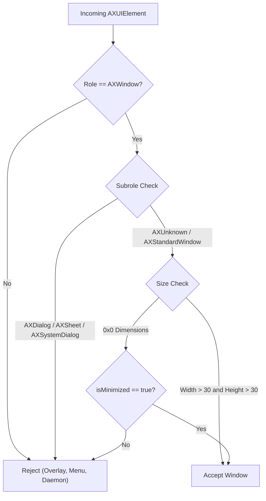
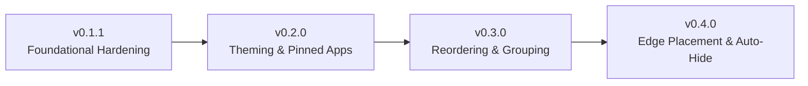

# macOS Window Management Ecosystem Research & Architectural Findings

This document presents the findings of **Milestone 1 (M1)**: an in-depth architectural survey of leading macOS window management utilities, taskbars, and switchers (**AltTab**, **uBar**, **DockDoor**, and tiling managers like **AeroSpace/yabai**).

The research focuses on two areas:
1. **Foundational Quality & Mechanics (v0.1.1):** Window filtering heuristics, Accessibility API latency, event throttling, memory hygiene, and permission boundaries.
2. **Upcoming Architectural Patterns (v0.2.0 / v0.3.0 / v0.4.0):** Data-driven theming, pinned applications, drag-and-drop re-ordering, window grouping, and multi-edge placement.

---

## 1. Executive Summary & Ecosystem Comparison

| Dimension | AltTab (Open-Source) | uBar (Commercial) | DockDoor (Open-Source) | Taskbar (Our App) |
|---|---|---|---|---|
| **Core Purpose** | Windows-style Alt+Tab switcher | Full Windows-style taskbar replacement | Dock hover previews & window peeking | Lightweight, high-performance taskbar |
| **Primary APIs** | `AXUIElement` + `CGWindowList` + `ScreenCaptureKit` | `AXUIElement` + Private SkyLight / CGS APIs | `AXUIElement` + `ScreenCaptureKit` | **100% Public `AXUIElement` + `NSWorkspace`** |
| **Permissions Required** | Accessibility + Screen Recording | Accessibility (+ System Integrity bypass for full dock kill) | Accessibility + Screen Recording | **Accessibility Only** |
| **Memory Footprint** | $120\text{ MB} - 350\text{ MB}$ RSS (due to live thumbnails) | $60\text{ MB} - 120\text{ MB}$ RSS | $150\text{ MB} - 300\text{ MB}$ RSS | **$< 40\text{ MB}$ RSS** (pure AppKit vector/icons) |
| **Idle CPU** | $0.2\% - 1.5\%$ | $0.5\% - 2.0\%$ | $0.3\% - 1.8\%$ | **$\sim 0.0\%$ (event-driven, zero polling)** |
| **Window Grouping** | N/A (linear switcher list) | Yes (Never, Always, Automatic) | Per-dock icon group | Planned for v0.3.0 |
| **Window Reordering** | MRU (Most Recently Used) | Drag-to-reorder supported | N/A | Planned for v0.3.0 |

---

## 2. Foundational Quality & Mechanics: Lessons for v0.1.1

### 1. Window Filtering Heuristics & Edge Cases

macOS Accessibility elements are loosely typed; third-party frameworks (Electron, Chromium, Qt, Catalyst, SwiftUI) do not implement `kAXRoleAttribute` and `kAXSubroleAttribute` consistently.

#### Key Lessons from AltTab:
1. **The 0x0 Chromium/Electron Quirk:**
   - When Google Chrome, Slack, VS Code, or Discord windows are minimized on macOS, they report bounds of $(0, 0, 0, 0)$ via `kAXSizeAttribute` and `kAXPositionAttribute`.
   - *AltTab's solution:* A window with zero dimensions is accepted **if and only if** `kAXWindowMiniaturizedAttribute` returns `true`. If a window is $0 \times 0$ and *not* minimized, it is an invisible tracking or analytics helper frame and must be discarded.
   - *Taskbar status:* Our [`WindowFilter.shouldInclude`](../../Sources/TaskbarCore/Logic/WindowFilter.swift) already implements this rule, backed by unit test [`testAcceptMinimizedWindowWithZeroSize`](../../Tests/TaskbarCoreTests/WindowFilterTests.swift).
2. **Modal Sheets & Save Panels:**
   - Sheets (e.g. "Save As...", "Print") have `kAXSubroleAttribute == "AXSheet"` or `kAXRoleAttribute == "AXSheet"`.
   - They share the PID of the parent app, but creating a separate taskbar button for a modal sheet confuses users and breaks 1-to-1 window raising.
   - *Takeaway:* Rejection of `AXSheet`, `AXDialog`, `AXDrawer`, and `AXFloatingWindow` must remain strict.
3. **Catalyst & Native System App Fallbacks:**
   - Certain macOS system apps (e.g. Books, System Settings, News) occasionally return `kAXErrorAttributeUnsupported` when querying `kAXWindowsAttribute` on the application element.
   - *AltTab's fallback:* If `kAXWindowsAttribute` returns empty or errors, query `kAXFocusedWindowAttribute` and `kAXMainWindowAttribute` to ensure the active window is never dropped.
   - *Action for Taskbar:* We already incorporate focused window fallback in [`AppTracker.swift`](../../Sources/TaskbarApp/Tracking/AppTracker.swift#L193-L197).

---

### 2. AX Concurrency, Event Throttling & Latency

1. **Deadlock Prevention with Timeouts:**
   - Any synchronous call to `AXUIElementCopyAttributeValue` can block if the target application is beachballing (unresponsive main thread).
   - If executed on the main UI thread, Taskbar would beachball alongside the frozen app.
   - *AltTab's architecture:* Clamps the AX timeout via `AXUIElementSetTimeout(appElement, 0.25)`.
   - *Taskbar confirmation:* Our architecture isolates all AX observer registrations and queries on a dedicated background thread ([`AXThread.swift`](../../Sources/TaskbarApp/Tracking/AXThread.swift)) with a 0.3s timeout ([`AXElement+Attributes.swift`](../../Sources/TaskbarApp/Tracking/AXElement+Attributes.swift)), keeping the AppKit UI thread completely non-blocking.
2. **Event Debouncing & Coalescing:**
   - High-churn applications (e.g. terminal windows printing fast outputs that change the window title, or rapid window resizing) can fire dozens of `kAXTitleChangedNotification` or `kAXWindowResizedNotification` events per second.
   - *AltTab's solution:* Coalesces notifications using a trailing debounce timer (typically 30–50ms).
   - *Taskbar alignment:* We use `TaskbarConstants.Timing.frameRenderDebounce = 0.05s` in `AppTracker`. In M2, we will ensure that multiple rapid events cancel pending work items cleanly.

---

### 3. Memory & Observer Lifecycle Hygiene

1. **Observer Retention & Leaks:**
   - In AltTab and other utilities, long-running processes (spanning weeks of uptime) frequently accumulate dangling `AXObserverRef` instances when applications launch and quit frequently.
   - Merely releasing the Swift reference does not immediately unbind the `CFRunLoopSource` from the run loop if `CFRunLoopRemoveSource` is omitted.
   - *Action for Taskbar M2:* Implement explicit `AXObserverRemoveNotification` loops and clean `CFRunLoopRemoveSource` + `CFRunLoopWakeUp` execution in [`AXAppObserver.invalidate()`](../../Sources/TaskbarApp/Tracking/AXAppObserver.swift).
2. **Icon Cache Bounds:**
   - Resolving application icons via `NSWorkspace.shared.icon(forFile:)` loads multi-representation icon files into memory.
   - Unbounded caching across hundreds of short-lived helper apps can inflate memory.
   - *Action for Taskbar M2:* Keep [`IconCache`](../../Sources/TaskbarApp/UI/IconCache.swift) strictly keyed by application `bundleIdentifier`, resizing directly to $16 \times 16$ single-bitmap representation on insertion to keep cache overhead $< 1\text{ MB}$.

---

## 3. Architecture Patterns for Upcoming Feature Milestones

---

### 1. Phase 2 (v0.2.0): Custom Theming Architecture
- **Ecosystem Precedent:**
  - uBar offers a small set of fixed themes (Light, Dark, Windows 10, System). However, it lacks user-defined custom JSON importing.
  - Windows utilities like RetroBar and Open-Shell demonstrate the power of pure JSON/XML theme configurations that decoupling skin definition from C#/C++ rendering code.
- **Taskbar Architectural Strategy (Pure Data-Driven Registry):**
  - All styling—palettes, materials, border bevels, corner radii, typography—lives in a `ThemeDefinition` struct conforming to `Codable`.
  - Built-in themes (`.modernHybrid`, `.retroClassic`) are defined in pure Swift code and registered in a `ThemeRegistry` singleton.
  - Custom user themes are standard `.json` files decoded directly into `ThemeDefinition` instances and registered in `ThemeRegistry`.
  - The AppKit renderer consumes `ThemeDefinition` agnostically: zero branching between built-ins and custom themes.

---

### 2. Phase 2 (v0.2.0): Pinned / Quick Launch Applications
- **Ecosystem Precedent (uBar & Windows Taskbar):**
  - A pinned button represents an application, regardless of whether it is currently running.
  - **State Machine:**
    1. *Not Running:* Shows 16x16 icon + dimmed title/indicator. Left click calls `NSWorkspace.shared.openApplication(at: URL, configuration: ...)`.
    2. *Running (1 window):* Highlights running indicator line/dot. Left click focuses or minimizes window.
    3. *Running (Multiple windows):* Left click raises most recent window or cycles through windows.
  - Right-click context menu offers: "Unpin from Taskbar", "Launch New Instance", and standard window controls.
- **Taskbar Architectural Strategy:**
  - Introduce `PinnedAppManager` storing `[PinnedApp]` (bundle ID, display name, custom icon override) in `Settings`.
  - In `ButtonLayout`, pinned buttons occupy dedicated slots immediately following the Start button.
  - Merges cleanly with `WindowStore`: if a window belongs to a pinned app, the button transitions from "launch launcher" to "window controller".

---

### 3. Phase 3 (v0.3.0): Window Re-Ordering
- **Ecosystem Precedent:**
  - uBar allows dragging taskbar buttons horizontally along the bar.
  - Standard macOS `NSView` drag-and-drop (`NSDraggingSource` / `NSDraggingDestination`) is often heavy for simple 1D button reordering.
- **Taskbar Architectural Strategy:**
  - **Custom Tracking in `TaskbarView`:** Rather than heavy system drag pasteboards, use lightweight AppKit mouse tracking:
    - `mouseDown`: Record initial button origin.
    - `mouseDragged`: Shift the dragged `TaskButton` frame along the X axis. If center passes adjacent button center, animate swap in visual layout.
    - `mouseUp`: Finalize the order.
  - **Order Storage in `WindowStore`:**
    - `WindowStore` retains an explicit order map: `[WindowKey: Int]`.
    - New windows are appended with incremented order indices.
    - Manual drags update order indices without touching background AX observer lists.

---

### 4. Phase 3 (v0.3.0): Window Grouping Mechanics
- **Ecosystem Precedent (uBar):**
  - Three configurable grouping modes:
    1. `Never`: 1 button per window (Taskbar's current behavior).
    2. `Always`: All windows of an app collapse into 1 application tile.
    3. `When Crowded` (Automatic): Collapses only when taskbar available width forces button width below threshold (e.g. $< 60\text{ pt}$).
  - Clicking a grouped button presents a clean vertical `NSMenu` or floating popover stack displaying the window titles with close buttons.
- **Taskbar Architectural Strategy:**
  - Introduce `GroupingPolicy` enum in `TaskbarCore`.
  - `ButtonLayout` can group items by `bundleIdentifier`.
  - `TaskButton` gains a `badgeCount: Int?` rendering (e.g. `(3)`).
  - Clicking a grouped button opens a native AppKit menu (`NSMenu`) listing windows for instant raising.

---

### 5. Phase 4 (v0.4.0): Edge Placement & Auto-Hide
- **Ecosystem Precedent:**
  - uBar supports positioning on Bottom, Top, Left, or Right edges.
  - DockDoor and macOS Dock slide offscreen and reveal upon mouse boundary contact.
- **Taskbar Architectural Strategy:**
  - **Edge Placement:**
    - Bottom/Top: Horizontal layout (variable button width, fixed height).
    - Left/Right: Vertical layout (fixed button width, variable button height).
    - `WorkAreaMath` extends from vertical bottom-edge clamping to arbitrary edge clamping (`EdgeMargin`).
  - **Auto-Hide:**
    - Panel slides offscreen via `NSAnimationContext.runAnimationGroup`.
    - A 1-pixel proximity edge tracking area or `NSEvent.addGlobalMonitorForEvents(matching: .mouseMoved)` triggers slide-in when mouse touches the screen edge.

---

## 4. Synthesis: Concrete Actions for Milestone 2 Refactoring

From this ecosystem research, we extract four concrete refactoring mandates for **Milestone 2 (M2)**:

1. **Implement `ThemeRegistry` with Option 2 Data-Driven Schema:**
   - Decompose `ThemeDefinition` into `ThemePalette`, `ThemeMetrics`, `ThemeMaterials`.
   - Implement `ThemeRegistry` to load both pre-builts and arbitrary JSON themes identically.
2. **Implement View Recycling in `TaskbarView`:**
   - Store buttons in `[WindowKey: TaskButton]`.
   - Update existing buttons in place during `updateWindows` instead of calling `removeFromSuperview()` and instantiating 50 new views on every window change.
3. **Observer & RunLoop Hygiene in `AXAppObserver` & `AppTracker`:**
   - Ensure `AXObserverRemoveNotification` is invoked for all registered notifications upon invalidation.
   - Add clean `stopTracking()` and `deinit` to `AppTracker` and `ScreenManager`.
4. **Resilient Window Filtering Fallback:**
   - Add unit tests verifying `WindowFilter` behavior across sheets, zero-size minimized frames, and modal dialogs.
