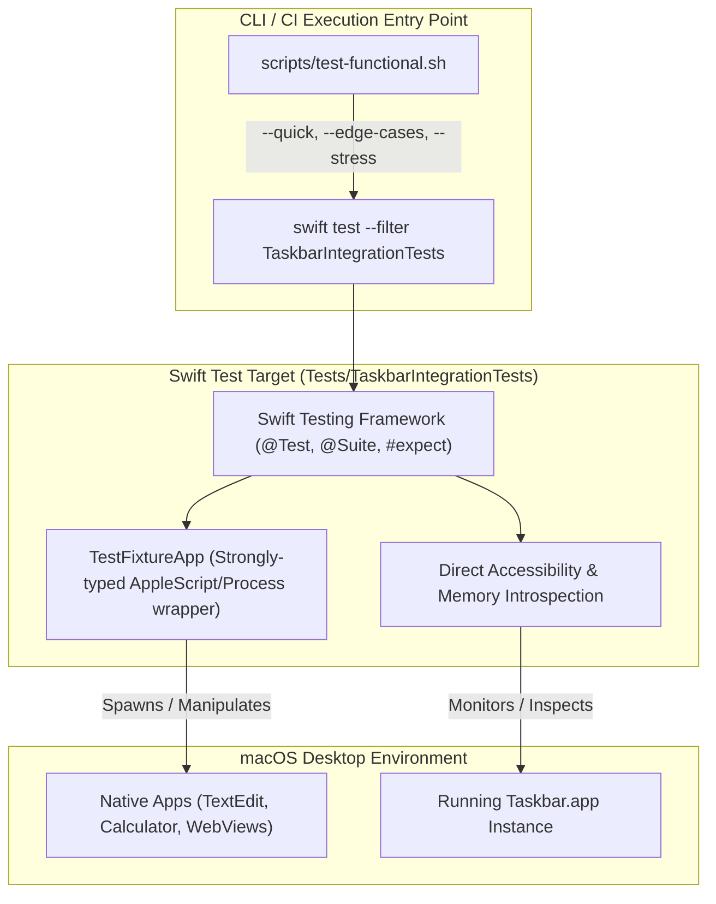

# Integration Test Framework Investigation & Evaluation

This document investigates testing framework architectures for **Taskbar** functional, integration, and stress testing (Tier 3). It details why running integration tests entirely within raw Bash scripts is suboptimal, evaluates candidate test frameworks (Swift, Python, TypeScript, and Bats), provides concrete code snippets for each, and outlines the recommended hybrid testing model.

---

## 1. Problem Statement: Why Pure Bash Is Fragile for Complex Tests

While Bash is effective for simple build scripts and CI entry points, implementing end-to-end window management tests entirely in Bash introduces significant maintenance risks:

1. **Lack of Structured Assertions:**
   - Pure Bash relies on exit codes and manual string comparisons (`if [ "$val" != "expected" ]; then ...`).
   - When a test fails, Bash produces no object diffs, variable dumps, or structured failure summaries without writing custom assertion engines.
2. **Brittle Setup & Teardown Hygiene:**
   - If an assertion fails midway through a Bash script, standard trap handlers (`trap cleanup EXIT`) must be carefully crafted to avoid orphaned windows or dirty desktop states.
   - Managing per-test fixtures (e.g. launching 3 apps, verifying state, and closing them before the next test) requires complex boilerplate.
3. **Async Polling & Timing Delays:**
   - Window Server animations (e.g. AppKit window miniaturization, space transitions) take 100–300ms to complete.
   - Writing resilient polling loops with timeouts in Bash requires cumbersome `while` loops, subshells, and sleep ticks that clutter test logic.
4. **No Test Lifecycle, Tagging, or Parallelism:**
   - Bash has no native test runner concepts: no `@Suite`, no test filtering by tag (e.g. `--quick` vs. `--stress`), and no formatted test reporting (JUnit XML, JSON).

---

## 2. Architectural Requirements for Taskbar Testing

Taskbar is a system-level window management overlay. Its testing harness must satisfy four requirements:

1. **External Process Orchestration:** Ability to launch, resize, minimize, mutate, and close *external* macOS applications (native Cocoa apps like `TextEdit` or `Calculator`, as well as Chromium and Electron apps).
2. **Reliable Teardown:** Guaranteed termination of fixture applications upon test pass, failure, or timeout.
3. **Accessibility & State Verification:** Ability to query window states (via macOS Accessibility APIs, AppleScript, or Taskbar internal status).
4. **Minimal Runtime Overhead:** Avoid introducing heavy runtimes or excessive package dependencies into a lightweight Swift project.

---

## 3. Candidate Framework Deep-Dive & Code Snippets

To illustrate how each framework approaches test fixtures, assertions, and teardown, we implement the identical test case across four candidate technologies:

> **Test Case (TC-FUNC-002):** Launch a `TextEdit` document, verify that it appears with 1 window, minimize it, assert that the window is minimized, restore it, assert that it is restored, and clean up.

---

### Candidate 1: Native Swift Integration Target (`Tests/TaskbarIntegrationTests`)

This approach adds a dedicated integration test target to `Package.swift` powered by **Swift Testing** (`import Testing`). A lightweight helper struct wraps AppleScript / `Process` calls while providing strongly-typed Swift models and `defer`-based cleanup.

```swift
import Testing
import Foundation
import ApplicationServices
@testable import TaskbarCore

/// Reusable fixture controller for real macOS application windows
public final class TestFixtureApp: @unchecked Sendable {
    public let appName: String
    private var isTerminated = false
    
    private init(appName: String) {
        self.appName = appName
    }
    
    public static func launchTextEdit(documentTitle: String) async throws -> TestFixtureApp {
        let script = """
        tell application "TextEdit"
            activate
            make new document with properties {name:"\(documentTitle)"}
        end tell
        """
        _ = try Shell.runAppleScript(script)
        try await Task.sleep(nanoseconds: 200_000_000) // Settle delay
        return TestFixtureApp(appName: "TextEdit")
    }
    
    public func windowCount() throws -> Int {
        let script = "tell application \"\(appName)\" to return count of windows"
        let output = try Shell.runAppleScript(script).trimmingCharacters(in: .whitespacesAndNewlines)
        return Int(output) ?? 0
    }
    
    public func minimizeWindow(index: Int = 1) throws {
        let script = "tell application \"\(appName)\" to set miniaturized of window \(index) to true"
        _ = try Shell.runAppleScript(script)
    }
    
    public func restoreWindow(index: Int = 1) throws {
        let script = "tell application \"\(appName)\" to set miniaturized of window \(index) to false"
        _ = try Shell.runAppleScript(script)
    }
    
    public func isWindowMinimized(index: Int = 1) throws -> Bool {
        let script = "tell application \"\(appName)\" to return miniaturized of window \(index)"
        let output = try Shell.runAppleScript(script).trimmingCharacters(in: .whitespacesAndNewlines)
        return output.lowercased() == "true"
    }
    
    public func terminate() {
        guard !isTerminated else { return }
        isTerminated = true
        _ = try? Shell.runAppleScript("tell application \"\(appName)\" to quit saving no")
    }
    
    deinit {
        terminate()
    }
}

// MARK: - Test Suite

@Suite("Window Lifecycle Integration Suite", .tags(.integration))
struct WindowLifecycleIntegrationTests {
    
    @Test("TC-FUNC-002: Window minimization and restoration state tracking")
    func testWindowMinimizationAndRestore() async throws {
        // 1. Launch fixture with self-cleaning defer
        let fixture = try await TestFixtureApp.launchTextEdit(documentTitle: "TaskbarTestDoc")
        defer { fixture.terminate() }
        
        #expect(try fixture.windowCount() == 1)
        
        // 2. Trigger minimization
        try fixture.minimizeWindow(index: 1)
        try await Task.sleep(nanoseconds: 150_000_000)
        
        // 3. Strongly typed assertion
        let minimized = try fixture.isWindowMinimized(index: 1)
        #expect(minimized == true)
        
        // 4. Trigger restore
        try fixture.restoreWindow(index: 1)
        try await Task.sleep(nanoseconds: 150_000_000)
        
        let restored = try fixture.isWindowMinimized(index: 1)
        #expect(restored == false)
    }
}
```

#### Evaluation:
- **Pros:** 100% Swift (zero external language runtimes); compiles alongside `TaskbarCore`; direct access to `AXUIElement` and `TaskbarCore` structs; guaranteed cleanup via `defer` and `deinit`; runs via `swift test --filter TaskbarIntegrationTests`.
- **Cons:** Requires adding the test target to `Package.swift`.

---

### Candidate 2: Python with PyTest (`tests/functional/test_window_lifecycle.py`)

Using Python's standard `pytest` framework with subprocess-driven AppleScript execution.

```python
import subprocess
import time
import pytest

def run_applescript(script: str) -> str:
    """Executes an AppleScript command via osascript and returns stdout."""
    result = subprocess.run(
        ["osascript", "-e", script],
        capture_output=True,
        text=True,
        check=True
    )
    return result.stdout.strip()

@pytest.fixture
def textedit_window():
    """Fixture to launch TextEdit with a document and guarantee clean termination."""
    script_open = """
    tell application "TextEdit"
        activate
        make new document with properties {name:"PyTestDoc"}
    end tell
    """
    run_applescript(script_open)
    time.sleep(0.2)  # Settle time
    
    yield "TextEdit"
    
    # Teardown: runs reliably after test finishes (pass or fail)
    script_close = 'tell application "TextEdit" to quit saving no'
    run_applescript(script_close)

# MARK: - Test Cases

def test_window_minimization_and_restore(textedit_window):
    """TC-FUNC-002: Verify window minimization and restoration."""
    app = textedit_window
    
    # 1. Assert initial window count
    count = int(run_applescript(f'tell application "{app}" to return count of windows'))
    assert count == 1, f"Expected 1 window, found {count}"
    
    # 2. Minimize window
    run_applescript(f'tell application "{app}" to set miniaturized of window 1 to true')
    time.sleep(0.15)
    
    # 3. Assert minimized state
    is_minimized = run_applescript(f'tell application "{app}" to return miniaturized of window 1')
    assert is_minimized.lower() == "true", "Window failed to minimize"
    
    # 4. Restore window
    run_applescript(f'tell application "{app}" to set miniaturized of window 1 to false')
    time.sleep(0.15)
    
    # 5. Assert restored state
    is_restored_min = run_applescript(f'tell application "{app}" to return miniaturized of window 1')
    assert is_restored_min.lower() == "false", "Window failed to restore"
```

#### Evaluation:
- **Pros:** Excellent fixture ergonomics (`yield` in fixtures ensures clean teardown); rich assertion diffs; vast ecosystem of plugins (`pytest-xdist`, `pytest-timeout`).
- **Cons:** Requires a Python 3 environment, `virtualenv`, and `pip install pytest`; adds dual-language maintenance to a Swift repository; cannot directly link or test Swift code.

---

### Candidate 3: TypeScript with Vitest / Node (`tests/functional/window-lifecycle.test.ts`)

Using TypeScript with `vitest` (or `jest`), invoking AppleScript or JXA (JavaScript for Automation) via `node:child_process`.

```typescript
import { describe, it, expect, beforeEach, afterEach } from 'vitest';
import { execSync } from 'node:child_process';

function runAppleScript(script: string): string {
  const sanitized = script.replace(/"/g, '\\"');
  return execSync(`osascript -e "${sanitized}"`, { encoding: 'utf8' }).trim();
}

function sleep(ms: number): Promise<void> {
  return new Promise((resolve) => setTimeout(resolve, ms));
}

describe('TC-FUNC-002: Window Minimization and Restoration', () => {
  const appName = 'TextEdit';

  beforeEach(async () => {
    // Launch TextEdit with a dedicated document
    runAppleScript(`
      tell application "${appName}"
        activate
        make new document with properties {name:"TSTestDoc"}
      end tell
    `);
    await sleep(200);
  });

  afterEach(() => {
    // Teardown: ensure TextEdit is terminated cleanly
    try {
      runAppleScript(`tell application "${appName}" to quit saving no`);
    } catch {
      // Ignored if app already closed
    }
  });

  it('accurately tracks window minimization and restoration', async () => {
    // 1. Verify window exists
    const windowCount = parseInt(
      runAppleScript(`tell application "${appName}" to return count of windows`),
      10
    );
    expect(windowCount).toBe(1);

    // 2. Minimize window
    runAppleScript(`tell application "${appName}" to set miniaturized of window 1 to true`);
    await sleep(150);

    // 3. Verify minimized state
    const isMinimized = runAppleScript(
      `tell application "${appName}" to return miniaturized of window 1`
    );
    expect(isMinimized.toLowerCase()).toBe('true');

    // 4. Restore window
    runAppleScript(`tell application "${appName}" to set miniaturized of window 1 to false`);
    await sleep(150);

    // 5. Verify restored state
    const isStillMinimized = runAppleScript(
      `tell application "${appName}" to return miniaturized of window 1`
    );
    expect(isStillMinimized.toLowerCase()).toBe('false');
  });
});
```

#### Evaluation:
- **Pros:** Can leverage JXA (`osascript -l JavaScript`) natively; readable `describe` / `it` / `expect` syntax; fast test execution.
- **Cons:** Requires Node.js runtime, `package.json`, `tsconfig.json`, and `node_modules` directory; external dependency footprint is disproportionate for a lightweight native Swift desktop project.

---

### Candidate 4: Bash with Bats-core (`tests/functional/window_lifecycle.bats`)

Using Bats (Bash Automated Testing System) to provide structured test cases in shell script.

```bash
#!/usr/bin/env bats

setup() {
  # Launch TextEdit before each test
  osascript -e 'tell application "TextEdit" to activate'
  osascript -e 'tell application "TextEdit" to make new document with properties {name:"BatsDoc"}'
  sleep 0.2
}

teardown() {
  # Guarantee cleanup after each test
  osascript -e 'tell application "TextEdit" to quit saving no' || true
}

@test "TC-FUNC-002: Window minimization and restoration state tracking" {
  # 1. Assert window count
  run osascript -e 'tell application "TextEdit" to return count of windows'
  [ "$status" -eq 0 ]
  [ "$output" -ge 1 ]

  # 2. Minimize window
  run osascript -e 'tell application "TextEdit" to set miniaturized of window 1 to true'
  [ "$status" -eq 0 ]
  sleep 0.15

  # 3. Assert minimized state
  run osascript -e 'tell application "TextEdit" to return miniaturized of window 1'
  [ "$status" -eq 0 ]
  [ "$output" = "true" ]

  # 4. Restore window
  run osascript -e 'tell application "TextEdit" to set miniaturized of window 1 to false'
  [ "$status" -eq 0 ]
  sleep 0.15

  # 5. Assert restored state
  run osascript -e 'tell application "TextEdit" to return miniaturized of window 1'
  [ "$status" -eq 0 ]
  [ "$output" = "false" ]
}
```

#### Evaluation:
- **Pros:** Adds structured `setup`, `teardown`, and `@test` syntax to shell scripts.
- **Cons:** Requires installing `bats` binary (via Homebrew); still suffers from bash variable stringification, lacks type checking, and becomes awkward for complex JSON data structures or memory profiling.

---

## 4. Architectural Comparison Matrix

| Evaluation Criteria | 1. Swift Integration Target (`TaskbarIntegrationTests`) | 2. Python (`pytest`) | 3. TypeScript (`vitest`) | 4. Bats-Core (Bash) |
|---|---|---|---|---|
| **Ecosystem Cohesion** | **100% Native Swift** | Mixed (Swift + Python) | Mixed (Swift + TS) | Mixed (Swift + Bash) |
| **External Dependencies** | **Zero** | `python3`, `pip`, `venv` | `node`, `npm`, `node_modules` | `brew install bats-core` |
| **Fixture Cleanup Safety** | **High** (`defer`, `deinit`) | **High** (`yield` fixture) | **High** (`afterEach`) | **Medium** (`teardown`) |
| **Typed Assertions & Diffs** | **High** (`#expect`, Swift types) | **High** (`assert`, pytest diffs) | **High** (`expect()`) | **Low** (`[ "$val" = "x" ]`) |
| **Direct System/AX Access** | **Full** (`AXUIElement`, `NSWorkspace`) | Subprocess only | Subprocess / JXA only | Subprocess only |
| **CLI & CI Integration** | Single command: `swift test` | `pytest` | `npm test` | `bats tests/` |

---

## 5. Architectural Recommendation: The Hybrid Swift + Runner Model

Based on this evaluation, the optimal architecture for Taskbar is the **Hybrid Swift + Runner Model**:



### Key Principles of the Hybrid Model:
1. **Tests are Authored in Swift (`Tests/TaskbarIntegrationTests/`):**
   - Full compiler safety, structured `@Test` annotations, descriptive test names, and automatic cleanup (`defer`).
   - Reusable `TestFixtureApp` helper encapsulates all AppleScript strings in one clean, tested location.
2. **Bash Serves Exclusively as a High-Level Runner (`scripts/test-functional.sh`):**
   - Does not contain brittle test logic.
   - Handles environment pre-flight (checking Accessibility permissions, ensuring no conflicting apps are running).
   - Executes the Swift test suite: `swift test --filter TaskbarIntegrationTests`.
   - Records RSS memory and CPU benchmarks (`ps`, `vmmap`) before and after the run.
   - Outputs clean, colored summary banners.
