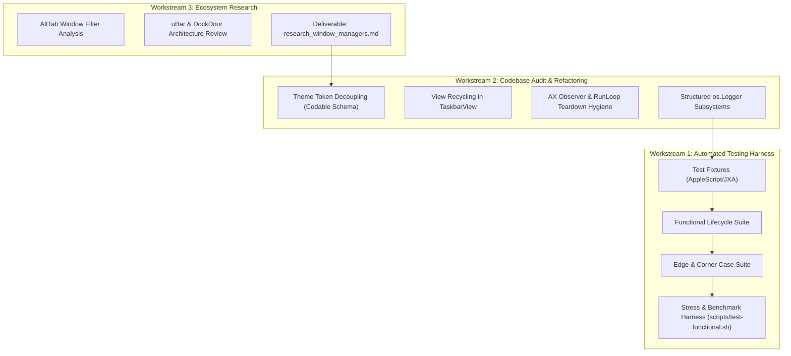
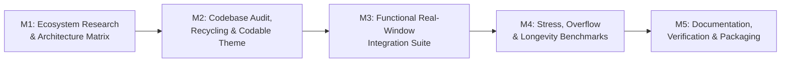

# Taskbar v0.1.1 Implementation Plan: Foundational Quality, Testing & Research

This document outlines the detailed engineering roadmap, architecture, and task sequence for **Taskbar v0.1.1**.

The focus of this milestone is **foundational hardening**: establishing automated functional and stress test harnesses with real windows, auditing and refactoring the codebase for maintainability and performance, and conducting ecosystem research into macOS window managers.

---

## 1. Milestone Goals & Success Metrics

| Goal | Success Criteria / Target |
|---|---|
| **Zero Functional Regressions** | Automated test harness executing complete window lifecycle tests against real macOS windows with 100% pass rate. |
| **Edge & Corner Case Coverage** | Validated filtering and handling of 0x0 minimized windows (Chromium/Electron), modal sheets/dialogs, rapid title changes, and full-screen spaces. |
| **Stress & Memory Stability** | Stable execution under 50–100 active windows; resident memory $< 45\text{ MB}$ RSS under load, $< 40\text{ MB}$ RSS idle; zero memory leaks after window destruction. |
| **Idle CPU Footprint** | Measured idle CPU $< 0.1\%$ averaged over 10 seconds of inactivity. |
| **Clean Architecture for v0.2.0** | `ThemeDefinition` decoupled into a fully `Codable` schema ready for `.json` custom theming; view recycling in `TaskbarView` replacing full view teardowns. |

---

## 2. Workstream Breakdown



---

### Workstream 1: Testing Framework Strategy, Test Case Documentation & Harness

#### 1. Testing Frameworks Evaluation & Architecture
To test a macOS utility like Taskbar—which monitors system-wide external application windows across process boundaries—we evaluate and select testing technologies across three layers:

| Layer | Candidate Technologies | Evaluation & Architectural Decision |
|---|---|---|
| **Unit / Logic Layer** | **XCTest** vs. **Swift Testing** (`@Test`, `@Suite`) | **Dual Strategy:** Retain existing 41 `XCTest` suites in `Tests/TaskbarCoreTests`. For new tests (e.g. `ThemeCodableTests`, boundary geometry matrix), adopt **Swift Testing** (`import Testing`). Its parameterized `@Test(arguments: ...)` drastically reduces boilerplate when testing permutations of window sizes, themes, and clamping math. |
| **System & E2E Layer** | **Pure Bash** vs. **Python (pytest)** vs. **TS (vitest)** vs. **Swift (`TaskbarIntegrationTests`)** | **Hybrid Swift Target + Bash Runner:** Integration tests are authored in a dedicated `Tests/TaskbarIntegrationTests` Swift target using `Swift Testing` (`@Test`, `@Suite`, `#expect(...)`) and typed `TestFixtureApp` helpers with `defer` cleanup. `scripts/test-functional.sh` acts as the high-level CLI and CI orchestrator (pre-flight checks, memory/CPU metrics collection, running `swift test --filter TaskbarIntegrationTests`). Detailed framework evaluation and snippets preserved in [`test_framework_investigation.md`](test_framework_investigation.md). |

#### 2. Test Case Documentation Standard (`docs/v0.1.1/TEST_SPECIFICATIONS.md`)
To ensure rigorous QA without regressions, all test cases must be documented in a central, standardized specification catalog.

##### Test Case Taxonomy:
- `TC-FUNC-xxx`: Functional window lifecycle (launch, minimize, restore, focus, title update, close, quit).
- `TC-EDGE-xxx`: Boundary & corner cases (0x0 minimized frames, modal sheets, full-screen spaces, multi-display moves).
- `TC-STRESS-xxx`: Load & capacity tests (50–100 window bursts, overflow chevron layout).
- `TC-PERF-xxx`: Performance & longevity benchmarks (RSS memory bounds, memory leaks, idle CPU).
- `TC-UNIT-xxx`: Core logic & math unit tests (clamping math, button layout, JSON codecs).

##### Standard Test Specification Schema:
Every test case in `docs/v0.1.1/TEST_SPECIFICATIONS.md` will follow this structure:
```markdown
### [TC-FUNC-002] Window Minimization and Deminiaturization State Tracking
- **Category:** Functional / Window State
- **Preconditions:** Taskbar running; TextEdit fixture launched with 1 window.
- **Stimulus / Action:** 
  1. Trigger window minimization via AX or AppleScript (`set miniaturized of window 1 to true`).
  2. Wait 100ms.
  3. Trigger window restore (`set miniaturized of window 1 to false`).
- **Expected Outcome:** 
  1. Taskbar button visual state changes to `isMinimized == true`.
  2. Clicking button restores window and restores active state.
- **Automated Verification:** `scripts/test-functional.sh --quick` (Case 2)
- **Pass/Fail Criteria:** Button state matches actual AX window state within 100ms.
```

##### Traceability Matrix:
A cross-reference table mapping Roadmap Requirements (v0.1.1 through v0.4.0) to Test Case IDs (`TC-*`) ensuring 100% test coverage before release.

#### 3. Automated Harness Architecture (Swift Target + `scripts/test-functional.sh`)
- **Swift Test Suite (`Tests/TaskbarIntegrationTests/`):**
  - Contains all test methods, fixtures, and assertions using `Swift Testing` (`@Test`, `@Suite`, `#expect`).
  - Helper controllers (`TestFixtureApp`) encapsulate AppleScript commands and window interaction with safe `defer { fixture.terminate() }` cleanup.
  - Interacts directly with `TaskbarCore` and macOS `AXUIElement` APIs with full type safety.
- **Orchestration Runner (`scripts/test-functional.sh`):**
  - A fail-fast bash script (`set -euo pipefail`) serving as the CLI and CI entrypoint.
  - Pre-flight checks: ensures Accessibility permissions are granted and no conflicting test windows exist.
  - Invokes Swift test target with tag filters: `swift test --filter TaskbarIntegrationTests`.
  - Benchmarks resident memory (RSS via `ps`/`vmmap`) and idle CPU before and after tests.
- **Modes of Operation:**
  - `./scripts/test-functional.sh --quick`: Runs basic functional lifecycle tests (`TC-FUNC-*`, < 15 seconds).
  - `./scripts/test-functional.sh --edge-cases`: Runs corner cases (`TC-EDGE-*`: sheets, 0x0 frames, rapid titles).
  - `./scripts/test-functional.sh --stress`: Spawns 50+ windows (`TC-STRESS-*`), validates chevron overflow, benchmarks memory/CPU (`TC-PERF-*`), and cleans up.
  - `./scripts/test-functional.sh --all`: Complete end-to-end suite.

#### 4. Real Window Test Fixtures & Matrix (Hybrid Strategy)
- **Hybrid Fixture Strategy:**
  - **Dedicated Swift Test Fixture (`TestWindowFixture`):** A minimal, headless/lightweight Swift test helper compiled as part of the test suite. Provides deterministic, instant creation of 50–100 test windows, programmatic title mutations, 0x0 minimized windows, and modal sheets without disk I/O, iCloud prompts, or system alert interference.
  - **Native macOS Apps (`TextEdit`, `Finder`):** Validates real-world integration with Apple's standard system applications via AppleScript drivers.
- **Accessibility Permission Handling:**
  - Interactive prompt then fail-fast: On startup, check `AXIsProcessTrusted()`. If not trusted, invoke `AXIsProcessTrustedWithOptions` to present macOS System Settings prompt, wait up to 15 seconds for authorization, and fail fast with actionable terminal diagnostics if not granted.
- **Test matrix:**
  1. **Window Creation & Detection (`TC-FUNC-001`):** App launches -> window appears -> Taskbar creates corresponding task button within $< 100\text{ms}$.
  2. **Window Minimization (`TC-FUNC-002`):** Window is minimized via AX -> button updates visual state to minimized.
  3. **Window Deminiaturization / Restoration (`TC-FUNC-003`):** Window is restored via AX -> button updates to normal state.
  4. **Active Focus Tracking (`TC-FUNC-004`):** Switching between two fixture windows updates the active button highlight accurately.
  5. **Dynamic Title Mutation (`TC-FUNC-005`):** Script modifies window document title -> Taskbar button reflects the new title without flicker.
  6. **Window Close & Destruction (`TC-FUNC-006`):** Window closes -> task button is removed; remaining buttons expand/reflow smoothly.
  7. **Process Termination (`TC-FUNC-007`):** App quits -> all corresponding task buttons are removed; `AXAppObserver` is torn down.

#### 5. Edge and Corner Cases Matrix
- **0x0 Minimized Frames (`TC-EDGE-001`):** Simulate minimized windows reporting zero-size frames (common in Chromium/Electron) and confirm `WindowFilter.shouldInclude` keeps them without throwing layout exceptions.
- **Modal Sheets & Save Panels (`TC-EDGE-002`):** Open open/save sheet in `TextEdit` or `TestWindowFixture` (`kAXSheetRole`, `kAXDialogRole`) and assert they are ignored by `WindowFilter`.
- **Rapid Title Churn (`TC-EDGE-003`):** A loop changing window title 20 times in 1 second to verify that `AppTracker` event debouncing (`TaskbarConstants.Timing.frameRenderDebounce = 0.05s`) coalesces events and prevents CPU spikes.
- **Space & Full-Screen Transitions (`TC-EDGE-004`):** Trigger native full-screen mode on a window and verify Taskbar hides/reveals appropriately.

#### 6. Stress & Longevity Benchmarks
- **Overflow Chevron Verification (`TC-STRESS-001`):**
  - Programmatically spawn 40–60 small windows via `TestWindowFixture`.
  - Assert that `OverflowButton` (`»`) becomes visible when buttons exceed available screen width.
  - Verify that clicking the overflow button opens the dropdown menu listing hidden windows.
- **Memory & Allocation Bounds (`TC-PERF-001`):**
  - Record RSS before test: $M_{\text{baseline}}$.
  - Under 50 windows: assert $M_{\text{peak}} < 45\text{ MB}$.
  - After closing all test windows: assert $M_{\text{final}} \le M_{\text{baseline}} + 2\text{ MB}$ (verifying no heap leaks).
- **Idle CPU Verification (`TC-PERF-002`):**
  - Measure Taskbar CPU usage over 10 seconds with `ps -o %cpu` or `sample`. Assert average CPU is $< 0.1\%$.

---

### Workstream 2: Codebase Audit, Cleanup & Refactoring

#### 1. Pure Data-Driven Theme Registry (`TaskbarCore/Config/Theme.swift`)
- **Current State:** `RGBAColor` is `Codable`, but `ThemeDefinition` contains hardcoded preset logic in `Theme.swift`.
- **Refactoring (Pure Data-Driven Registry):**
  - Decompose `ThemeDefinition` into structured `Codable` component tokens:
    - `ThemePalette`: background, text, borders, bevel highlights/shadows.
    - `ThemeMetrics`: button corner radii, padding, font size, icon size, 3D bevel flag.
    - `ThemeMaterials`: translucency flags.
  - Make `ThemeDefinition: Codable, Equatable, Sendable` with `id: String`, `displayName: String`, and `isCustom: Bool`.
  - Implement `ThemeRegistry` singleton to manage both built-in static presets (`.modernHybrid`, `.retroClassic`) and runtime-imported user JSON themes without code distinction.
  - Update `Settings.swift` to store `activeThemeId: String = "modern-hybrid"`.
  - Add unit tests verifying JSON encoding, decoding, and round-trip export of all themes.

#### 2. View Recycling in `TaskbarView` (`TaskbarApp/UI/TaskbarView.swift`)
- **Current State:** `updateWindows(windows:...)` currently calls `existing.removeFromSuperview()` on all task buttons and allocates new `TaskButton` instances on every update.
- **Optimization:**
  - Introduce an internal button pool / key map: `[WindowKey: TaskButton]`.
  - Re-use existing `TaskButton` views across updates if the `WindowKey` matches:
    - Update `windowInfo`, `isFocusedWindow`, and `theme` in-place.
    - Only instantiate new buttons for newly discovered windows.
    - Remove only destroyed window buttons from superview.
  - **Impact:** Eliminates transient heap allocations, reduces `NSTrackingArea` churn, and smooths out rapid window switching.

#### 3. AX Observer & RunLoop Teardown Hygiene
- **`AXAppObserver.swift`:**
  - In `invalidate()`, systematically call `AXObserverRemoveNotification` for all registered application-level and window-level notifications before tearing down the observer.
  - Ensure `CFRunLoopRemoveSource` and `CFRunLoopWakeUp` are safely executed on `AXThread.shared.runLoop`.
- **`AppTracker.swift`:**
  - Implement `stopTracking()` and `deinit` to remove observers from `NSWorkspace.shared.notificationCenter` and invalidate all `AXAppObserver` instances.
- **`ScreenManager.swift`:**
  - Add `deinit` to unregister from `NotificationCenter.default` and `NSWorkspace.shared.notificationCenter`.

#### 4. Unified Logging & Diagnostic Infrastructure
- Replace ad-hoc `print(...)` statements with Apple's unified `os.Logger`:
  - Subsystem: `com.taskbar.app` (or dynamic from `BuildConfiguration.bundleIdentifier`).
  - Categories: `Tracking`, `UI`, `WorkArea`, `Dock`, `Lifecycle`.
  - Enables low-overhead, filterable system logs in Console.app during stress testing and debugging.

---

### Workstream 3: macOS Window Management Ecosystem Research

#### 1. Scope & Research Targets
- **AltTab (open-source macOS):**
  - Examine window filtering rules: how it filters utility panels, zero-sized windows, Menubar extras, and hidden helper processes.
  - Review AX event throttling and caching strategies for window titles and icons.
- **uBar (commercial macOS):**
  - Study multi-monitor window segregation, window grouping heuristics, and dock replacement ergonomics.
- **DockDoor / Ice / Hidden Bar (open-source Swift):**
  - Study `NSPanel` window level layering (`.statusBar`, `.popUpMenu`), screen change event handling, and multi-space compatibility.

#### 2. Research Deliverable *(Completed)*
- Authored [`plans/v0.1.1/research_window_managers.md`](research_window_managers.md) with:
  - Comparative analysis matrix (Architecture, Permissions, Latency, CPU/Memory).
  - Concrete architectural recommendations for Taskbar's v0.2.0 (Custom Theming & Pinned Apps) and v0.3.0 (Grouping & Reordering).
  - Deep dive into AltTab (AX timeouts, Chromium 0x0 frames, debounce), uBar (window grouping, multi-monitor segregation), and DockDoor (ScreenCaptureKit vs Accessibility tradeoffs).

---

## 3. Execution Milestones & Sequence



### Milestone Schedule:
- **Milestone 1 (M1): Ecosystem Research Document** *(Completed)*
  - Authored comprehensive ecosystem review in [`research_window_managers.md`](research_window_managers.md).
  - Extracted key mechanics for window filtering (0x0 Chromium frames), AX timeout isolation, observer teardown, and architectural blueprints for v0.2.0–v0.4.0.
- **Milestone 2 (M2): Codebase Audit & Performance Refactoring** *(Completed)*
  - Decoupled `ThemeDefinition` into pure data-driven `Codable` schema with structured token groups (`ThemePalette`, `ThemeMetrics`, `ThemeMaterials`).
  - Added thread-safe `ThemeRegistry` singleton supporting dynamic built-ins and custom JSON import/export with round-trip test coverage.
  - Implemented persistent key-based `TaskButton` view recycling in `TaskbarView`, eliminating heap allocation thrashing on window updates.
  - Hardened observer and notification teardown hygiene across `AXAppObserver`, `AppTracker`, and `ScreenManager`.
  - Migrated entire codebase logging to unified Apple `os.Logger` (`TaskbarLogger` across `lifecycle`, `tracking`, `workArea`, `dock`, `ui`).
  - Verified all 44 unit tests pass (`swift test`) and clean release bundle assembly (`./scripts/build-app.sh`).
- **Milestone 3 (M3): Functional Integration Test Harness & Documentation**
  - Author `docs/v0.1.1/TEST_SPECIFICATIONS.md` with complete `TC-FUNC-*`, `TC-EDGE-*`, `TC-STRESS-*`, `TC-PERF-*` catalogs and traceability matrix.
  - Implement `scripts/test-functional.sh` with AppleScript/JXA real-window fixtures.
  - Implement `--quick` and `--edge-cases` test suites (happy path, minimize, restore, sheets, title changes).
- **Milestone 4 (M4): Stress & Longevity Benchmarks**
  - Implement `--stress` test mode spawning 50+ windows.
  - Validate chevron overflow menu under load.
  - Benchmark RSS (<45MB) and CPU (<0.1% idle) with automated pass/fail assertions.
- **Milestone 5 (M5): Verification & Release**
  - Run full test suite (`swift test` + `scripts/test-functional.sh --all`).
  - Update `docs/v0.1.1/` (`TESTING.md`, `ARCHITECTURE.md`, `CONFIGURATION.md`) and `CHANGELOG.md`.
  - Package release using `scripts/package-release.sh --patch` to produce `v0.1.1`.

---

## 4. Verification & Acceptance Checklist

- [ ] **Functional Tests:** `scripts/test-functional.sh --quick` passes 100% on a clean macOS environment.
- [ ] **Edge Cases:** Modal sheets, 0x0 frames, and dynamic title churn handled without crashes or dropped windows.
- [ ] **Stress Test:** `scripts/test-functional.sh --stress` passes with 50+ windows; chevron button appears and functions properly.
- [ ] **Memory Hygiene:** RSS remains $< 45\text{ MB}$ under peak load and recovers to baseline after window teardown.
- [ ] **Idle CPU:** Averaged idle CPU stays $< 0.1\%$.
- [ ] **Unit Tests:** `swift test` passes 100% (including new `ThemeCodableTests`).
- [ ] **Fail-Fast:** All scripts fail immediately if prerequisites or configurations are missing.
- [ ] **Privacy Check:** Zero mentions of personal user directories in code, logs, docs, or commit history.
