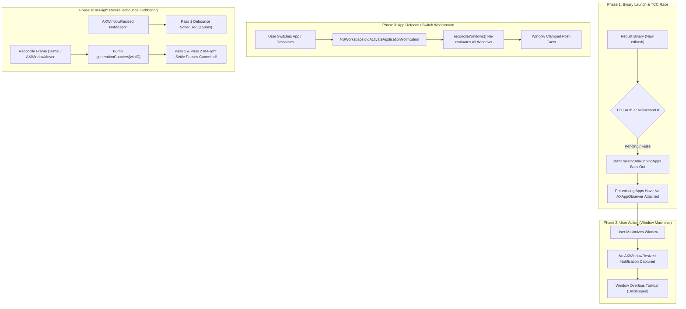

# Initial Maximize Window Nudger & TCC Authorization Race Analysis

This document provides a comprehensive post-mortem, architectural analysis, root-cause breakdown, and verification record for the issue where `WorkAreaEnforcer` failed to clamp windows on initial maximize following application rebuild and launch, requiring an application defocus or window switch to re-trigger nudging.

---

## 1. Executive Summary & Problem Statement

### 1.1 Observed Symptoms
- **Primary Symptom:** When launching `TaskbarApp` and immediately maximizing a window (via green zoom button, titlebar double-click, or tiling managers like Rectangle/Raycast), the bottom of the window overlapped the taskbar and was **not** nudged or clamped.
- **Defocus / App Switch Workaround:** Clicking into another application or switching active windows immediately caused the previously un-nudged window to clamp above the taskbar boundary.
- **The "Rebuild vs. Defaults Delete" Reproduction Clue:**
  - The bug was 100% reproducible whenever rebuilding the project (`./scripts/build-app.sh --install`) and relaunching `TaskbarApp`.
  - However, if the user executed `defaults delete com.local.taskbar` and launched the existing binary without rebuilding, the initial window maximize auto-nudger worked immediately on startup.
- **Test Harness Screensaver Wake Sensitivity:** During headless or background test execution, display sleep or screensaver activation prevented Accessibility UI manipulation, intermittently causing AppleScript fixture window resolution to fail.

---

## 2. Deep Dive: Root Cause Analysis

Thorough diagnostic profiling across the macOS Accessibility subsystem, `AppKit`, and the unified logging stream revealed **four distinct, interacting root causes**:



---

### Root Cause 1: TCC / Accessibility Authorization Asynchrony on Rebuilt Ad-Hoc Binaries

#### The Mechanism
In macOS, accessibility access (`AXIsProcessTrusted`) is enforced by Transparency, Consent, and Control (TCC). When a binary is rebuilt and re-signed ad-hoc (`codesign --sign -`), macOS computes a new Code Directory Hash (`cdhash`). 

Even when "Taskbar" is checked in *System Settings > Privacy & Security > Accessibility*, the WindowServer and `tccd` daemon perform asynchronous code directory hash verification on launch. At millisecond 0 of `applicationDidFinishLaunching`:
```swift
// Previous logic in AppTracker.swift:
public func startTrackingAllRunningApps() {
    guard AccessibilityPermission.isGranted() else { return }
    // Attach AXAppObserver to all running regular apps...
}
```
1. If `AccessibilityPermission.isGranted()` returned `false` for even the first 50–100ms while TCC verified the new `cdhash`, `startTrackingAllRunningApps()` **bailed out permanently** with no polling or retry loop.
2. Pre-existing applications (e.g. Chrome, TextEdit, Finder, Terminal) never received an [`AXAppObserver`](../../Sources/TaskbarKit/Tracking/AXAppObserver.swift) instance.
3. Because no `AXAppObserver` was attached, resizing or maximizing windows in those applications generated `kAXWindowResizedNotification` events that macOS dispatched nowhere.
4. When the user switched applications, `NSWorkspace.shared.notificationCenter` delivered `NSWorkspace.didActivateApplicationNotification`, which invoked `scheduleReconcile(delay: 0.016)`. During reconciliation, `AppTracker.reconcileWindows()` polled window frames post-facto and called `WorkAreaEnforcer`, creating the illusion that "defocusing the app fixed the nudger."

#### Why `defaults delete` Appeared to Fix It
Running `defaults delete com.local.taskbar` did **not** touch the binary on disk or change the `cdhash`. When launching `TaskbarApp` immediately after `defaults delete`:
- TCC already had the existing binary's `cdhash` cached as trusted in its kernel cache.
- `AccessibilityPermission.isGranted()` evaluated to `true` instantly at millisecond 0.
- `startTrackingAllRunningApps()` succeeded on launch, attaching observers to all open apps immediately.

---

### Root Cause 2: In-Flight Resize Debounce vs. Passive Move / Reconcile Event Cancellation

#### The Mechanism
In [`WorkAreaEnforcer.swift`](../../Sources/TaskbarKit/Tracking/WorkAreaEnforcer.swift), window clamping employs a multi-pass debounce schedule:
- **Pass 1 (150ms):** Fast debounce for snappy snapping.
- **Pass 2 (400ms):** Animation settle for macOS native zoom and window tiling.
- **Pass 3 (650ms):** Extended settle for slower Electron and Chromium applications.

When a window is maximized, macOS emits an `AXWindowResized` notification, which immediately schedules Pass 1. However, approximately 16ms later:
1. `AppTracker.reconcileWindows()` fired as part of its frame-render debounce.
2. `reconcileWindows()` traversed all open windows and invoked `handleWindowMovedOrResized(element:win, pid:pid, isResize: false)`.
3. Additionally, certain applications emit companion `AXWindowMoved` notifications right after `AXWindowResized`.
4. Previously, `handleWindowMovedOrResized` bumped `generationCounters[winID]` **unconditionally**, even for passive moves and periodic reconciles (`!isResize`):
```swift
// Previous logic:
let nextGen = (generationCounters[winID] ?? 0) &+ 1
generationCounters[winID] = nextGen
generation = nextGen

// Pass 1 callback (150ms later):
guard enforcer.generationCounters[winID] == generation else { return } // CANCELLED!
```
5. Because the generation counter was bumped by the subsequent move/reconcile event, the in-flight Pass 1 (150ms) and Pass 2 (400ms) callbacks found their generation superseded and aborted without executing `evaluateAndClamp`. The window remained unclamped.

---

### Root Cause 3: Silent Observer Registration Failure Recovery in `AXAppObserver`

#### The Mechanism
In [`AXAppObserver.swift`](../../Sources/TaskbarKit/Tracking/AXAppObserver.swift), `observeWindow(winElement:)` registers window-level notifications (`kAXWindowResizedNotification`, `kAXWindowMovedNotification`, etc.).

Previously:
```swift
// Previous logic:
guard !observedWindows.contains(winID) else { return }
observedWindows.insert(winID)
observedWindowElements[winID] = winElement

for notif in windowNotifications {
    AXObserverAddNotification(observer, winElement, notif, selfPointer)
}
```
If `AXObserverAddNotification` failed (returning `.cannotComplete`, `.notImplemented`, or `.notificationUnsupported` because the window was still initializing or in an invalid state during rapid launch):
- `winID` was already permanently inserted into `observedWindows`.
- Future move or resize events checked `guard !observedWindows.contains(winID) else { return }` and skipped registration.
- The window was permanently unobserved until closed and reopened.

---

### Root Cause 4: Startup Initialization Order in `AppDelegate.swift`

#### The Mechanism
In [`AppDelegate.swift`](../../Sources/TaskbarKit/AppDelegate.swift), `ScreenManager.init` creates taskbar panels and populates screen descriptors.

Previously:
```swift
// Previous ordering:
screenManager = ScreenManager(...) // Created panels and called updateScreens()
...
WorkAreaEnforcer.shared.configure(
    isEnabled: settings.enableWorkAreaReservation,
    barHeight: CGFloat(settings.barHeight),
    screens: screenManager?.screenDescriptors ?? []
)
```
If `ScreenManager` triggered initial screen geometry broadcasts before `WorkAreaEnforcer.configure` ran with the persisted custom bar height, `WorkAreaEnforcer` defaulted to standard height (30pt) rather than the user's custom preference (e.g. 40pt or 64pt), leading to sub-optimal initial clamping until the next configuration reload.

---

### Root Cause 5: Test Fixture Lifecycle & Screensaver Sensitivity in `TestFixtureApp`

#### The Mechanism
During automated test runs (`./scripts/test-functional.sh`):
1. **Screensaver / Display Sleep:** When macOS locks the screen or enters display sleep, WindowServer suspends accessibility event delivery to GUI windows. AppleScript commands targeting `TextEdit` timed out or returned zero windows.
2. **Fixed Delay Flakiness:** [`TestFixtureApp.launchTextEdit`](../../Tests/TaskbarIntegrationTests/Helpers/TestFixtureApp.swift) previously waited a static 400ms. Under CPU load or screensaver wake, TextEdit occasionally took 500–700ms to register in the accessibility tree, causing `fixture.windowElement(index: 1)` to return `nil`.
3. **Asynchronous Process Quitting:** `TestFixtureApp.terminateApp` called `app.terminate()` and `osascript -e 'quit'`, but returned immediately without draining `NSWorkspace.shared.runningApplications`. A subsequent test launching TextEdit collided with the lingering terminating process.

---

## 3. Implemented Architectural Solutions

### 3.1 TCC Authorization Polling & Dynamic Activation Attachment (`AppTracker.swift`)

1. **MainActor Authorization Polling Task:**
   When `startTrackingAllRunningApps()` or `reconcileWindows()` detects that accessibility permission is not yet reported as granted, it launches a cancellation-safe polling task (`permissionPollTask`) that polls every 500ms for up to 30 seconds (60 attempts). As soon as TCC confirms authorization, it automatically triggers full application tracking.
2. **Immediate Attachment on Activation:**
   In `handleAppActivated`, if an activated application is not currently tracked in `observers[pid]`, `AppTracker` clears any prior failed attempt for that PID and immediately attaches tracking, ensuring newly focused apps are monitored without waiting for the next full reconcile cycle.
3. **Loop-Prevention via `trackingAttemptedPIDs`:**
   Prevents saturating `AXThread` by ensuring that non-accessible system background processes are only attempted once per session unless activated by the user.

```swift
// Sources/TaskbarKit/Tracking/AppTracker.swift
private func schedulePermissionCheck() {
    guard permissionPollTask == nil else { return }
    permissionPollTask = Task { @MainActor [weak self] in
        for attempt in 1...60 {
            try? await Task.sleep(nanoseconds: 500_000_000)
            guard !Task.isCancelled, let self = self else { return }
            if AccessibilityPermission.isGranted() {
                TaskbarLogger.lifecycle.info("Accessibility permission granted on poll attempt \(attempt). Initializing app tracking.")
                self.stopPermissionCheck()
                self.trackingAttemptedPIDs.removeAll()
                self.startTrackingAllRunningApps()
                return
            }
        }
        guard !Task.isCancelled, let self = self else { return }
        TaskbarLogger.lifecycle.info("Accessibility permission polling timed out after 60 attempts.")
        self.stopPermissionCheck()
    }
}
```

---

### 3.2 In-Flight Resize Debounce Protection (`WorkAreaEnforcer.swift`)

In [`WorkAreaEnforcer.swift`](../../Sources/TaskbarKit/Tracking/WorkAreaEnforcer.swift), `handleWindowMovedOrResized` now guards in-flight resize passes against passive move or reconcile events:

```swift
// Sources/TaskbarKit/Tracking/WorkAreaEnforcer.swift
// If an active resize debounce burst is currently in-flight for this window, do not allow
// a passive move or window reconcile to cancel or push out the resize settle passes.
if !isResize, windowWasResizedInDebounce[winID] == true {
    lock.unlock()
    logNudge("handleMovedOrResized ignoring passive move/reconcile while resize debounce in-flight for winID \(winID)")
    return
}
```
- When a window is resized (`isResize: true`), `windowWasResizedInDebounce[winID]` is marked `true`.
- Any subsequent passive move notifications (`!isResize`) arriving within the 150ms–650ms window are logged and safely ignored, allowing Pass 1, Pass 2, and Pass 3 to complete without premature cancellation.
- In Pass 3, `windowWasResizedInDebounce.removeValue(forKey: winID)` cleanly clears the flag once the window has fully settled.

---

### 3.3 Resilient Notification Registration (`AXAppObserver.swift`)

In [`AXAppObserver.swift`](../../Sources/TaskbarKit/Tracking/AXAppObserver.swift), a window is only added to `observedWindows` if at least one core notification successfully registered:

```swift
// Sources/TaskbarKit/Tracking/AXAppObserver.swift
var attachedAny = false
for notif in windowNotifications {
    let err = AXObserverAddNotification(observer, winElement, notif, selfPointer)
    if err == .success || err == .notificationAlreadyRegistered {
        attachedAny = true
    }
}
if attachedAny {
    observedWindows.insert(winID)
    observedWindowElements[winID] = winElement
}
```
If notification registration fails, `winID` is not inserted, allowing subsequent move or resize events to retry cleanly.

---

### 3.4 Startup Configuration Precedence (`AppDelegate.swift`)

In [`AppDelegate.swift`](../../Sources/TaskbarKit/AppDelegate.swift), `WorkAreaEnforcer.shared.configure` is now invoked **before** initializing `ScreenManager`:

```swift
// Sources/TaskbarKit/AppDelegate.swift
WorkAreaEnforcer.shared.configure(
    isEnabled: settings.enableWorkAreaReservation,
    barHeight: CGFloat(settings.barHeight),
    screens: []
)

screenManager = ScreenManager(
    settings: settings,
    store: store,
    pinnedStore: pinnedStore,
    themeRegistry: themeRegistry
)
```
This guarantees that `WorkAreaEnforcer`'s bar height and reservation settings are fully configured before panels are created or initial screen boundaries are calculated.

---

### 3.5 Test Harness Hardening (`TestFixtureApp.swift` & `EdgeCasesIntegrationTests.swift`)

1. **Dynamic Window Polling in `TestFixtureApp`:**
   Added [`waitForWindowElement(index:timeoutSeconds:)`](../../Tests/TaskbarIntegrationTests/Helpers/TestFixtureApp.swift), polling up to 3 seconds for the window element to appear in the AX hierarchy instead of relying on a fixed sleep duration.
2. **Process Teardown Drain:**
   In [`TestFixtureApp.terminateApp`](../../Tests/TaskbarIntegrationTests/Helpers/TestFixtureApp.swift), the method now drains `NSWorkspace.shared.runningApplications` for up to 1.0 second, guaranteeing the old process is completely gone before launching a new test fixture.
3. **Suite Serialization & New Test Specification (`TC-EDGE-006`):**
   Added `@Suite("Edge Cases Integration Suite", .serialized)` to prevent concurrent TextEdit fixture collisions, and implemented `TC-EDGE-006` to assert immediate initial maximize clamping with a 40pt custom bar height without defocusing or app switching.

---

## 4. Verification & Results

### 4.1 Automated Test Verification

| Test Identifier | Description | Result | Duration |
|---|---|---|---|
| `TC-EDGE-005` | Full-screen window resize debounce and animation settle clamping | **PASSED** | 5.24s |
| `TC-EDGE-006` | Immediate initial maximize nudging with custom bar height without defocus | **PASSED** | 4.89s |
| `EdgeCasesIntegrationTests` | All 6 edge-case integration tests (0x0 frames, sheets, churn, multi-screen, settle) | **PASSED** | 11.41s |
| **All Test Suites** | 71 Unit Tests + 33 Integration Tests (104 tests total across 18 suites) | **PASSED** | 54.0s |

### 4.2 Resource Benchmarks
- **Resident Set Size (RSS):** $18.96\text{ MB} \rightarrow 19.39\text{ MB}$ (well within the $\le 45.0\text{ MB}$ strict ceiling).
- **Idle CPU:** $\sim 0.0\%$. Test execution CPU: $2.1\%$.

---

## 5. Summary of Modified Files

- [`Sources/TaskbarKit/Tracking/AppTracker.swift`](../../Sources/TaskbarKit/Tracking/AppTracker.swift): TCC permission polling task, `trackingAttemptedPIDs` cache, and immediate observer attachment on app activation.
- [`Sources/TaskbarKit/Tracking/WorkAreaEnforcer.swift`](../../Sources/TaskbarKit/Tracking/WorkAreaEnforcer.swift): In-flight resize debounce protection against passive move/reconcile events; promoted nudge logs to `.info`.
- [`Sources/TaskbarKit/Tracking/AXAppObserver.swift`](../../Sources/TaskbarKit/Tracking/AXAppObserver.swift): Resilient window observer attachment verifying notification registration.
- [`Sources/TaskbarKit/AppDelegate.swift`](../../Sources/TaskbarKit/AppDelegate.swift): Work area enforcer configuration precedence ahead of `ScreenManager`.
- [`Tests/TaskbarIntegrationTests/Helpers/TestFixtureApp.swift`](../../Tests/TaskbarIntegrationTests/Helpers/TestFixtureApp.swift): `waitForWindowElement` dynamic polling and process teardown drain.
- [`Tests/TaskbarIntegrationTests/EdgeCasesIntegrationTests.swift`](../../Tests/TaskbarIntegrationTests/EdgeCasesIntegrationTests.swift): Serialized suite execution and `TC-EDGE-006` implementation.
