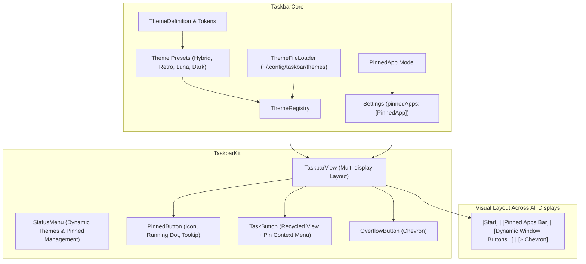
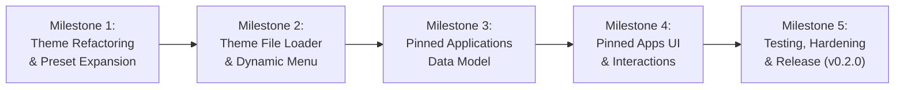

# Taskbar v0.2.0 Implementation Plan: Personalization & Quick Launch

This document establishes the detailed technical specifications, architectural design, task dependencies, and verification criteria for **Taskbar v0.2.0**.

The primary focus of this milestone is **Personalization & Quick Launch**:
1. **Modular Theming & Preset Expansion:** Refactor built-in presets into dedicated files, add Windows XP Luna and Dark Minimal presets, and introduce a user custom theme engine supporting external `.json` themes from `~/.config/taskbar/themes/`.
2. **Pinned Applications / Quick Launch Bar:** Render pinned application shortcuts across all connected displays adjacent to the Start button, featuring app icon caching, running indicator dots, one-click launch/raise mechanics, and context menu pinning.

---

## 1. Milestone Goals & Success Metrics

| Goal | Success Criteria / Target |
|---|---|
| **Preset Modularization** | Monolithic `Theme.swift` refactored into `ThemeDefinition.swift` and dedicated preset files under `Sources/TaskbarCore/Config/Theme/Presets/`. |
| **New Built-in Themes** | Fully functional and contrast-tested `windows-xp-luna` and `dark-minimal` presets alongside existing `modern-hybrid` and `retro-classic`. |
| **User JSON Theme Loader** | `ThemeFileLoader` auto-discovers and validates `.json` themes from `~/.config/taskbar/themes/`; dynamically lists them in the Status Menu; live reload without app restart. |
| **Pinned Applications Bar** | Pinned application shortcuts rendered on all displays between Start button and task buttons; launch closed apps; focus running apps; subtle running indicator badge/dot. |
| **Pin / Unpin UX** | Right-click dynamic `TaskButton` $\rightarrow$ "Pin to Taskbar"; right-click `PinnedButton` $\rightarrow$ "Unpin from Taskbar" / "Quit". |
| **Backward Compatibility** | `Settings` seamlessly decodes existing `v0.1.0` and `v0.1.1` preference plists with zero corruption or data loss. |
| **Zero Regressions & Benchmarks** | All unit and integration test suites pass (100%); resident memory remains $< 45\text{ MB}$ RSS under load; idle CPU remains $\sim 0.0\%$. |

---

## 2. Architecture & UI Layout

### Taskbar Horizontal Geometry
On every connected display, `TaskbarView` lays out subviews in the following order:
1. **Start Button:** Fixed width at `x = buttonSpacing`.
2. **Separator / Spacer:** Visual delimiter between Start/Pinned apps and active windows.
3. **Pinned Apps Bar:** Fixed compact square buttons ($w = \text{height} - 2 \times \text{padding}$) for each pinned application.
4. **Dynamic Task Buttons:** Auto-stretching or shrinking task buttons for open windows on that display.
5. **Overflow Chevron (`»`):** Appears automatically if window density forces buttons below `minButtonWidth`.

---

## 3. Milestone Workstreams

---

### Milestone 1 (M1): Theme Architecture Refactoring & Preset Expansion *(Completed)*

#### Objective
Refactor the current monolithic `Theme.swift` into modular, single-responsibility files, and introduce two new built-in presets: **Windows XP Luna** and **Dark Minimal**.

#### Tasks & Deliverables
1. **Directory Restructure:** *(Completed)*
   - Created `Sources/TaskbarCore/Config/Theme/`
   - Created `Sources/TaskbarCore/Config/Theme/Presets/`
2. **Core Types (`ThemeDefinition.swift`):** *(Completed)*
   - Extracted `ThemeDefinition`, `ThemePalette`, `ThemeMetrics`, `ThemeMaterials`, and `RGBAColor` into `ThemeDefinition.swift`.
3. **Dedicated Built-in Preset Files:** *(Completed)*
   - [`ModernHybridTheme.swift`](../../Sources/TaskbarCore/Config/Theme/Presets/ModernHybridTheme.swift): Frosted glass vibrancy, pill buttons, system fonts.
   - [`RetroClassicTheme.swift`](../../Sources/TaskbarCore/Config/Theme/Presets/RetroClassicTheme.swift): Windows 95/98 `#C0C0C0` solid background, 3D beveled borders.
   - [`WindowsXPLunaTheme.swift`](../../Sources/TaskbarCore/Config/Theme/Presets/WindowsXPLunaTheme.swift):
     - Background: Classic Luna taskbar blue (`#245EDC` / `#1642A5`).
     - Start button: Signature green (`#388E3C` / `#43A047`) with gold accent.
     - Active buttons: Sunken darker royal blue (`#1941A5`) with subtle border bevels.
     - Inactive buttons: Softer blue gradient/tint (`#3877E8`).
   - [`DarkMinimalTheme.swift`](../../Sources/TaskbarCore/Config/Theme/Presets/DarkMinimalTheme.swift):
     - Background: Pitch dark (`#121212`) with subtle border separator.
     - Buttons: Flat minimal hover rectangles, active indicator border (`#00BCD4` cyan).
4. **Theme Registry Update (`ThemeRegistry.swift`):** *(Completed)*
   - Registered all 4 built-in presets during initialization.
5. **Unit Test Suite:** *(Completed)*
   - Created `Tests/TaskbarCoreTests/ThemePresetsTests.swift` validating all 4 presets deserialize cleanly, round-trip through JSON, and adhere to color contrast minimums.

---

### Milestone 2 (M2): User Custom Theme Loader & Dynamic Menu Integration *(Completed)*

#### Objective
Enable users to create, share, and refresh external `.json` themes placed in `~/.config/taskbar/themes/` via an initial scan on startup and an on-demand "Reload Themes" action.

#### Tasks & Deliverables
1. **Custom Theme File Loader (`ThemeFileLoader.swift`):** *(Completed)*
   - Target directory: `~/.config/taskbar/themes/` (with fallback to `~/Library/Application Support/Taskbar/Themes/`).
   - Method `discoverCustomThemes() -> [ThemeDefinition]`:
     - Creates directory if missing.
     - Scans for all `*.json` files.
     - Deserializes into `ThemeDefinition` with resilient decoders.
     - Validates non-empty `id` and skips collisions with built-in preset IDs.
     - Logs corrupted files without crashing.
   - Method `exportTheme(_ theme: ThemeDefinition, to destinationURL: URL) throws`.
   - Method `exportThemeToCustomDirectory(_:fileName:) throws -> URL`.
2. **Lifecycle & Startup Integration:** *(Completed)*
   - On application startup (`applicationDidFinishLaunching`), `ThemeFileLoader.shared.reloadCustomThemes()` performs an initial scan and registers discovered themes with `ThemeRegistry`.
3. **Dynamic Menu in `StatusMenu.swift`:** *(Completed)*
   - Dynamically builds the **Theme** submenu:
     - Section 1: Built-in Presets (Modern Hybrid, Retro Classic, Windows XP Luna, Dark Minimal).
     - Section 2: Custom Themes (scanned from disk, checkmarked if active, empty state if none installed).
     - Section 3: Disk Actions:
       - "Open Themes Folder in Finder..."
       - "Reload Themes from Disk" (rescans folder, updates registry, re-evaluates active theme, refreshes menu)
       - "Export Current Theme as JSON..." (interactive `NSSavePanel` export)
4. **On-Demand Reload & Live Switching:** *(Completed)*
   - Clicking "Reload Themes from Disk" invokes `ThemeFileLoader.shared.reloadCustomThemes()`, updates all screen panels, and refreshes the menu.
   - Deleted files are pruned from `ThemeRegistry` and active theme falls back gracefully to default.
5. **Unit & Integration Test Suites:** *(Completed)*
   - Added `Tests/TaskbarCoreTests/ThemeFileLoaderTests.swift` (8 tests) covering empty directories, valid custom JSON, omitted defaults, non-JSON filtering, built-in ID collision protection, corrupted JSON handling, round-trip exporting, and registry synchronization.
   - Added `Tests/TaskbarIntegrationTests/StatusMenuThemeTests.swift` (3 tests) validating dynamic submenu population, custom theme selection states, and reload callbacks.

---

### Aside: Functional Test Harness & Accessibility Lifecycle Hardening *(Completed)*

Prior to commencing Milestone 3, full-suite verification with `./scripts/test-functional.sh --quick` diagnosed and resolved five critical window tracking and test harness edge cases:
- **macOS Window Minimization Subrole Morphing:** When Cocoa windows minimize to the Dock, macOS Accessibility dynamically mutates their subrole to `AXDialog`. `WindowFilter.shouldInclude` was updated so modal dialog rejections only apply when `!isMinimized`.
- **In-Flight Observer Coalescing:** Added `needsReconcileAgain` latching to `AppTracker` to prevent dropping notifications (e.g. `AXWindowDeminiaturized`) that arrive while a snapshot reconciliation pass is already in flight.
- **Fixture Process Lifecycle:** Fixed a premature `isTerminated = true` latch in `TestFixtureApp` that was preventing clean termination of test fixtures, and ensured launch scripts close default untitled documents.
- **Swift Testing Serialization:** Enforced `.serialized` on `WindowLifecycleIntegrationTests` to eliminate cross-test race conditions when controlling the singleton system `TextEdit` application.

*Full technical postmortem, diagnostic logs, and architectural analysis are recorded in [`functional_test_harness_and_ax_lifecycle_bugs.md`](./functional_test_harness_and_ax_lifecycle_bugs.md).*

---

### Milestone 3 (M3): Pinned Applications Data Model & Persistence *(Completed)*

#### Objective
Establish a clean, type-safe domain model for pinned applications with backward-compatible settings persistence.

#### Tasks & Deliverables
1. **Pinned App Domain Model (`PinnedApp.swift` in `TaskbarCore`):** *(Completed)*
   - Created `Sources/TaskbarCore/Model/PinnedApp.swift` with `id`, `bundleIdentifier`, `displayName`, `customPath`.
   - Conforms to `Codable, Equatable, Hashable, Sendable, Identifiable`.
   - Resilient decoding falling back to generated `UUID` and `bundleIdentifier` for missing fields.
   - `PinnedApp.defaultPinnedApps`: Finder (`com.apple.finder`), Safari (`com.apple.Safari`), Terminal (`com.apple.Terminal`).
2. **Settings Migration (`Settings.swift`):** *(Completed)*
   - Added `public var pinnedApps: [PinnedApp]`.
   - Updated `Settings.default` and initializers with default pinned applications list.
   - Resilient decoding: `decodeIfPresent([PinnedApp].self, forKey: .pinnedApps) ?? PinnedApp.defaultPinnedApps` to guarantee 100% backward compatibility when reading older settings files.
   - Added pinned app helpers:
     - `pinApp(bundleIdentifier:displayName:customPath:) -> Bool`
     - `pinApp(_ app: PinnedApp) -> Bool`
     - `unpinApp(bundleIdentifier:) -> Bool`
     - `isPinned(bundleIdentifier:) -> Bool`
     - `movePinnedApp(fromIndex:toIndex:) -> Bool`
3. **Strings (`TaskbarStrings.swift`):** *(Completed)*
   - Added `pinToTaskbar` ("Pin to Taskbar") and `unpinFromTaskbar` ("Unpin from Taskbar") to `TaskbarStrings.ContextMenu`.
4. **Unit Tests (`PinnedAppTests.swift` & `SettingsTests.swift`):** *(Completed)*
   - Added `Tests/TaskbarCoreTests/PinnedAppTests.swift` (9 tests) covering JSON round-trip serialization, resilient missing field decoding, duplicate pin rejection, unpinning, index boundary checks for reordering, and UserDefaults persistence.
   - Updated `Tests/TaskbarCoreTests/SettingsTests.swift` validating backward-compatible decoding of older payloads lacking `pinnedApps`.

---

### Milestone 4 (M4): Pinned Apps UI, Layout & Context Menu Interactions *(Completed)*

#### Objective
Render pinned application buttons on all connected displays, implement one-click launch/activate behavior, running status indicators, and context menus.

#### Tasks & Deliverables
1. **Pinned Button Component (`PinnedButton.swift` in `TaskbarKit`):** *(Completed)*
   - Compact square button component subclassing `NSView`.
   - Dimension: `width = height = max(minimumButtonHeight, barHeight - 2 * padding)`.
   - Icon: Cached app icon via `IconCache.shared.icon(for:customPath:size:)` with bundle ID / path resolution.
   - Running Indicator: Subtle indicator dot rendered at bottom center (black/dark in Retro bevel mode, theme accent color in Modern Hybrid / Luna / Minimal).
   - Hover & Pressed States: Styled according to active `ThemeDefinition` (3D bevel in Retro; rounded rect with hover/press background and border in Hybrid/Luna/Minimal).
   - Tooltip & Accessibility: Set to `pinnedApp.displayName`.
2. **Layout Integration in `TaskbarView.swift`:** *(Completed)*
   - Embedded `PinnedButton` subviews immediately following `StartButton` across all displays.
   - Integrated spacing: `pinnedButtonSpacing = 2.0pt` and `pinnedSectionTrailingMargin = 6.0pt` before task buttons.
   - View recycling: Pinned buttons are reused and preserved in memory keyed by `bundleIdentifier`.
3. **Click & Activation Interactions (`WindowActions.swift`):** *(Completed)*
   - `WindowActions.launchOrActivateApp(bundleIdentifier:customPath:store:)`:
     - If not running $\rightarrow$ Launch via `NSWorkspace.shared.openApplication(at:configuration:)`.
     - If running $\rightarrow$ Unhide and activate process, raising frontmost window (or deminiaturizing if minimized).
4. **Context Menu Interactions:** *(Completed)*
   - **On `PinnedButton` (Right-Click):**
     - "Open <App>"
     - "Unpin from Taskbar"
     - If running: "Quit <App>" via `WindowActions.quitApplication(bundleIdentifier:)`.
   - **On `TaskButton` (Right-Click Running Window):**
     - Dynamic menu item: "Unpin from Taskbar" if pinned, "Pin to Taskbar" if unpinned.
   - Pinning / unpinning mutates `settings.pinnedApps`, saves to UserDefaults, synchronizes panels across all displays, and broadcasts `Notification.Name.taskbarPinnedAppsDidChange`.
5. **Unit & Integration Test Suite (`PinnedAppsIntegrationTests.swift`):** *(Completed)*
   - Added 7 integration tests covering properties, context menus, layout positioning, view recycling, dynamic task button pinning toggle, running indicator transitions, and multi-display synchronization. (Total: 92 tests passing).

---

### Milestone 5 (M5): Integration Testing, Benchmarking & Release Packaging

#### Objective
Verify end-to-end functionality across all monitors, validate resource benchmarks, update documentation, and package `v0.2.0`.

#### Tasks & Deliverables
1. **Integration Test Suite (`Tests/TaskbarIntegrationTests/`):**
   - `PinnedAppsIntegrationTests.swift`:
     - Test pinning an application dynamically adds `PinnedButton` across all screens.
     - Test running indicator state transitions when test fixture (`TextEdit`) opens and closes.
     - Test unpinning cleans up subview instances.
   - `ThemeExpansionIntegrationTests.swift`:
     - Test switching to `Windows XP Luna` and `Dark Minimal` themes across all displays.
     - Test loading a synthetic valid and invalid `.json` custom theme file.
2. **Benchmark Verification:**
   - Execute `./scripts/test-functional.sh --all`.
   - Verify RSS memory remains $< 45\text{ MB}$ under 50+ windows with pinned apps active.
   - Verify idle CPU remains $< 0.1\%$.
3. **Release Documentation (`docs/v0.2.0/`):**
   - Create `docs/v0.2.0/ARCHITECTURE.md`, `TESTING.md`, `CONFIGURATION.md`, `TEST_SPECIFICATIONS.md`, `CONVENTIONS.md`, `BUILD_AND_RELEASE.md`.
   - Update `CHANGELOG.md` with complete `[0.2.0]` release notes.
   - Update `README.md` to showcase new presets and pinned apps.
4. **Packaging:**
   - Run `./scripts/package-release.sh --minor` to bump version to `0.2.0` (Build 3).
   - Generate `Taskbar-v0.2.0.dmg`, `Taskbar-v0.2.0.zip`, and `SHA256SUMS.txt`.

---

## 4. Verification & Acceptance Checklist

- [x] **Preset Modularization:** `Sources/TaskbarCore/Config/Theme/Presets/` contains clean individual files for all 4 presets.
- [x] **Windows XP Luna & Dark Minimal:** Both themes render faithfully, with correct contrast, active states, and borders.
- [ ] **Custom Theme Loading:** Dropping a `.json` theme into `~/.config/taskbar/themes/` enables it in the Status Menu without app restart.
- [ ] **Pinned Applications Bar:** Pinned icons appear on all connected displays.
- [ ] **Running Indicator:** Indicator dot dynamically reflects whether the pinned app has active windows.
- [ ] **Pin / Unpin UX:** Right-click pinning on `TaskButton` and unpinning on `PinnedButton` works smoothly.
- [ ] **Click Launch / Raise:** Clicking a closed pinned app launches it; clicking a running pinned app brings it to focus.
- [ ] **Backward Compatibility:** Older settings without `pinnedApps` deserialize cleanly with default apps.
- [ ] **Performance & Memory:** 100% test pass rate, $< 45\text{ MB}$ RSS memory, $< 0.1\%$ idle CPU.
- [ ] **Privacy Standard:** Zero mentions of personal user directories in code, logs, docs, or git history.
