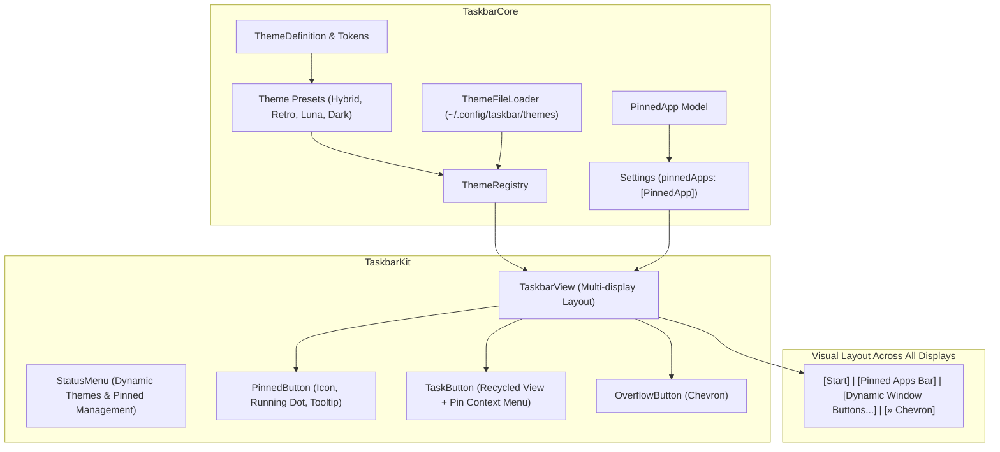
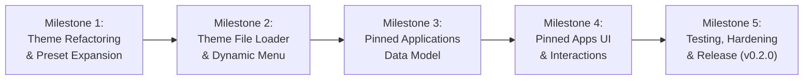

# Taskbar v0.2.0 Implementation Plan: Personalization & Quick Launch

This document establishes the detailed technical specifications, architectural design, task dependencies, and verification criteria for **Taskbar v0.2.0**.

The primary focus of this milestone is **Personalization & Quick Launch**:
1. **Modular Theming & Preset Expansion:** Refactor built-in presets into dedicated files, add Windows XP Luna and Dark Minimal presets, and introduce a user custom theme engine supporting external `.json` themes from `~/.config/taskbar/themes/`.
2. **Pinned Applications / Quick Launch Bar:** Render pinned application shortcuts across all connected displays adjacent to the Start button, featuring app icon caching, running indicator dots, one-click launch/raise mechanics, and context menu pinning.

---

## 1. Milestone Goals & Success Metrics

| Goal | Success Criteria / Target |
|---|---|
| **Preset Modularization** | Monolithic `Theme.swift` refactored into `ThemeDefinition.swift` and dedicated preset files under `Sources/TaskbarCore/Config/Theme/Presets/`. |
| **New Built-in Themes** | Fully functional and contrast-tested `windows-xp-luna` and `dark-minimal` presets alongside existing `modern-hybrid` and `retro-classic`. |
| **User JSON Theme Loader** | `ThemeFileLoader` auto-discovers and validates `.json` themes from `~/.config/taskbar/themes/`; dynamically lists them in the Status Menu; live reload without app restart. |
| **Pinned Applications Bar** | Pinned application shortcuts rendered on all displays between Start button and task buttons; launch closed apps; focus running apps; subtle running indicator badge/dot. |
| **Pin / Unpin UX** | Right-click dynamic `TaskButton` $\rightarrow$ "Pin to Taskbar"; right-click `PinnedButton` $\rightarrow$ "Unpin from Taskbar" / "Quit". |
| **Backward Compatibility** | `Settings` seamlessly decodes existing `v0.1.0` and `v0.1.1` preference plists with zero corruption or data loss. |
| **Zero Regressions & Benchmarks** | All unit and integration test suites pass (100%); resident memory remains $< 45\text{ MB}$ RSS under load; idle CPU remains $\sim 0.0\%$. |

---

## 2. Architecture & UI Layout



### Taskbar Horizontal Geometry
On every connected display, `TaskbarView` lays out subviews in the following order:
1. **Start Button:** Fixed width at `x = buttonSpacing`.
2. **Separator / Spacer:** Visual delimiter between Start/Pinned apps and active windows.
3. **Pinned Apps Bar:** Fixed compact square buttons ($w = \text{height} - 2 \times \text{padding}$) for each pinned application.
4. **Dynamic Task Buttons:** Auto-stretching or shrinking task buttons for open windows on that display.
5. **Overflow Chevron (`»`):** Appears automatically if window density forces buttons below `minButtonWidth`.

---

## 3. Milestone Workstreams



---

### Milestone 1 (M1): Theme Architecture Refactoring & Preset Expansion

#### Objective
Refactor the current monolithic `Theme.swift` into modular, single-responsibility files, and introduce two new built-in presets: **Windows XP Luna** and **Dark Minimal**.

#### Tasks & Deliverables
1. **Directory Restructure:**
   - Create `Sources/TaskbarCore/Config/Theme/`
   - Create `Sources/TaskbarCore/Config/Theme/Presets/`
2. **Core Types (`ThemeDefinition.swift`):**
   - Extract `ThemeDefinition`, `ThemePalette`, `ThemeMetrics`, `ThemeMaterials`, and `CodableColor` into `ThemeDefinition.swift`.
3. **Dedicated Built-in Preset Files:**
   - [`ModernHybridTheme.swift`](../../Sources/TaskbarCore/Config/Theme/Presets/ModernHybridTheme.swift): Frosted glass vibrancy, pill buttons, system fonts.
   - [`RetroClassicTheme.swift`](../../Sources/TaskbarCore/Config/Theme/Presets/RetroClassicTheme.swift): Windows 95/98 `#C0C0C0` solid background, 3D beveled borders.
   - [`WindowsXPLunaTheme.swift`](../../Sources/TaskbarCore/Config/Theme/Presets/WindowsXPLunaTheme.swift):
     - Background: Classic Luna taskbar blue (`#245EDC` / `#1642A5`).
     - Start button: Signature green (`#388E3C` / `#43A047`) with gold accent.
     - Active buttons: Sunken darker royal blue (`#1941A5`) with subtle border bevels.
     - Inactive buttons: Softer blue gradient/tint (`#3877E8`).
   - [`DarkMinimalTheme.swift`](../../Sources/TaskbarCore/Config/Theme/Presets/DarkMinimalTheme.swift):
     - Background: Pitch dark (`#121212`) with subtle border separator.
     - Buttons: Flat minimal hover rectangles, active indicator border (`#00BCD4` cyan or `#3B82F6` blue).
4. **Theme Registry Update (`ThemeRegistry.swift`):**
   - Register all 4 built-in presets during initialization.
5. **Unit Test Suite:**
   - Create `Tests/TaskbarCoreTests/ThemePresetsTests.swift` validating all 4 presets deserialize cleanly, round-trip through JSON, and adhere to color contrast minimums.

---

### Milestone 2 (M2): User Custom Theme Loader & Dynamic Menu Integration

#### Objective
Enable users to create, share, and hot-reload external `.json` themes placed in `~/.config/taskbar/themes/`.

#### Tasks & Deliverables
1. **Custom Theme File Loader (`ThemeFileLoader.swift`):**
   - Target directory: `~/.config/taskbar/themes/` (with fallback to `~/Library/Application Support/Taskbar/Themes/`).
   - Method `discoverCustomThemes() -> [ThemeDefinition]`:
     - Creates the directory if it does not exist.
     - Scans for all `*.json` files.
     - Deserializes into `ThemeDefinition`.
     - Validates required fields and color hex strings.
     - Logs corrupt files with helpful diagnostics via `TaskbarLogger.ui` without crashing.
   - Method `exportTheme(_ theme: ThemeDefinition, to destinationURL: URL) throws`.
2. **Dynamic Menu in `StatusMenu.swift`:**
   - Dynamically build the **Theme** submenu:
     - Section 1: Built-in Presets (Modern Hybrid, Retro Classic, Windows XP Luna, Dark Minimal).
     - Section 2: Custom Themes (scanned dynamically from disk).
     - Section 3: Actions:
       - "Open Custom Themes Folder in Finder..."
       - "Export Current Theme as JSON..."
3. **Live Theme Switching:**
   - Selecting any theme updates `Settings.shared.activeThemeId`.
   - Posts `Notification.Name.taskbarThemeDidChange`.
   - All `TaskbarView` and `TaskButton` instances across all screens re-render with sub-millisecond latency.

---

### Milestone 3 (M3): Pinned Applications Data Model & Persistence

#### Objective
Establish a clean, type-safe domain model for pinned applications with backward-compatible settings persistence.

#### Tasks & Deliverables
1. **Pinned App Domain Model (`PinnedApp.swift` in `TaskbarCore`):**
   ```swift
   public struct PinnedApp: Codable, Equatable, Hashable, Sendable {
       public let id: UUID
       public let bundleIdentifier: String
       public var displayName: String
       public var customPath: String?

       public init(id: UUID = UUID(), bundleIdentifier: String, displayName: String, customPath: String? = nil) { ... }
   }
   ```
2. **Settings Migration (`Settings.swift`):**
   - Add property:
     ```swift
     public var pinnedApps: [PinnedApp]
     ```
   - Default pinned applications:
     - Finder (`com.apple.finder`)
     - Terminal (`com.apple.Terminal`)
     - Safari (`com.apple.Safari`)
   - Resilient decoding: Use `decodeIfPresent([PinnedApp].self, forKey: .pinnedApps) ?? defaultPinnedApps` to guarantee 100% backward compatibility when reading older settings files.
3. **Unit Tests (`PinnedAppTests.swift`):**
   - Test JSON round-trip serialization of `PinnedApp`.
   - Test decoding older `Settings` payloads lacking `pinnedApps`.
   - Test deduplication and list manipulation helpers (pin, unpin, move).

---

### Milestone 4 (M4): Pinned Apps UI, Layout & Context Menu Interactions

#### Objective
Render pinned application buttons on all connected displays, implement one-click launch/activate behavior, running status indicators, and context menus.

#### Tasks & Deliverables
1. **Pinned Button Component (`PinnedButton.swift` in `TaskbarKit`):**
   - Compact square button based on `NSButton`.
   - Width / Height = `taskbarHeight - 2 * buttonPadding`.
   - Icon: Cached 16x16 / 20x20 app icon via `NSWorkspace.shared.icon(forFile:)` or bundle resolution.
   - Running Indicator:
     - Check whether the application is running via `WindowStore.allWindows` or `NSRunningApplication.runningApplications(withBundleIdentifier:)`.
     - Render a subtle running dot (`3pt` circle) or horizontal accent bar at the bottom edge.
   - Hover & Pressed States: Styled according to the active `ThemeDefinition`.
   - Native Tooltip: Shows the application's display name on hover.
2. **Layout Integration in `TaskbarView.swift`:**
   - Embed a horizontal stack or array of `PinnedButton` subviews immediately following the Start button.
   - Rendered on **all connected displays** simultaneously.
   - View recycling: Reuse `PinnedButton` instances keyed by `bundleIdentifier`.
3. **Click & Activation Interactions:**
   - When clicked:
     - If application is not running $\rightarrow$ Launch via `NSWorkspace.shared.openApplication(at:configuration:)`.
     - If application is running $\rightarrow$ Focus the application via `NSRunningApplication.activate(options: .activateIgnoringOtherApps)` and raise its frontmost window.
4. **Context Menu Interactions:**
   - **On `PinnedButton` (Right-Click):**
     - "Open <App>"
     - "Unpin from Taskbar"
     - If running: "Quit <App>"
   - **On `TaskButton` (Right-Click Running Window):**
     - Add dynamic menu item:
       - If currently pinned $\rightarrow$ "Unpin from Taskbar"
       - If not pinned $\rightarrow$ "Pin to Taskbar"
   - Pinning or unpinning updates `Settings.shared.pinnedApps` and broadcasts notification to update all panels immediately.

---

### Milestone 5 (M5): Integration Testing, Benchmarking & Release Packaging

#### Objective
Verify end-to-end functionality across all monitors, validate resource benchmarks, update documentation, and package `v0.2.0`.

#### Tasks & Deliverables
1. **Integration Test Suite (`Tests/TaskbarIntegrationTests/`):**
   - `PinnedAppsIntegrationTests.swift`:
     - Test pinning an application dynamically adds `PinnedButton` across all screens.
     - Test running indicator state transitions when test fixture (`TextEdit`) opens and closes.
     - Test unpinning cleans up subview instances.
   - `ThemeExpansionIntegrationTests.swift`:
     - Test switching to `Windows XP Luna` and `Dark Minimal` themes across all displays.
     - Test loading a synthetic valid and invalid `.json` custom theme file.
2. **Benchmark Verification:**
   - Execute `./scripts/test-functional.sh --all`.
   - Verify RSS memory remains $< 45\text{ MB}$ under 50+ windows with pinned apps active.
   - Verify idle CPU remains $< 0.1\%$.
3. **Release Documentation (`docs/v0.2.0/`):**
   - Create `docs/v0.2.0/ARCHITECTURE.md`, `TESTING.md`, `CONFIGURATION.md`, `TEST_SPECIFICATIONS.md`, `CONVENTIONS.md`, `BUILD_AND_RELEASE.md`.
   - Update `CHANGELOG.md` with complete `[0.2.0]` release notes.
   - Update `README.md` to showcase new presets and pinned apps.
4. **Packaging:**
   - Run `./scripts/package-release.sh --minor` to bump version to `0.2.0` (Build 3).
   - Generate `Taskbar-v0.2.0.dmg`, `Taskbar-v0.2.0.zip`, and `SHA256SUMS.txt`.

---

## 4. Verification & Acceptance Checklist

- [ ] **Preset Modularization:** `Sources/TaskbarCore/Config/Theme/Presets/` contains clean individual files for all 4 presets.
- [ ] **Windows XP Luna & Dark Minimal:** Both themes render faithfully, with correct contrast, active states, and borders.
- [ ] **Custom Theme Loading:** Dropping a `.json` theme into `~/.config/taskbar/themes/` enables it in the Status Menu without app restart.
- [ ] **Pinned Applications Bar:** Pinned icons appear on all connected displays.
- [ ] **Running Indicator:** Indicator dot dynamically reflects whether the pinned app has active windows.
- [ ] **Pin / Unpin UX:** Right-click pinning on `TaskButton` and unpinning on `PinnedButton` works smoothly.
- [ ] **Click Launch / Raise:** Clicking a closed pinned app launches it; clicking a running pinned app brings it to focus.
- [ ] **Backward Compatibility:** Older settings without `pinnedApps` deserialize cleanly with default apps.
- [ ] **Performance & Memory:** 100% test pass rate, $< 45\text{ MB}$ RSS memory, $< 0.1\%$ idle CPU.
- [ ] **Privacy Standard:** Zero mentions of personal user directories in code, logs, docs, or git history.
