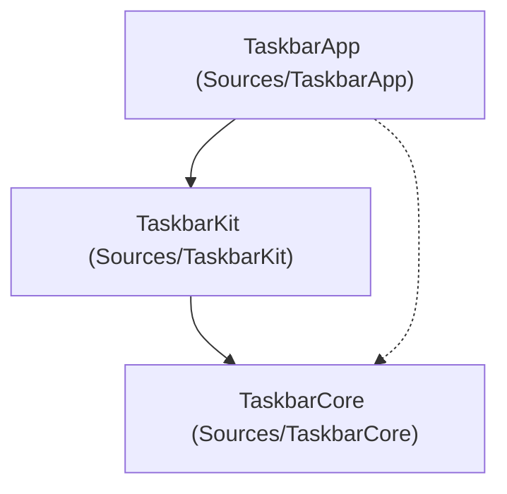

# Codebase Audit Report (v0.3.1)

**Date:** October 10, 2026  
**Milestone:** Post-v0.3.1 Patch Release & Pre-v0.4.0 Preparation  
**Auditor:** Codebase Audit & Refactor Subsystem  
**Scope:** `Sources/`, `Tests/`, `docs/`, `plans/`, `config/`, `scripts/`, `.agents/skills/`  
**Test Suite Status:** 142 / 142 Passing (100% across 25 suites)  
**Memory & Performance:** 21.04 MB RSS (Bound: $\le 45.0\text{ MB}$), Idle CPU: $\sim 0.0\%$  

---

## 1. Executive Summary

Following the release of **v0.3.1** (Window Grouping Responsiveness & Single-Window Focus Isolation), this codebase audit was executed in accordance with [.agents/skills/codebase-audit-refactor](../../.agents/skills/codebase-audit-refactor/SKILL.md).

The audit verified structural modularity, Swift 6 strict concurrency compliance, memory and CPU bounds, and synchronized all documentation, test catalogs, and agent skills across the repository.

### Key Audit Outcomes & Mitigations Applied:
1. **Swift 6 Strict Concurrency Isolation:** Added explicit `@MainActor` annotations to `TaskbarPanel`, `TaskbarView`, and `GroupWindowPopup` (including private container subviews `GroupWindowContentView` and `GroupWindowRowsView`).
2. **Test Harness Concurrency Synchronization:** Refactored `TestFixtureQueue` in `TestFixtureApp.swift` from an asynchronous actor with detached `Task` teardowns to a thread-safe synchronous `NSCondition` lock, eliminating AppleScript fixture collisions and observer clobbering.
3. **Documentation & Specification Synchronization:** 
   - Synchronized test count baselines to **142 tests** across `README.md`, `docs/TESTING.md`, `docs/TEST_SPECIFICATIONS.md`, `plans/roadmap.md`, and `.agents/skills/`.
   - Formalized test specifications and Traceability Matrix entries for `TC-GROUP-005` (popup mouse interaction, close button trigger, and dynamic resize) and `TC-GROUP-006` (loss of key focus auto-dismissal).
4. **Privacy Audit:** Verified 100% compliance with zero developer paths (`/Users/...`) in git history or tracked sources.
5. **Full Test & Release Verification:** Executed `./scripts/test-functional.sh --all` with 142/142 tests passing in 49 seconds with 21.04 MB RSS ($\le 45.0\text{ MB}$ bound) and completed release build and local installation via `./scripts/build-app.sh --install`.

---

## 2. Stage 1: Codebase Survey & Structural Inventory

### 2.1 Target Breakdown & Volume
```
┌────────────────────────────────────────────────────────────────────────┐
│ Target                      Files    Lines     Responsibilities        │
├────────────────────────────────────────────────────────────────────────┤
│ Sources/TaskbarCore            25    3,458     Pure models, math,      │
│                                                layout engine, grouping,│
│                                                stores, themes, config  │
│ Sources/TaskbarKit             23    3,892     AppKit UI, AX tracking, │
│                                                work area enforcer,     │
│                                                popups, panels, manager │
│ Sources/TaskbarApp              1       37     Minimal main entry      │
│ Tests/TaskbarCoreTests         16    2,122     Pure Swift unit suites  │
│                                                (94 test cases)         │
│ Tests/TaskbarIntegrationTests  11    3,299     UI & AX integration     │
│                                                (48 test cases)         │
├────────────────────────────────────────────────────────────────────────┤
│ Total                          76   12,808                             │
└────────────────────────────────────────────────────────────────────────┘
```

### 2.2 Directory Hierarchy Evaluation
- **`Sources/TaskbarCore/`**:
  - `Config/`: `BuildConfiguration.swift`, `Settings.swift`, `TaskbarConstants.swift`, `TaskbarStrings.swift`.
  - `Logging/`: `TaskbarLogger.swift`.
  - `Logic/`: `ButtonLayout.swift`, `ClickPolicy.swift`, `ScreenAssignment.swift`, `TaskbarLayoutEngine.swift`, `WindowFilter.swift`, `WindowGroupingLogic.swift`, `WindowOrderingLogic.swift`, `WorkAreaMath.swift`.
  - `Model/`: `LayoutPlan.swift`, `PinnedApp.swift`, `ThemeDefinition.swift`, `ThemeMaterials.swift`, `ThemeMetrics.swift`, `ThemePalette.swift`, `ThemeRegistry.swift`, `WindowGroup.swift`, `WindowInfo.swift`, `WindowStore.swift`, `WindowStoreProtocol.swift`.
  - `Presets/`: Built-in theme definitions (`ModernHybridTheme`, `RetroClassicTheme`, `WindowsXPLunaTheme`, `DarkMinimalTheme`).
- **`Sources/TaskbarKit/`**:
  - `Actions/`: `WindowActions.swift`.
  - `System/`: `AccessibilityPermission.swift`, `DockController.swift`, `Launcher.swift`.
  - `Tracking/`: `AXAppObserver.swift`, `AXElement+Attributes.swift`, `AXThread.swift`, `AppTracker.swift`, `WorkAreaEnforcer.swift`.
  - `UI/`: Organized cleanly into:
    - `Buttons/`: `BaseTaskbarButton.swift`, `OverflowButton.swift`, `PinnedButton.swift`, `StartButton.swift`, `TaskButton.swift`.
    - `Drawing/`: `BevelDrawing.swift`.
    - `Images/`: `IconCache.swift`.
    - `Management/`: `ScreenManager.swift`.
    - `Menu/`: `StatusMenu.swift`.
    - `Panels/`: `GroupWindowPopup.swift`, `TaskbarPanel.swift`, `TaskbarView.swift`.
    - `Themes/`: `ThemeFileLoader.swift`, `VisualEffectMapping.swift`.

### 2.3 Complexity Hotspots
Files exceeding 400 lines identified for monitoring:
- `TaskbarView.swift` (795 lines): Central coordinator for button view recycling, drag-and-drop indicator rendering, click routing, and popup presentation.
- `GroupWindowPopup.swift` (682 lines): Native floating panel managing visual effect background, window rows rendering, mouse tracking, keyboard navigation, and dynamic height animations.

---

## 3. Stage 2: Architectural Boundaries & Modularity

### 3.1 `TaskbarCore` Purity Verification
Grep analysis confirmed **zero** forbidden imports in `Sources/TaskbarCore/`:
- `import AppKit`: 0 occurrences.
- `import ApplicationServices`: 0 occurrences.
- `AXUIElement`: 0 occurrences.

`TaskbarCore` remains 100% decoupled and compiles purely on headless platforms without Cocoa or WindowServer runtime dependencies.

### 3.2 Dependency Flow

No circular dependencies exist between SPM targets.

---

## 4. Stage 3: Code Hygiene, Dead Code & Deduplication

1. **Compiler Diagnostics:** Zero warnings under `swift build` and `swift test` across all targets.
2. **Dead Code Elimination:** Confirmed complete retirement of legacy `StatusMenu.onThemeChanged` callbacks; all theme changes route through `onThemeIdChanged(String)`.
3. **Button Hierarchy Deduplication:** Common tracking area setup, hover, and press states remain unified under `BaseTaskbarButton`.
4. **Encapsulation:** Subviews inside `GroupWindowPopup.swift` (`GroupWindowContentView`, `GroupWindowRowsView`) use `private final class` scoping.

---

## 5. Stage 4: Conventions, Concurrency & Safety Verification

1. **Swift 6 Strict Concurrency Isolation:**
   - Explicit `@MainActor` added to `TaskbarPanel`, `TaskbarView`, and `GroupWindowPopup`.
   - Verified that `AXUIElement*` calls are dispatched exclusively to `AXThread.shared.async` or background tasks, never blocking `@MainActor`.
2. **Test Harness Synchronization:**
   - Refactored `TestFixtureQueue` to synchronous `NSCondition` locking.
   - Serialized GUI fixture creation across test suites, preventing orphan processes and AppleScript `-609` connection errors.
3. **Privacy Invariant:**
   - Scan across git diff confirmed zero developer paths (`/Users/...`).

---

## 6. Stage 5: Documentation & Specification Synchronization

| Document | Stale Value | Synchronized Value | Notes |
|---|---|---|---|
| `docs/TESTING.md` | 46 integration / 140 total | 48 integration / 142 total | Added `TC-GROUP-005` and `TC-GROUP-006` |
| `docs/TEST_SPECIFICATIONS.md` | Omitted `TC-GROUP-005/006` | Fully specified in Section 2.8 & Matrix | Mouse interaction, dynamic resize & key dismiss |
| `README.md` | 140 / 112 tests | 142 tests | Updated test runner commands and doc links |
| `plans/roadmap.md` | 140 tests | 142 tests | Updated v0.3.0–v0.3.1 milestone summary |
| `.agents/skills/codebase-audit-refactor/` | 112+ tests | 142 tests | Updated baseline checklist and doc sync guide |

---

## 7. Stage 6: Actionable Refactoring Plan & Next Milestone Readiness

### Risk Tier Categorization:

#### Tier 1: Low Risk (Completed in this Audit)
- Added `@MainActor` annotations to UI panels and views.
- Refactored `TestFixtureQueue` to synchronous `NSCondition`.
- Synchronized all documentation, test counts, and specifications to 142 tests.

#### Tier 2: Medium Risk (Pre-v0.4.0 Modular Extraction)
- **Extract Popup Rows View:** Split `GroupWindowRowsView` out of `GroupWindowPopup.swift` into a separate file in `Sources/TaskbarKit/UI/Panels/` to reduce file length below 400 lines.
- **Extract Drag Coordinator:** Extract drag gesture tracking and insertion indicator calculations from `TaskbarView.swift` into a dedicated `TaskbarDragCoordinator` helper.

#### Tier 3: High Risk (Phase 4: v0.4.0 Edge Placement & Auto-Hide)
- **Multi-Edge Layout Generalization:** Generalize `WorkAreaMath` and `TaskbarLayoutEngine` to support vertical and top taskbar geometry plans.
- **Auto-Hide Tracking Engine:** Introduce edge-proximity mouse tracking area and off-screen slide animation controller.
- *Mitigation Plan:* Must pass all 142 existing tests (`TC-FUNC-*`, `TC-EDGE-*`, `TC-STRESS-*`, `TC-GROUP-*`, `TC-DRAG-*`) without regressions before introducing horizontal layout extensions.
