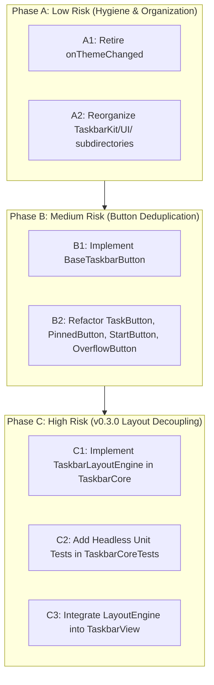

# Refactoring Implementation Plan: Post-v0.2.3 Hygiene & v0.3.0 Enablement

**Document Version:** 1.0.0  
**Target Milestone:** Pre-v0.3.0 Technical Refactor  
**Status:** Draft / Ready for Review  
**Related Audit Report:** [codebase_audit_v0.2.3.md](./codebase_audit_v0.2.3.md)  
**Parent Roadmap:** [plans/roadmap.md](../roadmap.md)  

---

## 1. Overview & Objectives

Following the successful release of **v0.2.3**, this refactoring plan addresses architectural debt, removes dead code, eliminates button boilerplate duplication, and prepares the layout architecture for **Phase 3 (v0.3.0: Window Re-ordering & Grouping)**.

### Primary Objectives:
1. **Hygiene & Dead Code Removal (Low Risk):** Retire obsolete `StatusMenu.onThemeChanged(ThemeStyle)` legacy callback and synchronize test suites.
2. **Directory & Structural Organization (Low Risk):** Reorganize `Sources/TaskbarKit/UI/` from a flat directory into focused subpackages (`Buttons/`, `Panels/`, `Menu/`, `Management/`).
3. **UI Button Deduplication (Medium Risk):** Introduce `BaseTaskbarButton` to consolidate `NSTrackingArea` and mouse hover/press state logic across `TaskButton`, `PinnedButton`, `StartButton`, and `OverflowButton`.
4. **Architectural Decoupling for Phase 3 (High Risk / Architectural Enabler):** Extract `TaskbarLayoutEngine` into `TaskbarCore/Logic/` as a pure Swift layout computation engine. This decouples geometry calculations from AppKit `NSView` hierarchies, enabling headless unit testing for drag-and-drop slot re-ordering and application window grouping.

---

## 2. Refactoring Phases



---

## 3. Phase A: Low Risk (Hygiene & Directory Organization)

### Task A1: Retire Dead Legacy Callback `StatusMenu.onThemeChanged`
- **Current State:**
  - `StatusMenu.swift` retains `public var onThemeChanged: ((ThemeStyle) -> Void)?`.
  - In v0.2.1, this callback was guarded because custom themes evaluate `style` to `.modernHybrid`, which clobbered custom theme selection.
  - `AppDelegate.swift` exclusively binds `statusMenu.onThemeIdChanged: ((String) -> Void)?`.
  - `StatusMenuThemeTests.swift` contains a negative assertion verifying that `onThemeChanged` is `nil` for custom themes.
- **Action Items:**
  1. Remove `public var onThemeChanged: ((ThemeStyle) -> Void)?` from [Sources/TaskbarKit/StatusMenu.swift](../../Sources/TaskbarKit/StatusMenu.swift).
  2. Remove internal dispatches: `onThemeChanged?(theme.style)` and `onThemeChanged?(style)`.
  3. Update [Tests/TaskbarIntegrationTests/StatusMenuThemeTests.swift](../../Tests/TaskbarIntegrationTests/StatusMenuThemeTests.swift) to remove testing of the retired callback.
  4. Update [docs/ARCHITECTURE.md](../../docs/ARCHITECTURE.md) and [docs/CONVENTIONS.md](../../docs/CONVENTIONS.md) to remove legacy references to `onThemeChanged`.
- **Risk Level:** Minimal (0 runtime impact on `AppDelegate`).

### Task A2: Reorganize `Sources/TaskbarKit/UI/` Subdirectories
- **Current State:**
  - `Sources/TaskbarKit/UI/` contains 10 un-subdivided files.
  - `StatusMenu.swift` resides at `Sources/TaskbarKit/StatusMenu.swift` root.
- **Proposed Layout:**
  ```
  Sources/TaskbarKit/UI/
  ├── Buttons/
  │   ├── BaseTaskbarButton.swift  (Added in Phase B)
  │   ├── TaskButton.swift
  │   ├── PinnedButton.swift
  │   ├── StartButton.swift
  │   └── OverflowButton.swift
  ├── Panels/
  │   ├── TaskbarPanel.swift
  │   ├── TaskbarView.swift
  │   └── BevelDrawing.swift
  ├── Menu/
  │   └── StatusMenu.swift         (Relocated from TaskbarKit root)
  └── Management/
      ├── ScreenManager.swift
      ├── IconCache.swift
      └── VisualEffectMapping.swift
  ```
- **Action Items:**
  1. Move button files to `UI/Buttons/`.
  2. Move panel and view files to `UI/Panels/`.
  3. Move menu files to `UI/Menu/`.
  4. Move managers to `UI/Management/`.
  5. Update file header comments to match new relative paths.
  6. Verify SPM package builds cleanly (`swift build`).
- **Risk Level:** Minimal (directory paths within the SPM target do not alter Swift module namespaces).

---

## 4. Phase B: Medium Risk (UI Button Deduplication)

### Task B1: Create `BaseTaskbarButton`
- **Location:** `Sources/TaskbarKit/UI/Buttons/BaseTaskbarButton.swift`
- **Design:**
  - Subclasses `NSView`.
  - Marked `@MainActor`.
  - Encapsulates:
    - Active `NSTrackingArea` creation with `[.mouseEnteredAndExited, .activeAlways, .inVisibleRect]`.
    - `isHovered: Bool` and `isPressed: Bool` with automatic `needsDisplay = true` triggers.
    - `mouseEntered(with:)` and `mouseExited(with:)` management.
    - `mouseDown(with:)` and `mouseUp(with:)` click coordination with configurable click trigger policy:
      - Standard buttons: trigger `onClick` on `mouseUp` if location is within `bounds`.
      - Immediate action buttons (e.g. `OverflowButton`): configurable `triggerClickOnMouseDown: Bool`.
    - Subclass hook: `open func didUpdateHoverOrPressState()`.
- **Implementation Outline:**
  ```swift
  // Sources/TaskbarKit/UI/Buttons/BaseTaskbarButton.swift

  import AppKit
  import TaskbarCore

  @MainActor
  open class BaseTaskbarButton: NSView {
      public var onClick: (() -> Void)?
      
      public private(set) var isHovered: Bool = false {
          didSet {
              if oldValue != isHovered {
                  needsDisplay = true
                  didUpdateHoverOrPressState()
              }
          }
      }
      
      public private(set) var isPressed: Bool = false {
          didSet {
              if oldValue != isPressed {
                  needsDisplay = true
                  didUpdateHoverOrPressState()
              }
          }
      }
      
      open var triggerClickOnMouseDown: Bool { false }
      
      private var trackingArea: NSTrackingArea?
      
      public override init(frame frameRect: NSRect) {
          super.init(frame: frameRect)
          wantsLayer = true
      }
      
      public required init?(coder: NSCoder) {
          fatalError("init(coder:) has not been implemented")
      }
      
      open override func updateTrackingAreas() {
          super.updateTrackingAreas()
          if let trackingArea = trackingArea {
              removeTrackingArea(trackingArea)
          }
          let area = NSTrackingArea(
              rect: bounds,
              options: [.mouseEnteredAndExited, .activeAlways, .inVisibleRect],
              owner: self,
              userInfo: nil
          )
          addTrackingArea(area)
          self.trackingArea = area
      }
      
      open override func mouseEntered(with event: NSEvent) {
          isHovered = true
      }
      
      open override func mouseExited(with event: NSEvent) {
          isHovered = false
          isPressed = false
      }
      
      open override func mouseDown(with event: NSEvent) {
          isPressed = true
          if triggerClickOnMouseDown {
              onClick?()
          }
      }
      
      open override func mouseUp(with event: NSEvent) {
          guard isPressed else { return }
          isPressed = false
          guard !triggerClickOnMouseDown else { return }
          let location = convert(event.locationInWindow, from: nil)
          if bounds.contains(location) {
              onClick?()
          }
      }
      
      open func didUpdateHoverOrPressState() {}
  }
  ```

### Task B2: Refactor Taskbar Buttons
- **`TaskButton.swift`:**
  - Inherit from `BaseTaskbarButton`.
  - Remove duplicate `trackingArea`, `isHovered`, `isPressed`, and mouse overrides.
- **`PinnedButton.swift`:**
  - Inherit from `BaseTaskbarButton`.
  - Remove duplicate tracking area and mouse overrides.
- **`StartButton.swift`:**
  - Inherit from `BaseTaskbarButton`.
  - Remove duplicate tracking area and mouse overrides.
- **`OverflowButton.swift`:**
  - Inherit from `BaseTaskbarButton`.
  - Override `override var triggerClickOnMouseDown: Bool { true }`.
  - Remove duplicate tracking area and mouse overrides.
- **Verification:** Run `PinnedAppsIntegrationTests.swift` and `StressIntegrationTests.swift`.
- **LOC Reduction:** ~80–110 duplicated lines removed across button classes.

---

## 5. Phase C: High Risk / Bold Refactoring (Architectural Enablement for v0.3.0)

### Background & Motivation:
In **v0.3.0**, the roadmap introduces:
1. **Drag-and-Drop Window Re-ordering:** Dragging taskbar buttons horizontally to re-order window slots on the taskbar.
2. **Application Window Grouping:** Combining multiple windows from the same application bundle into a single button or expandable group.
3. **Group Hover Previews:** Displaying interactive previews for multi-window groups.

Currently, `TaskbarView.layoutComponents()` calculates:
- Start button frame
- Pinned button frames and trailing margins
- Available width for task buttons
- First call to `ButtonLayout.computeLayout`
- Overflow reservation and second call to `ButtonLayout.computeLayout`
- Task button frames and hidden flags
- Overflow button frame and hidden flag

If window grouping and drag slot reordering are integrated directly into `TaskbarView.swift`, `TaskbarView` will become an unmaintainable god-class (>650 lines) with coupled UI drawing and complex layout state machine logic.

### Task C1: Implement `TaskbarLayoutEngine` in `TaskbarCore`
- **Location:** `Sources/TaskbarCore/Logic/TaskbarLayoutEngine.swift`
- **Design Principles:**
  - 100% pure Swift struct, zero AppKit dependencies.
  - Decouples geometry computation from `NSView` hierarchy.
  - Operates on immutable geometry inputs and returns an immutable layout plan.

```swift
// Sources/TaskbarCore/Logic/TaskbarLayoutEngine.swift

import Foundation
import CoreGraphics

public struct TaskbarLayoutParameters: Equatable, Sendable {
    public let containerSize: CGSize
    public let startButtonWidth: Double
    public let pinnedItemCount: Int
    public let taskItemCount: Int
    public let minButtonWidth: Double
    public let maxButtonWidth: Double
    public let buttonSpacing: Double
    public let titleVisibilityThreshold: Double
    public let verticalPadding: Double
    public let startButtonLeadingMargin: Double
    public let startButtonTrailingMargin: Double
    public let pinnedButtonSpacing: Double
    public let pinnedSectionTrailingMargin: Double
    public let taskbarTrailingMargin: Double
    public let overflowButtonWidth: Double
    public let overflowButtonTrailingMargin: Double
    
    public init(
        containerSize: CGSize,
        startButtonWidth: Double,
        pinnedItemCount: Int,
        taskItemCount: Int,
        minButtonWidth: Double = TaskbarConstants.Layout.defaultMinButtonWidth,
        maxButtonWidth: Double = TaskbarConstants.Layout.defaultMaxButtonWidth,
        buttonSpacing: Double = TaskbarConstants.Layout.defaultButtonSpacing,
        titleVisibilityThreshold: Double = TaskbarConstants.Layout.defaultTitleVisibilityThreshold,
        verticalPadding: Double = TaskbarConstants.Layout.taskbarVerticalPadding,
        startButtonLeadingMargin: Double = TaskbarConstants.Layout.startButtonLeadingMargin,
        startButtonTrailingMargin: Double = TaskbarConstants.Layout.startButtonTrailingMargin,
        pinnedButtonSpacing: Double = TaskbarConstants.Layout.pinnedButtonSpacing,
        pinnedSectionTrailingMargin: Double = TaskbarConstants.Layout.pinnedSectionTrailingMargin,
        taskbarTrailingMargin: Double = TaskbarConstants.Layout.taskbarTrailingMargin,
        overflowButtonWidth: Double = TaskbarConstants.Layout.overflowButtonWidth,
        overflowButtonTrailingMargin: Double = TaskbarConstants.Layout.overflowButtonTrailingMargin
    ) { ... }
}

public struct TaskbarLayoutPlan: Equatable, Sendable {
    public let startButtonFrame: CGRect
    public let pinnedButtonFrames: [CGRect]
    public let taskButtonFrames: [CGRect]
    public let overflowButtonFrame: CGRect?
    public let visibleTaskCount: Int
    public let showTitle: Bool
    public let hasOverflow: Bool
    public let buttonWidth: Double
}

public enum TaskbarLayoutEngine {
    public static func computeLayout(params: TaskbarLayoutParameters) -> TaskbarLayoutPlan {
        // Pure Swift frame math extracted from TaskbarView
    }
}
```

### Task C2: Headless Unit Test Suite in `TaskbarCoreTests`
- **Location:** `Tests/TaskbarCoreTests/TaskbarLayoutEngineTests.swift`
- **Test Scenarios:**
  1. `testEmptyTaskbarLayout`: Start button only, zero pinned, zero tasks.
  2. `testPinnedOnlyLayout`: Start button and multiple pinned buttons without tasks.
  3. `testStandardTaskbarLayout`: Full-width buttons when screen width is ample.
  4. `testCompressedTaskbarLayout`: Compressed buttons within threshold, titles visible.
  5. `testOverflowActivationAndReservation`: Overflow button allocated, frames correctly offset, hidden count matches expectation.
  6. `testZeroOrNarrowContainerWidth`: Defensive clamping when bounds are zero or extremely constrained.
  7. `testExtensibilityForWindowGrouping`: Verifies slot frame allocation allows grouping multi-window items into unified bounds.

### Task C3: Integrate `TaskbarLayoutEngine` into `TaskbarView`
- In `TaskbarView.layoutComponents()`:
  - Construct `TaskbarLayoutParameters` from current bounds and settings.
  - Call `TaskbarLayoutEngine.computeLayout(params:)`.
  - Apply returned `TaskbarLayoutPlan` frames to subviews in one clean pass:
    - `startButton.frame = plan.startButtonFrame`
    - `pinnedButtons[i].frame = plan.pinnedButtonFrames[i]`
    - `taskButtons[i].frame = plan.taskButtonFrames[i]`, `btn.isHidden = (i >= plan.visibleTaskCount)`, `btn.showTitle = plan.showTitle`
    - `overflowButton.isHidden = !plan.hasOverflow`, `overflowButton.frame = plan.overflowButtonFrame ?? .zero`
- **Result:**
  - `TaskbarView.swift` line count drops by ~50 LOC.
  - Zero layout math remains in AppKit UI layer.
  - Drag-and-drop hit testing and slot calculation in Phase 3 can query `TaskbarLayoutEngine` directly.

---

## 6. Regression Mitigation & Verification Matrix

Every phase must pass the entire test matrix before progressing:

| Test Suite | Associated Verification Target | Target Metric |
|---|---|---|
| `swift test --filter TaskbarCoreTests` | Core purity, `ButtonLayout`, `TaskbarLayoutEngineTests` | 100% pass (71 + new unit tests) |
| `StatusMenuThemeTests` | Retirement of `onThemeChanged` without regression | 100% pass |
| `PinnedAppsIntegrationTests` | Base button hover/press, dynamic unpin/pin, context menu | 100% pass (8 tests) |
| `StressIntegrationTests` | 100-window burst, view recycling, overflow button activation | 100% pass (3 tests) |
| `EdgeCasesIntegrationTests` | Display re-plug, space change, sleep wake, subpixel bounds | 100% pass (6 tests) |
| `WindowLifecycleIntegrationTests` | AX observer creation, window minimization/restoration, focus | 100% pass (7 tests) |
| `./scripts/test-functional.sh --all` | Full end-to-end automated test harness | 104+ tests, 100% pass |
| Memory Benchmark | Resident memory footprint | $\le 45.0\text{ MB}$ RSS |
| Idle CPU Benchmark | Steady-state processor usage | $\sim 0.0\%$ |
| Privacy Audit | Zero personal paths in git diff or code | 0 matches |

---

## 7. Execution Checklist

- [x] **Phase A: Low Risk**
  - [x] A1. Retire `onThemeChanged` in `StatusMenu.swift`.
  - [x] A1. Update `StatusMenuThemeTests.swift`.
  - [x] A1. Sync `docs/ARCHITECTURE.md` and `docs/CONVENTIONS.md`.
  - [x] A2. Create `Sources/TaskbarKit/UI/Buttons/`, `Panels/`, `Menu/`, `Management/`.
  - [x] A2. Move files and update header comments.
  - [x] A2. Compile and verify `swift build`.
- [ ] **Phase B: Medium Risk**
  - [ ] B1. Implement `BaseTaskbarButton.swift`.
  - [ ] B2. Refactor `TaskButton`, `PinnedButton`, `StartButton`, `OverflowButton`.
  - [ ] B2. Run integration tests for buttons and context menus.
- [ ] **Phase C: High Risk / v0.3.0 Enabler**
  - [ ] C1. Implement `TaskbarLayoutParameters`, `TaskbarLayoutPlan`, and `TaskbarLayoutEngine` in `TaskbarCore/Logic/`.
  - [ ] C2. Author comprehensive unit test suite in `Tests/TaskbarCoreTests/TaskbarLayoutEngineTests.swift`.
  - [ ] C3. Wire `TaskbarLayoutEngine` into `TaskbarView.layoutComponents()`.
  - [ ] C3. Run full test harness `./scripts/test-functional.sh --all`.
  - [ ] C3. Verify memory RSS $\le 45\text{ MB}$ and CPU $\sim 0.0\%$.
