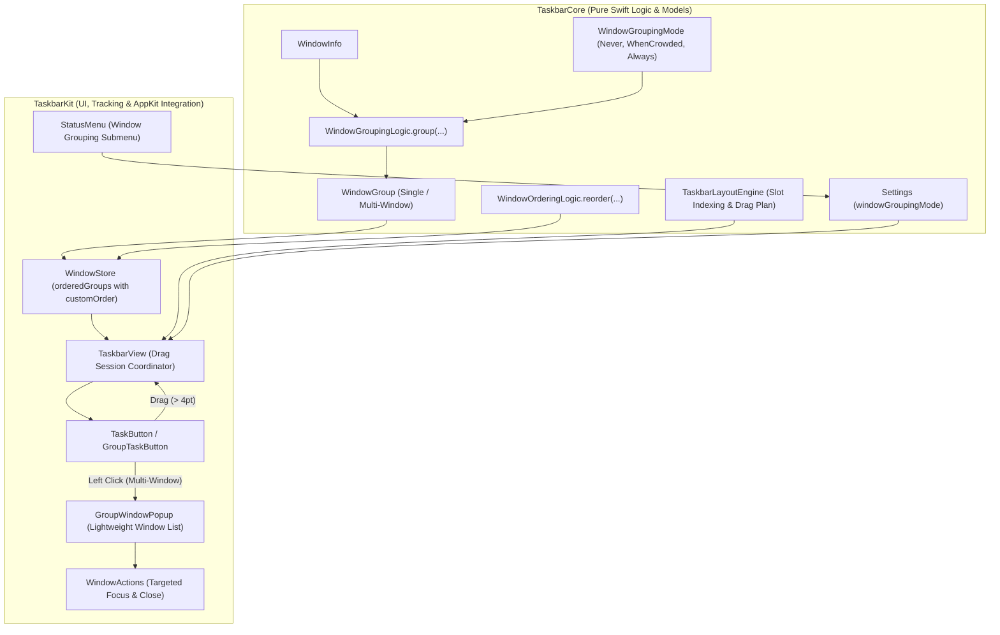
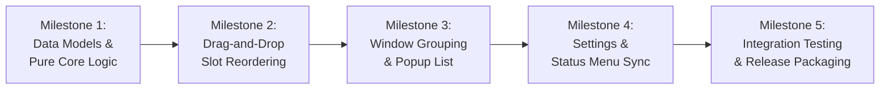

# Taskbar v0.3.0 Implementation Plan: Advanced Window Organization

**Milestone:** v0.3.0  
**Status:** In Planning  
**Target Release:** v0.3.0  
**Architectural Foundation:** Decoupled `TaskbarLayoutEngine`, `BaseTaskbarButton`, and thread-safe `AXObserverContext` (established in v0.2.3 refactoring phases A, B, and C).  

---

## 1. Executive Summary & Milestone Objectives

The primary focus of **Taskbar v0.3.0** is **Advanced Window Organization**:
1. **Interactive Re-Ordering (Drag-and-Drop):** Enable users to drag task buttons horizontally along the taskbar to customize window order, as well as drag pinned application buttons to reorder Quick Launch shortcuts, with smooth live slot shifting and persistent ordering across displays and sessions.
2. **Application Window Grouping:** Allow multiple windows belonging to the same application (`bundleID`) to be organized into a single grouped taskbar button, supporting three configurable grouping policies (`Never`, `When Crowded`, `Always`) and an interactive window list popup for multi-window management.

---

## 2. Milestone Goals & Success Metrics

| Goal | Success Criteria / Target |
|---|---|
| **Drag-to-Reorder UX (Task Buttons)** | Users can click and drag task buttons horizontally; adjacent buttons visually shift to indicate insertion slots; release drops into new position. |
| **Drag-to-Reorder UX (Pinned Apps)** | Users can drag pinned shortcut buttons horizontally within the Quick Launch section; reordering immediately updates `Settings.pinnedApps`, persists to disk, and syncs across all monitors. |
| **Custom Ordering State** | Custom button orders are maintained in `WindowStore` without disrupting background AX tracking or PID life-cycles. |
| **Configurable Window Grouping** | Support three distinct grouping modes in `Settings`: `.never`, `.whenCrowded` (auto-group on taskbar overflow), and `.always`. |
| **Group Button Presentation** | Grouped buttons display app icon, app name, and an indicator badge showing the open window count (e.g. `Xcode (3)`). |
| **Group Window Menu Popup** | Clicking a grouped button opens a lightweight, keyboard-accessible popup list of open windows; clicking a window immediately raises/focuses it; includes individual window close buttons. |
| **Decoupled Core Architecture** | 100% of grouping math and slot indexing resides in `TaskbarCore` (`WindowGroupingLogic`, `WindowOrderingLogic`, `TaskbarLayoutEngine`) with headless unit test coverage. |
| **Zero Regressions & Benchmarks** | All existing 112 tests continue to pass; new test suites cover `TC-DRAG-*` and `TC-GROUP-*`; RSS memory $\le 45.0\text{ MB}$; idle CPU $\sim 0.0\%$. |

---

## 3. High-Level Architecture & Data Flow



---

## 4. Workstream Breakdown



---

### Milestone 1 (M1): Data Models & Pure Core Logic (`TaskbarCore`)

#### 1.1 `WindowGroupingMode` Enum
- **Location:** `Sources/TaskbarCore/Model/WindowGroupingMode.swift`
- **Definition:**
  ```swift
  public enum WindowGroupingMode: String, Codable, CaseIterable, Sendable {
      case never = "never"
      case whenCrowded = "whenCrowded"
      case always = "always"
  }
  ```

#### 1.2 `WindowGroup` Model
- **Location:** `Sources/TaskbarCore/Model/WindowGroup.swift`
- **Definition:**
  ```swift
  public struct WindowGroup: Identifiable, Equatable, Sendable {
      public let id: String                    // bundleID (or windowKey for ungrouped)
      public let bundleID: String
      public let appName: String
      public let windows: [WindowInfo]
      public let isGrouped: Bool
      
      public var count: Int { windows.count }
      public var primaryWindow: WindowInfo? { windows.first }
      public var isFocused: Bool { windows.contains { $0.isFocused } }
      public var isMinimized: Bool { windows.allSatisfy { $0.isMinimized } }
      public var isAppHidden: Bool { windows.allSatisfy { $0.isAppHidden } }
      public var displayTitle: String {
          if isGrouped {
              return "\(appName) (\(windows.count))"
          } else {
              return windows.first?.displayTitle ?? appName
          }
      }
  }
  ```

#### 1.3 `WindowGroupingLogic` Engine
- **Location:** `Sources/TaskbarCore/Logic/WindowGroupingLogic.swift`
- **Responsibilities:**
  - Evaluates `windows: [WindowInfo]` against `mode: WindowGroupingMode`.
  - Under `.never`: Produces 1-to-1 `WindowGroup` per window.
  - Under `.always`: Aggregates all windows with matching `bundleID` into a multi-window `WindowGroup`.
  - Under `.whenCrowded`: Evaluates if ungrouped task buttons exceed available width (`availableWidth < totalRequiredWidth`); if crowded, groups multi-window applications until the layout fits or all candidates are grouped.
  - Pure function, 100% unit-tested with zero AppKit dependencies.

#### 1.4 `WindowOrderingLogic` Engine
- **Location:** `Sources/TaskbarCore/Logic/WindowOrderingLogic.swift`
- **Responsibilities:**
  - Manages ordering state `[String: Int]` (keyed by group ID or window ID).
  - Handles drag-to-reorder slot swaps:
    ```swift
    public static func moveItem(
        in items: [WindowGroup],
        fromIndex: Int,
        toIndex: Int
    ) -> [WindowGroup]
    ```
  - Preserves user custom order across new window discoveries and closed window purges.

#### 1.5 `TaskbarLayoutEngine` Drag & Drop Extensions
- **Location:** `Sources/TaskbarCore/Logic/TaskbarLayoutEngine.swift`
- **New APIs:**
  - `taskSlotIndex(forHorizontalPosition x: Double, in plan: TaskbarLayoutPlan) -> Int`: Computes insertion slot (0 to N) based on drag X coordinate in the dynamic task area.
  - `pinnedSlotIndex(forHorizontalPosition x: Double, in plan: TaskbarLayoutPlan) -> Int`: Computes insertion slot (0 to M) based on drag X coordinate within the Quick Launch pinned section.
  - `reorderedPlan(params: TaskbarLayoutParameters, draggedSection: DragSection, draggedIndex: Int, currentDragX: Double) -> TaskbarLayoutPlan`: Produces dynamic preview frames for sibling buttons shifting out of the dragged button's way.

---

### Milestone 2 (M2): Drag-and-Drop Slot Reordering (`TaskbarKit`)

#### 2.1 Drag Gesture Detection in `BaseTaskbarButton`
- **Location:** `Sources/TaskbarKit/UI/Buttons/BaseTaskbarButton.swift`
- **Unified Drag Inheritance:**
  - Because `TaskButton` and `PinnedButton` both inherit from `BaseTaskbarButton`, drag tracking is implemented once in `BaseTaskbarButton` and instantly available to both running task buttons and pinned quick-launch buttons!
  - Track `mouseDownLocation: NSPoint?`.
  - In `mouseDragged(with event: NSEvent)`: Check if horizontal distance moved exceeds drag threshold (4pt).
  - Fire `onDragStarted?()`, `onDragged?(currentWindowLocation: NSPoint)`, and `onDragEnded?(cancelled: Bool)`.
  - If mouse leaves the taskbar bounds vertically by $> 30\text{pt}$ or Escape key is pressed, cancel the drag session.

#### 2.2 Live Drag Sessions in `TaskbarView` (Option B: Insertion Bar Model)
- **Location:** `Sources/TaskbarKit/UI/Panels/TaskbarView.swift`
- **UX Paradigm (Option B):**
  - Sibling buttons remain stationary during the drag to completely eliminate layout jitter and high-frequency frame thrashing.
  - A lightweight 2–3pt vertical insertion indicator line (`insertionIndicatorView`) glides horizontally to indicate the active drop slot between buttons.
  - Dragged button elevates slightly above sibling z-order (`layer?.zPosition = 100`) with subtle opacity (0.85).
  - On mouse release (`mouseUp`), buttons cleanly snap into their new calculated positions.
- **Dual Drag Scope:**
  ```swift
  private enum DragSessionTarget {
      case task(button: TaskButton, initialIndex: Int)
      case pinned(button: PinnedButton, initialIndex: Int)
  }
  
  private struct DragSession {
      let target: DragSessionTarget
      var currentTargetIndex: Int
      var currentDragX: CGFloat
  }
  ```
- **Task Button Reordering:**
  - Dragged within the dynamic task area. Insertion bar tracks slots `0...taskButtons.count`.
  - On mouse up: Commits new order to in-memory `WindowStore.customOrder` (session-only persistence) and updates layout.
- **Pinned App Reordering:**
  - Dragged within the Quick Launch pinned area. Insertion bar tracks slots `0...pinnedButtons.count`.
  - On mouse up: Reorders `settings.pinnedApps`, immediately writes to disk (permanent persistence), and triggers `ScreenManager` to broadcast the new pinned order across all connected displays in lockstep!

---

### Milestone 3 (M3): Application Window Grouping UI & Popup Menu

#### 3.1 `TaskButton` Group Representation
- **Location:** `Sources/TaskbarKit/UI/Buttons/TaskButton.swift`
- **Group Visuals:**
  - Displays application icon and grouped title string: `App Name (Count)`.
  - In Retro theme: Classic sunken bevel when any window is focused; subtle stacked border indicator.
  - In Modern Hybrid theme: Pill background with badge counter indicator.
- **Click Dispatch Policy:**
  - **Single Window (`count == 1`):** Dispatches normal click policy (focus / minimize directly without opening a popup).
  - **Multi-Window Group (`count > 1`):** Left-click immediately opens the `GroupWindowPopup` window list.
  - **Right-Click Context Menu:** Offers "Close All Windows", "Quit Application", and "Pin to Taskbar" / "Unpin from Taskbar".

#### 3.2 Lightweight Window List Popup (`GroupWindowPopup`)
- **Location:** `Sources/TaskbarKit/UI/Panels/GroupWindowPopup.swift`
- **Architecture & Accessibility:**
  - Lightweight borderless `NSPanel` (sharing taskbar styling and visual effect blur).
  - Anchored directly above the clicked group button on the corresponding monitor.
  - Lists each open window with:
    - Application icon & document / window title (truncated with ellipsis).
    - Focused state indicator dot.
    - Dedicated close button (`✕`) on the trailing edge calling `WindowActions.closeWindow(win.key)`.
  - **Keyboard Navigation & Accessibility (~15 LOC):**
    - `Up` / `Down` arrow keys navigate and highlight window rows.
    - `Enter` / `Return` immediately raises and focuses the highlighted window and dismisses popup.
    - `Escape` dismisses the popup instantly.
  - Clicking any item raises and focuses that specific window:
    - Calls `WindowActions.restoreAndFocusWindow` or `focusWindow`.
    - Closes the popup immediately.
  - Auto-dismisses when clicking outside (`activeAlways`, local event monitor).

---

### Milestone 4 (M4): Settings & Status Menu Synchronization

#### 4.1 `Settings` Model Expansion
- **Location:** `Sources/TaskbarCore/Config/Settings.swift`
- **New Field:**
  ```swift
  public var windowGroupingMode: WindowGroupingMode = .always
  ```
- **Persistence:** Decodes safely with fallback to `.always` if omitted in legacy `settings.json`.

#### 4.2 Status Menu Integration
- **Location:** `Sources/TaskbarKit/UI/Menu/StatusMenu.swift`
- **New Submenu:**
  - "Window Grouping"
    - `Always (Group multi-window apps)` (Checkmark when active)
    - `When Crowded (Auto-group on overflow)` (Checkmark when active)
    - `Never (One button per window)` (Checkmark when active)
- **Action Dispatch:** Mutates settings, saves to disk, and invokes `ScreenManager.updateGroupingMode(mode:)` to refresh all connected panels instantly.

#### 4.3 Multi-Monitor Scope & Order Isolation
- **Running Task Windows:** Each display panel maintains its own in-memory custom order for windows located on that screen. When a window is dragged to another physical screen in macOS, it migrates to that screen's taskbar without disturbing either screen's custom ordering state.
- **Pinned Quick Launch Apps:** Pinned shortcuts are global application launchers. Any reordering operation executed on any display is immediately saved to `Settings.pinnedApps` and broadcast to all connected panels via `ScreenManager.updatePinnedApps`, keeping all screens synchronized in lockstep.

---

### Milestone 5 (M5): Testing, Verification & Release Preparation

#### 5.1 Unit Test Specifications (`TaskbarCoreTests`)
- **`WindowGroupingLogicTests.swift` (`TC-UNIT-005` to `TC-UNIT-008`):**
  - `testNeverGroupingModeLeavesAllSeparate`: 10 windows across 3 apps $\rightarrow$ 10 groups.
  - `testAlwaysGroupingModeAggregatesByBundleID`: 10 windows across 3 apps $\rightarrow$ 3 groups.
  - `testWhenCrowdedAutoGroupsOnOverflow`: Under wide bounds $\rightarrow$ ungrouped; under constrained width $\rightarrow$ groups multi-window apps until layout fits.
  - `testGroupDerivedStates`: Verification of `isFocused`, `isMinimized`, and `displayTitle`.
- **`WindowOrderingLogicTests.swift` (`TC-UNIT-009` to `TC-UNIT-011`):**
  - `testReorderItemShiftsIndices`: Validates slot move array operations.
  - `testCustomOrderPersistsAcrossNewWindows`: Newly opened windows append without clobbering manual order.
  - `testCustomOrderPurgesClosedWindows`: Closed windows cleanly removed from order dictionary.
- **`TaskbarLayoutEngineDragTests.swift` (`TC-UNIT-012`):**
  - Validates `slotIndex(forHorizontalPosition:in:)` math and boundary clamping.

#### 5.2 Integration Test Specifications (`TaskbarIntegrationTests`)
- **`WindowReorderingIntegrationTests.swift` (`TC-DRAG-001` to `TC-DRAG-003`):**
  - `TC-DRAG-001`: Dragging button beyond threshold triggers slot reorder; verify button frames update.
  - `TC-DRAG-002`: Vertical mouse escape cancels drag session; button restores original slot.
  - `TC-DRAG-003`: Multi-display drag isolation: dragging on Display 1 does not disrupt Display 2 button layout.
  - `TC-DRAG-004`: Dragging a pinned button reorders `Settings.pinnedApps`, immediately persists to disk, and broadcasts the new order across all displays.
- **`WindowGroupingIntegrationTests.swift` (`TC-GROUP-001` to `TC-GROUP-004`):**
  - `TC-GROUP-001`: Multi-window application forms group button with badge counter.
  - `TC-GROUP-002`: Group button click opens popup window list displaying matching window titles.
  - `TC-GROUP-003`: Selecting window in popup focuses specific target window without raising unrelated windows.
  - `TC-GROUP-004`: Dynamic mode switching via `ScreenManager` updates taskbar layout across all displays.

---

## 5. Requirements Traceability Matrix Expansion

| Feature Requirement | Specification IDs | Target Test Suite |
|---|---|---|
| **Window Grouping Logic** | `TC-UNIT-005` - `TC-UNIT-008` | `Tests/TaskbarCoreTests/WindowGroupingLogicTests.swift` |
| **Window Ordering Logic** | `TC-UNIT-009` - `TC-UNIT-011` | `Tests/TaskbarCoreTests/WindowOrderingLogicTests.swift` |
| **Drag Slot Math** | `TC-UNIT-012` | `Tests/TaskbarCoreTests/TaskbarLayoutEngineTests.swift` |
| **Task Drag-and-Drop UX** | `TC-DRAG-001` - `TC-DRAG-003` | `Tests/TaskbarIntegrationTests/WindowReorderingIntegrationTests.swift` |
| **Pinned Drag-and-Drop UX** | `TC-DRAG-004` | `Tests/TaskbarIntegrationTests/PinnedAppsIntegrationTests.swift` |
| **Group UI & Popup Menu** | `TC-GROUP-001` - `TC-GROUP-004` | `Tests/TaskbarIntegrationTests/WindowGroupingIntegrationTests.swift` |

---

## 6. Execution Checklist

### Phase 1: Core Logic & Value Models
- [x] Implement `WindowGroupingMode.swift` in `Sources/TaskbarCore/Model/`.
- [x] Implement `WindowGroup.swift` in `Sources/TaskbarCore/Model/`.
- [x] Implement `WindowGroupingLogic.swift` in `Sources/TaskbarCore/Logic/`.
- [x] Implement `WindowOrderingLogic.swift` in `Sources/TaskbarCore/Logic/`.
- [x] Add task and pinned drag slot calculation methods to `TaskbarLayoutEngine.swift`.
- [x] Author unit tests in `Tests/TaskbarCoreTests/WindowGroupingLogicTests.swift`.
- [x] Author unit tests in `Tests/TaskbarCoreTests/WindowOrderingLogicTests.swift`.
- [x] Author drag slot unit tests in `Tests/TaskbarCoreTests/TaskbarLayoutEngineDragTests.swift`.
- [x] Verify `swift test --filter TaskbarCoreTests` passes 100%.

### Phase 2: Drag-and-Drop Re-ordering (Task & Pinned Buttons)
- [x] Add drag threshold and event callbacks to `BaseTaskbarButton.swift`.
- [x] Implement `DragSession` and Option B insertion indicator bar in `TaskbarView.swift` for task buttons.
- [x] Implement `DragSession` and Option B insertion indicator bar in `TaskbarView.swift` for pinned buttons.
- [x] Integrate `customOrder` storage in `WindowStore.swift` for task buttons.
- [x] Integrate `Settings.pinnedApps` reordering and multi-display broadcast for pinned buttons.
- [x] Author integration tests in `WindowReorderingIntegrationTests.swift` (`TC-DRAG-001` to `TC-DRAG-003`).
- [x] Author pinned drag reorder test (`TC-DRAG-004`).
- [x] Verify drag cancellations on Escape or vertical leave.
- [x] Centralize all drag metrics, keycodes, and component IDs into `TaskbarConstants.swift` and `TaskbarStrings.swift`.

### Phase 3: Application Window Grouping & Popup Menu
- [x] Update `TaskbarView` to render `[WindowGroup]` instead of raw `[WindowInfo]`.
- [x] Update `TaskButton` with group count badge and multi-window indicator.
- [x] Implement `GroupWindowPopup.swift` panel with window list and close triggers.
- [x] Wire popup item selection to `WindowActions.restoreAndFocusWindow`.
- [x] Author integration tests in `WindowGroupingIntegrationTests.swift`.

### Phase 4: Settings, Status Menu & Multi-Screen Propagation
- [x] Add `windowGroupingMode` to `Settings.swift` with backward-compatible decoding.
- [x] Add "Window Grouping" submenu to `StatusMenu.swift`.
- [x] Connect grouping mode switching to `ScreenManager` multi-display broadcast.
- [x] Author `StatusMenuGroupingTests.swift`.

### Phase 5: Verification, Documentation & Release
- [x] Run `./scripts/test-functional.sh --all` and verify all tests pass (140 tests).
- [x] Run memory benchmark ($\le 45\text{ MB}$ RSS, baseline 16.31 MB $\rightarrow$ 15.32 MB) and idle CPU (0.7%).
- [x] Update `README.md`, `docs/ARCHITECTURE.md`, `docs/CONFIGURATION.md`, `docs/TESTING.md`, and `docs/TEST_SPECIFICATIONS.md`.
- [x] Verify privacy hygiene (0 personal paths in diff).
- [x] Run `codebase-audit-refactor` and `performance-optimization-audit` skills.
- [ ] Tag and build `v0.3.0` release package.

---

## 7. Non-Goals & Boundary Conditions

To maintain the project's performance and simplicity standards:
- ❌ **No Screen Recording Previews:** No live thumbnail previews or `ScreenCaptureKit` integration. The window list popup uses clean, fast, text-and-icon lists.
- ❌ **No Drag Across Multiple Displays:** Dragging a button re-orders windows within its active display bar. Moving a window to another monitor is handled by native macOS window movement.
- ❌ **No Nested Subgroups:** Windows group by `bundleID` only; sub-categorization by window title or document type is out of scope.
