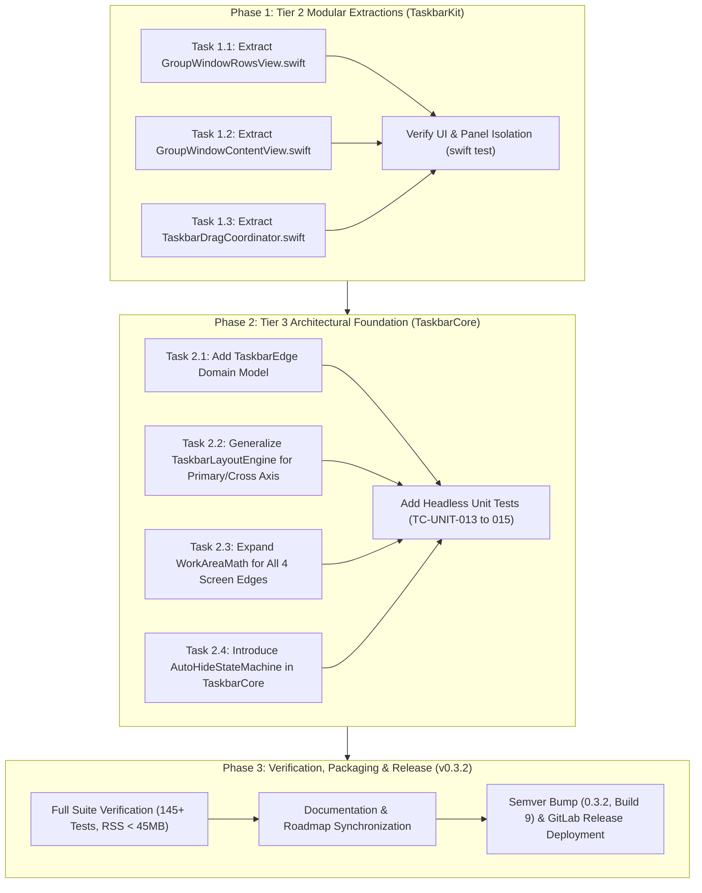

# Refactoring & Architectural Foundation Plan: v0.3.2 Patch Release

**Document Version:** 1.0.0  
**Target Milestone:** `v0.3.2` (Modular Hygiene & Architectural Enablers)  
**Status:** Ready for Review / Implementation  
**Predecessor Audit Report:** [codebase_audit_v0.3.1.md](./codebase_audit_v0.3.1.md)  
**Parent Roadmap:** [plans/roadmap.md](../roadmap.md)  

---

## 1. Executive Overview & Objectives

Following the release of **v0.3.1** and the completion of the post-release codebase audit, this implementation plan operationalizes **Stage 6 (Tier 2 & Tier 3)** refactoring recommendations as a dedicated patch release: **`v0.3.2`**.

While `v0.3.1` resolved immediate single-window focus isolation and popup mouse interaction defects, the audit identified architectural complexity hotspots in two core AppKit panels:
- [`Sources/TaskbarKit/UI/Panels/TaskbarView.swift`](../../Sources/TaskbarKit/UI/Panels/TaskbarView.swift) (795 lines)
- [`Sources/TaskbarKit/UI/Panels/GroupWindowPopup.swift`](../../Sources/TaskbarKit/UI/Panels/GroupWindowPopup.swift) (682 lines)

Additionally, preparing the codebase for **Phase 4 (`v0.4.0`: Multi-Edge Placement & Auto-Hide)** requires generalizing geometry and clamping calculations in [`Sources/TaskbarCore/`](../../Sources/TaskbarCore) before introducing UI-level edge mutations.

### Primary Objectives:

1. **Tier 2: Modular Extractions & Complexity Reduction (Medium Risk):**
   - **Extract `GroupWindowRowsView`:** Move the 337-line rows renderer and mouse/hover interaction engine out of `GroupWindowPopup.swift` into [`Sources/TaskbarKit/UI/Panels/GroupWindowRowsView.swift`](../../Sources/TaskbarKit/UI/Panels/GroupWindowRowsView.swift).
   - **Extract `GroupWindowContentView`:** Move container and visual effect view layering out of `GroupWindowPopup.swift` into [`Sources/TaskbarKit/UI/Panels/GroupWindowContentView.swift`](../../Sources/TaskbarKit/UI/Panels/GroupWindowContentView.swift).
   - **Extract `TaskbarDragCoordinator`:** Extract the drag-and-drop state machine, insertion indicator calculations, and drop commit callbacks from `TaskbarView.swift` into [`Sources/TaskbarKit/UI/Panels/TaskbarDragCoordinator.swift`](../../Sources/TaskbarKit/UI/Panels/TaskbarDragCoordinator.swift).
   - **Result:** Reduces `TaskbarView.swift` to ~450 lines and `GroupWindowPopup.swift` to ~180 lines.

2. **Tier 3: Architectural Foundation for Multi-Edge & Auto-Hide (High Risk Enablers):**
   - **`TaskbarEdge` Domain Model:** Introduce `TaskbarEdge: String, CaseIterable, Codable, Sendable` (`.bottom`, `.top`, `.left`, `.right`) in `TaskbarCore`.
   - **Axis-Agnostic Layout Math in `TaskbarLayoutEngine`:** Generalize slot calculations from horizontal-only to primary/cross-axis layout plans, enabling vertical (left/right) taskbars.
   - **Multi-Edge Screen Clamping in `WorkAreaMath`:** Expand clamping mathematics to accommodate top, left, right, and bottom screen boundaries with subpixel overlap tolerance.
   - **Pure Auto-Hide State Machine:** Introduce `TaskbarAutoHideState` and pure transition logic in `TaskbarCore` modeling hidden, revealing, visible, and hiding states.

3. **Zero Regressions & Release Delivery:**
   - 100% pass rate across all 142 existing tests.
   - New unit tests for multi-edge geometry (`TC-UNIT-013` – `TC-UNIT-015`).
   - Package and publish as **`v0.3.2`** patch release on GitLab.

---

## 2. Phased Implementation Roadmap



---

## 3. Phase 1: Tier 2 Detailed Specifications (Modular Extractions)

### Task 1.1: Extract `GroupWindowRowsView`
- **Source File:** `Sources/TaskbarKit/UI/Panels/GroupWindowPopup.swift` (lines 348–685)
- **Target File:** `Sources/TaskbarKit/UI/Panels/GroupWindowRowsView.swift`
- **Access Modifier:** Promote from `private final class` to `package final class` (or `internal final class`) within `TaskbarKit`.
- **Responsibilities:**
  - Maintains `windows: [WindowInfo]`, `focusedKey`, `frontmostPID`, `selectedIndex`.
  - Computes row frame metrics: `rowHeight`, `iconSize`, `closeButtonRect`.
  - Handles mouse events: `mouseMoved`, `mouseDown`, single-click window selection, single-click window closing.
  - Custom drawing: Bevel drawing (`RetroClassic`), background tinting, window title typography, icon rendering, active focus indicator dot.
  - Implements `acceptsFirstMouse(for:) -> true`.

### Task 1.2: Extract `GroupWindowContentView`
- **Source File:** `Sources/TaskbarKit/UI/Panels/GroupWindowPopup.swift` (lines 228–344)
- **Target File:** `Sources/TaskbarKit/UI/Panels/GroupWindowContentView.swift`
- **Access Modifier:** Promote from `private final class` to `package final class` (or `internal final class`).
- **Responsibilities:**
  - Layered container holding background `NSVisualEffectView` and foreground `GroupWindowRowsView`.
  - Theme change propagation: dynamically updates corner radius, material, blending mode, and translucency.
  - Forwarding helper methods (`preferredSize()`, `removeWindow(forKey:)`, `moveSelection(up:)`).

### Task 1.3: Extract `TaskbarDragCoordinator`
- **Source File:** `Sources/TaskbarKit/UI/Panels/TaskbarView.swift` (lines 43–56, 477–655)
- **Target File:** `Sources/TaskbarKit/UI/Panels/TaskbarDragCoordinator.swift`
- **Class Design:**
  ```swift
  @MainActor
  package final class TaskbarDragCoordinator {
      package enum DragTarget {
          case task(button: TaskButton, initialIndex: Int)
          case pinned(button: PinnedButton, initialIndex: Int)
      }
      
      package struct DragSession {
          let target: DragTarget
          var currentTargetSlot: Int
          let initialFrame: NSRect
          let startMouseWindowX: CGFloat
      }
      
      package private(set) var activeSession: DragSession?
      package let insertionIndicatorView = NSView()
      
      package weak var delegate: TaskbarDragCoordinatorDelegate?
      
      package func handleTaskButtonDrag(button: TaskButton, event: NSEvent, in view: TaskbarView)
      package func endTaskButtonDrag(button: TaskButton, cancelled: Bool, in view: TaskbarView)
      package func handlePinnedButtonDrag(button: PinnedButton, event: NSEvent, in view: TaskbarView)
      package func endPinnedButtonDrag(button: PinnedButton, cancelled: Bool, in view: TaskbarView)
      package func cancelActiveDrag(in view: TaskbarView)
  }
  ```
- **Delegate Protocol:**
  ```swift
  @MainActor
  package protocol TaskbarDragCoordinatorDelegate: AnyObject {
      func dragCoordinatorDidCommitTaskReorder(from fromIndex: Int, to toIndex: Int)
      func dragCoordinatorDidCommitPinnedReorder(updatedPinnedApps: [PinnedApp])
      func dragCoordinatorRequiresLayoutUpdate()
  }
  ```
- **Benefits:** Decouples mouse drag math and insertion visual states from general view recycling and status updates in `TaskbarView`.

---

## 4. Phase 2: Tier 3 Detailed Specifications (Architectural Foundation)

### Task 2.1: `TaskbarEdge` Domain Model
- **Target File:** `Sources/TaskbarCore/Model/TaskbarEdge.swift`
- **Definition:**
  ```swift
  public enum TaskbarEdge: String, CaseIterable, Codable, Sendable {
      case bottom
      case top
      case left
      case right
      
      public var isHorizontal: Bool {
          self == .bottom || self == .top
      }
      
      public var isVertical: Bool {
          self == .left || self == .right
      }
  }
  ```
- **Settings Integration:**
  - Add `public var taskbarEdge: TaskbarEdge = .bottom` to [`Sources/TaskbarCore/Config/Settings.swift`](../../Sources/TaskbarCore/Config/Settings.swift).
  - Backward compatibility: Use standard `decodeIfPresent(TaskbarEdge.self, forKey: .taskbarEdge) ?? .bottom` to ensure existing `Settings` payloads deserialize seamlessly.

### Task 2.2: Axis-Agnostic Layout Math in `TaskbarLayoutEngine`
- **Current State:** `TaskbarLayoutParameters` takes `availableWidth: Double` and computes horizontal `[TaskbarSlotPlan]` x-coordinates.
- **Enhanced Design:**
  - Add `primaryDimension: Double` (width for horizontal, height for vertical).
  - Add `crossDimension: Double` (bar height for horizontal, bar width for vertical).
  - Add `edge: TaskbarEdge` to parameters (defaulting to `.bottom`).
  - Extend slot hit-testing:
    ```swift
    public static func slotIndex(
        forPosition position: Double,
        edge: TaskbarEdge = .bottom,
        in plan: TaskbarLayoutPlan
    ) -> Int
    ```
  - Preserve convenience `slotIndex(forHorizontalPosition:in:)` as a forwarder to guarantee 100% compatibility with existing drag tests.

### Task 2.3: Multi-Edge Screen Clamping in `WorkAreaMath`
- **Target File:** `Sources/TaskbarCore/Logic/WorkAreaMath.swift`
- **Enhanced Clamping API:**
  ```swift
  public static func clampedFrame(
      windowFrame: CGRect,
      screenBounds: CGRect,
      barDimension: Double,
      edge: TaskbarEdge = .bottom,
      overlapThreshold: Double = TaskbarConstants.Clamping.subpixelOverlapThreshold,
      allowNonMaximized: Bool = false
  ) -> CGRect?
  ```
- **Clamping Geometry by Edge:**
  - **`.bottom`:** `clampedFrame.maxY <= screenBounds.maxY - barDimension` (Existing logic).
  - **`.top`:** `clampedFrame.origin.y >= screenBounds.origin.y + barDimension`.
  - **`.left`:** `clampedFrame.origin.x >= screenBounds.origin.x + barDimension`.
  - **`.right`:** `clampedFrame.maxX <= screenBounds.maxX - barDimension`.

### Task 2.4: Pure Auto-Hide State Machine in `TaskbarCore`
- **Target File:** `Sources/TaskbarCore/Logic/AutoHideStateMachine.swift`
- **Definition:**
  ```swift
  public enum AutoHideState: String, Sendable, Equatable {
      case visible
      case hiding
      case hidden
      case revealing
  }
  
  public struct AutoHideTransition: Sendable, Equatable {
      public let fromState: AutoHideState
      public let toState: AutoHideState
      public let animated: Bool
      public let animationDuration: Double
  }
  ```
- **Pure Evaluation Logic:**
  - Methods: `onMouseEntered()`, `onMouseExited()`, `onWindowActive()`, `onPopupPresented()`, `onPopupDismissed()`.
  - Ensures auto-hide does not engage while a context menu or `GroupWindowPopup` is active.

---

## 5. Automated Test Plan & Traceability

### New Unit Test Specifications (`Tests/TaskbarCoreTests/`):

1. **`TC-UNIT-013: Multi-Edge Screen Clamping Geometry`** (`WorkAreaMathTests.swift`)
   - Test clamping against `.top`, `.left`, `.right`, and `.bottom` edges.
   - Verify subpixel overlap thresholds across all 4 edges.
   - Verify non-maximized window pass-through behavior.

2. **`TC-UNIT-014: Primary/Cross Axis Slot Calculation`** (`TaskbarLayoutEngineTests.swift`)
   - Validate layout computation when `edge == .left` or `.right`.
   - Verify vertical slot indexing and drag indicator positions along the vertical axis.

3. **`TC-UNIT-015: TaskbarEdge Domain Serialization & Settings`** (`SettingsTests.swift`)
   - Verify JSON encoding and decoding of `TaskbarEdge`.
   - Verify fallback to `.bottom` when reading v0.1.0 – v0.3.1 configuration files.

4. **`TC-UNIT-016: AutoHide State Machine Transitions`** (`AutoHideStateMachineTests.swift`)
   - Test mouse dwell trigger, popup lock, and drag lock states.

---

## 6. Execution Phases & Quality Gates

| Gate | Verification Check | Target Standard |
|---|---|---|
| **Gate 1: Compilation** | `swift build` & `swift build --build-tests` | 0 warnings, Swift 6 strict concurrency clean |
| **Gate 2: Unit Suites** | `swift test --filter TaskbarCoreTests` | 98+ tests passing 100% (< 0.08s) |
| **Gate 3: Integration Suites** | `./scripts/test-functional.sh --grouping` & `--reordering` | Zero regressions in popup & drag behavior |
| **Gate 4: Full Test Harness** | `./scripts/test-functional.sh --all` | 146+ tests passing 100% |
| **Gate 5: Resource Benchmark** | Memory & CPU monitor | RSS $\le 45.0\text{ MB}$, idle CPU $\sim 0.0\%$ |
| **Gate 6: Privacy Scan** | `git diff \| grep -E "/Users/..."` | 0 developer paths |
| **Gate 7: Release Packaging** | `./scripts/package-release.sh --patch` | Valid DMG, ZIP, and SHA256 checksums |

---

## 7. Release Deliverables (v0.3.2)

1. **Version Bump:**
   - `config/build.env`: `APP_VERSION="0.3.2"`, `BUILD_NUMBER="9"`.
   - Automatically propagated to `BuildConfiguration.swift` and `Info.plist`.
2. **Documentation Updates:**
   - `CHANGELOG.md`: New entry for `[0.3.2]` detailing modular panel extraction and multi-edge layout enablers.
   - `docs/ARCHITECTURE.md`: Updated class diagram reflecting `TaskbarDragCoordinator` and `GroupWindowRowsView`.
   - `docs/TESTING.md` & `docs/TEST_SPECIFICATIONS.md`: Traceability entries for `TC-UNIT-013` through `TC-UNIT-016`.
   - `README.md` & `plans/roadmap.md`: Updated test counts (146+ tests) and milestone status.
3. **Artifact Publishing:**
   - Package release binaries via `./scripts/package-release.sh`.
   - Deploy release tag `v0.3.2` and assets to GitLab Package Registry via `./scripts/upload-release.sh --create-release`.
